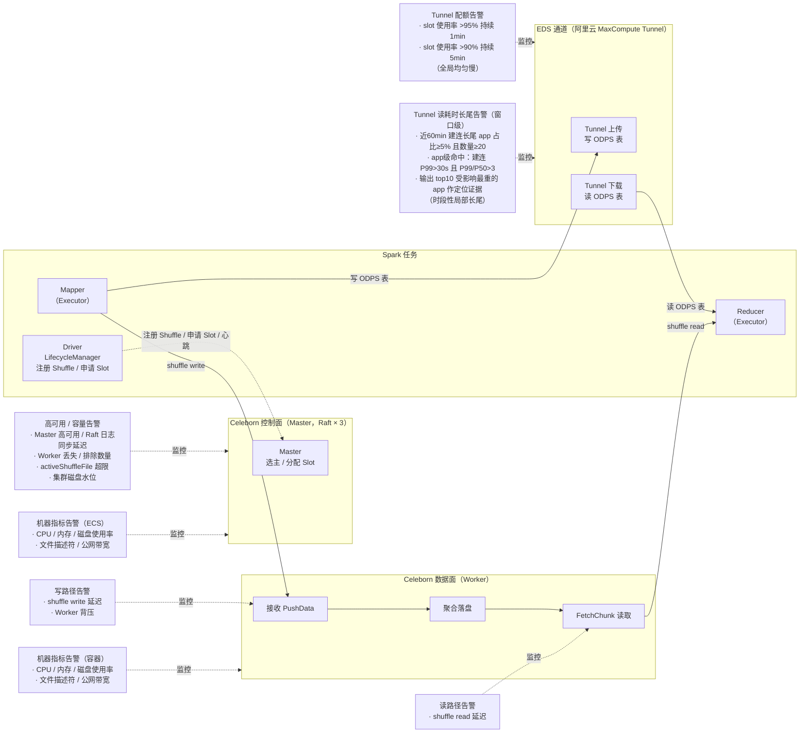

# Celeborn 集群监控与告警（EDS 通道 + Shuffle 服务）

> **背景**：Spark 任务的运行依赖两条数据通道，监控与告警按这两条通道展开：
> - **EDS 通道**：Spark 任务读写 ODPS（MaxCompute）表数据均通过 EDS 通道服务（阿里云 MaxCompute Tunnel），配额打满会直接拖慢任务读写；
> - **Celeborn 服务**：Spark Shuffle 中间数据读写服务，Master 部署于 ECS 3 节点（Raft 选主高可用），Worker 部署于 K8s 容器集群（单宿主机单 Worker，宿主机空闲资源混部其他业务 Pod）。
>
> 核心关注：EDS Tunnel 配额使用率、Celeborn 集群高可用、Shuffle 读写性能、磁盘水位与背压。
>
> 本文由 `celeborn-alerting-overview.md`（告警全景与已上线规则）与 `celeborn-disk-capacity-fluctuation-monitoring.md`（磁盘余量异常波动监控设计）合并：**第一部分是现状规则全景，第二部分是针对"磁盘余量变化本身异常"的新增设计**——后者补齐了现有"低水位告警"看不到的锯齿状波动。

---

# 第一部分 告警全景与现状规则

## 1. 告警全景图

下图以 Spark 任务数据流为主线，将 EDS 通道与 Celeborn 各环节对应的告警指标串联起来：



**读图方式**：Spark 任务有两条数据链路——① 读写 ODPS 表经 EDS Tunnel 通道，配额打满会导致读写排队变慢（**全局均匀慢**，由 Tunnel 配额告警覆盖）；② shuffle 中间数据经 Celeborn，先由 LifecycleManager 向 Master 注册 Shuffle 并申请 Slot（控制面），之后 Mapper 将数据推送到 Worker 聚合落盘（写路径），最后 Reducer 从 Worker 拉取数据（读路径）。任一环节的指标异常，都会沿数据流向上传导为 Spark 任务变慢或失败。

**两张 EDS 告警的差异**：Tunnel 配额告警描述**全局拥堵**——配额 slot 打满，该配额下所有任务读写 ODPS 都慢，指标整体平移；Tunnel 读耗时长尾告警描述**时段性局部长尾**——EDS 服务端某时段存在异常节点，仅命中它的部分 task 慢，且单 app 级长尾是集群常态（正常日全天也有 10% 的 app 建连 P99>30s），必须以"同一窗口内大量 app 同时长尾"的窗口级聚集才构成异常信号。两者并行互补：配额打满看全局均匀慢，读耗时长尾看时段性聚集，且倍数判据天然排除全局均匀慢，不会重复触发。

## 2. EDS 通道告警

### 2.1 EDS 通道说明

EDS 是 Spark 任务读写 ODPS（MaxCompute）表数据的通道服务，对应阿里云 MaxCompute Tunnel API，指标前缀 `AliyunMaxcompute_prepay_*`（MaxCompute 包年包月 Tunnel 二级配额）。二级配额 slot 被打满时，Tunnel 上传 / 下载排队，Spark 任务读写 ODPS 表变慢直至超时。

### 2.2 Tunnel 配额容量告警

**告警规则**：

| 规则名称 | 告警链接 | PromQL | 触发条件 | 备注 |
|---------|---------|--------|---------|------|
| 【云监控】Tunnel二级配额slot使用率发生告警 | [APM 告警平台](https://apm.dewu-inc.com/alertPlatform?tab=6&from=now-1h&to=now&env=csprd-proxy&app=bigdata-sre-aliyun&language=H5&searchName=&selectValue=all&namespace=%E7%94%9F%E4%BA%A7%E7%8E%AF%E5%A2%83&ruleId=1259693#) | 见下方 PromQL | 持续 1min > 95%，offset 2min | 高阈值快速告警，优先暴露配额打满 |
| 【云监控】Tunnel二级配额slot使用率发生告警 | 同上 | 见下方 PromQL | 持续 5min > 90%，offset 2min | 低阈值慢速告警，过滤瞬时抖动 |

**PromQL**（两条规则共用，`offset 3m` 覆盖阿里云指标同步到 APM 的 1～2 分钟延迟）：

```promql
sum(sum(AliyunMaxcompute_prepay_PrePayTunnelSlotUsageValueOnLevel2{quota!~"ot_235454102432001_1702525731826_p#ot_235454102432001_1702525731826|ot_581084746792098_1758781262270_p#ot_581084746792098_1758781262270|ot_235454102432001_1714461007540_p#ot_235454102432001_1714461007540"}[1m]offset 3m)by(quota)/sum(AliyunMaxcompute_prepay_PrePayTunnelSlotLimitOnLevel2{quota!~"ot_235454102432001_1702525731826_p#ot_235454102432001_1702525731826|ot_581084746792098_1758781262270_p#ot_581084746792098_1758781262270|ot_235454102432001_1714461007540_p#ot_235454102432001_1714461007540"}[1m]offset 3m)by(quota)*100 )by(quota)
```

**PromQL 解析**：

- `PrePayTunnelSlotUsageValueOnLevel2` / `PrePayTunnelSlotLimitOnLevel2`：MaxCompute 包年包月 Tunnel 二级配额 slot 使用量 / 上限，两者按 quota 分组求和后相除 ×100，得到各二级配额 slot 使用率；
- `quota!~"..."`：排除 3 个固定 quota（`ot_235454102432001_1702525731826_p#...`、`ot_581084746792098_1758781262270_p#...`、`ot_235454102432001_1714461007540_p#...`）；
- `[1m] offset 3m`：取 1 分钟窗口、回看 3 分钟的数据，覆盖阿里云指标同步到 APM 的 1～2 分钟延迟；
- 双规则组合：超 95% 持续 1min 快速响应，超 90% 持续 5min 过滤瞬时抖动。

**影响与处置建议**：

Tunnel 二级配额 slot 使用率打满，说明该配额下的 Tunnel 通道拥堵，Spark 任务读写 ODPS 表会排队变慢、超时：

- 定位同时段大规模读写 ODPS 的任务（Tunnel 上传 / 下载并发高），在 MaxCompute 侧按 quota 排查具体占用任务；
- 调整 MaxCompute Tunnel 二级配额（扩容 slot），或对超大任务错峰调度；
- 规则已排除 3 个固定 quota，需关注是否出现新的热点 quota 打满却被排除规则漏掉的情况。

### 2.3 Tunnel 读耗时长尾告警

**告警目的**：检出 **EDS 服务端是否存在异常节点**（CPU / 连接数 / GC 打满等）。异常节点只会让命中它的 Spark task 变慢，同 stage 内其余 task 正常——形成**局部长尾**；此时全局配额使用率往往不高，Tunnel 配额容量告警（覆盖全局拥堵）不会触发，需要基于 task 级 EDS 指标单独检测。

**检测思路（两级：窗口级触发 + app 级定位）**：对 EDS 建连耗时按 **"app 命中 → 窗口聚集"** 两级判定——单 app 长尾在本集群是常态（三轮校准证实，见"设计要点"），**同一 60 分钟窗口内大量 app 同时长尾**才是 EDS 服务端时段性异常的信号。窗口触发后输出受影响最重的 top10 app 作为定位证据。

- **app 级命中**（窗口内每个 app 的判定）：该 app 存在 scan task 数 >10 且 `P99(建连) > 30s` 且 `P99/P50 > 3` 的 stage。建连耗时与读取数据量无关，task 间天然可比，直接用原始值；倍数 >3 用于排除"全局均匀慢"的 stage（配额打满时 P99 高但倍数接近 1）；
- **窗口级触发**：60 分钟窗口内 app 级命中的 app **占比 ≥5% 且数量 ≥20**。占比自适应 app 总量波动，数量下限防凌晨小窗口误报。

**为什么窗口级而不是 app 级触发**（20260717 故障日 / 20260903 正常日三轮实测校准）：

1. **长尾倍数不稀缺**：全天 84% 的 app 建连 P99/P50 >5、66% >10——EDS 建连天然重尾（大量 task 命中毫秒级快路径，少数走完整握手），倍数高是常态；
2. **绝对水位也不稀缺**：全天 10% 的 app 建连 P99 >30s，单看任何一个 app 都"不稀奇"；
3. **但时间维度极其干净**：按小时切开后，正常日 `pct_gt_30s` 全天 0~0.05%，故障日异常时段 10%~19.4%，5% 一刀切零重叠——同一窗口大量 app 同时长尾 = EDS 服务端该时段异常。

**建连面与读取面**：观测的是 EDS 服务端两条独立的资源路径——**建连面**（受理能力：TCP 握手 → 连接队列 → accept 线程）与**读取面**（数据读取链路：磁盘 IO / 带宽 / 读线程池）。20260717 故障的主要证据落在建连面（异常最重 stage 建连 P99 达 241s/784 倍长尾，读取面仅 1.66 倍均匀），因此窗口级主判据只校准了建连面；读取面（`scan_time` 按 `eds_batch_num` 归一化的每 batch 耗时）保留在输出列中作辅助证据，其窗口级阈值待积累故障样本后再校准。数据亦佐证 `scan_time` 不含建连（否则该 stage 的每 batch 耗时不可能仍均匀）。

**指标表**（MaxCompute aliorc 表，pt 分区，LIFECYCLE 720，来源见"附：指标来源说明"）：

- **主表** `du_ops.spark_app_meta_tbl`：Spark app 级元数据表，负责圈定时间窗——按 `pt = 当日分区` + `end_time >= 近 60 分钟` 筛出最近结束的 app，同时提供 `app_name` / `queue` 作为告警定位证据列；
- **关联表** `du_ops.spark_task_meta_tbl`：Spark task 级指标表，按 `app_unique_id` 关联主表后提供 EDS 访问耗时指标。EDS 相关字段口径：

| 字段 | 口径 | 在检测中的角色 |
| --- | --- | --- |
| `eds_read_open_connect_duration` | 单 task 建立 EDS 连接（open）的耗时（ms），不含数据读取 | 主判据指标：app 级命中取 stage 级 P99，窗口级按命中 app 占比触发 |
| `eds_read_connect_attempts` | 建立连接次数（含重试），正常 1，>1 即发生过连接重试 | 辅助证据：输出 `max_attempts`，用于严重程度分级与处置参考 |
| `scan_time` | 读取 EDS 数据（scan）的耗时（ms），与 batch 数正相关；20260717 数据佐证不含建连，最终口径待采集方确认 | 读取面辅助证据：按 batch 归一化为每 batch 耗时，随告警输出 |
| `eds_batch_num` | 当前读取 EDS 的 task 有多少 batch，反映读取数据规模 | scan 归一化分母（SQL 中已显式过滤 >0 防除零） |

**判定条件**（两级判定，窗口触发输出 app 明细）：

| 层级 | 条件 | 阈值 | 说明 |
| --- | --- | --- | --- |
| **app 级命中** | 存在 stage：scan task 数 \>10 且 `P99(建连) > 30s` 且 `P99/P50(建连) > 3` | — | 倍数 >3 排除全局均匀慢的 stage（配额打满时 P99 高但倍数≈1）；P50 \>50ms 护栏防小数值倍数虚高 |
| **窗口级触发** | 命中 app 占比 | ≥ **5%** | 正常日实测 0~0.05%，故障日异常时段 10%~19.4%，两侧百倍余量 |
| （窗口级） | 命中 app 数量 | ≥ **20** | 防凌晨小窗口分母小时占比失真 |
| 严重度分级 | 窗口占比 ≥15% 或 app 级 `max_p99 > 60s` 或 `max_attempts >= 3` | 仅输出 | P1 升级证据，不参与触发 |

**阈值依据（故障日 / 正常日双向校准）**：

| 指标 | 正常日（20260903 实测） | 故障日异常时段（20260717 00~08 点实测） |
| --- | --- | --- |
| 窗口内建连 P99\>30s 的 app 占比 | **0~0.05%**（20 个小时中 16 个为 0，最多 5 个 app） | **10%~19.4%**（每小时 1057~1738 个 app） |
| 窗口内建连 P99\>10s 的 app 占比 | 0.06%~3.86%（离 5% 阈值过近，仅作预警档） | 15%~20% |

5% 触发阈值位于正常日峰值（0.05%）的 100 倍、故障日谷值（10%）的一半处，无边缘区间。20260717 已知故障 app（`dws_ad_newbie_supply_coupon_subord_ext_detail_df`，建连 P99 最高 241s/784 倍长尾）全部落在异常时段内，会被 app 级命中捕获并随窗口告警输出。

**演进记录**：初版规则按单 app 级判定（建连 P50\>1s AND P99\>30s AND 双故障面 P99/P50\>5 全 AND），对 20260717 已知异常 app 全部漏报（P50 条件与局部长尾互斥、30s 阈值仅能抓极端形态、双面 AND 过严）；改为单 app 级长尾倍数判据后又发现全天 84% 的 app 倍数\>5、10% 的 app P99\>30s——单 app 级判定在该集群天然分布下不收敛，任何阈值都分不开正常与异常；最终按小时切分发现长尾高度时间聚集（正常日占比 0~0.05% vs 故障时段 10%+），收敛到窗口级判据。三轮校准数据即上表与"检测思路"的实测依据。

**告警规则**：

| 规则名称 | 告警链接 | 检测 SQL | 触发条件 | 备注 |
|---------|---------|---------|---------|------|
| 【Tunnel 读耗时长尾】Tunnel 读耗时长尾告警 | DataWorks 周期任务 + 告警规则 | 见下方 SQL | SQL 返回行数 \> 0（窗口级触发一行 + 全局 top10 受影响 app 明细） | 窗口级判据（占比≥5% 且数量≥20）触发，以 `spark_app_meta_tbl` 为主表按 `end_time` 圈定近 60 分钟结束的 app，再关联 task 表统计 |

**核心 SQL**（MaxCompute 方言）：

```sql
SET odps.task.wlm.quota = bigdata_poc_zj;
SET odps.instance.priority = 0;

-- Tunnel 读耗时长尾检测（窗口级）：
-- 单 app 建连长尾是本集群常态（正常日全天也有 10% 的 app 建连 P99>30s），
-- 同一 60 分钟窗口内大量 app 同时长尾（占比≥5% 且数量≥20）才是 EDS 服务端时段性异常。
-- 触发时输出：窗口汇总一行 + 受影响最重的全局 top10 app（定位证据）。
WITH recent_app AS (
  -- 近 60 分钟结束的 app（end_time 为 epoch 毫秒）——窗口分母
  SELECT app_unique_id, app_name, cluster_name
  FROM du_ops.spark_app_meta_tbl
  WHERE pt = TO_CHAR(GETDATE(), 'yyyymmdd')                            -- 当日分区（pt 为 yyyymmdd 字符串分区）
    AND end_time >= UNIX_TIMESTAMP(DATEADD(GETDATE(), -60, 'mi')) * 1000
),
stage_stat AS (
  -- 按 stage 聚合建连耗时分位数
  SELECT
    a.cluster_name,
    a.app_unique_id,
    t.stage_unique_id,
    COUNT(*)                                                  AS n_tasks,
    PERCENTILE_APPROX(t.eds_read_open_connect_duration, 0.99) AS p99_conn,
    PERCENTILE_APPROX(t.eds_read_open_connect_duration, 0.50) AS p50_conn,
    MAX(t.eds_read_connect_attempts)                          AS max_attempts
  FROM du_ops.spark_task_meta_tbl t
  JOIN recent_app a
    ON t.app_unique_id = a.app_unique_id
  WHERE t.pt >= TO_CHAR(DATEADD(GETDATE(), -1, 'dd'), 'yyyymmdd')  -- 含前一日分区，兜底跨零点（app 凌晨结束、task 落昨日分区）
    AND t.is_success = TRUE                  -- 仅成功 task，排除失败原因干扰
    AND t.input_records > 0                  -- 仅 scan stage（读取 ODPS 表，有实际输入记录的 task）
  GROUP BY a.cluster_name, a.app_unique_id, t.stage_unique_id
),
app_hit AS (
  -- app 级命中：存在 stage 满足（样本量>10、P99>30s、倍数>3 排除全局均匀慢、P50>50ms 防倍数虚高）
  SELECT
    cluster_name,
    app_unique_id,
    MAX(p99_conn)      AS max_p99_connect,   -- 该 app 最严重 stage 的建连 P99
    MAX(max_attempts)  AS max_attempts
  FROM stage_stat
  WHERE n_tasks > 10
    AND p99_conn > 30000                      -- 建连 P99 > 30s
    AND p50_conn > 50                         -- P50 护栏：中位数过小的 stage 倍数无统计意义
    AND p99_conn / p50_conn > 3               -- 长尾倍数：排除全局均匀慢（配额打满时 P99 高但倍数≈1）
  GROUP BY cluster_name, app_unique_id
),
window_stat AS (
  -- 窗口级触发判定：分母 = 窗口内结束的全部 app，分子 = 命中 app，占比≥5% 且数量≥20
  SELECT
    COUNT(DISTINCT h.app_unique_id) AS hit_app_count,
    COUNT(DISTINCT r.app_unique_id) AS window_apps
  FROM recent_app r
  LEFT JOIN app_hit h
    ON r.app_unique_id = h.app_unique_id
  HAVING COUNT(DISTINCT h.app_unique_id) >= 20
     AND COUNT(DISTINCT h.app_unique_id) * 100.0 / COUNT(DISTINCT r.app_unique_id) >= 5
)
SELECT
  'window' AS row_type,
  NULL AS cluster_name,
  NULL AS app_unique_id,
  NULL AS app_name,
  w.hit_app_count,
  w.window_apps,
  ROUND(w.hit_app_count * 100.0 / w.window_apps, 2) AS hit_pct,
  NULL AS max_p99_connect_ms,
  NULL AS max_attempts
FROM window_stat w
UNION ALL
SELECT
  'app' AS row_type,                          -- 命中 app 明细：受影响最重的全局 top10
  hit.cluster_name,
  hit.app_unique_id,
  r.app_name,
  NULL AS hit_app_count,
  NULL AS window_apps,
  NULL AS hit_pct,
  ROUND(hit.max_p99_connect, 0) AS max_p99_connect_ms,
  hit.max_attempts
FROM (
  SELECT
    a.*,
    ROW_NUMBER() OVER (ORDER BY a.max_p99_connect DESC) AS rn    -- 全局排序，不区分 cluster
  FROM app_hit a
  JOIN window_stat                              -- 门控：窗口触发（HAVING 通过）才输出明细；window_stat 0 行 → JOIN 滤掉全部 app_hit 行
) hit
JOIN recent_app r
  ON hit.app_unique_id = r.app_unique_id
WHERE hit.rn <= 10                            -- 只保留受影响最重的 top10
ORDER BY row_type DESC, max_p99_connect_ms DESC;
```

**SQL 解析**：

- **`recent_app`（窗口分母）**：近 60 分钟结束的全部 app；app 表侧不加 `is_success` 过滤——app 最终失败不影响其已完成 task 的耗时证据价值；
- **`stage_stat`**：stage 级建连分位数。建连耗时与数据量无关，直接用原始值取分位数（不需要按 batch 归一化）；
- **`app_hit`（app 级命中）**：WHERE 四个条件即判定条件表的 app 级一行——`n_tasks > 10`（样本量）、`p99_conn > 30000`（P99>30s 绝对水位）、`p50_conn > 50`（P50 护栏）、`p99_conn / p50_conn > 3`（长尾倍数，排除全局均匀慢）；
- **`window_stat`（窗口级触发）**：LEFT JOIN 保证分母是窗口内全部 app，`HAVING` 同时卡数量（≥20）与占比（≥5%）——正是 DataWorks"返回行数>0"的触发载体，本 CTE 无行即整体不返回；
- **输出形态**：`window` 行（全局一行汇总）+ `app` 行（全局 top10 受影响 app，`ROW_NUMBER` 不分区截断），UNION 平铺；app 分支通过 `JOIN window_stat` 门控——窗口未触发（命中数 <20 或占比 <5%）时 `window_stat` 0 行，JOIN 滤掉全部 `app_hit` 行，整条 SQL 返回 0 行，告警不触发（注意窗口不触发 ≠ `app_hit` 为空，偶发 1~19 个长尾 app 属正常，不能直接输出明细）。
- 关联方式：task 表按 `app_unique_id` JOIN 主表（app 级表 `app_unique_id` 唯一，JOIN 不放大 task 行数）；task 表 `pt >= 前一日` 分区裁剪兜底跨零点；
- `input_records > 0` 过滤：仅保留读取 ODPS 表（scan stage）的 task——有实际输入记录才会读 EDS；
- `max_attempts` / `max_p99_connect > 60000` 为 P1 分级证据，仅输出不参与触发；`attempts` 不硬性加入触发条件——避免漏掉"排队但未超时（attempts=1）"的建连慢形态。

**影响与处置建议**：

- 触发即代表当前 60 分钟窗口内建连长尾 app 占比 ≥5%（正常日实测 0~0.05%，异常时段 10%+），EDS 服务端该时段大概率存在异常节点；告警附窗口汇总（cluster / 命中数 / 占比）与 top10 受影响 app（含 `max_p99_connect` / `max_attempts`）；
- 排查路径：
  - 联系 EDS 服务方按 `cluster_name` 排查该时段服务端节点的连接受理能力（连接数 / CPU / GC / 网络），top10 app 的慢 task 调度区间可辅助锁定热点节点；
  - `max_p99_connect > 60000` 或 `max_attempts >= 3`：已出现分钟级建连或多次重试，建议按 P1 升级，并确认是否向全局扩散；
- 与 Tunnel 配额告警的区分：配额打满是**全局均匀慢**（所有 task 同步变慢，长尾倍数 ≈1，被 app 级倍数 >3 条件排除），本告警是**时段性局部长尾**（多数 task 正常、少数命中异常节点）；若两者同时触发，按配额规则优先处置；
- 阈值复校准：占比 5% / 数量 20 / P99 30s / 倍数 3 基于 20260717（故障）与 20260903（正常）双向校准，两侧余量充足；若后续发现读取面故障样本（20260717 故障主要落在建连面），需为读取面（每 batch 耗时）补充同结构的窗口级判据；`scan_time` 口径（是否含建连）待采集方最终确认。

## 3. Celeborn 服务告警

### 3.1 集群高可用

高可用类告警关注"集群还能不能正常提供服务"：Master 侧关注选主状态和 Raft 日志同步，Worker 侧关注节点在线率和可服务状态。这类告警触发时，意味着集群的服务能力已经受损或存在隐患，需要**立即介入处理**。

#### 1.1 Master 节点

| 规则 ID | 规则名称 | 规则描述 | 高危触发条件 | 影响与处置建议 |
|---------|---------|---------|-------------|---------------|
| 1359058 | Master 高可用 | Celeborn Master 没有保持单个 Leader（Raft 组选主异常，可能出现无 Leader 或多 Leader） | IsActiveMaster != 1，持续 1 分钟，立即触发 | 集群无法进行 Slot 分配，新提交的 Spark 任务会失败；检查 3 个 Master 节点进程状态及相互网络连通性 |
| NA | Master Raft 日志同步延迟 | Master 节点组之间 Raft log 同步延迟，Follower 落后过多时选主切换可能丢数据 | RatisApplyCompletedIndexDiff > 1000，持续 3 分钟，立即触发 | 通常是某个 Master 节点负载过高或网络抖动；关注落后节点的 CPU/GC 和网络 |

#### 1.2 Worker 节点

| 规则 ID | 规则名称 | 规则描述 | 高危触发条件 | 影响与处置建议 |
|---------|---------|---------|-------------|---------------|
| 1356273 | Worker 丢失数量 | 心跳丢失的 Worker 节点数量（节点宕机、容器重建或网络分区） | LostWorkers > 10，持续 1 分钟，立即触发 | 丢失节点上的 shuffle 数据可能不可用，运行中任务可能 Fetch 失败；排查失联宿主机及 K8s 事件 |
| 1359059 | Worker 排除数量 | Worker 心跳存在但已经不能接受新的 Slot 申请（磁盘故障、负载过高等被 Master 拉黑） | ExcludedWorkerCount > 10，持续 3 分钟，立即触发 | 集群可用容量下降，新任务可能分配不到资源；登录被排除节点检查磁盘和负载 |
| 1359060 | activeShuffleFile 数量超限 | 监控 shuffle 产生的文件句柄数量，防止耗尽系统文件句柄限制 | ActiveShuffleFileCount > 400000，持续 3 分钟，立即触发 | 句柄耗尽会导致 Worker 无法读写任何文件；确认是否有超大规模任务，必要时提升 ulimit 或扩容 |
| 1358940 | Worker 端口 9080 探活 | 对 Worker 的 HTTP 端口 9080 探活 | 节点丢失，持续 1 分钟，立即发出 | 单节点级告警，用于快速定位具体故障 Worker；配合"Worker 丢失数量"一起判断影响面 |

### 3.2 集群性能

性能类告警关注"Spark 任务跑得够不够快"：从写入、读出一条链路监控 shuffle 延迟，同时通过磁盘水位和背压提前发现会导致性能劣化的容量与流控问题。这类告警触发时任务通常还在运行，但**时延已经明显变差**，需要及时介入避免扩大。

| 规则 ID | 规则名称 | 规则描述 | 高危触发条件 | 影响与处置建议 |
|---------|---------|---------|-------------|---------------|
| 1356265 | 集群磁盘水位 | 集群 Worker 磁盘使用率过高，剩余空间不足会导致无法接收新的 shuffle 写入 | 磁盘超过 80%，持续 5 分钟，立即发出 | **高频告警**。扩容磁盘或清理过期数据；混部环境下需确认是否被其他业务 Pod 占用 |
| 1356284 | Worker 背压 | 因内存 / IO 压力触发流控、暂停接收 PushData 的 Worker 节点比例过高 | PausePushData 节点比例 > 30%，持续 5 分钟，立即触发 | 集群整体写入吞吐下降，Spark 任务写 stage 变慢；定位压力来源（磁盘 IO / 内存），必要时扩容 Worker |
| 1358938 | shuffle write 延迟 | Worker 处理客户端 PushData 请求的耗时（PrimaryPushDataTime 最大值），反映写入链路的最慢节点 | PrimaryPushDataTime_Max >= 60000，持续 3 分钟，立即触发 | 长尾写入拖慢整个 Spark stage；定位慢节点，检查其磁盘 IO 与混部资源争抢 |
| 1358939 | shuffle read 延迟 | Worker 处理 FetchChunk 读请求的耗时（FetchChunkTime 最大值），反映读取链路的最慢节点 | FetchChunkTime_Max >= 60000，持续 3 分钟，立即触发 | Reducer 拉取数据变慢、任务尾部拉长；定位慢节点，检查磁盘读 IO 与网络 |

> 上表的"集群磁盘水位"是**绝对值/水位**视角（>80% 持续 5 分钟）；它看不到"水位尚可但正在异常骤降"的场景，这正是第二部分要补的**波动**视角。

### 3.3 机器指标

机器指标是底层资源兜底监控：Master 走 ECS 云监控规则，Worker 走 K8s 容器监控规则。这类告警通常是高可用、性能类告警的**根因线索**——例如磁盘使用率打满会引发磁盘水位告警，CPU / 内存打满会引发 Worker 丢失和背压。

| 规则 ID | 规则名称 | 规则描述 | 高危触发条件 |
|---------|---------|---------|-------------|
| 1402006（ECS）<br/>1383042（容器） | 服务 CPU 使用率 | 节点 CPU 使用率过高，会导致请求处理排队、心跳超时 | 最近 1 分钟求和 ＞ 90.0%，持续 1 分钟触发 |
| 1402007（ECS）<br/>1383044（容器） | 服务内存使用率 | 节点内存使用率过高，可能触发 OOM 或频繁 GC | 最近 1 分钟平均值 ≥ 90.0%，持续 1 分钟触发 |
| 1402008（ECS）<br/>1383036（容器） | 服务磁盘使用率 | 节点磁盘使用率过高，是集群磁盘水位告警的单机视角 | 最近 1 分钟求和 ＞ 80.0%，持续 1 分钟触发 |
| 1402012（ECS）<br/>1383045（容器） | 服务使用的文件描述符 | 进程打开的文件描述符数量过多，接近系统上限后无法新建连接和文件 | 使用的文件描述符最近 1 分钟求和大于 60000，持续 1 分钟触发 |
| 1402011（ECS）<br/>1383040（容器） | 服务公网出 / 入方向带宽 | 节点网络带宽接近打满，会拉高 shuffle 读写延迟 | 上传带宽大小最近 1 分钟求平均大于等于 8000.0MBit/s，持续 3 分钟，立即发出 |

## 4. 指标来源说明

- EDS 通道指标（`AliyunMaxcompute_prepay_PrePayTunnelSlotUsageValueOnLevel2` / `PrePayTunnelSlotLimitOnLevel2`）来自阿里云 MaxCompute 云监控，指标同步到 APM 存在 1～2 分钟延迟；
- Tunnel 读耗时长尾指标来自 Spark app 级元数据表 `du_ops.spark_app_meta_tbl`（时间窗主表：按 pt + `end_time` 圈定近 60 分钟结束的 app，提供 `app_name` / `queue`）关联 Spark task 级指标表 `du_ops.spark_task_meta_tbl`（均为 MaxCompute aliorc 表，pt 分区，LIFECYCLE 720），task 表字段 `eds_read_open_connect_duration`（建立 EDS 连接耗时）、`eds_read_connect_attempts`（建立连接次数，含重试）、`scan_time`（读取 EDS 数据耗时，口径待确认）、`eds_batch_num`（task 读取的 batch 数），由 Spark 任务运行时采集上报；
- Celeborn 服务指标（IsActiveMaster、LostWorkers、ExcludedWorkerCount、ActiveShuffleFileCount、PausePushData、PrimaryPushDataTime、FetchChunkTime 等）来自 Master / Worker 内置的 Metrics 体系，指标释义可参考项目文档 `docs/monitoring.md`；
- 机器指标（CPU、内存、磁盘、文件描述符、带宽）来自 ECS 云监控与 K8s 容器监控平台。

---

# 第二部分 磁盘余量异常波动监控设计

> 第一部分 §3.2 的"集群磁盘水位"只看**绝对水位**（>80% 持续 5 分钟）。本部分在此基础上设计**异常波动**监控：通过小时环比、日环比、周同比三个粒度识别"变化本身异常"，与既有水位告警互补。

**背景**：现有监控已覆盖集群磁盘总余量的绝对值：

```promql
sum(metrics_DeviceOSFreeBytes_Value{job=~"celeborn", db_type=~"celeborn", instance_role="worker", instance_id="${cluster_name}"})
```

`metrics_DeviceOSFreeBytes_Value` 是 Worker 上报的设备 OS 剩余磁盘字节数（gauge 型，来源 `worker/src/main/scala/org/apache/celeborn/service/deploy/worker/WorkerSource.scala`，配套总量指标 `metrics_DeviceOSTotalBytes_Value`）。

## 5. 设计思路

### 5.1 为什么不能直接对原始值做差值告警

Celeborn Worker 的磁盘余量随 shuffle 业务天然大幅波动：任务写入 → 聚合落盘 → application 结束后清理释放，余量曲线本身呈锯齿状。直接 `当前值 - offset 值 < 阈值` 会在业务高峰切换时产生大量误报。因此本设计的核心手段：

1. **平滑**：对比前先用 `avg_over_time(...[30m])` 做窗口平均，消除瞬时抖动；
2. **双条件**：相对变化率（%）与绝对变化量（GB）**同时满足**才告警，避免"低水位时小波动被放大成大百分比"以及"大集群正常吞吐触发纯百分比阈值"；
3. **多粒度互补**：
   - **小时环比**（vs 1h 前）：灵敏，抓突发写入暴涨 / 清理失效；
   - **日环比**（vs 昨天同时刻）：排除日内业务高峰低谷干扰，抓慢速容量劣化；
   - **周同比**（vs 上周同时刻）：对齐业务周周期，抓趋势性异常；
4. **方向区分**：
   - **余量骤降**（高危）：写入暴涨、清理线程失效、文件泄漏；
   - **余量骤升**（中危）：写入流量消失，可能是 LifecycleManager 异常、任务大面积失败或上游任务没起来——磁盘"变健康"恰恰是业务异常的信号。

### 5.2 指标总览

| 层次 | 指标 | 用途 |
|------|------|------|
| 基础 | `celeborn:cluster_disk_free_bytes:raw` | 集群总余量原始值 |
| 基础 | `celeborn:cluster_disk_free_bytes:avg30m` | 30min 平滑值（所有对比的基准） |
| 小时环比 | `celeborn:cluster_disk_free:delta_1h` / `ratio_1h` | 突发波动告警 |
| 日环比 | `celeborn:cluster_disk_free:delta_1d` / `ratio_1d` | 慢速劣化告警 |
| 周同比 | `celeborn:cluster_disk_free:delta_7d` / `ratio_7d` | 趋势异常告警 / 看板对比 |

## 6. Recording Rules

预计算可以显著降低告警评估和看板查询的开销，同时让告警表达式更可读。命名遵循 Prometheus 惯例（`level:metric:operations`）。

```yaml
groups:
  - name: celeborn-disk-capacity-fluctuation
    interval: 1m
    rules:
      # ========== 基础指标 ==========
      # 集群磁盘总余量（原始）
      - record: celeborn:cluster_disk_free_bytes:raw
        expr: |
          sum(metrics_DeviceOSFreeBytes_Value{
            job=~"celeborn", db_type=~"celeborn",
            instance_role="worker", instance_id="${cluster_name}"
          })

      # 集群磁盘总余量（30min 平滑，所有同环比对比的基准）
      - record: celeborn:cluster_disk_free_bytes:avg30m
        expr: avg_over_time(celeborn:cluster_disk_free_bytes:raw[30m])

      # 集群磁盘总容量（用于阈值按容量比例换算）
      - record: celeborn:cluster_disk_total_bytes:raw
        expr: |
          sum(metrics_DeviceOSTotalBytes_Value{
            job=~"celeborn", db_type=~"celeborn",
            instance_role="worker", instance_id="${cluster_name}"
          })

      # ========== 小时环比（vs 1 小时前）==========
      # 绝对变化量（字节，负数 = 余量减少）
      - record: celeborn:cluster_disk_free:delta_1h
        expr: |
          celeborn:cluster_disk_free_bytes:avg30m
          - (celeborn:cluster_disk_free_bytes:avg30m offset 1h)

      # 相对变化率（-0.3 = 余量下降 30%）
      - record: celeborn:cluster_disk_free:ratio_1h
        expr: |
          celeborn:cluster_disk_free_bytes:avg30m
          / (celeborn:cluster_disk_free_bytes:avg30m offset 1h) - 1

      # ========== 日环比（vs 昨天同一时刻）==========
      - record: celeborn:cluster_disk_free:delta_1d
        expr: |
          celeborn:cluster_disk_free_bytes:avg30m
          - (celeborn:cluster_disk_free_bytes:avg30m offset 1d)

      - record: celeborn:cluster_disk_free:ratio_1d
        expr: |
          celeborn:cluster_disk_free_bytes:avg30m
          / (celeborn:cluster_disk_free_bytes:avg30m offset 1d) - 1

      # ========== 周同比（vs 上周同一时刻）==========
      - record: celeborn:cluster_disk_free:delta_7d
        expr: |
          celeborn:cluster_disk_free_bytes:avg30m
          - (celeborn:cluster_disk_free_bytes:avg30m offset 7d)

      - record: celeborn:cluster_disk_free:ratio_7d
        expr: |
          celeborn:cluster_disk_free_bytes:avg30m
          / (celeborn:cluster_disk_free_bytes:avg30m offset 7d) - 1
```

> **说明**
> - `offset` 修饰的是平滑后的 recording rule，因此对比的是"当前 30min 均值"与"N 前的 30min 均值"，两侧都经过平滑，差值稳定。
> - 若监控平台指标同步存在 1~2 分钟延迟（如云监控 → APM），可在告警表达式上整体加 `offset 3m`（与第一部分 §2.2 Tunnel 配额告警的做法一致）。
> - 如果不便配置 recording rules，所有告警表达式也可展开为原始 PromQL 直接使用（见每条告警的备注）。

## 7. Alert Rules（Prometheus 风格）

### 7.1 规则总表

| # | 告警 | 触发条件（双条件） | for | 级别 | 说明 |
|---|------|-------------------|-----|------|------|
| 1 | 集群磁盘余量骤降（小时环比） | `delta_1h < -10% 总容量` 且 `ratio_1h < -0.3` | 15m | critical | 突发写入暴涨 / 清理失效 |
| 2 | 集群磁盘余量慢速劣化（日环比） | `delta_1d < -15% 总容量` 且 `ratio_1d < -0.3` | 30m | warning | 泄漏型劣化（清理不干净、文件残留累积） |
| 3 | 集群磁盘余量异常偏高（周同比） | `ratio_7d > 0.5` 且 `delta_7d > 15% 总容量` | 1h | warning | 写入流量消失，疑似客户端 / 上游任务异常 |
| 4 | 集群磁盘低水位兜底 | 剩余率 `< 15%` | 10m | critical | 与波动告警互补，防打满 |
| 5 | 单 Worker 余量骤降（下钻） | 单机 `delta_1h` 偏离集群单机中位数 > 3 倍 | 15m | warning | 区分"集群级波动"与"单机异常（倾斜 / 坏盘 / 清理卡死）" |

**阈值取值约定**：绝对量阈值一律用"占集群总容量百分比"表达（表达式中乘 `celeborn:cluster_disk_total_bytes:raw`），避免拍一个固定 GB 值不适配不同规模集群。上表的 10% / 15% / 30% 为建议起点，**必须先按 7.4 节方法用历史数据校准后再上线**。

### 7.2 告警 1：集群磁盘余量骤降（小时环比）

```yaml
- alert: CelebornClusterDiskFreeDropHod
  expr: |
    celeborn:cluster_disk_free:delta_1h
      < -0.10 * celeborn:cluster_disk_total_bytes:raw
    and
    celeborn:cluster_disk_free:ratio_1h < -0.3
  for: 15m
  labels:
    severity: critical
  annotations:
    summary: "Celeborn 集群磁盘余量 1 小时骤降 {{ $value | humanize1024 }}B"
    description: "集群总余量较 1 小时前下降超过总容量 10% 且降幅超过 30%。可能原因：突发大 shuffle 写入、Worker 清理失效、文件泄漏。请检查当前 shuffle 写入量与各 Worker 清理日志。"
```

不依赖 recording rules 的展开形式：

```promql
(
  avg_over_time(sum(metrics_DeviceOSFreeBytes_Value{job=~"celeborn", db_type=~"celeborn", instance_role="worker", instance_id="${cluster_name}"})[30m])
  -
  avg_over_time(sum(metrics_DeviceOSFreeBytes_Value{job=~"celeborn", db_type=~"celeborn", instance_role="worker", instance_id="${cluster_name}"})[30m] offset 1h)
) < -0.10 * sum(metrics_DeviceOSTotalBytes_Value{job=~"celeborn", db_type=~"celeborn", instance_role="worker", instance_id="${cluster_name}"})
and
(
  avg_over_time(sum(metrics_DeviceOSFreeBytes_Value{job=~"celeborn", db_type=~"celeborn", instance_role="worker", instance_id="${cluster_name}"})[30m])
  /
  avg_over_time(sum(metrics_DeviceOSFreeBytes_Value{job=~"celeborn", db_type=~"celeborn", instance_role="worker", instance_id="${cluster_name}"})[30m] offset 1h)
  - 1
) < -0.3
```

### 7.3 告警 2 / 3 / 4 的表达式

**告警 2：慢速劣化（日环比）** —— 与告警 1 结构相同，将 `1h` 换成 `1d`：

```yaml
- alert: CelebornClusterDiskFreeDegradeDod
  expr: |
    celeborn:cluster_disk_free:delta_1d
      < -0.15 * celeborn:cluster_disk_total_bytes:raw
    and
    celeborn:cluster_disk_free:ratio_1d < -0.3
  for: 30m
  labels:
    severity: warning
  annotations:
    summary: "Celeborn 集群磁盘余量日环比下降异常"
    description: "与昨天同一时刻相比余量下降超过总容量 15% 且降幅超 30%，属于慢速容量劣化。重点排查：shuffle 文件清理不彻底、expired 文件残留、Worker 磁盘被其他混部业务占用。"
```

**告警 3：余量异常偏高（周同比）** —— 注意方向相反，余量"太多"也是异常：

```yaml
- alert: CelebornClusterDiskFreeAbnormallyHighWow
  expr: |
    celeborn:cluster_disk_free:ratio_7d > 0.5
    and
    celeborn:cluster_disk_free:delta_7d
      > 0.15 * celeborn:cluster_disk_total_bytes:raw
  for: 1h
  labels:
    severity: warning
  annotations:
    summary: "Celeborn 集群磁盘余量周同比异常偏高"
    description: "余量较上周同一时刻高出 50% 以上，写入流量可能消失。请确认 LifecycleManager 是否正常、上游 Spark/Flink 任务是否大面积失败或未提交。"
```

**告警 4：低水位兜底** —— 波动告警只说明"变化异常"，不说明"水位危险"，两者必须配套：

```yaml
- alert: CelebornClusterDiskLowWatermark
  expr: |
    celeborn:cluster_disk_free_bytes:raw
    / celeborn:cluster_disk_total_bytes:raw < 0.15
  for: 10m
  labels:
    severity: critical
  annotations:
    summary: "Celeborn 集群磁盘剩余率低于 15%"
```

### 7.4 阈值校准方法（上线前必做）

建议先只配 recording rules + 看板，观察 1~2 周历史数据再定阈值：

```promql
# 小时环比 delta 的历史极端值分布（字节）—— 取 P1（骤降侧）作为阈值参考
quantile_over_time(0.01, celeborn:cluster_disk_free:delta_1h[7d])

# 小时环比 ratio 的分布
quantile_over_time(0.01, celeborn:cluster_disk_free:ratio_1h[7d])
```

- 若 P1 的 delta 远大于 `-10% 总容量`（说明正常业务就会有这种波动），则放宽阈值或加大平滑窗口（`avg30m` → `avg_over_time(...[1h])`）；
- 若阈值过松从未触发，收紧到 P1 ~ P5 分位之间；
- 告警 3（余量偏高）用 `quantile_over_time(0.99, ...)` 做同样的校准。

### 7.5 告警 5：单 Worker 下钻（集群 sum 会掩盖单机异常）

集群总余量不变，可能掩盖"个别 Worker 余量骤降 + 其他 Worker 清理后上升"的对冲。补一条单机级告警：单机小时环比变化量偏离全体 Worker 中位数 3 倍以上：

```yaml
- alert: CelebornWorkerDiskFreeDropOutlier
  expr: |
    (
      avg_over_time(metrics_DeviceOSFreeBytes_Value{job=~"celeborn", db_type=~"celeborn", instance_role="worker", instance_id="${cluster_name}"}[30m])
      -
      avg_over_time(metrics_DeviceOSFreeBytes_Value{job=~"celeborn", db_type=~"celeborn", instance_role="worker", instance_id="${cluster_name}"}[30m] offset 1h)
    )
    <
    3 * quantile(0.5,
      avg_over_time(metrics_DeviceOSFreeBytes_Value{job=~"celeborn", db_type=~"celeborn", instance_role="worker", instance_id="${cluster_name}"}[30m])
      -
      avg_over_time(metrics_DeviceOSFreeBytes_Value{job=~"celeborn", db_type=~"celeborn", instance_role="worker", instance_id="${cluster_name}"}[30m] offset 1h)
    )
  for: 15m
  labels:
    severity: warning
  annotations:
    summary: "Worker {{ $labels.instance }} 磁盘余量降幅显著偏离集群中位数"
    description: "该 Worker 小时环比降幅超过集群中位数的 3 倍，疑似数据倾斜、单盘故障或该节点清理卡死。"
```

> 说明：这里用"小于中位数的 3 倍"表达负向偏离（中位数通常为小幅负值）。实际使用中建议先在 Grafana 画出单机 delta 分布，确认中位数符号与离散度后再定倍数；如果集群规模小（< 10 台），分位数统计意义有限，可简化为单机绝对阈值。

## 8. Grafana 看板建议

### 8.1 面板 1：同环比对比（核心面板）

当前值与 1 小时前 / 昨天同时刻 / 上周同时刻四条曲线同图，时间轴对齐后肉眼即可发现偏离：

| 曲线 | 表达式 |
|------|--------|
| 当前 | `celeborn:cluster_disk_free_bytes:raw` |
| 1 小时前 | `celeborn:cluster_disk_free_bytes:raw offset 1h` |
| 昨天同时刻 | `celeborn:cluster_disk_free_bytes:raw offset 1d` |
| 上周同时刻 | `celeborn:cluster_disk_free_bytes:raw offset 7d` |

Grafana 中给 offset 曲线设置较浅的线色/虚线，便于区分。

### 8.2 面板 2：变化量 / 变化率

- `celeborn:cluster_disk_free:delta_1h`（字节，叠加 `-10% 总容量` 阈值线）
- `celeborn:cluster_disk_free:ratio_1d`（百分比，叠加 `-0.3` 阈值线）

### 8.3 面板 3：单机下钻

`metrics_DeviceOSFreeBytes_Value{...}` by (instance)，或多实例热力图，用于告警触发后定位是集群级波动还是单机异常。

## 9. 注意事项与局限性

1. **数据保留时长**：`offset 7d` 要求 Prometheus / 监控平台 retention ≥ 7 天（做周同比阈值校准建议 ≥ 14 天），否则周同比曲线和告警不会有数据，且不会产生任何报错提示——接入后需人工确认 offset 曲线有值。
2. **扩缩容造成"假波动"**：Worker 增减会改变总余量基数（加机器余量"凭空"变多）。两种处理：
   - 改用单 Worker 平均余量做对比：`avg(metrics_DeviceOSFreeBytes_Value{...})`，对机器数量变化免疫（但会失去"总量够不够"的语义，建议与 sum 版并存）；
   - 或在有扩缩容操作时配置告警静默窗口。
3. **波动告警 ≠ 水位告警**：本方案只回答"变化是否异常"，必须和告警 4（低水位兜底）以及第一部分 §3.2 的"集群磁盘水位"配套，才构成完整的磁盘容量监控。
4. **已知会误报的场景**：大促、定时超大批量 shuffle 任务天然触发小时环比骤降。建议为这类已知业务窗口预留告警静默（silence）机制，或将该类窗口的阈值临时放宽。
5. **本环境的指标接入**：文中表达式沿用了 `${cluster_name}`、`job/db_type/instance_role` 这套 label 体系；若接入的监控平台（如内部 APM）不支持 recording rules，可直接使用各告警附带的展开 PromQL。
