# Celeborn Shuffle 读写链路流程图（Spark SQL）

> **基线**：所有结论来自代码调研，行号基于 `celeborn-ai` 工作树（0.7.0-SNAPSHOT）
> **写侧场景**：Spark SQL + `HashBasedShuffleWriter.fastWrite0` 路径。record 经 `Platform.copyMemory` 直拷 UnsafeRow 到 sendBuffer，**绕过 Kryo/Java serializer，序列化近乎免费**。真正矛盾不是"序列化 vs push"，而是 **map task 的 Spark SQL 业务计算（CPU 密集）与 DataPusher 后台 compress（LZ4/Zstd，CPU 密集）在 executor 4 核上的争抢**。
> **读侧场景**：Spark SQL + 行式 `CelebornShuffleReader`（columnar 路径见文末说明）+ 单 executor 4 核并发 4 个 reduce task，`celeborn.client.push.replicate.enabled=false`（默认，不开副本）。与写侧"8 线程抢 4 核"不同，读链路**没有 Celeborn 自建的后台工作线程**：fetch 由 Netty IO 线程异步完成，解压/反序列化/聚合全部在 reduce task 线程上串行——真正矛盾是 **task 线程上"网络等待（fetchWaitTime）与 CPU 处理（decompress/deserialize/聚合）"的串行交替**，靠 fetch in-flight 预取窗口把网络藏在 CPU 后面。
>
> 本文由 `celeborn-write-pipeline.md` 与 `celeborn-read-pipeline.md` 合并：第一部分写链路、第二部分读链路、第三部分与 Spark 原生实现对比。

---

# 第一部分 写链路

## 图 1:4 Task 并发拓扑(共享 vs 隔离)

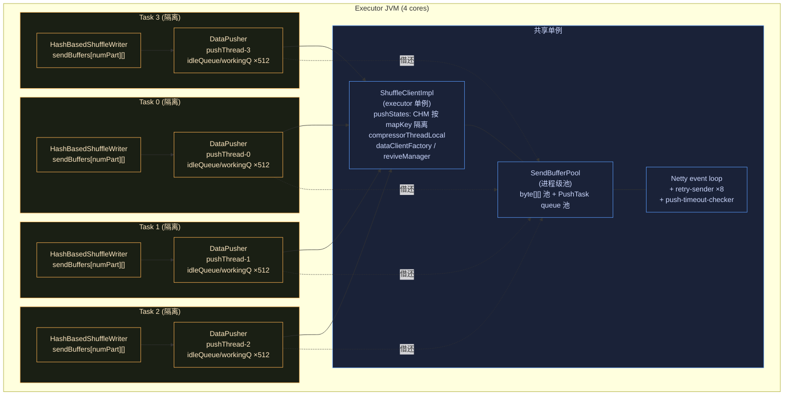

**要点**:`ShuffleClientImpl`、`SendBufferPool`、Netty 连接池**共享**;每个 task 隔离自己的 writer、sendBuffers、DataPusher、pushThread、PushState、in-flight tracker。**4 个 map 线程 + 4 个 push 线程 = 8 线程,只有 4 核**——这是 CPU 争抢的根源。

---

## 图 2:写链路泳道时序图(核心)

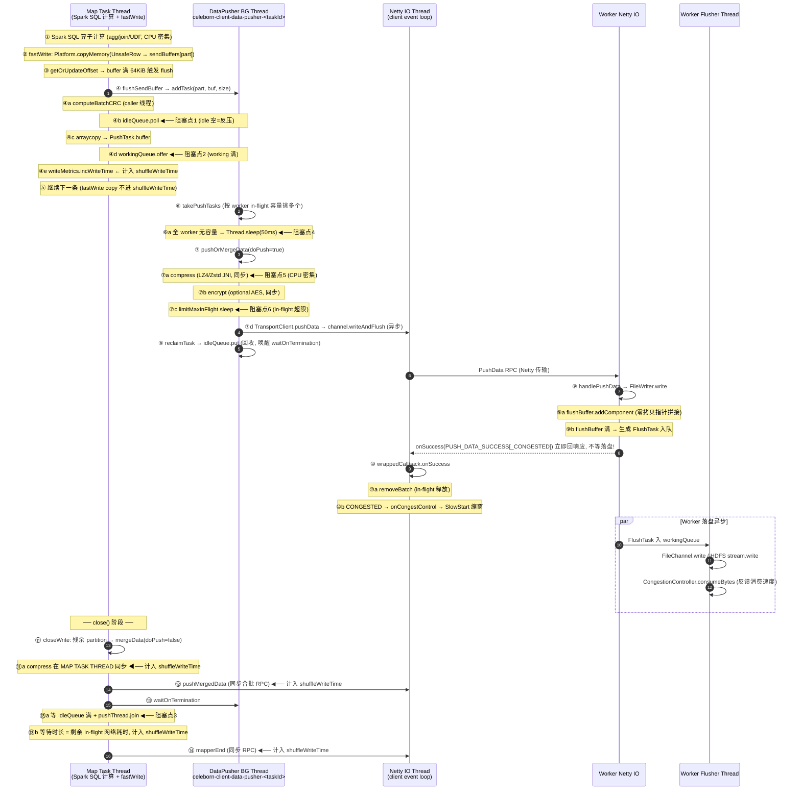

**6 个阻塞点**:`①`idleQueue.poll、`②`workingQueue.offer(map 线程);`④`takePushTasks sleep、`⑤`compress、`⑥`limitMaxInFlight(push 线程);`③`waitOnTermination(map close)。红色为同步阻塞。

---

## 图 3:三级反压链(worker → map task)


**要点**:窗口式(类 TCP cwnd),非 credit/token。worker 用状态码软反压(不丢数据),client 用 `Thread.sleep` 主动降速。反压最终回压到 map 线程的 `idleQueue.poll`,使 Spark SQL 计算暂停——**这与"压缩抢 CPU"是同一现象的两个根因**:push 慢既可能是 worker 反压,也可能是 compress 抢不到核。

---

## 图 4:CPU 争抢模型(4 核 × 8 线程,本场景核心矛盾)

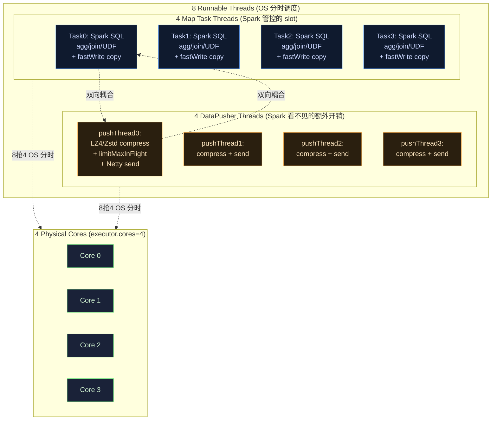

**双向耦合(本场景核心洞察)**:

- **方向 A — 计算重 → push 慢 → 反压阻塞计算**:Spark SQL 算子(重 agg/hash-join/UDF)占满 4 核 → push 线程被 OS 饥饿 → compress/网络慢 → worker 收得慢但不会 CONGESTED(是 client 端慢)→ 数据堆在 workingQueue → idleQueue 空 → map 阻塞在 `addTask` → **Spark SQL 计算被自己产生的数据反压拖慢**。
- **方向 B — compress 重 → 计算被挤压**:Zstd 高 level / 高压缩比数据 → compress 吃 CPU → 4 个 push 线程与 4 个 map 线程抢核 → **map 线程的 Spark SQL 计算被 compress 抢占,task 变慢**。Spark slot 只数 4 个 map 线程,看不见 push 线程的 CPU 开销 → **executor CPU 利用率可能 >100%(按 slot 计),但 Spark UI 不体现**。

---

## 图 5:耗时归属对照(fastWrite 下 shuffleWriteTime 严重失真)

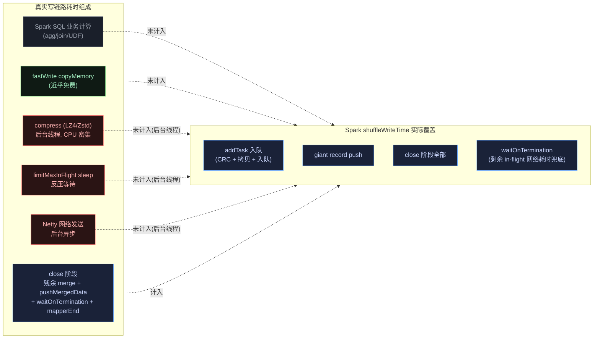

**结论**:

| 耗时项 | 真实存在 | 进 shuffleWriteTime? | 能否观测 |
|---|---|---|---|
| Spark SQL 业务计算 | ✅ 重 | ❌ 进 task 总时间 | Spark UI task duration |
| fastWrite 序列化 | ✅ 近乎免费 | ❌ | 几乎无 |
| compress | ✅ 后台 CPU 密集 | ❌(close 残余除外) | **无指标**,靠 profiling |
| limitMaxInFlight 反压等待 | ✅ | ❌ | **无指标** |
| 后台网络发送 | ✅ | ❌ | **无指标** |
| addTask 入队 | ✅ 轻 | ✅ | shuffleWriteTime |
| close 阶段 + waitOnTermination | ✅ | ✅ | shuffleWriteTime |

> **fastWrite 下 `shuffleWriteTime` 既不反映 Spark SQL 计算开销,也不反映后台 compress/网络开销**,仅反映 addTask 入队(轻)和 close 兜底。稳态吞吐下 shuffleWriteTime 可能很小,但 push 带宽可能已打满(8 线程 CPU 100%)。**优化瓶颈判定不能只看 shuffleWriteTime,必须结合 task 总时间、executor CPU、worker 侧吞吐,或 async-profiler 看 `Lz4Compressor.compress` 占比**。

---

## 关键洞察汇总(写侧)

1. **fastWrite 让序列化免费**:`Platform.copyMemory` 直拷 UnsafeRow,绕过 serializer。序列化不是瓶颈,别在这里优化。

2. **核心矛盾是 CPU 争抢**:4 map + 4 push = 8 线程抢 4 核。Spark SQL 计算(CPU 密集)与 compress(CPU 密集)双向耦合,互相拖累,且 Spark slot 体系看不见 push 线程开销。

3. **compress 是单 task 吞吐天花板**:每个 DataPusher 单 push 线程串行 compress。LZ4 ~500MB/s → 单 task 理论 ~500MB/s,4 task ~2GB/s;Zstd level-3 ~150MB/s → 单 task ~150MB/s。Zstd 高 level 下 compress 易成瓶颈。

4. **shuffleWriteTime 严重失真**:后台 compress/网络/反压等待均不计入。指标只能看"反压是否兜底到 close",看不出稳态吞吐瓶颈。

5. **无 compressTime/serializeTime 独立指标**:Celeborn 完全复用 Spark `ShuffleWriteMetricsReporter`。瓶颈判定靠 async-profiler / JFR 看 `compressor.compress` 与 Spark SQL 算子的 CPU 占比。

6. **反压是窗口式**:worker `*_CONGESTED` 软反压 → `SlowStartPushStrategy` 缩窗(可至 1)→ `limitMaxInFlight` sleep → idleQueue 空 → map 阻塞。与 CPU 争抢是同一现象的两个根因,需结合 worker 侧 CONGESTED 频率区分。

---

## 可优化点与代码债务(写侧)

> 本节条目已于 2026-09 对照当前代码逐项核查(file:line 基于 `celeborn-ai` 工作树)。每条均附代码证据;核查后前提不成立或不值得做的条目见文末附表。

### P0:推荐优先实施

#### 1. `takePushTasks` 空转轮询 `Thread.sleep(50ms)`,无事件唤醒

**代码位置**:`client/src/main/java/org/apache/celeborn/client/write/DataPushQueue.java:128-138`

```java
if (!tasks.isEmpty()) { return tasks; }
// Reaching here means no available tasks can be pushed to any worker, wait for a while
Thread.sleep(takeTaskWaitIntervalMs);
workerWaitAttempts.values().forEach(AtomicInteger::incrementAndGet);
```

两种场景都会睡满 50ms:(a) workingQueue 为空时,新 task 到来要等下一轮轮询(低流量 task 每批数据尾部延迟 +0~50ms);(b) 所有 worker in-flight 打满时,RPC 响应完成(`removeBatch`)本可立即唤醒,却要等 poll 周期;close 阶段 `waitOnTermination` join 的 pushThread 若正在 sleep,也最多多等 50ms。已有配置 `celeborn.client.push.takeTaskWaitInterval`(50ms)与 `takeTaskMaxWaitAttempts`(1)(`CelebornConf.scala:5135-5150`)只能调轮询周期,不能消除轮询机制。

**优化方向**:workingQueue 空改为 `poll(timeout)` 阻塞唤醒(offer 即唤醒);in-flight 满的场景由 `InFlightRequestTracker.removeBatch`(每次 RPC 响应都走)回调 signal,sleep 仅作兜底超时。收益主要在尾部延迟与 close 延迟。

#### 2. `limitMaxInFlight` / `limitZeroInFlight` 纯 sleep 轮询,响应到达也要等下个 tick

**代码位置**:`common/src/main/java/org/apache/celeborn/common/write/InFlightRequestTracker.java:157`、`:222`

```java
if (pushState.exception.get() != null) {
  throw pushState.exception.get();
}
Thread.sleep(delta);   // delta 默认 50ms(celeborn.client.push.limit.inFlight.sleepInterval,CelebornConf.scala:5106-5113)
times--;
```

worker 响应回来、in-flight 计数已下降,push 线程仍要等下一个 50ms tick 才放行;worker 抖动/拥塞时,所有 map task 的吞吐被量化到 50ms 粒度。`SlowStartPushStrategy.limitPushSpeed`(`SlowStartPushStrategy.java:153-166`)同样是裸 sleep。

**优化方向**:`removeBatch` 中对等待方 signal,sleep 仅作兜底超时;注意保持 `cleaned`/`exception` 检查语义不变。

#### 3. Worker 侧:flush 触发、buffer 分配、锁竞争全部发生在 push IO 线程上

**代码位置**:`worker/.../PushDataHandler.scala:389,398`(同步 `writeLocalData`)→ `worker/.../storage/PartitionDataWriter.java:144` → `worker/.../storage/TierWriter.scala:70-85,432-449`

```java
// PartitionDataWriter.java:144 —— 实例级 monitor,在 Netty IO 线程上互斥
public synchronized void write(ByteBuf data) throws IOException {
```

```scala
// TierWriter.scala:432-449 (LocalTierWriter.writeInternal) —— 锁内可能同步触发 flush+分配
if (flushBufferReadableBytes != 0 && flushBufferReadableBytes + numBytes >= flusherBufferSize) {
  flush(false)   // genFlushTask → addFlushTask → takeBuffer(PooledByteBufAllocator 分配)
}
```

push 处理全程由 channelRead 直接驱动,无 executor 卸载;`PartitionDataWriter.write` 的实例级 monitor 还与 `evict`(`:197`)、`flush`(`:121`)竞争——MemoryManager trim 线程执行 `flushOnMemoryPressure` 时会阻塞该 partition 的 IO 写线程。单 partition 热点或 direct memory 分配抖动会直接拖慢该 EventLoop 上的所有连接。注意:Flusher 工作队列是**无界**的(`Flusher.scala:67`),反压完全依赖 MemoryManager 水位暂停接收 + CongestionController 软反压,这是设计契约,不宜简单改有界(`offer(120s)` 会反向阻塞 IO 线程)。

**优化方向**:write 路径卸载到按 partition 分片的 dispatcher 线程池(保证单 partition 有序),或至少把 `synchronized` 细化为只保护 buffer swap。

### P1:小而实的改进

#### 4. 疑似逻辑缺陷:bytes 限流开启后,reqs 限流被 OR 短路

**代码位置**:`InFlightRequestTracker.java:147-151`(上游 CELEBORN-1917 引入)

```java
if ((totalInflightReqs.sum() <= maxInFlightReqsTotal
        && batchIdSet.size() <= currentMaxReqsInFlight)
    || (maxInFlightBytesSizeEnabled
        && totalInflightBytes.sum() <= maxInFlightBytesSizeTotal
        && batchBytesSize.sum() <= maxInFlightBytesSizePerWorker)) {
  break;
}
```

`celeborn.client.push.maxBytesSizeInFlight.enabled=true` 时,只要 bytes 未超限,即使 in-flight 请求数远超 `maxReqsInFlightTotal`/单 worker 窗口也放行——两个维度从"同时约束"变成"任一满足即放行";超时告警分支(`:166-194`)又分别检查两者,与放行条件不一致。默认 `enabled=false`(`CelebornConf.scala:4946-4953`)不触发,开启即语义突变。

**优化方向**:先与上游确认语义(提 Jira/邮件);若非有意,应改为 AND。

#### 5. `DataPusher` 构造时 eager 分配 32MiB/task

**代码位置**:`DataPusher.java:92-94` + `client/.../write/PushTask.java:26-28`

```java
for (int i = idleQueue.size(); i < pushQueueCapacity; i++) {
  idleQueue.put(new PushTask(pushBufferMaxSize));   // 512 × 64KiB = 32MiB
}
```

每个 map task 构造时立即分配 `queueCapacity × pushBufferMaxSize`(默认 32MiB),与实际数据量无关;调大 `pushBufferMaxSize` 会线性放大(1MiB → 512MiB/task)。`SendBufferPool` 跨 task 复用队列可缓解,但并发 core 数个 task 冷启动时仍各自吃满,且池化队列 60s 才过期。

**优化方向**:懒分配 PushTask(`setSize` 已有扩容分支 `PushTask.java:43-45`),或把 eager 填充改为可配置。

#### 6. `addTask` 中 sendBuffer → PushTask 的整批 arraycopy 可换"buffer 交换"

**代码位置**:`DataPusher.java:165`(caller 线程)

```java
System.arraycopy(buffer, 0, task.getBuffer(), 0, size);
```

每个 64KiB batch 在 caller 线程多一次全量拷贝。可改为交换:writer 把填满的 sendBuffer 直接交给 PushTask,同时从 idleQueue 取空 buffer 作为该 partition 的新 sendBuffer(flush 后 offset 归零,`getOrUpdateOffset` 对 buffer 长度变化天然兼容,`HashBasedShuffleWriter.java:308-328`)。风险:sendBuffer 可能处于增长中间态(8K/16K/32K),池内 buffer 尺寸不再均一,需接受尺寸混合或按 max size 补齐。

#### 7. `pushOrMergeData` 的 body 头拼接多一次分配+拷贝

**代码位置**:`client/src/main/java/org/apache/celeborn/client/ShuffleClientImpl.java:1078-1083`

```java
final byte[] body = new byte[BATCH_HEADER_SIZE + length];
... (4 个 Platform.putInt)
System.arraycopy(data, offset, body, BATCH_HEADER_SIZE, length);
```

压缩开启时一批数据的路径是:sendBuffer →(拷贝)PushTask buffer →(LZ4 压缩写入)thread-local compressedBuffer →(拷贝)body,共 3 次拷贝 + 1 次分配。优化方向(按侵入度排序):(a) 先分配 body,`compressor.compress` 以 `BATCH_HEADER_SIZE` 为 dest 偏移直写,省掉最后一次拷贝与 compressedBuffer 中转;(b) 或用 `CompositeByteBuf` 零拷贝拼头——`doPushMergedData` 已有先例(`ShuffleClientImpl.java:1487` 附近 `Unpooled.compositeBuffer()`)。

**反证核查**(为什么当前拷贝存在):`TransportClient.pushData` 是异步的,body 在回调中还会被 HARD_SPLIT 重试复用;compressedBuffer 是 ThreadLocal 会被下一批覆盖,PushTask buffer 在 `reclaimTask` 后立即回池——直接 wrap 现有 buffer 不成立,方案必须保持 body 独立所有权。方案 (a) 满足此约束。

#### 8. 每个 map task 一个 DataPusher 线程,压缩串行

**代码位置**:`DataPusher.java:107-151`(每 task `newDaemonThread` + start;SortBasedPusher 同样每 task 一个)

线程数 = 并发 task 数,随 task churn 创建/销毁;更关键的是单 task 内 compress+push 完全串行——Zstd 高 level 时压缩成单线程瓶颈,task 内无法并行。`ShuffleClientImpl.pushDataRetryPool`(8 线程)只用于重试,主路径无压缩并行。

**优化方向**:DataPusher 按 executor 池化共享(以 mapKey 区分 PushState),或将 compress 剥离到小线程池。属架构级改动,建议先做 #6/#7 再评估。

#### 9. Worker 热路径三处小开销(均在 IO 线程,按开启条件分别命中)

- **CongestionController 开启后每写分配+全局锁**:`TierWriter.scala:434-435` → `UserCongestionControlContext.updateProduceBytes`(`UserCongestionControlContext.java:66-71`)每个写 batch 分配 `BufferStatusNode` 并 clone,再走两次 `synchronized` 的 `TimeSlidingHub.add`(`TimeSlidingHub.java:87`);worker 级 hub 是全局的,所有 IO 线程争同一把锁。默认 `celeborn.worker.congestionControl.enabled=false`(`CelebornConf.scala:4383-4390`)不命中;开启后可把时间桶改为 LongAdder 数组 + volatile 游标。
- **每 push 的 metrics 计时(默认全采样)**:`RpcResponseCallbackWithTimer`(`PushDataHandler.scala:866-883`)每条 push 都 start/stop timer;`AbstractSource.doStartTimer/doStopTimer`(`AbstractSource.scala:318-350`)每次调用重新拼接常量 metricName(`metricNameWithCustomizedLabels`,`:711-719`)+ per-timer CHM put/remove(key 为新建字符串)。`celeborn.metrics.sample.rate` 默认 1.0。可缓存拼接结果、key 改用 Long。
- **handlePushMergedData 按 partition 线性放大的每消息检查**:`PushDataHandler.scala:576,590,600,622` 循环内反复调 `checkDiskFullAndSplit`(`:1440`,内含 diskInfos map 查找)与 `isHardSplitPartition`(`:908`,HashMap 查找);一个 merged batch 可含数百 partition。disk full 状态可按 mount point 缓存(DeviceMonitor 已周期更新),hardSplitIndexes 已排序可用双指针。

### P2:低优先级与代码债务

| 条目 | 位置 | 说明 |
|---|---|---|
| 每 batch `new CRC32` | `CelebornCRC32.java:43-47`,调用点 `DataPusher.java:156` | 仅 `celeborn.client.shuffle.integrityCheck.enabled=true`(默认 false,`CelebornConf.scala:5767-5773`)时命中;可 ThreadLocal 复用 |
| `takePushTasks` 每轮 new ArrayList+2×HashMap | `DataPushQueue.java:83-85,110` | 空转时随 50ms 周期持续产生小对象;修 #1 时顺手改成员复用 |
| SlowStartPushStrategy 魔数 + per-response synchronized | `SlowStartPushStrategy.java:67,82,143,146` | 60ms/1000ms 无开关;默认策略是 SIMPLE 不走这里(`CelebornConf.scala:5037-5047`) |
| close 阶段 pushMergedData 逐 partition 串行 + 每轮 limitMaxInFlight | `ShuffleClientImpl.java:1449-1461` | 残差大时 close 被 in-flight 窗口串行化;属 close 路径优化,正常流占比小 |
| 非复制路径伪异步 Promise/Await | `PushDataHandler.scala:398-399,796` | 同线程同步完成 promise,Await 从不阻塞,但每 push 白付 Promise+Try 分配;可直接返回 `Array[StatusCode]` |
| `getMapAttempt` 每消息 new byte[8] | `PushDataHandler.scala:855-862` | handlePushMergedData 每条消息无条件调用(`:462`);可 `body.getInt(readerIndex())` 零分配直读 |
| 复制路径每 push `new WorkerInfo` | `PushDataHandler.scala:281-286,613-618` | 仅为 `unavailablePeers.containsKey` 构造对象并哈希;可用 (host, replicatePort) 键 |
| `checkAuth` 每 push `splitShuffleKey` | `PushDataHandler.scala:992` | `split("-")`+`mkString` 3 次分配仅为取 appId;shuffleKey→appId 可连接级缓存 |
| Flusher 循环内随机 metrics key | `Flusher.scala:77` | `s"Flusher-$this-${Random.nextInt()}"` 每个 flush task 新建随机字符串;线程内固定值即可 |
| `takeBuffer` 的 per-file timer | `TierWriter.scala:215-229` | key 为 fileAbsPath,文件数多时 timer map 膨胀;`metricsCollectCriticalEnabled` 默认 false,标注即可 |

### 附:核查后不建议做的条目

以下候选点经核查前提不成立、开销可忽略或属故意设计,不建议纳入优化:

| 候选点 | 结论与原因 |
|---|---|
| `idleQueue.poll(500ms)` 是阻塞点 | **不做**。`DataPusher.java:161`:poll 仅在空闲 buffer 耗尽(真实背压)时阻塞,有元素立即返回;500ms 只是异常检查节拍 |
| `workingQueue.offer(500ms)` 是阻塞点 | **不做**。`DataPushQueue.java:144` 同理,队列未满立即成功;真正问题在 take 侧轮询(见 P0-1) |
| compressor buffer 每次 new | **不做**。`Lz4Compressor`/`ZstdCompressor` 的 compressedBuffer 是 ThreadLocal(`ShuffleClientImpl.java:143-149`)且仅不够大时才重分配,已是每线程一次分配 |
| `PushTask.setSize` 重分配 | **不做**。buffer 初始即 pushBufferMaxSize;giant record 走 `pushGiantRecord` 旁路(`HashBasedShuffleWriter.java:288-306`),该分支实为防御性死代码 |
| SendBufferPool 缺失/不完整 | **不做**。`byte[][]` 与 PushTask 队列均已池化,capacity=executor cores,60s 过期清理 |
| `pushMergedData` 静态共享 `RND` | **不做**。`java.util.Random` 内部 AtomicLong 线程安全;close 路径低频 |
| SlowStartPushStrategy 的 synchronized 是瓶颈 | **不做**。默认 SIMPLE 不经过;临界区仅几次原子操作 |
| 合并压缩器块校验与端到端 CRC 省一遍计算 | **不做**。前者是传输块校验(xxhash32/CRC32,写在压缩头),后者是 per-partition commit 校验,层与语义不同;且后者默认关闭 |
| `mapStatusLengths` LongAdder 争用 | **不做**。caller 与 pusher 线程都会写,LongAdder 正是正确选择 |
| PUSH_DATA body 接收拷贝 | **不存在**。`TransportFrameDecoder` readSlice+retain,`PushData.decode` 直接包 NettyManagedBuffer,零拷贝 |
| writeLocalData 的 mergeBuffer 拷贝 | **故意设计且有开关**。`workerPushDataMergeBufferEnabled` 默认 false,治理 Netty 池碎片 |
| Flusher WorkingQueue 有界化/丢弃策略 | **不做**。改有界会让 `offer(120s)` 阻塞 IO 线程,反而更糟;无界队列依赖 MemoryManager 水位反压是设计契约 |
| mapIdBitmap 更新开销 | **不做**。仅 `rangeReadFilter` 开启才执行,RoaringBitmap.add 均摊 O(1) |
| HDFS/S3 FlushTask 的 convertBufferToBytes 拷贝 | **不做**。stream API 必需;已有 `workerFlushReuseCopyBufferEnabled`(默认 true)复用 copy buffer;LocalFlushTask 走 nioBuffers gather write 无拷贝 |
| CongestionController 10ms 检查线程 | **不做**。独立后台线程,开销可忽略 |

> **不确定性说明**:本节为静态代码阅读结论,未做运行期 profiling。P0-3 的实际影响取决于单 partition 热点程度与 flusher 消费速度,建议配合 worker 侧 `PartitionWriteBytes`/`TakeBufferTime` 及 flusher 队列 gauge 观测后再动手。

---

## 参考代码位置(写侧)

| 关注点 | 位置 |
|---|---|
| fastWrite 路径 | `client-spark/spark-3/.../HashBasedShuffleWriter.java:208-249` |
| sendBuffer flush 阈值 | `HashBasedShuffleWriter.java:308-328` (`PUSH_BUFFER_MAX_SIZE=64KiB`) |
| DataPusher.addTask(CRC+拷贝+入队) | `client/.../write/DataPusher.java:154-174` |
| DataPusher 后台 run loop | `DataPusher.java:125-147` |
| DataPusher eager buffer 分配 | `DataPusher.java:92-94`、`client/.../write/PushTask.java:26-28` |
| takePushTasks 轮询与唤醒缺口 | `client/.../write/DataPushQueue.java:82-138` |
| compress 同步点 | `client/.../ShuffleClientImpl.java:1050-1058` (`compressorThreadLocal`) |
| pushOrMergeData body 拼接 | `client/.../ShuffleClientImpl.java:1078-1083` |
| limitMaxInFlight 反压 | `common/.../write/InFlightRequestTracker.java:130-202` |
| SlowStartPushStrategy | `common/.../write/SlowStartPushStrategy.java:50-180` |
| waitOnTermination | `DataPusher.java:176-196` |
| worker handlePushData | `worker/.../PushDataHandler.scala:148-260` |
| worker writer 锁与 evict 竞争 | `worker/.../storage/PartitionDataWriter.java:121,144,197` |
| worker 零拷贝入 flushBuffer | `worker/.../storage/TierWriter.scala:432-449` |
| worker 拥塞控制热路径 | `worker/.../congestcontrol/UserCongestionControlContext.java:66-71`、`TimeSlidingHub.java:78-87` |
| worker metrics 计时 | `common/.../metrics/source/AbstractSource.scala:318-350,711-719` |
| worker 异步落盘 | `worker/.../storage/Flusher.scala:69-102` |
| shuffleWriteTime 计时点 | `HashBasedShuffleWriter.java:330-336, 379-400` |

---

# 第二部分 读链路

## 图 6:4 Reduce Task 并发拓扑(共享 vs 隔离)

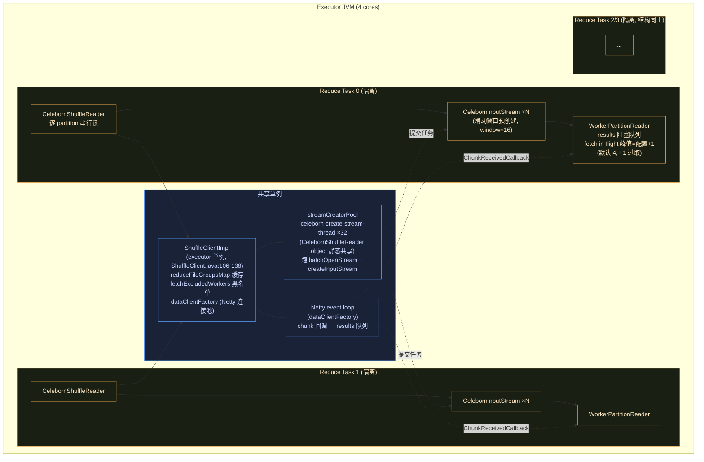

**要点**:`ShuffleClientImpl`(含 fileGroup 缓存、fetch 黑名单、Netty 连接池)与 `streamCreatorPool` 是 **executor 级共享**;每个 reduce task 隔离自己的 `CelebornShuffleReader`、每 partition 一个 `CelebornInputStream`、每 location 一个 `WorkerPartitionReader` 及其 `results` 队列。**读侧没有 DataPusher 式的 per-task 后台线程**,4 个 task 线程就是全部 CPU 消费者,网络到达由共享 Netty 线程投递——这是与写链路"4 map + 4 push 抢核"最本质的拓扑差异。

---

## 图 7:读链路泳道时序图(核心)

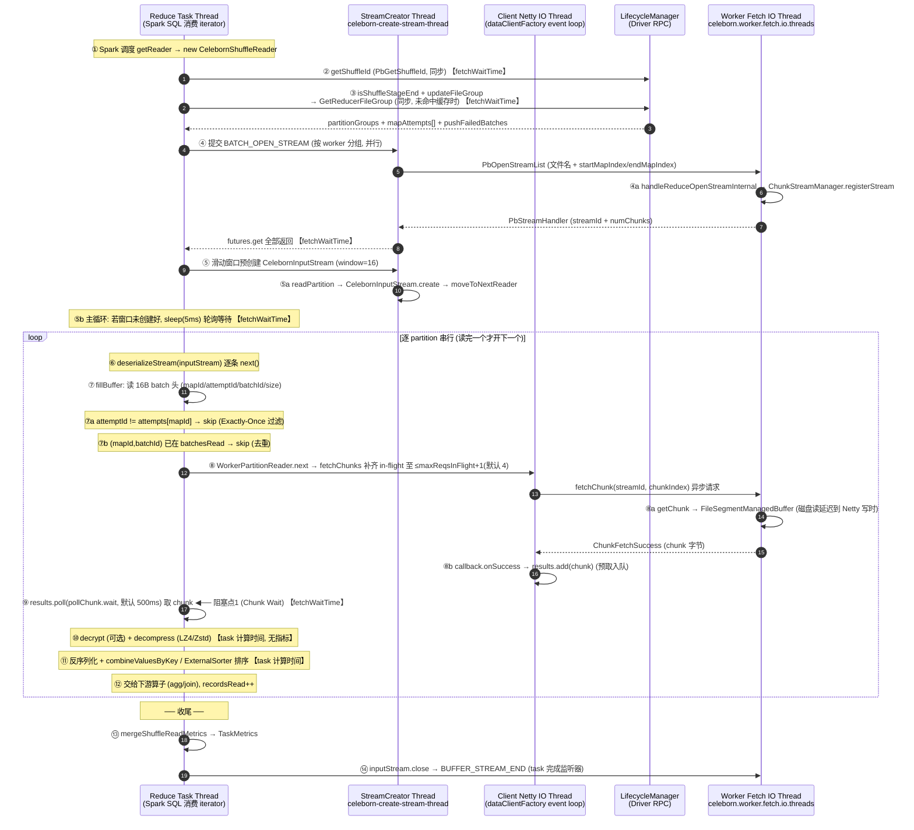

**线程归属总结**:②③④⑤的 RPC 与等待全部计入 Spark `fetchWaitTime`(采集点见 CelebornShuffleReader.scala:158-166/389/476-477 与 WorkerPartitionReader.java:204);⑩⑪在 task 线程但**不进任何 shuffle 读指标**,沉进 task 总时间。唯一的稳态阻塞点是 `⑨results.poll`——in-flight 预取窗口正常时网络被解压/反序列化的 CPU 时间掩盖,poll 近似零等待。注意窗口实际是 **maxReqsInFlight+1**:`fetchChunks` 以 `窗口 - inFlight + 1` 过取补齐(WorkerPartitionReader.java:274-277),峰值 4 个 chunk 在飞,保证 task 线程处理期间仍有满窗口预取。

---

## 图 8:失败与重试路径(fetchChunk / openStream 双分支)

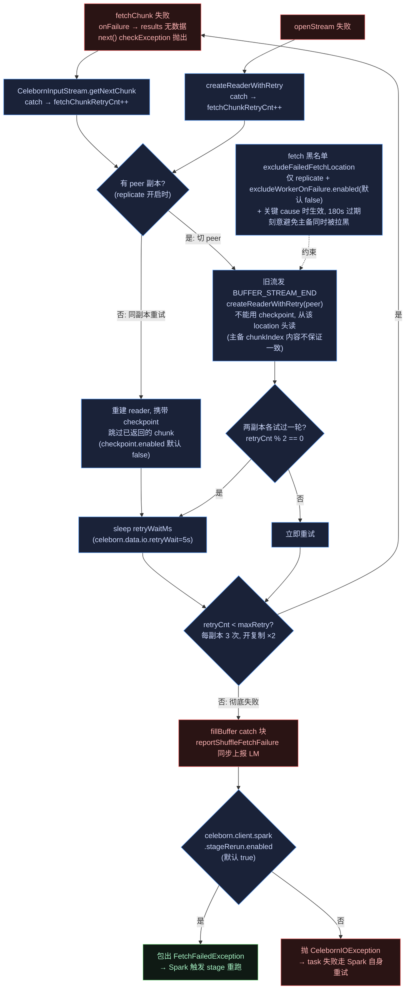

**要点**:两层重试(建 reader `createReaderWithRetry`、拉 chunk `getNextChunk`)共用同一计数器,语义一致——**同副本重试可带 checkpoint 续读,切 peer 必须从头读该副本**;彻底失败后不是简单 task 报错,而是**同步上报 LM 清理,再抛 `FetchFailedException` 让 Spark 重跑整个 stage**(map 侧分区文件可能已随 worker 丢失,重跑才能重建)。黑名单默认关闭,且只在复制开启时才有意义。详见 [client-data-plane-deep-dive.md](./client-data-plane-deep-dive.md) 第 5.4/5.5 节,本文不重复展开。

---

## 图 9:耗时归属对照(fetchWaitTime 只覆盖"等数据",不覆盖"处理数据")

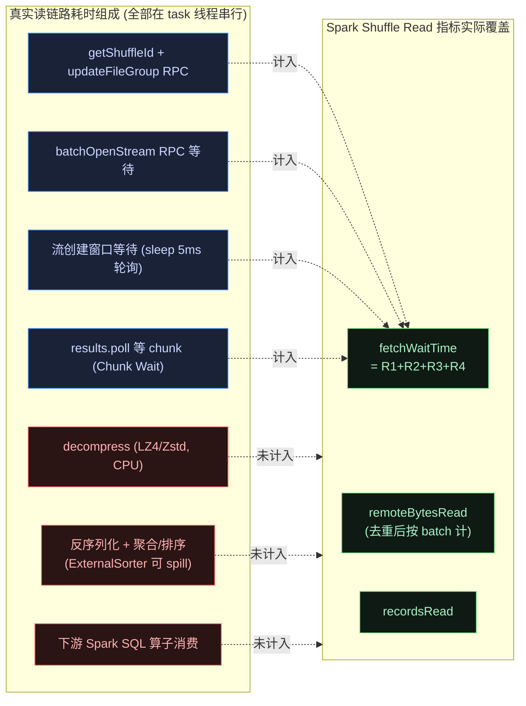

**结论**:

| 耗时项 | 线程 | 进 fetchWaitTime? | 观测方式 |
|---|---|---|---|
| getShuffleId / GetReducerFileGroup RPC | task | ✅(CelebornShuffleReader.scala:389) | fetchWaitTime |
| batchOpenStream 等待 | task(等 streamCreator 线程) | ✅(同上) | fetchWaitTime |
| 流创建窗口等待 | task | ✅(:476-477) | fetchWaitTime |
| results.poll 等 chunk | task | ✅(WorkerPartitionReader.java:204) | fetchWaitTime |
| decompress | task | ❌ | **无指标**,沉进 task 计算时间 |
| 反序列化 + 聚合/排序 | task | ❌ | spill 有独立字节数指标,耗时无 |
| 重试 sleep / 切副本 | task | ❌(sleep 期间不在 poll 内) | 仅日志 |

> **口径警告**:`fetchWaitTime` 在 Celeborn 下语义被**拓宽**了——Spark 原生口径里它只是 ShuffleBlockFetcherIterator 等 block 的时间,而 Celeborn 把 getShuffleId/updateFileGroup/batchOpenStream 这些**控制面 RPC** 也计了进去(:389 注释明言 "readTime should include ...")。反之,decompress 在 task 线程真实消耗 CPU 却无任何指标。读侧线程模型与 Decompress 口径见 [spark-shuffle-thread-model-and-metrics.md](./spark-shuffle-thread-model-and-metrics.md) 第一部分第 2 节、第二部分第 5-6 节——**注意该文档基于 celeborn-main 增强分支,本工作树(0.7.0-SNAPSHOT)读侧只有 Spark 原生 ShuffleReadMetrics 四项,无自定义 Read Times 页面**。

---

## 关键洞察汇总(读侧)

1. **读侧无后台工作线程**:与写链路"每 task 一个 DataPusher 后台压缩"相反,读侧解压/反序列化/聚合全在 reduce task 线程,Netty 线程只负责投递 chunk。CPU 争抢问题读侧天然不存在,代价是**解压 CPU 与网络等待串行交替**,靠 in-flight 预取打 pipeline 来掩盖(配置 `maxReqsInFlight=3`,因 +1 过取实际峰值 4 个 chunk,见 WorkerPartitionReader.java:274-277)。

2. **partition 间串行,location 间串行**:一个 reduce task 逐 partition 读(`recordIter` 顺序展开),每个 partition 内逐 location 串接(`moveToNextReader`)。并发度 = executor 上 reduce task 数;单 task 吞吐上限 ≈ 单线程 decompress + deserialize 速度。

3. **初始化三段 RPC 全计入 fetchWaitTime**:getShuffleId → GetReducerFileGroup → batchOpenStream,外加滑动窗口(默认 16)的流创建等待。大 shuffle 首个 reduce task 的 fetchWaitTime 会被控制面 RPC 显著抬高,这不是网络慢。

4. **Exactly-Once 在读侧补票**:worker 只透传存储,`attempts[mapId]` 过滤 + `(mapId, batchId)` 去重在 `fillBuffer` 里做(CelebornInputStream.java:849-878),去重**先于**解密/解压,避免为丢弃的 batch 付 CPU。机制细节见 client-data-plane-deep-dive.md 第 6 节。

5. **失败语义是"重试 → 切副本 → 上报 → stage rerun"**:每副本 `celeborn.client.fetch.maxRetriesForEachReplica`=3 次(开复制 ×2),同副本可 checkpoint 续读、切副本从头读;彻底失败同步上报 LM 后抛 `FetchFailedException`(`stageRerun.enabled` 默认 true),由 Spark 重跑 stage 重建丢失分区——比 Spark 原生"block 拉不到即 FetchFailed"多了一层客户端自愈。

6. **指标只能回答"等了多久",不能回答"算了多久"**:fetchWaitTime 覆盖 RPC + chunk 等待;decompress/deserialize/聚合耗时无任何指标,判定读侧瓶颈需结合 task 总时间减 fetchWaitTime 的残差,或 async-profiler 看 `Decompressor.decompress` 占比。

---

## 可优化点与代码债务(读侧)

> 本节条目于 2026-09 对照当前工作树(0.7.0-SNAPSHOT)逐项核查,体例仿 [network-and-protocol-deep-dive.md](./network-and-protocol-deep-dive.md) 第 6 节。核查结论:读链路没有 V2 serde 级别的 P0 事项——主体路径(预取窗口、去重顺序、重试/切副本语义)实现干净;以下为 P1(小而安全)与 P2(低优先级/需评估)条目,末尾附核查后排除的候选。

### P1:小而安全的改进

#### O1. 为解压/解密补充耗时指标

**代码位置**:`CelebornInputStream.java:881-931`(解密 :881-910,解压 :925-931)

fillBuffer 中 decrypt/decompress 在 task 线程真实消耗 CPU,但全部指标只有 `incBytesRead`/`incDuplicateBytesRead` 两个字节口径,耗时为零——`fetchWaitTime` 只回答"等了多久",判定"读慢是网络还是解压"只能靠 task 总时间残差或 async-profiler。`MetricsCallback` 已有 `incReadTime` 通道(WorkerPartitionReader.java:204 的用法),扩展一个解压耗时回调即可贯通。

**优化方向**:
- 在 :925-931 解压与 :881-910 解密处加 nanoTime 计时,经 MetricsCallback 上报;注意 Spark 原生 ShuffleReadMetrics 无对应字段,需走自定义 source 或日志聚合,接入点需与 Spark 侧 metrics reporter 约定。

#### O2. 流创建等待改通知机制,消除 sleep(5ms) 轮询

**代码位置**:`CelebornShuffleReader.scala:457-471`

`while (inputStream == null) { Thread.sleep(5); ... }` 忙等 streamCreatorPool 的异步创建结果:命中等待时按 5ms 粒度取整(平均白等 ~2.5ms/次),coalesce 场景(单 task 数百 partition)若窗口预创建跟不上消费速度则累计可观,且轮询时间全部计入 fetchWaitTime,抬高指标噪音。`createInputStream` 完成后没有通知机制。

**优化方向**:
- `streams` 改为 `partitionId -> CompletableFuture[CelebornInputStream]`,等待侧 `future.get()` 阻塞唤醒(异常经 future 传递,语义与现状一致);改动局限在 read() 内。

### P2:低优先级与需评估项

#### O3. `batchesRead` 去重数据结构

**代码位置**:`CelebornInputStream.java:191, 868-878`

`Map<Integer, Set<Integer>`(HashMap + HashSet,Integer boxing)按 (mapId, batchId) 去重,每个输入流一份。大 shuffle(数万 map × 多 batch/个)下内存与 GC 开销可见;worker 侧同类问题(mapIdBitmap)已用 RoaringBitmap 解决,可对齐。

**优化方向**:
- 改 `Map<Integer, RoaringBitmap>`;收益随 map 数增长,小 shuffle 无感。

#### O4. 重试 sleep 不可中断且不进任何指标

**代码位置**:`CelebornInputStream.java:484, 522, 564, 576`(`Uninterruptibles.sleepUninterruptibly(retryWaitMs)`,retryWaitMs = `celeborn.data.io.retryWait` 默认 5s,CelebornConf:2356-2369)

两处问题:(a) `Uninterruptibles` 吞掉 interrupt——Spark kill task(推测执行、stage 取消)时若 task 线程正在重试 sleep,要等满 5s 才退出,延迟 executor 资源释放;(b) sleep 期间不在 `results.poll` 内,既不计入 fetchWaitTime 也无独立指标,只能从 warn 日志推断发生了重试。

**优化方向**:
- 改可中断 sleep(中断时按 task 取消语义直接抛出),并将重试等待累计值经 MetricsCallback 或日志结构化输出。

#### O5. 两个默认关闭的读侧开关值得评估/文档化

**代码位置**:`CelebornConf.scala:6405-6411`(chunk.prefetch,默认 false)、`:5209-5216`(partition.reader.checkpoint,默认 false);生效点 `CelebornInputStream.java:355-360`(构造时预取首 chunk)与 `WorkerPartitionReader.java:280-291`(checkpoint 跳过已返回 chunk)

- `celeborn.client.chunk.prefetch.enabled=true`:流创建时即发出首个 chunk 请求,把首 chunk 的 RTT+磁盘读藏进滑动窗口等待里;默认关闭意味着每换一个 location,首 chunk 必等一轮网络往返。
- `celeborn.client.partition.reader.checkpoint.enabled=true`:同副本重试跳过已返回 chunk(图 8 E 支路);默认关闭意味着同副本重试从该 location 头重读,重试成本高时浪费明显。

**优化方向**:
- 均为纯配置项、无代码改动风险;建议基准评估后考虑调默认值,或至少在调优文档中给出推荐。

### 附:核查后排除的候选

以下候选看似可优化,经核查不成立或不值得做,不建议引入:

| 候选 | 排除原因 |
|---|---|
| `results.poll(500ms)` 改 `take()` 阻塞 | onFailure 只设 AtomicReference 不入队(WorkerPartitionReader.java:122-127),poll 超时循环是周期性 `checkException` 的唯一时机,改 take() 会在 fetch 失败后永久阻塞;500ms 可由 `celeborn.client.fetch.pollChunk.wait` 调节(CelebornConf:5188-5197) |
| in-flight 只在 next() 入口补齐是缺陷 | +1 过取(:277 `maxReqsInFlight - inFlight + 1`)保证 task 处理期间仍有满窗口在飞,是刻意设计;代价只是峰值 in-flight = 配置值+1 |
| `fetch.maxReqsInFlight=3` 默认太小 | 可调配置而非缺陷:3×8MB chunk ≈ 24MB 在飞/流,单流吞吐不受限;调大只线性增加内存占用 |
| batchesRead 跨 location 不去重 | 事实错误:batchesRead 是 CelebornInputStream 级字段(:191,per partition),location 串接(moveToNextReader)间持续有效 |
| streamCreatorPool 32 线程可能是瓶颈 | 池为 fixed 32 + LinkedBlockingQueue 排队(ThreadUtils.scala:165-178),batchOpenStream 按 host 分组后任务数 ≤ worker 数,且 keepalive 60s 空闲自动收缩,稳态远未打满 |

---

## 参考代码位置(读侧)

| 关注点 | 位置 |
|---|---|
| Spark reader 入口分派 | `client-spark/spark-3/.../SparkShuffleManager.java:376, 449-483`(columnar 分派 :458-469) |
| reader 主流程 read() | `client-spark/spark-3/.../celeborn/CelebornShuffleReader.scala:130-583` |
| fetchWaitTime 采集(控制面 RPC 段) | `CelebornShuffleReader.scala:158-166, 388-389` |
| getShuffleId RPC(仅 stageRerun 开启时发) | `client-spark/spark-3/.../SparkUtils.java:143-165`;`client/.../ShuffleClientImpl.java:640-660`(PbGetShuffleId) |
| batchOpenStream 并行 RPC | `CelebornShuffleReader.scala:360-390`(线程池 :168-177) |
| 流创建滑动窗口 + 等待计时 | `CelebornShuffleReader.scala:442-449, 452-490` |
| 反序列化 / 排序 / 聚合接管 | `CelebornShuffleReader.scala:499, 522-570` |
| ShuffleClientImpl 单例 | `client/.../ShuffleClient.java:106-138` |
| updateFileGroup 缓存 + GetReducerFileGroup | `client/.../ShuffleClientImpl.java:1874-1949, 1973-1993` |
| readPartition 组装入口 | `ShuffleClientImpl.java:2004-2066` |
| fetch 黑名单判定 | `ShuffleClientImpl.java:2193-2200`;过期/主备避让 `CelebornInputStream.java:430-449` |
| 重试上限计算(×2) | `client/.../read/CelebornInputStream.java:341-345` |
| 建 reader 重试 + 切副本 + BUFFER_STREAM_END | `CelebornInputStream.java:456-527` |
| 拉 chunk 重试(checkpoint 续读 / peer 头读) | `CelebornInputStream.java:529-590` |
| reader 类型分派(Worker/Local/Dfs) | `CelebornInputStream.java:592-665` |
| fillBuffer:attempt 过滤 + 去重 + 解压 | `CelebornInputStream.java:820-986`(过滤 :849-878,解压 :925-931) |
| 彻底失败上报 + FetchFailedException 包装 | `CelebornInputStream.java:948-975`;Spark 侧 `CelebornShuffleReader.scala:602-620` |
| openStream RPC + streamHandler | `client/.../read/WorkerPartitionReader.java:136-156` |
| fetch 窗口(+1 过取)+ chunk 轮询等待计时 | `WorkerPartitionReader.java:188-233, 274-319`(过取 :277;poll 超时配置 `celeborn.client.fetch.pollChunk.wait` 默认 500ms) |
| 关键配置默认值 | `common/.../CelebornConf.scala:5180-5244`(fetch 系列)、`:2356-2369`(io.retryWait=5s)、`:5246-5253`(stageRerun 默认 true)、`:5273-5288`(fetch 黑名单)、`:6388-6420`(线程池 32/窗口 16/parallelClientCreation 默认 true)、`:6405-6411`(chunk.prefetch 默认 false) |
| worker 侧 openStream / fetchChunk | `worker/.../FetchHandler.scala:105-116, 144-177, 252-354, 356-420, 551-619` |
| worker chunk 源(惰性磁盘读) | `worker/.../storage/ChunkStreamManager.java:73-86`;`common/.../buffer/FileChunkBuffers.java:38-41` |
| fetch IO 线程数 | `worker/.../Worker.scala:256-261`(`celeborn.worker.fetch.io.threads`,回落 totalFlusherThread) |

---

# 第三部分 与 Spark 原生实现对比

## 3.1 写侧:SortShuffleWriter · compress / shuffleWriteTime 口径对比

> 调研对象:Apache Spark 源码(本地基线工作树 `spark`)的 `SortShuffleWriter`(走 `ExternalSorter` + `ShufflePartitionPairsWriter` 路径)。

### 核心结论

**Spark SortShuffleWriter 的 `shuffleWriteTime` 也不包含 compress 耗时**,且 **serialize 也没有单独指标**。这与 Celeborn 表面口径一致,但底层机制完全不同。

### 图 10:Spark SortShuffleWriter 流链路(compress 在计时点上游)

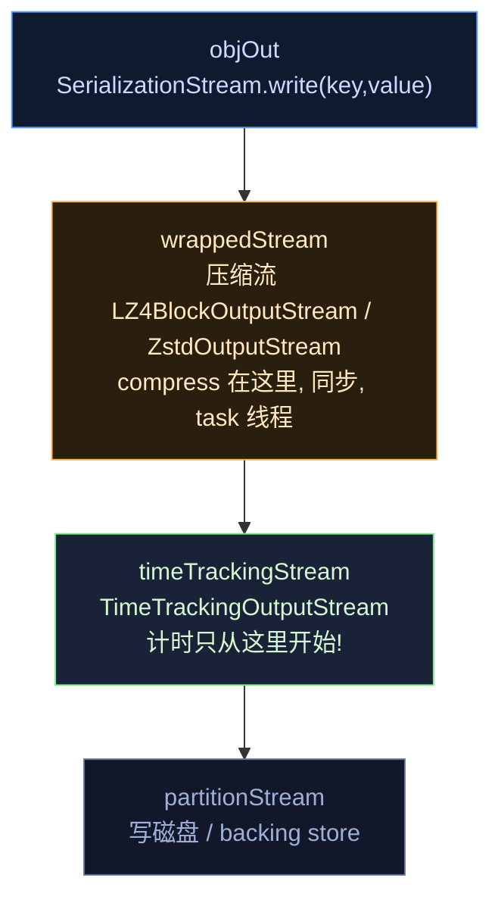

**关键**:`TimeTrackingOutputStream.write()`(Spark `core/.../storage/TimeTrackingOutputStream.java:46-49`)只计时 `outputStream.write(b, off, len)` 这一行--而此刻数据**已被压缩完毕**。compress 的 CPU 耗时在 `wrappedStream.write()` 内部消耗,发生在计时点**之前**。

- 流链路组装:`ShufflePartitionPairsWriter.open()`(`core/.../shuffle/ShufflePartitionPairsWriter.scala:67-85`)
- 压缩入口:`SerializerManager.wrapForCompression`(`core/.../serializer/SerializerManager.scala:133-160`),`shouldCompress(ShuffleBlockId)` = `spark.shuffle.compress`(默认 true)
- spill 路径同样:`DiskBlockObjectWriter.initialize()`(`core/.../storage/DiskBlockObjectWriter.scala:147-176`),且 spill 用**全新** `spillMetrics`,writeTime 被故意丢弃(`ShuffleExternalSorter.java:284` 注释:"intentionally ignore ... we do not count this IO towards shuffle write time")

### 图 11:差异对比表

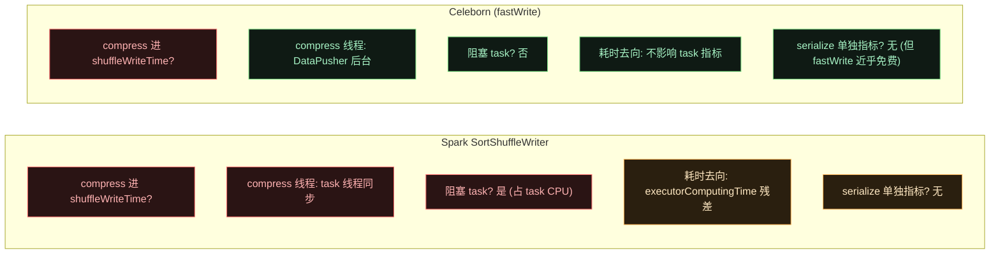

| 维度 | Spark SortShuffleWriter | Celeborn (fastWrite) |
|---|---|---|
| compress 进 `shuffleWriteTime`? | **否** | **否** |
| compress 执行线程 | **task 线程同步**(`LZ4BlockOutputStream.write` 在调用栈内) | **DataPusher 后台线程** |
| compress 是否阻塞 task | **是**(占 task CPU,拖慢实际执行) | 否 |
| compress 耗时去向 | 吞没在 `executorComputingTime` 残差(`runTime - readTime - writeTime`) | 不影响任何 task 指标 |
| serialize 是否单独统计 | 否,无 shuffle serialize time 指标,也在残差里 | 否(fastWrite 近乎免费) |
| spill 阶段 compress | 有,但 writeTime **故意丢弃** | 无(无本地 spill) |
| merge 阶段 | **重新压缩**,仍在计时上游,不进 writeTime | 无 merge 到本地,直接 push |

### 图 12:残差隐藏洞察(最反直觉的点)

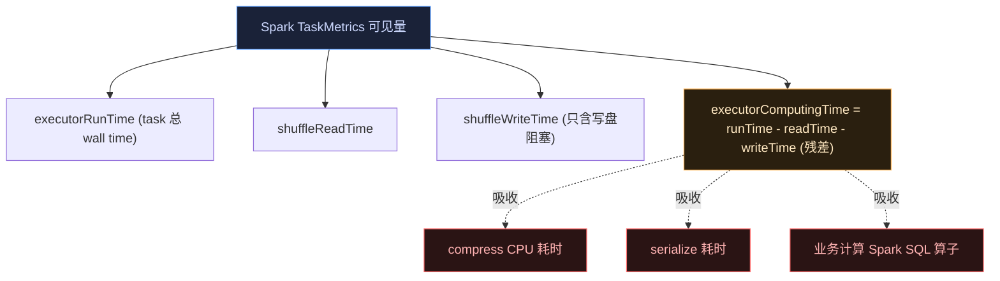

**最反直觉的点**:两者 `shuffleWriteTime` 都不含 compress,但机制不同:

- **Spark**:compress 同步阻塞 task 线程,拖慢实际执行,只是指标"看不见"--它藏进 `executorComputingTime` 残差。所以 Spark 里看到 `shuffleWriteTime` 小,**不代表 compress 没开销**,要看 task 总时间。
- **Celeborn**:compress 在后台线程,不阻塞 task 线程;但代价是 **4 map + 4 push = 8 线程抢 4 核**的跨线程 CPU 争抢。Spark 只有 4 个 task 线程,compress 与业务计算在**同一根**上排队,不跨线程争抢--这是 Celeborn 相对 Spark 引入的新矛盾。

### 优化判定启示

- **Spark 调优**:看 `executorComputingTime` 残差是否异常高 + `executorCpuTime`,怀疑 compress/serialize 隐藏开销时用 async-profiler 看 `LZ4BlockOutputStream.write` / `ZstdOutputStream.write` 占比。
- **Celeborn 调优**:看 `shuffleWriteTime` 失真更严重(后台 compress/网络/反压都不计),必须结合 executor CPU、worker 吞吐、`SlowStartPushStrategy` 窗口演化,或 async-profiler 看 `Lz4Compressor.compress` 与 Spark SQL 算子的 CPU 占比。
- **共同点**:两者都无 compressTime/serializeTime 独立指标,瓶颈判定靠 profiling。

### Spark 参考代码位置(写)

| 关注点 | 位置 |
|---|---|
| SortShuffleWriter.write 主循环 | `core/.../shuffle/sort/SortShuffleWriter.scala:65-89` |
| 最终输出流链路组装 | `core/.../shuffle/ShufflePartitionPairsWriter.scala:67-85` |
| spill 路径流链路 | `core/.../storage/DiskBlockObjectWriter.scala:147-176` |
| 计时实现 | `core/.../storage/TimeTrackingOutputStream.java:31-76` |
| 压缩流包装入口 | `core/.../serializer/SerializerManager.scala:133-160` |
| LZ4/Zstd 压缩流(同步) | `core/.../io/CompressionCodec.scala:144-152,240-246` |
| shuffleWriteTime 累加器 | `core/.../executor/ShuffleWriteMetrics.scala:31-53` |
| 全部 accumulator(无 serialize time) | `core/.../executor/TaskMetrics.scala:236-274` |
| spill writeTime 故意忽略 | `core/.../java/.../shuffle/sort/ShuffleExternalSorter.java:284-286` |
| spill/merge 路径 | `core/.../util/collection/ExternalSorter.scala:286-344,741-767` |
| UI 指标口径(残差) | `core/.../ui/jobs/StagePage.scala:280-311` |

---

## 3.2 读侧:BlockStoreShuffleReader · 读模型对比

> 调研对象:Apache Spark 源码(本地基线工作树 `spark`)的 `BlockStoreShuffleReader` + `ShuffleBlockFetcherIterator`(SortShuffleManager 默认读路径)。

### 图 13:读模型结构对比

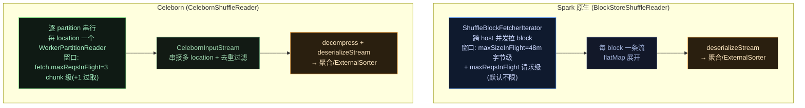

### 图 14:关键差异速查

| 维度 | Spark BlockStoreShuffleReader | Celeborn CelebornShuffleReader |
|---|---|---|
| 拉取并发模型 | 跨 host 并发,字节级窗口 48m(`spark.reducer.maxSizeInFlight`,package.scala:2202-2209) | **partition 间串行**,chunk 级窗口 3(`celeborn.client.fetch.maxReqsInFlight`,+1 过取实际峰值 4) |
| 元数据来源 | MapOutputTracker(driver 推送) | GetReducerFileGroup RPC(主动拉,计入 fetchWaitTime) |
| 解压位置 | `serializerManager.wrapStream` 包压缩流,读时解压,task 线程 | `fillBuffer` 显式 decompress,task 线程 |
| 去重 | 无概念(block 由 map 输出唯一确定) | attempt 过滤 + (mapId,batchId) 去重,Exactly-Once |
| 失败重试 | Netty 层 `spark.shuffle.io.maxRetries`=3(TransportConf.java:158),失败即 `FetchFailedException`(ShuffleBlockFetcherIterator.scala:1249) | 每副本 3 次 + 切副本续读,仍失败上报 LM 再 `FetchFailedException` |
| fetchWaitTime 口径 | 仅等 block 的时间(:196-202 `withFetchWaitTimeTracked`) | **等 block + 控制面 RPC + 流创建等待**(口径被拓宽) |
| 排序/聚合接管 | 相同模板代码(ExternalSorter / combineValuesByKey) | 相同(CelebornShuffleReader.scala:522-570 与 BlockStoreShuffleReader.scala:114-150 几乎逐行对应) |

**最反直觉的点**:两者读路径骨架几乎一样(都是"拉流 → 反序列化 → 可选聚合/排序"),但 **Spark 原生靠跨 host 并发隐藏网络,Celeborn 靠 in-flight 预取隐藏网络**——Celeborn 单 task 的网络并行度更低,换来的收益在写侧(map 端免本地落盘、merge 后顺序读)。读侧若 fetchWaitTime 高,优先怀疑控制面 RPC(初始化段)与 worker 端 `maxChunksBeingTransferred` 限流,而不是带宽。

### Spark 参考代码位置(读)

| 关注点 | 位置 |
|---|---|
| reader 主流程 | `core/.../shuffle/BlockStoreShuffleReader.scala:72-159` |
| fetch 迭代器(并发/窗口) | `core/.../storage/ShuffleBlockFetcherIterator.scala:86`(类定义), 初始化与拉取主循环 :194 起 |
| fetchWaitTime 计时 | `ShuffleBlockFetcherIterator.scala:196-202` |
| FetchFailedException 抛出 | `ShuffleBlockFetcherIterator.scala:1249` |
| reducer 窗口配置 | `core/.../internal/config/package.scala:2202-2219`(48m / 不限) |
| 网络层重试默认值 | `common/network-common/.../TransportConf.java:158`(maxRetries=3) |
