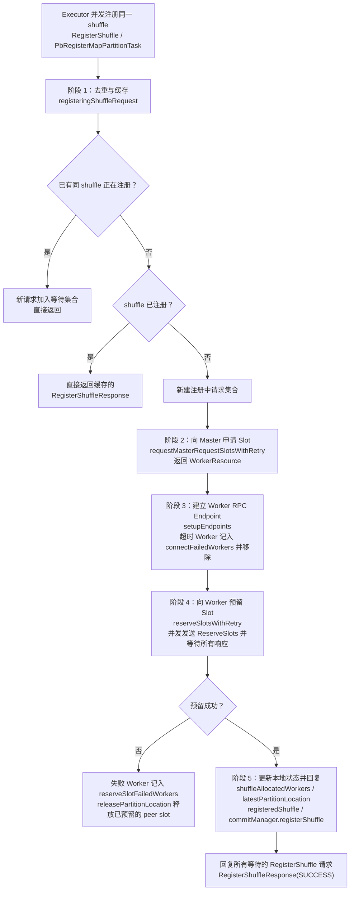
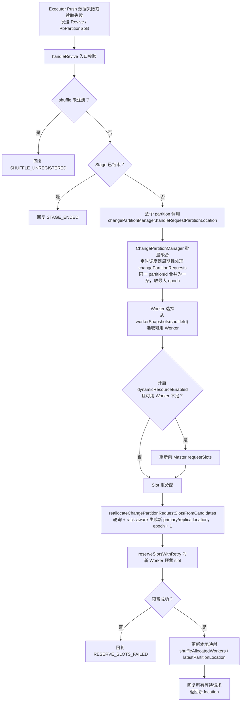
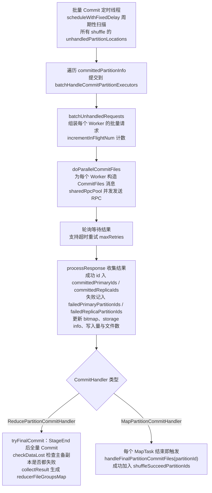

# Celeborn Client 控制平面源码阅读指南

> 基于版本 0.7.0-SNAPSHOT，整理日期 2026-08-05；第 5 节配置表与第 6 节于 2026-09 对照当前代码逐项核查修订。
> 覆盖模块：`client/src/main/scala/org/apache/celeborn/client/`
> 核心文件：`LifecycleManager.scala`、`CommitManager.scala`、`ChangePartitionManager.scala`、`ReleasePartitionManager.scala`、`WorkerStatusTracker.scala`、`ApplicationHeartbeater.scala`、`commit/CommitHandler.scala`、`commit/ReducePartitionCommitHandler.scala`、`commit/MapPartitionCommitHandler.scala`

---

## 1. 模块定位与职责

Client 控制平面运行在计算引擎的 Driver / JobMaster 端（Spark Driver、Flink JobManager），负责管理一个 Application 内所有 Shuffle 的生命周期。与 Executor 端直接读写数据的 `ShuffleClientImpl`（数据平面）不同，控制平面关注的是：

- **元数据管理**：Shuffle 注册、PartitionLocation 维护、Mapper 完成状态。
- **资源协调**：向 Master 申请 Slot、向 Worker 预留 Slot、失败重分配。
- **容错恢复**：Worker 失效检测、Partition Revive、ChangePartition。
- **阶段收尾**：StageEnd / PartitionEnd 触发 Commit、Reducer 文件组分发。
- **心跳与清理**：Application 心跳、Shuffle 过期清理、Slot 释放。

`LifecycleManager` 是控制平面的入口，本身是一个 `RpcEndpoint`，接收来自 Executor 的 RPC 消息，并协调 `CommitManager`、`ChangePartitionManager`、`ReleasePartitionManager`、`WorkerStatusTracker` 等子模块完成具体工作。

---

## 2. 核心类与文件清单

| 类/对象 | 文件 | 职责 |
|---|---|---|
| `LifecycleManager` | `LifecycleManager.scala` | 控制平面主入口，`RpcEndpoint`，处理所有控制消息，协调子模块 |
| `CommitManager` | `CommitManager.scala` | 管理 Commit 请求，按 `PartitionType` 委托给具体 `CommitHandler` |
| `ReducePartitionCommitHandler` | `commit/ReducePartitionCommitHandler.scala` | Reduce 分区模式：所有 MapTask 结束后统一 StageEnd Commit |
| `MapPartitionCommitHandler` | `commit/MapPartitionCommitHandler.scala` | Map 分区模式：每个 MapTask 结束即触发 Partition Commit |
| `CommitHandler`（抽象） | `commit/CommitHandler.scala` | Commit 公共逻辑：批量请求组装、`doParallelCommitFiles`、结果收集 |
| `ChangePartitionManager` | `ChangePartitionManager.scala` | 处理 Partition Revive / Split 请求，重新分配 Slot |
| `ReleasePartitionManager` | `ReleasePartitionManager.scala` | 批量释放不再需要的 Partition Slot |
| `WorkerStatusTracker` | `WorkerStatusTracker.scala` | 维护本 App 视角的 Worker 黑名单/Shutdown 状态 |
| `ApplicationHeartbeater` | `ApplicationHeartbeater.scala` | 向 Master 发送应用心跳，同步指标与 Worker 状态 |
| `ShuffleCommittedInfo` | `CommitManager.scala` | 每个 shuffle 的 Commit 状态快照 |

### 2.1 关键数据结构

`LifecycleManager` 内部用大量并发容器维护状态：

```scala
// shuffle id -> 该 shuffle 分配到的 Worker 与 PartitionLocation
val shuffleAllocatedWorkers = new ShuffleAllocatedWorkers

// shuffle id -> (partitionId -> 最新 PartitionLocation)
val latestPartitionLocation =
  JavaUtils.newConcurrentHashMap[Int, ConcurrentHashMap[Int, PartitionLocation]]()

// 已注册完成的 shuffle 集合
val registeredShuffle = ConcurrentHashMap.newKeySet[Int]()

// App shuffle id -> 内部 shuffle id 映射（Spark 可见 shuffle id 与 Celeborn 内部 shuffle id 解耦）
private val shuffleIdMapping = JavaUtils.newConcurrentHashMap[...]

// 正在注册中的 shuffle 请求（合并同一 shuffle 的并发注册）
private val registeringShuffleRequest =
  JavaUtils.newConcurrentHashMap[Int, util.Set[RegisterCallContext]]()
```

---

## 3. 关键流程源码走读

### 3.1 LifecycleManager 初始化

`LifecycleManager` 在构造时完成：

1. **创建 RPC 环境**：`RpcEnv.create(...)` 启动 LifecycleManager RPC 服务，绑定 `LIFECYCLE_MANAGER_EP`。
2. **认证环境**（可选）：若开启 `authEnabled`，额外创建 master/worker 专用 `RpcEnv` 并配置 SASL Context。
3. **初始化子模块**：`MasterClient`、`CommitManager`、`WorkerStatusTracker`、`ApplicationHeartbeater`、`ChangePartitionManager`、`ReleasePartitionManager`。
4. **延迟初始化**：`initialize()` 在构造末尾调用，注册应用信息并启动各子模块。

```scala
private val masterClient = new MasterClient(masterRpcEnvInUse, conf, false)
val commitManager = new CommitManager(appUniqueId, conf, this)
val workerStatusTracker = new WorkerStatusTracker(conf, this)
private val heartbeater = new ApplicationHeartbeater(...)
private val changePartitionManager = new ChangePartitionManager(conf, this)
private val releasePartitionManager = new ReleasePartitionManager(conf, this)

private def initialize(): Unit = {
  registerApplicationInfo()
  commitManager.start()
  heartbeater.start()
  changePartitionManager.start()
  releasePartitionManager.start()
}
```

### 3.2 RegisterShuffle 与 Slot 申请/预留

#### 3.2.1 消息入口

Executor 端通过 RPC 发送 `RegisterShuffle`（Reduce 分区）或 `PbRegisterMapPartitionTask`（Map 分区），`LifecycleManager.receiveAndReply` 统一路由到 `offerAndReserveSlots`。

```scala
case RegisterShuffle(shuffleId, numMappers, numPartitions, serdeVersion) =>
  offerAndReserveSlots(RegisterCallContext(context), serdeVersion, shuffleId, numMappers, numPartitions)

case pb: PbRegisterMapPartitionTask =>
  shufflePartitionType.putIfAbsent(shuffleId, PartitionType.MAP)
  offerAndReserveSlots(RegisterCallContext(context, partitionId), SerdeVersion.V1,
    shuffleId, numMappers, numMappers, partitionId, isSegmentGranularityVisible)
```

#### 3.2.2 offerAndReserveSlots 五阶段流程

`offerAndReserveSlots` 是控制平面最核心的方法之一，可拆解为五个阶段：

先用一张图总览这五个阶段的流转：



**阶段 1：去重与缓存（registeringShuffleRequest）**

同一 shuffle 可能被多个 Executor 并发注册。`registeringShuffleRequest` 合并这些请求：

- 若已有同 shuffle 正在注册，新请求加入等待集合，直接返回。
- 若 shuffle 已注册，直接返回缓存的 `RegisterShuffleResponse`（Reduce 分区用 Guava Cache 缓存序列化后的消息）。
- 否则新建等待集合并继续后续流程。

```scala
registeringShuffleRequest.synchronized {
  if (registeringShuffleRequest.containsKey(shuffleId)) {
    registeringShuffleRequest.get(shuffleId).add(context)
    return
  }
  if (registeredShuffle.contains(shuffleId)) {
    // 直接返回缓存的 partition locations
    return
  }
  // 新建注册中请求集合
  registeringShuffleRequest.put(shuffleId, set)
}
```

**阶段 2：向 Master 申请 Slot（requestMasterRequestSlotsWithRetry）**

构造 `RequestSlots` 消息，通过 `MasterClient` 同步请求 Master。Master 返回 `RequestSlotsResponse`，其中 `workerResource` 是一个 `WorkerResource`（`Map[WorkerInfo, (primaryLocations, replicaLocations)]`）。

```scala
val ids = new util.ArrayList[Integer](numPartitions)
(0 until numPartitions).foreach(idx => ids.add(Integer.valueOf(idx)))
val res = requestMasterRequestSlotsWithRetry(shuffleId, ids)
```

**阶段 3：建立 Worker RPC Endpoint（setupEndpoints）**

对分配到的每个 Worker 异步建立 RPC 连接。超时的 Worker 被记录到 `connectFailedWorkers`，并从候选集中移除。

```scala
setupEndpoints(slots.keySet(), shuffleId, connectFailedWorkers)
candidatesWorkers.removeAll(connectFailedWorkers.asScala.keys.toList.asJava)
workerStatusTracker.recordWorkerFailure(connectFailedWorkers)
workerStatusTracker.removeFromExcludedWorkers(candidatesWorkers)
```

**阶段 4：向 Worker 预留 Slot（reserveSlotsWithRetry）**

对每个 Worker 发送 `ReserveSlots` RPC，要求 Worker 为该 shuffle 创建 `PartitionDataWriter`。`reserveSlots` 内部对每个 Worker 并发发送请求，并等待所有响应。

```scala
val reserveSlotsSuccess = reserveSlotsWithRetry(
  shuffleId, candidatesWorkers, slots, updateEpoch = false, isSegmentGranularityVisible)
```

`reserveSlots` 的关键逻辑：

- 对 `slots` 中每个 Worker，在 `rpcSharedThreadPool` 中异步发送 `ReserveSlots`。
- 通过轮询 `future.isCompleted` 等待结果，超时记录失败。
- 失败 Worker 记录到 `reserveSlotFailedWorkers`，并触发 `releasePartitionLocation` 释放已预留的 peer slot。

**阶段 5：更新本地状态并回复**

预留成功后：

1. 更新 `shuffleAllocatedWorkers` 和 `latestPartitionLocation`。
2. 将 shuffle 加入 `registeredShuffle`。
3. 调用 `commitManager.registerShuffle` 初始化 Commit 状态。
4. 回复所有等待的 `RegisterShuffle` 请求。

```scala
shuffleAllocatedWorkers.put(shuffleId, allocatedWorkers)
registeredShuffle.add(shuffleId)
commitManager.registerShuffle(shuffleId, numMappers, isSegmentGranularityVisible, numPartitions)
replyRegisterShuffle(RegisterShuffleResponse(StatusCode.SUCCESS, allPrimaryPartitionLocations, serdeVersion))
```

### 3.3 MapperEnd 与 StageEnd 处理

#### 3.3.1 Reduce 分区模式

Executor 端每个 MapTask 完成后发送 `MapperEnd`。`handleMapperEnd` 调用 `commitManager.finishMapperAttempt` 更新 Mapper 完成状态。

```scala
val (mapperAttemptFinishedSuccess, allMapperFinished) =
  commitManager.finishMapperAttempt(shuffleId, mapId, attemptId, numMappers, ...)
if (mapperAttemptFinishedSuccess && allMapperFinished) {
  self.send(StageEnd(shuffleId))
}
context.reply(MapperEndResponse(StatusCode.SUCCESS, serdeVersion))
```

`ReducePartitionCommitHandler.finishMapperAttempt`：

- 用 `shuffleIdLocks` 保证同一 shuffle 的 MapperEnd 串行处理。
- `shuffleMapperAttempts` 记录每个 mapId 完成的 attemptId（-1 表示未完成）。
- 处理推测执行（speculation）：若某 mapId 已有其他 attempt 完成，则当前请求被跳过。
- 当 `completedMappers == attempts.length` 时返回 `allMapperFinished = true`。

当所有 Mapper 完成后，`LifecycleManager` 给自己发送 `StageEnd` 消息，`handleStageEnd` 调用 `commitManager.tryFinalCommit`：

```scala
private def handleStageEnd(shuffleId: Int): Unit = {
  if (commitManager.tryFinalCommit(shuffleId)) {
    // 清理 shuffleAllocatedWorkers 中的 PartitionLocation（保留 Worker 信息）
    workerSnapshots(shuffleId).asScala.foreach { case (_, partitionLocationInfo) =>
      partitionLocationInfo.removeAllPrimaryPartitions()
      partitionLocationInfo.removeAllReplicaPartitions()
    }
  }
}
```

`ReducePartitionCommitHandler.tryFinalCommit`：

1. 检查 `stageEndShuffleSet` 防止重复处理。
2. 调用 `parallelCommitFiles` 向所有持有该 shuffle 分区的 Worker 发送 `CommitFiles`。
3. `CommitHandler.doParallelCommitFiles` 并发提交，收集成功/失败的 partition unique id、storage info、mapId bitmap。
4. 等待所有 in-flight commit 请求完成。
5. `checkDataLost` 检查主副本与备副本是否都失败。
6. `collectResult` 生成 `reducerFileGroupsMap`，供后续 Reducer 拉取。
7. 设置 `stageEndShuffleSet`，并唤醒所有等待 `GetReducerFileGroup` 的请求。

#### 3.3.2 Map 分区模式

Map 分区模式用于 Flink Pipeline Shuffle / Hybrid Shuffle 等场景：一个 MapTask 的输出（Map Partition）可被多个下游 ReduceTask 消费。

`handleMapPartitionEnd` 调用 `commitManager.finishMapperAttempt`，最终由 `MapPartitionCommitHandler.finishMapperAttempt` 处理：

- 将该 partitionId 加入 `inProcessMapPartitionEndIds`。
- 立即对该 Map Partition 涉及的所有 Worker 调用 `parallelCommitFiles(shuffleId, allocatedWorkers, Some(partitionId))`。
- Commit 成功后加入 `shuffleSucceedPartitionIds`。
- 不需要等待所有 Mapper，每个 Mapper 独立 Commit。

### 3.4 Revive / ChangePartition 流程

当 Executor 端 Push 数据失败或读取失败时，会发送 `Revive` 或 `PbPartitionSplit` 请求，请求重新分配 PartitionLocation。

整体流程总览如下：



#### 3.4.1 Revive 入口

```scala
private def handleRevive(...): Unit = {
  if (!registeredShuffle.contains(shuffleId)) {
    contextWrapper.reply(-1, StatusCode.SHUFFLE_UNREGISTERED, None, false)
    return
  }
  if (commitManager.isStageEnd(shuffleId)) {
    contextWrapper.reply(-1, StatusCode.STAGE_ENDED, None, false)
    return
  }
  // 标记已结束的 mapId
  mapIds.asScala.foreach { mapId =>
    if (commitManager.isMapperEnded(shuffleId, mapId)) {
      contextWrapper.markMapperEnd(mapId)
    }
  }
  // 逐个 partition 发起 change partition
  (0 until partitionIds.size()).foreach { idx =>
    changePartitionManager.handleRequestPartitionLocation(...)
  }
}
```

#### 3.4.2 ChangePartitionManager 批量处理

`ChangePartitionManager` 内部有一个定时调度器（若开启 `batchHandleChangePartitionEnabled`），周期性批量处理 `changePartitionRequests`。

核心流程：

1. **请求合并**：同一 partitionId 的多个 revive 请求合并为一条，取最大 epoch。
2. **Worker 选择**：从 `workerSnapshots(shuffleId)` 中选取可用 Worker；若开启 `dynamicResourceEnabled` 且可用 Worker 不足，则重新向 Master `requestSlots`。
3. **Slot 重分配**：`reallocateChangePartitionRequestSlotsFromCandidates` 按轮询+rack-aware 方式生成新的 primary/replica location，epoch + 1。
4. **预留 Slot**：`reserveSlotsWithRetry` 为新 Worker 预留 slot。
5. **更新本地映射**：将新 location 加入 `shuffleAllocatedWorkers` 和 `latestPartitionLocation`。
6. **回复所有等待请求**。

```scala
val newlyAllocatedLocations = reallocateChangePartitionRequestSlotsFromCandidates(...)
if (!lifecycleManager.reserveSlotsWithRetry(shuffleId, candidates, newlyAllocatedLocations, ...)) {
  replyFailure(StatusCode.RESERVE_SLOTS_FAILED)
  return
}
// 更新 workerSnapshots 与 latestPartitionLocation
...
replySuccess(newPrimaryLocations.toArray)
```

### 3.5 Commit 流程与两种 CommitHandler

`CommitManager` 是 Commit 的统一门面，根据 `PartitionType` 选择 `ReducePartitionCommitHandler` 或 `MapPartitionCommitHandler`。

```scala
def getCommitHandler(shuffleId: Int): CommitHandler = {
  val partitionType = lifecycleManager.getPartitionType(shuffleId)
  commitHandlers.computeIfAbsent(partitionType, (partitionType: PartitionType) => {
    partitionType match {
      case PartitionType.REDUCE => new ReducePartitionCommitHandler(...)
      case PartitionType.MAP => new MapPartitionCommitHandler(...)
    }
  })
}
```

先用一张图总览批量 Commit 线程与两种 CommitHandler 的处理路径：



#### 3.5.1 批量 Commit 线程

`CommitManager.start()` 启动一个定时线程，周期性扫描所有 shuffle 的 `unhandledPartitionLocations`，批量发起 Commit。

```scala
batchHandleCommitPartition = batchHandleCommitPartitionSchedulerThread.map {
  _.scheduleWithFixedDelay(new Runnable {
    override def run(): Unit = {
      committedPartitionInfo.asScala.foreach { case (shuffleId, shuffleCommittedInfo) =>
        batchHandleCommitPartitionExecutors.submit {
          val workerToRequests = commitHandler.batchUnhandledRequests(shuffleId, shuffleCommittedInfo)
          commitHandler.incrementInFlightNum(shuffleCommittedInfo, workerToRequests)
          commitHandler.doParallelCommitFiles(shuffleId, shuffleCommittedInfo, params, commitFilesFailedWorkers)
          commitHandler.decrementInFlightNum(shuffleCommittedInfo, workerToRequests)
        }
      }
    }
  }, 0, batchHandleCommitPartitionRequestInterval, TimeUnit.MILLISECONDS)
}
```

该批量 Commit 的待处理 partition location 有两个来源（`CommitManager.scala`）：

1. **HARD_SPLIT 分区裂变**：`registerCommitPartitionRequest`（:257-269）仅在 `cause == StatusCode.HARD_SPLIT` 时加入 `unhandledPartitionLocations`；
2. **Worker 优雅下线**：`ShutdownWorkerListener`（:340-368，见 CELEBORN-696）在心跳发现 shuttingWorker 时，将其持有的未 StageEnd 分区的全部 location 加入 `unhandledPartitionLocations` 提前 Commit。

另外注意上面代码片段为简化示意：实际实现中 `batchUnhandledRequests` 与 `incrementInFlightNum` 在 `shuffleCommittedInfo.synchronized` 内执行（:112-118），且仅当 `workerToRequests` 非空时才发起 `doParallelCommitFiles`（:120-161）。

#### 3.5.2 CommitHandler.doParallelCommitFiles

`doParallelCommitFiles` 是 Commit 的核心执行方法：

1. 为每个 Worker 构造 `CommitFiles` 消息，包含 primary/replica partition unique id、当前 `mapperAttempts`、commit epoch。
2. 在 `sharedRpcPool` 中并发发送 `CommitFiles` RPC。
3. 轮询等待结果，支持超时重试（`maxRetries`）。
4. 处理响应：
   - 成功的 partition unique id 加入 `committedPrimaryIds` / `committedReplicaIds`。
   - 失败的记录到 `failedPrimaryPartitionIds` / `failedReplicaPartitionIds`。
   - 更新 `committedMapIdBitmap`、`committedPrimaryStorageInfos`、总写入量与文件数。

```scala
def processResponse(res: CommitFilesResponse, worker: WorkerInfo): Unit = {
  shuffleCommittedInfo.synchronized {
    res.committedPrimaryIds.asScala.foreach { commitPrimaryId =>
      val partitionUniqueIdList = shuffleCommittedInfo.committedPrimaryIds.computeIfAbsent(
        Utils.splitPartitionLocationUniqueId(commitPrimaryId)._1, ...)
      partitionUniqueIdList.add(commitPrimaryId)
    }
    // ... replica、storage info、failed ids、bitmap、metrics 等
  }
}
```

#### 3.5.3 ReducePartitionCommitHandler 特化

- `tryFinalCommit`：全量 Commit 所有 Worker 上的该 shuffle 分区。
- `finishMapperAttempt`：维护 `shuffleMapperAttempts`，检测所有 Mapper 完成。
- `handleGetReducerFileGroup`：StageEnd 后将 `reducerFileGroupsMap` 返回给 Reducer；未 StageEnd 时缓存请求。
- `finishPartition`：支持按 subpartition 范围的完整性校验（skew partition 场景）。
- `waitStageEnd`：Reducer 端等待 StageEnd 时自旋轮询。

#### 3.5.4 MapPartitionCommitHandler 特化

- `finishMapperAttempt`：每个 MapTask 独立触发 `handleFinalPartitionCommitFiles(partitionId)`。
- `inProcessMapPartitionEndIds` / `partitionInFlightCommitRequestNum`：按 partition 粒度跟踪 in-flight commit。
- `shuffleSucceedPartitionIds`：记录已成功 Commit 的 Map Partition。
- `handleGetReducerFileGroup`：直接返回当前已成功 Commit 的 partitionId 集合，支持下游任务提前开始读取（segment granularity visible）。

### 3.6 ReleasePartition 与 Shuffle 清理

#### 3.6.1 ReleasePartitionManager

`ReleasePartitionManager` 批量处理 partition 释放请求：

- 若开启 `batchHandleReleasePartitionEnabled`，请求先加入 `shuffleReleasePartitionRequests`，由定时线程批量处理。
- 否则立即从 `workerSnapshots(shuffleId)` 中移除对应 partition 的 primary/replica location，并发送 `DestroyWorkerSlots` RPC。

```scala
def releasePartition(shuffleId: Int, partitionId: Int): Unit = {
  if (batchHandleReleasePartitionEnabled) {
    // 加入批量队列
  } else {
    val destroyResource = new WorkerResource
    lifecycleManager.workerSnapshots(shuffleId).asScala.foreach { case (_, partitionLocationInfo) =>
      addDestroyResource(destroyResource, partitionLocationInfo, partitionId)
    }
    lifecycleManager.destroySlotsWithRetry(shuffleId, destroyResource)
  }
}
```

#### 3.6.2 Shuffle 过期清理

`LifecycleManager` 启动定时线程 `forwardMessageThread`，周期性发送 `RemoveExpiredShuffle` 给自己。`removeExpiredShuffle` 会：

1. 检查 `unregisterShuffleTime` 中记录的 shuffle 是否超过过期时间。
2. 调用 `requestMasterUnregisterShuffle` 或 `batchRequestMasterUnregisterShuffles` 通知 Master。
3. 清理本地 `shuffleAllocatedWorkers`、`latestPartitionLocation`、`registeredShuffle` 等。

```scala
private def removeExpiredShuffle(): Unit = {
  val currentTime = System.currentTimeMillis()
  val shuffleIdsToRemove = new ArrayBuffer[Integer]
  unregisterShuffleTime.asScala.foreach { case (shuffleId, time) =>
    if (currentTime - time > shuffleExpiredCheckIntervalMs) {
      shuffleIdsToRemove.append(shuffleId)
    }
  }
  // 通知 Master 并清理本地状态
}
```

### 3.7 Worker 状态跟踪与心跳

#### 3.7.1 WorkerStatusTracker

`WorkerStatusTracker` 维护本 App 视角的 Worker 状态：

- `excludedWorkers`：因 Push 失败、Commit 失败、ReserveSlot 失败等原因被临时排除的 Worker。
- `shuttingWorkers`：Master 通知正在优雅下线的 Worker。
- `workerAvailable(worker)`：判断 Worker 是否可用（不在 excluded/shutting 集合中）。

`excludeWorkerFromPartition` 根据失败状态码决定是排除 primary Worker 还是 replica Worker：

```scala
cause match {
  case StatusCode.PUSH_DATA_WRITE_FAIL_PRIMARY => excludeWorker(oldPartition, ...)
  case StatusCode.PUSH_DATA_WRITE_FAIL_REPLICA
      if oldPartition.hasPeer && conf.clientExcludeReplicaOnFailureEnabled =>
    excludeWorker(oldPartition.getPeer, ...)
  // ... 其他 PRIMARY/REPLICA 失败状态码
}
```

#### 3.7.2 ApplicationHeartbeater

`ApplicationHeartbeater` 周期性向 Master 发送 `HeartbeatFromApplication`：

- 上报应用写入量、文件数、shuffle 数、fallback 计数。
- 上报本 App 需要 Master 检查的 Worker 列表（`workerStatusTracker.getNeedCheckedWorkers()`）。
- 接收 Master 返回的 `excludedWorkers`、`unknownWorkers`、`shuttingWorkers`，更新本地状态。
- 若开启 `reviseLostShufflesEnabled`，会对比本地与 Master 记录的 shuffle id，修复丢失的 shuffle 注册。
- 配额超限且开启 `quotaInterruptShuffleEnabled` 时，取消所有 active stages。

```scala
val appHeartbeat = HeartbeatFromApplication(
  appId, tmpTotalWritten, tmpTotalFileCount, tmpShuffleCount, tmpApplicationCount,
  tmpShuffleFallbackCounts.asJava, tmpApplicationFallbackCounts.asJava,
  workerStatusTracker.getNeedCheckedWorkers().toList.asJava, ZERO_UUID, true)
val response = requestHeartbeat(appHeartbeat)
workerStatusTracker.handleHeartbeatResponse(response)
checkQuotaExceeds(response.checkQuotaResponse)
```

---

## 4. 与其他模块的交互

```
┌─────────────────────────────────────────────────────────────────────────────┐
│                           LifecycleManager (Driver/JM)                      │
│  ┌──────────────┐  ┌──────────────┐  ┌──────────────┐  ┌──────────────┐    │
│  │ CommitManager│  │ChangePartition│  │ReleasePartition│  │WorkerStatus   │    │
│  │              │  │   Manager    │  │   Manager    │  │  Tracker     │    │
│  └──────┬───────┘  └──────┬───────┘  └──────┬───────┘  └──────┬───────┘    │
│         │                 │                 │                 │            │
│         └─────────────────┴─────────────────┴─────────────────┘            │
│                              │                                              │
│                              ▼                                              │
│                    ┌─────────────────────┐                                 │
│                    │   LifecycleManager  │ ◀── RPC ── Executor/Driver     │
│                    │   (RpcEndpoint)     │                                 │
│                    └──────────┬──────────┘                                 │
└───────────────────────────────┼─────────────────────────────────────────────┘
                                │
        ┌───────────────────────┼───────────────────────┐
        │                       │                       │
        ▼                       ▼                       ▼
┌───────────────┐      ┌───────────────┐      ┌───────────────┐
│    Master     │      │    Worker     │      │  ShuffleClient │
│ (MasterClient)│      │(setupEndpoint)│      │(RegisterShuffle)│
└───────────────┘      └───────────────┘      └───────────────┘
```

- **与 Master**：`MasterClient` 负责发送 `RegisterApplicationInfo`、`RequestSlots`、`UnregisterShuffle`、`HeartbeatFromApplication` 等。
- **与 Worker**：`setupEndpoints` 建立 RPC 连接；`reserveSlots`、`destroySlotsWithRetry`、`doParallelCommitFiles` 发送控制 RPC。
- **与 Executor 端 ShuffleClient**：`LifecycleManager` 作为 `RpcEndpoint` 接收 `RegisterShuffle`、`MapperEnd`、`Revive`、`GetReducerFileGroup` 等消息。
- **与 WorkerStatusTracker / ApplicationHeartbeater**：Worker 状态由 Tracker 维护，心跳响应更新 Tracker。

---

## 5. 关键配置参数（CelebornConf 视角）

| 配置项 | 默认值 | 作用位置 | 说明 |
|---|---|---|---|
| `celeborn.client.rpc.maxRetries` | 3 | LifecycleManager | 向 Master/Worker 发 RPC 的最大重试次数 |
| `celeborn.rpc.askTimeout` | 60s | LifecycleManager | RPC ask 超时时间 |
| `celeborn.client.rpc.shared.threads` | 16 | LifecycleManager | 共享 RPC 线程池大小 |
| `celeborn.client.rpc.cache.size` | 256 | LifecycleManager | RegisterShuffle / GetReducerFileGroup 响应缓存大小 |
| `celeborn.client.reserveSlots.maxRetries` | 3 | LifecycleManager | 预留 Slot 失败重试次数 |
| `celeborn.client.reserveSlots.retryWait` | 3s | LifecycleManager | 预留 Slot 重试间隔 |
| `celeborn.client.push.replicate.enabled` | false | LifecycleManager/ChangePartition | 是否开启副本写入 |
| `celeborn.client.reserveSlots.rackaware.enabled` | false | LifecycleManager | Slot 分配是否启用机架感知 |
| `celeborn.client.shuffle.partitionSplit.threshold` | 1G | LifecycleManager | 触发分区裂变的阈值 |
| `celeborn.client.shuffle.partitionSplit.mode` | SOFT | LifecycleManager | 分区裂变模式（SOFT/HARD） |
| `celeborn.client.shuffle.dynamicResourceEnabled` | false | ChangePartitionManager | Revive 时是否允许动态申请新 Worker |
| `celeborn.client.shuffle.dynamicResourceFactor` | 0.5 | ChangePartitionManager | 触发动态申请 Worker 的不可用比例阈值 |
| `celeborn.client.shuffle.batchHandleChangePartition.enabled` | true | ChangePartitionManager | 是否批量处理 ChangePartition 请求 |
| `celeborn.client.shuffle.batchHandleChangePartition.threads` | 8 | ChangePartitionManager | 批量处理线程数 |
| `celeborn.client.shuffle.batchHandleChangePartition.interval` | 100ms | ChangePartitionManager | 批量处理调度间隔 |
| `celeborn.client.shuffle.batchHandleCommitPartition.enabled` | true | CommitManager | 是否批量处理 HARD_SPLIT Commit |
| `celeborn.client.shuffle.batchHandleCommitPartition.threads` | 8 | CommitManager | 批量 Commit 线程数 |
| `celeborn.client.shuffle.batchHandleReleasePartition.enabled` | true | ReleasePartitionManager | 是否批量释放 Partition |
| `celeborn.client.push.stageEnd.timeout` | 240s（fallback 至 `celeborn.<module>.io.connectionTimeout` → `celeborn.network.timeout`） | ReducePartitionCommitHandler | 等待 StageEnd 超时时间 |
| `celeborn.client.shuffle.integrityCheck.enabled` | false | CommitHandler | 是否开启 Reducer 端完整性校验 |
| `celeborn.client.spark.shuffle.getReducerFileGroup.broadcast.enabled` | false | ReducePartitionCommitHandler | 是否广播大 GetReducerFileGroup 响应 |
| `celeborn.client.spark.shuffle.getReducerFileGroup.broadcast.miniSize` | 512k | ReducePartitionCommitHandler | 触发广播的大小阈值 |
| `celeborn.client.excludedWorker.expireTimeout` | 180s | WorkerStatusTracker | 本地 excluded Worker 过期时间 |
| `celeborn.client.checked.useAllocatedWorkers` | false | WorkerStatusTracker | 心跳时是否只检查已分配 Worker |
| `celeborn.client.application.heartbeatInterval` | 10s | ApplicationHeartbeater | 应用心跳间隔 |
| `celeborn.client.application.unregister.enabled` | true | ApplicationHeartbeater | 应用停止时是否主动注销 |
| `celeborn.client.shuffle.expired.checkInterval` | 60s | LifecycleManager | Shuffle 过期检查间隔 |
| `celeborn.auth.enabled` | false | LifecycleManager | 客户端是否启用认证 |

---

## 6. 可优化点与代码债务

> 本节条目已于 2026-09 对照当前代码逐项核查。原 10 项中事实前提不成立或不值得做的 4 项已删除（见文末附表），其余 6 项经修正后重新排序编号，另新增 2 项核查中发现的条目，共保留 8 项。

### P0：推荐优先实施

#### 6.1 StageEnd 前等待 in-flight Commit 完成使用固定 1s 轮询（原 6.7）

**代码位置**：`ReducePartitionCommitHandler.scala:272-276`；同样模式还存在于 `MapPartitionCommitHandler.scala:187-196`（按 partition 粒度等待）

```scala
while (shuffleCommittedInfo.allInFlightCommitRequestNum.get() > 0) {
  Thread.sleep(1000)
}
```

StageEnd 最终 Commit 前需等待批量 Commit 线程的 in-flight 请求归零，当前实现固定睡眠 1s 轮询。StageEnd 处于作业关键路径（Reducer 正等待 GetReducerFileGroup），平均多等约 0.5s、最坏近 1s，且每个 Stage 都会付出该代价。

**优化方向**：
- 将 in-flight 计数与 `CountDownLatch` / `Phaser` 或 wait/notify 结合，归零时立即唤醒。

#### 6.2 RegisterShuffle / GetReducerFileGroup 响应缓存 key 未包含 SerdeVersion（原 6.10 修订）

**代码位置**：`LifecycleManager.scala:659-670`（`registerShuffleResponseRpcCache`，定义于 :127-131）；`ReducePartitionCommitHandler.scala:489-526`（`getReducerFileGroupRpcCache`）

两处缓存均以 `shuffleId` 为唯一 key，但缓存内容是按**当前请求的 serdeVersion** 序列化后的字节。`ReducePartitionCommitHandler` 已引入 `MultiSerdeVersionRpcContext`（:558）表明多版本请求客观存在，缓存 key 却未含版本：混合版本场景下，后到的请求会拿到按错误版本序列化的字节。同一 App 内 serdeVersion 通常一致，属低概率正确性隐患。

**优化方向**：
- 缓存 key 改为 (shuffleId, serdeVersion)。
- 顺带封装统一的 `RpcResponseCache` 工具类，收敛两处 Guava Cache + `Callable` 样板代码（原 6.10 的诉求）。

### P1：中等影响优化

#### 6.3 Future busy-wait 轮询模式在 4 处重复（原 6.3、6.6 合并）

**代码位置**（均为 `while + future.isCompleted + Thread.sleep(50)` 轮询）：

| 位置 | 方法 | 说明 |
|---|---|---|
| `LifecycleManager.scala:584-610` | `setupEndpoints` | 等待 Worker RPC endpoint 建立 |
| `LifecycleManager.scala:1354-1389` | `reserveSlots` | 等待 ReserveSlots 响应 |
| `LifecycleManager.scala:1744-1803` | `destroySlotsWithRetry` | 等待 Destroy 响应，含重试状态机 |
| `CommitHandler.scala:336-421` | `doParallelCommitFiles` | 等待 CommitFiles 响应，含重试状态机 |

Worker 数量多、网络延迟高时，50ms 粒度轮询增加响应延迟并浪费 CPU。

**优化方向**：
- 无重试的 `reserveSlots` / `setupEndpoints`：用 `Future.sequence` + 带超时的 `Await.result` 替代。
- 含重试状态机的 `destroySlotsWithRetry` / `doParallelCommitFiles`：改为 `onComplete` 回调 + 调度器重试，避免主线程轮询。

#### 6.4 `registeringShuffleRequest` 全局锁内执行响应序列化（原 6.2 修正）

**代码位置**：`LifecycleManager.scala:632-684`；`replyRegisterShuffle`（:729-782）

修正原条目论断：锁内**并无 RPC 调用**——重量级 RPC（RequestSlots/ReserveSlots）均在锁外执行，不同 shuffle 的注册天然并行。真实问题是该锁为全局 monitor，锁内包含：缓存命中路径的 `getLatestLocs` 全量遍历（:686-705）、Guava Cache loader 内的**响应序列化**（:659-670），以及 `replyRegisterShuffle` 在锁内向所有等待 context 序列化并逐个回复（:729-782）。大 shuffle（十万级 partition）下序列化耗时可观，期间会阻塞所有其他 shuffle 的注册去重与回复。

**优化方向**：
- 将响应序列化移出锁（锁内仅做集合操作，序列化结果异步传递）。
- 或按 shuffleId 分段加锁。

#### 6.5 `ReducePartitionCommitHandler.waitStageEnd` 自旋轮询（原 6.5）

**代码位置**：`ReducePartitionCommitHandler.scala:570-579`

```scala
var timeout = stageEndTimeout
val delta = 100
while (!isStageEnd(shuffleId) && timeout > 0) {
  Thread.sleep(delta)
  timeout = timeout - delta
}
```

Reducer 端等待 StageEnd 时固定 100ms 轮询（调用方含 `LifecycleManager.unregisterShuffle`，`LifecycleManager.scala:1274`），延迟抖动大。

**优化方向**：
- 引入 per-shuffle `CountDownLatch` 或 `CompletableFuture`，`setStageEnd` 时统一唤醒。

### P2：低优先级

#### 6.6 `requestMasterRequestSlotsWithRetry` 名不副实（新增）

**代码位置**：`LifecycleManager.scala:1850-1881`

方法名含 `WithRetry`，实际失败后仅**立即再试一次**、无退避（`res.status != SUCCESS` 时直接再调一次 `requestMasterRequestSlots`），第二次的结果无论成败直接返回给上层。语义与命名不符，容易误导调用方以为有可靠重试。

**优化方向**：
- 实现带退避的有限重试，或改名/加注释澄清语义。

#### 6.7 `doParallelCommitFiles` 轮询热循环内重复拼接 shuffleKey（新增）

**代码位置**：`CommitHandler.scala:342`

`Utils.makeShuffleKey(appUniqueId, shuffleId)` 位于双层 while 轮询循环内部，每个未完成的 future、每 50ms 迭代都重新拼接一次字符串。提升到循环外即可。

### 附：核查后删除的条目

以下 4 项原为第 6 节内容，经核查事实前提不成立或收益过低，已删除，不建议重新引入：

| 原条目 | 删除原因 |
|---|---|
| 6.1 `offerAndReserveSlots` 四阶段全串行 | 串行属实，但阶段间存在数据依赖（建连/预留依赖 Master 返回的 Worker 列表）；"收到部分 Worker 即开始建连"前提不成立——RequestSlots 是单次 RPC，一次性返回全部 Worker；不同 shuffle 的注册在 RPC dispatcher 线程上天然并行；每 shuffle 仅注册一次，流水化收益低、复杂度高 |
| 6.4 `ChangePartitionManager` 锁竞争与全量扫描 | 锁已是按 `partitionId % 256` 分桶的条纹锁（`ChangePartitionManager.scala:96-105`，桶数由 `celeborn.client.shuffle.batchHandleChangePartition.partitionBuckets` 控制，默认 256），临界区仅 contains/add/maxBy，纳秒~微秒级；"全量扫描"范围限于未处理请求集合、每 100ms 一次，开销有界；"锁竞争"无证据 |
| 6.8 `handleMapperEnd` 与 `handleMapPartitionEnd` 逻辑重复 | 公共部分仅 `finishMapperAttempt` 调用与 `MapperEndResponse` 回复（`LifecycleManager.scala:933-964` vs :1228-1264），其余逻辑（StageEnd 触发 vs partition 级 dataLost 回复）差异大，提取公共方法收益极小 |
| 6.9 `ChangePartitionManager` containsKey 双重检查锁 | 描述失实：并非双重检查锁，而是条纹锁内的单次 `containsKey` 分支（`ChangePartitionManager.scala:182-204`），锁粒度已细；`computeIfAbsent` 改造收益边际 |

---

## 7. 阅读建议与延伸阅读

### 7.1 阅读路径建议

1. **先读 `LifecycleManager` 的 `receiveAndReply`**：了解所有控制消息的入口与分发。
2. **跟踪 `offerAndReserveSlots` 完整流程**：这是理解 Celeborn 如何分配资源的最好入口。
3. **对比两种 `CommitHandler`**：理解 Reduce 分区与 Map 分区在 Commit 语义上的本质差异。
4. **结合 `ShuffleClientImpl` 阅读**：控制平面决定 PartitionLocation，数据平面实际 Push/Fetch，两者通过 RPC 交互。

### 7.2 延伸阅读

- [ARCHITECTURE_ANALYSIS.md](./ARCHITECTURE_ANALYSIS.md) — 整体架构与数据流
- [network-and-protocol-deep-dive.md](./network-and-protocol-deep-dive.md) — 本文档中大量 RPC 调用的底层实现，以及 `RegisterShuffle`、`ReserveSlots`、`CommitFiles` 等消息格式
- [client-data-plane-deep-dive.md](./client-data-plane-deep-dive.md) — Executor 端 `ShuffleClientImpl` 数据平面，与控制平面互为 RPC 对端
- [master-control-plane-deep-dive.md](./master-control-plane-deep-dive.md) — Master 端 RequestSlots 处理与应用心跳
- [performance-optimization-analysis.md](./performance-optimization-analysis.md) — Worker 端 `PushDataHandler`、`StorageManager` 与 Commit 的交互
