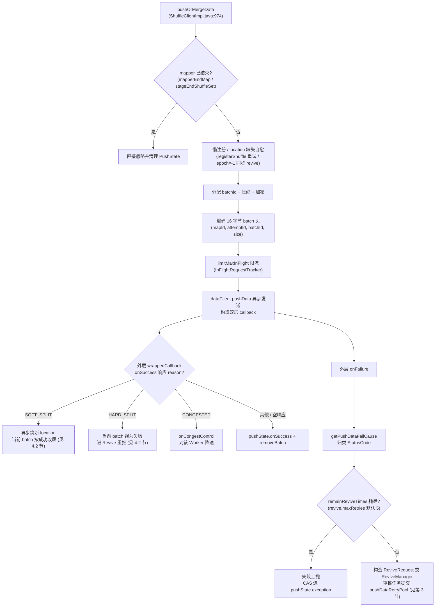
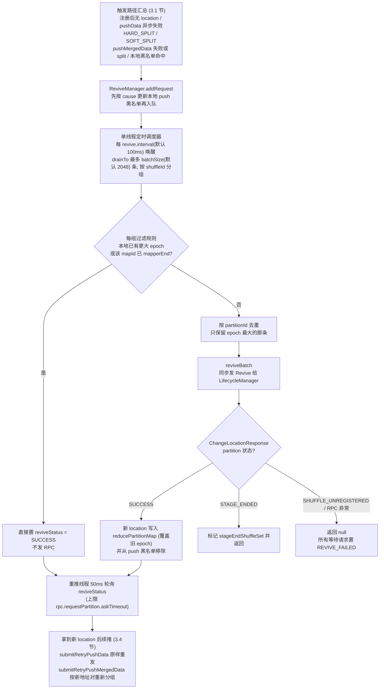
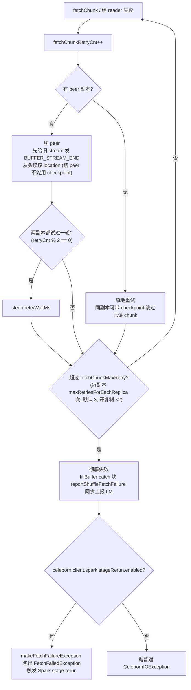

# Celeborn Client 数据平面源码阅读指南

> 基于版本 0.7.0-SNAPSHOT，整理日期 2026-08-20。
> 覆盖模块：`client/src/main/java/org/apache/celeborn/client/`、`client/src/main/java/org/apache/celeborn/client/read/`、`common/src/main/java/org/apache/celeborn/common/write/`
> 核心文件：`ShuffleClient.java`、`ShuffleClientImpl.java`、`ReviveManager.java`、`read/CelebornInputStream.java`、`read/WorkerPartitionReader.java`、`read/DfsPartitionReader.java`、`read/LocalPartitionReader.java`、`common/write/PushState.java`、`common/write/InFlightRequestTracker.java`、`common/write/DataBatches.java`

**边界说明**：控制平面（`LifecycleManager` 的 `offerAndReserveSlots` / StageEnd / Commit / ChangePartitionManager 内部实现）已由 [client-control-plane-deep-dive.md](./client-control-plane-deep-dive.md) 覆盖，本文只写数据面，LM 侧仅描述接口边界。写路径在 Executor 内的线程模型（`DataPusher`、Writer 线程、压缩等）已由 [celeborn-shuffle-pipeline.md](./celeborn-shuffle-pipeline.md) 与 [spark-shuffle-thread-model-and-metrics.md](./spark-shuffle-thread-model-and-metrics.md) 覆盖，本文不重复展开。

---

## 1. 数据面总览

### 1.1 职责边界

数据面运行在每个叶子进程内（Spark Executor、Flink TaskManager），`ShuffleClient` 是进程级单例（`ShuffleClient.java:106-138`，双重检查锁构建 `ShuffleClientImpl`）。它只关心"把字节推给 Worker / 从 Worker 把字节拉回来"：

- **写**：`pushData` / `mergeData` / `pushMergedData` / `mapperEnd`。
- **读**：`readPartition` 返回 `CelebornInputStream`，逐 chunk 拉取。
- **容错**：push 失败 Revive、SOFT/HARD_SPLIT 处理、fetch 失败重试与副本切换。
- **状态**：`PartitionLocation` 本地缓存（`reducePartitionMap`）、每 map task 的 `PushState`、fetch/push 黑名单。

资源分配、Slot 预留、Commit、StageEnd 判定全部在控制面 `LifecycleManager`，数据面通过 RPC 与其交互。

### 1.2 核心类与文件清单

| 类 | 文件 | 职责 |
|---|---|---|
| `ShuffleClient`（抽象） | `client/.../ShuffleClient.java` | 数据面 API 与进程单例；定义 `pushData`/`mergeData`/`readPartition` 等接口 |
| `ShuffleClientImpl` | `client/.../ShuffleClientImpl.java` | 唯一实现：注册 shuffle、push/merge、Revive、Split 处理、mapperEnd、GetReducerFileGroup |
| `ReviveManager` | `client/.../ReviveManager.java` | 聚合 Revive 请求，定时批量发向 LifecycleManager |
| `ReviveRequest` | `common/.../protocol/ReviveRequest.java` | 单条 revive 请求（shuffleId, mapId, attemptId, partitionId, epoch, loc, cause） |
| `PushState` | `common/.../write/PushState.java` | 每个 map task（`shuffleId-mapId-attemptId`）的 push 状态：in-flight 跟踪、batchId 分配、失败 batch 记录、CRC 累积 |
| `InFlightRequestTracker` | `common/.../write/InFlightRequestTracker.java` | in-flight 限流（总数 / 单 Worker）、batchId 自增、拥塞控制状态 |
| `DataBatches` | `common/.../write/DataBatches.java` | `pushMergedData` 的本地合并缓冲（按 primary+replica 地址对分组） |
| `LocationPushFailedBatches` | `common/.../write/LocationPushFailedBatches.java` | 记录某 location 上推送失败的 `(mapId, attemptId) -> batchIds`，供读侧去重 |
| `CelebornInputStream` | `client/.../read/CelebornInputStream.java` | 读侧门面：串接多个 `PartitionReader`，attempt 过滤与 batch 去重 |
| `WorkerPartitionReader` | `client/.../read/WorkerPartitionReader.java` | 从 Worker 读：OpenStream + 异步 fetchChunk |
| `LocalPartitionReader` | `client/.../read/LocalPartitionReader.java` | 本机磁盘直读（`celeborn.client.readLocalShuffleFile.enabled`） |
| `DfsPartitionReader` | `client/.../read/DfsPartitionReader.java` | 从 HDFS/S3/OSS 直读 |
| `PartitionReader` | `client/.../read/PartitionReader.java` | Reader 接口（`hasNext`/`next`/`close`） |

### 1.3 与 LifecycleManager 的交互点

数据面对 LM 的调用全部走 `lifecycleManagerRef.askSync`，集中在 `ShuffleClientImpl`：

| 调用 | 代码位置 | 消息 | 用途 |
|---|---|---|---|
| `registerShuffleInternal` | `ShuffleClientImpl.java:722-783` | `RegisterShuffle` / `RegisterMapPartitionTask` | 首次 push 前注册 shuffle，拿回 `PartitionLocation` 集合 |
| `reviveBatch` | `ShuffleClientImpl.java:893-968` | `Revive`（批量） | push 失败 / split 时请求新 location |
| `mapEndInternal` | `ShuffleClientImpl.java:1807-1849` | `MapperEnd` | map task 结束上报（含失败 batch、每分区 CRC/字节数） |
| `loadFileGroupInternal` | `ShuffleClientImpl.java:1874-1949` | `GetReducerFileGroup` | reducer 侧拿 `partitionId -> 所有 PartitionLocation split` 与 `mapAttempts` |
| `readReducerPartitionEnd` | `ShuffleClientImpl.java:662-689` | `PbReadReducerPartitionEnd` | 读完一个分区后上报实际读到的 CRC/字节数（完整性校验） |
| `reportShuffleFetchFailure` | `ShuffleClientImpl.java:691-705` | `PbReportShuffleFetchFailure` | fetch 彻底失败时同步上报，配合 Spark stage rerun |
| `getShuffleId` | `ShuffleClientImpl.java:639-660` | `PbGetShuffleId` | appShuffleId → 内部 shuffleId 映射（引擎侧缓存于 `shuffleIdCache`） |

LM 侧入口对照：`LifecycleManager.scala:395`（`case Revive`）→ `handleRevive`（`LifecycleManager.scala:880-931`）→ 逐 partition 委托 `changePartitionManager.handleRequestPartitionLocation`（`LifecycleManager.scala:922`）。重分配细节见控制面文档第 3.4 节。

### 1.4 总体数据流

```
 MapTask (Executor)                        Worker                LifecycleManager (Driver)
 ----------------                        ------                -------------------------
 pushData/mergeData
      │  注册(首次) ──RegisterShuffle──────────────────────────> 申请+预留 Slot
      │ <──────────── PartitionLocation[] ──────────────────────
      │  压缩/加密 + batch 头(mapId,attemptId,batchId,size)
      │ ──PushData / PushMergedData──> 写盘 + 可选复制到 peer
      │ <──ACK (可能携带 SOFT_SPLIT / HARD_SPLIT / CONGESTED)
      │  失败或 HARD_SPLIT ──Revive(批量)──────────────────────> ChangePartitionManager
      │ <──────────── 新 PartitionLocation ───────────────────── 重新分配 Slot
      │  mapperEnd(等 in-flight 清零) ──MapperEnd──────────────> 记录 attempt、触发 Commit

 ReduceTask (Executor)
 ----------------
 updateFileGroup ──GetReducerFileGroup────────────────────────> 返回全部 split + mapAttempts
      │ <──────────── ReduceFileGroups ─────────────────────────
      │  CelebornInputStream ──OpenStream / fetchChunk──> Worker（失败切 peer 副本重试）
      │  读侧过滤：attempts[mapId] 匹配 + (mapId,batchId) 去重
```

---

## 2. 写路径：pushData / pushMergedData / mapperEnd

### 2.1 主入口 `pushOrMergeData`

`pushData` 与 `mergeData` 都委托给 `pushOrMergeData`（`ShuffleClientImpl.java:974-1368`），仅 `doPush` 标志不同。先看 pushData 主流程总览：



流程拆解：

1. **mapper 已结束短路**（`:990-1002`）：`mapperEnded()` 命中（本地 `mapperEndMap` / `stageEndShuffleSet`，见 `:2137-2144`）则直接忽略并清理 `PushState`。这是处理"重跑/推测 task 晚于 StageEnd"的保护。
2. **懒注册**（`:1004-1005`）：`getPartitionLocation` 命中本地 `reducePartitionMap` 缓存，未命中走 `registerShuffle`（带 `celeborn.client.registerShuffle.maxRetries`=3、`retryWait`=3s 的重试，`registerShuffleInternal` `:722-783`）。
3. **location 缺失自愈**（`:1010-1022`）：注册后仍无该 partitionId（如 StageEnd 后重跑注册返回空 map），立即以 `-1` epoch 发起一次同步 `revive`。
4. **分配 batchId**（`:1048`）：`pushState.nextBatchId()`，同一 `(shuffleId,mapId,attemptId)` 内单调递增——这是读侧去重的 key 的一部分。
5. **压缩**（`:1050-1058`）与**加密**（`:1061-1076`）：压缩用 `ThreadLocal<Compressor>`；注意压缩/加密发生在 batch 头编码**之前**，头部 16 字节始终是明文，读侧先读头再做去重/解密（见 6.3 节注释 "Perform dedup/stale-attempt checks before decrypting"）。
6. **编码 batch 头并组装 body**（`:1078-1083`），见下节。
7. `doPush=true` 走单条 PushData（`:1085-1345`）；`doPush=false` 走本地合并（`:1346-1365`）。

### 2.2 batch 头编码

`BATCH_HEADER_SIZE = 4 * 4`（`ShuffleClientImpl.java:101`），编码在 `:1078-1083`：

```java
final byte[] body = new byte[BATCH_HEADER_SIZE + length];
Platform.putInt(body, Platform.BYTE_ARRAY_OFFSET, mapId);
Platform.putInt(body, Platform.BYTE_ARRAY_OFFSET + 4, attemptId);
Platform.putInt(body, Platform.BYTE_ARRAY_OFFSET + 8, nextBatchId);
Platform.putInt(body, Platform.BYTE_ARRAY_OFFSET + 12, length);
System.arraycopy(data, offset, body, BATCH_HEADER_SIZE, length);
```

| 偏移 | 字段 | 作用 |
|---|---|---|
| 0 | `mapId` | 读侧按 map 范围过滤、attempt 数组索引 |
| 4 | `attemptId` | 读侧 `attempts[mapId]` 比对，丢弃非成功 attempt 的数据 |
| 8 | `batchId` | map attempt 内唯一，读侧去重 |
| 12 | `size` | 载荷长度（压缩+加密后），读侧据此 skip/read |

这个头是 Exactly-Once 的基石：Worker 只做透传存储，去重全部发生在读侧（`CelebornInputStream.fillBuffer`）。

### 2.3 pushData 的异步回调（双层 callback）

`pushData` 构造两层 callback（`ShuffleClientImpl.java:1098-1312`）：

- 内层 `callback`（`:1098-1125`）：终态回调。成功时若响应带 `MAP_ENDED` 则记录本地 `mapperEndMap`；失败时把异常 CAS 进 `pushState.exception`，后续 `limitMaxInFlight`/`mapperEnd` 会读到并抛出。
- 外层 `wrappedCallback`（`:1127-1312`）：容错决策层，处理 Worker 返回的 reason 字节：
  - `SOFT_SPLIT` → 见 4.2 节；
  - `HARD_SPLIT` → 见 4.2 节；
  - `PUSH_DATA_SUCCESS_PRIMARY/REPLICA_CONGESTED` → `pushState.onCongestControl(...)`（`:1216`/`:1228`），由 `InFlightRequestTracker` 对该 Worker 降速；
  - 其他（含空响应）→ 正常成功，`pushState.onSuccess` + `removeBatch`。

`onFailure`（`:1246-1311`）的失败处理顺序：

1. 若开启 `dataPushFailureTrackingEnabled`（`celeborn.client.adaptive.optimizeSkewedPartitionRead.enabled`），先 `recordFailedBatch`（`:1247-1249`）。
2. 已有终态异常或 `InterruptedException` → 直接上抛。
3. `getPushDataFailCause`（`:2146-2185`）按异常消息前缀归类 `StatusCode`：13 个 `startsWith(StatusCode.xxx.name())` 前缀分支（PRIMARY/REPLICA、连接失败/超时/写失败/复制失败等）外加 `ExceptionUtils.connectFail` 连接异常启发式。
4. `remainReviveTimes`（初始 `celeborn.client.push.revive.maxRetries`=5，`CelebornConf.scala:5004-5010`）耗尽 → 失败上抛。
5. 否则：构造 `ReviveRequest` 交给 `ReviveManager`，并把重推任务提交到 `pushDataRetryPool`（`celeborn-retry-sender` 线程池，大小 `celeborn.client.push.retry.threads`=8）异步执行 `submitRetryPushData`——**push 失败本身不阻塞生产线程**，阻塞发生在重推线程内等 Revive 结果。

发送前还有一道本地黑名单检查 `isPushTargetWorkerExcluded`（`:286-301`）：命中 `pushExcludedWorkers` 则直接以 `PUSH_DATA_PRIMARY/REPLICA_WORKER_EXCLUDED` 失败，进入上面的 Revive 流程。worker 何时被加入黑名单见 `excludeWorkerByCause`（`:841-857`）：仅当 `celeborn.client.push.excludeWorkerOnFailure.enabled`=true（默认 false）且 cause 是连接/超时类。

### 2.4 mergeData 与 pushMergedData

小记录直接推网卡效率低，`mergeData` 先按 **(primary 地址, replica 地址) 地址对** 在 `PushState.batchesMap` 里聚合（`PushState.java:54-63`），超过 `celeborn.client.push.buffer.max.size`（默认 64KiB）触发 `doPushMergedData`；task 收尾时 `pushMergedData`（`ShuffleClientImpl.java:1442-1462`）随机打乱顺序 flush 所有残余 batch。

`doPushMergedData`（`:1464-1792`）把多条 batch 拼成 `CompositeByteBuf`，消息体携带 `partitionUniqueIds[]` 与 `offsets[]`，整个组共享一个 `groupedBatchId` 计入 in-flight。注意组内每条 batch 仍有自己的 batch 头，Worker 侧拆开存储，读侧去重粒度不变。

失败处理与 pushData 对称：整组失败 → 对**组内每条 batch** 各建一个 `ReviveRequest`（`addAndGetReviveRequests` `:402-418`），`submitRetryPushMergedData`（`:420-546`）拿到新 location 后**按新地址对重新分组**再推——Revive 后不同 partition 可能散到不同 Worker。官方文档说明 PushMergedData 目前是 all-or-nothing 语义（`docs/developers/faulttolerant.md` "Handle PushData Failure" 一节）。

### 2.5 mapperEnd

`mapperEnd` / `mapPartitionMapperEnd` 都进 `mapEndInternal`（`ShuffleClientImpl.java:1807-1849`）：

1. `limitZeroInFlight`（`:1819`）阻塞等该 map task 所有 in-flight batch 清零（超时读 `pushState.exception` 上抛）。
2. 若开完整性校验，收集每分区 CRC32 与字节数（`PushState.java:111-133`）。
3. 同步发 `MapperEnd`，携带 `pushState.getFailedBatches()`（失败 batch 集合，供 LM 随 `GetReducerFileGroupResponse` 下发给读侧去重）。
4. `finally` 中移除 `pushStates` 条目（`:1847`）。

控制面侧的 `finishMapperAttempt` / StageEnd 触发逻辑见控制面文档第 3.3 节。

---

## 3. Revive 机制

Revive 是 Celeborn push 容错的核心：push 失败**不立即判定 Worker 死亡**，而是视为临时不可用，向 LM 申请一对新 `PartitionLocation` 继续推（`docs/developers/faulttolerant.md` "Handle PushData Failure"）。先给出 Revive 闭环总览：



### 3.1 触发路径汇总

| 触发点 | cause | 代码位置 |
|---|---|---|
| 注册后无该 partition 的 location | `PUSH_DATA_FAIL_NON_CRITICAL_CAUSE_PRIMARY`（epoch=-1） | `ShuffleClientImpl.java:1010-1022` |
| pushData 异步失败 | `getPushDataFailCause` 归类的具体 cause | `ShuffleClientImpl.java:1281-1284` |
| pushData 收到 HARD_SPLIT | `HARD_SPLIT` | `ShuffleClientImpl.java:1181-1190` |
| pushData 收到 SOFT_SPLIT | `SOFT_SPLIT`（异步换新，不重推当前 batch） | `ShuffleClientImpl.java:1152-1164` |
| pushMergedData 整组失败 | 具体 cause | `ShuffleClientImpl.java:1726-1727` |
| pushMergedData 部分 split | `SOFT_SPLIT`/`HARD_SPLIT` | `ShuffleClientImpl.java:1584-1601`、`:1637-1639` |
| 目标 Worker 在本地黑名单 | `PUSH_DATA_*_WORKER_EXCLUDED` | `ShuffleClientImpl.java:286-301` |

### 3.2 ReviveManager：批量聚合

Worker 宕机瞬间会有大量 partition 同时 Revive，客户端做了聚合（对应官方文档的 BatchRevive 图）。`ReviveManager`（`ReviveManager.java:34-131`）内部是一个无界队列 + 单线程定时调度器：

- `addRequest`（`:118-126`）：先按 cause 更新本地 push 黑名单（`excludeWorkerByCause`），再入队。
- 调度器每 `celeborn.client.push.revive.interval`（默认 100ms，`CelebornConf.scala:5012-5019`）唤醒，`drainTo` 最多取 `celeborn.client.push.revive.batchSize`（默认 2048，`:5021-5027`）条，按 shuffleId 分组后**循环处理直到队列剩余不足 batchSize 一半**（`:111`）。
- 每组的过滤规则（`:72-87`）：
  - 本地已有更大 epoch 的 location（`newerPartitionLocationExists`，`ShuffleClientImpl.java:818-839`）或该 mapId 已 mapperEnd → 直接置 `reviveStatus = SUCCESS`，不发 RPC；
  - 否则按 partitionId 去重，**只保留 epoch 最大的那条**发往 LM。

等待方（`submitRetryPushData` 的重推线程）以 50ms 轮询 `request.reviveStatus`（`ShuffleClientImpl.java:320-329`），超时上限为 `celeborn.client.rpc.requestPartition.askTimeout`。

### 3.3 reviveBatch：与 LM 的接口

`reviveBatch`（`ShuffleClientImpl.java:893-968`）同步发送 `Revive` 消息并处理 `ChangeLocationResponse`：

1. 响应中的 `endedMapIds` 并入本地 `mapperEndMap`（`:916-919`）——这是客户端感知"别的 attempt 已完成该 map"的主要通道。
2. 每个 partition 按状态处理：
   - `SUCCESS`：新 location 写入 `reducePartitionMap`（覆盖旧 epoch），并从 push 黑名单移除（`:931-937`）；
   - `STAGE_ENDED`：标记 `stageEndShuffleSet` 并返回（`:938-940`）；
   - `SHUFFLE_UNREGISTERED`：返回 null，上层把所有等待请求置为 `REVIVE_FAILED`（`ReviveManager.java:94-97`）。
3. RPC 异常同样返回 null（`:949-967`）。

### 3.4 拿到新 location 后续推

- 单条 push：`submitRetryPushData`（`:303-400`）确认 revive 成功后，从 `reducePartitionMap` 取新 location，`updateLatestPartition` 把该 batch 的 in-flight 记账迁到新 Worker（`:1132-1137`），再原样重发 `PushData`（`:363-374`）。若期间 mapper 已结束，则只清理记账不再重推（`:330-339`）。
- merged push：`submitRetryPushMergedData`（`:420-546`）按新 location 的地址对重新 `computeIfAbsent` 分组（`:451-454`），逐组回调 `doPushMergedData`；仍有失败的 batch 且 `remainReviveTimes > 0` 时递归再 Revive 一轮（`:528-545`）。

**与 ChangePartitionManager 的协作边界**：客户端只发 `Revive` 消息并消费响应；LM 侧 `handleRevive`（`LifecycleManager.scala:880-931`）校验 shuffle 已注册、未 StageEnd、标记已结束 mapId 后，逐 partition 调 `changePartitionManager.handleRequestPartitionLocation` 做批量合并与 Slot 重分配（epoch+1）。这部分属于控制面，见控制面文档第 3.4 节。

---

## 4. Split：SOFT_SPLIT 与 HARD_SPLIT

Split 由 Worker 侧触发（文件超阈值 `celeborn.client.shuffle.partitionSplit.threshold` 默认 1G、磁盘空间不足、Graceful Shutdown 等），通过 push 响应的 reason 字节通知客户端。两种模式（`StatusCode.java:54-55`，`HARD_SPLIT(21)`/`SOFT_SPLIT(22)`）在客户端的行为差异：

| 维度 | SOFT_SPLIT | HARD_SPLIT |
|---|---|---|
| 当前 batch | **视为成功**（旧 epoch 继续收数据） | **视为失败**，必须重推 |
| 当前线程是否阻塞 | 否 | 是（重推线程轮询等新 location） |
| Revive 时机 | 异步提交 `ReviveManager`，后续 batch 透明切新 location | 立即 Revive 并等结果 |
| 失败 batch 记录 | 不记录 | `recordFailedBatch`（`:1177-1180`），供读侧去重 |
| 配置默认值 | `celeborn.client.shuffle.partitionSplit.mode` 默认 SOFT（`CelebornConf.scala:5330-5340`） | 同左 |

### 4.1 pushData 路径

- SOFT_SPLIT（`ShuffleClientImpl.java:1143-1167`）：先查本地是否已有更大 epoch（避免重复 Revive），没有则异步提交 Revive 请求；然后 `pushState.onSuccess` + `removeBatch`，**按成功收尾**。新 location 到位后由 `reviveBatch` 写入 `reducePartitionMap`，下一次 push 自然用到。
- HARD_SPLIT（`:1168-1206`）：提交 Revive 请求后，把当前 batch 的重推任务丢进 `pushDataRetryPool`，走与 push 失败完全相同的 `submitRetryPushData` 等待-重推路径。

### 4.2 pushMergedData 路径

merged 场景的响应可能携带 `PbPushMergedDataSplitPartitionInfo`（`:1562-1602`），逐个 partition 给出各自状态：SOFT_SPLIT 的只异步 Revive，HARD_SPLIT 的收集进 `batchesNeedResubmit` 重推。对未实现 CELEBORN-1721 的旧 Worker（响应无 partition 级信息）做了兼容：整组按 HARD_SPLIT 重推（`:1611-1616`）。全部无需重推时按 SOFT_SPLIT 成功收尾（`:1627-1629`）。

---

## 5. 读路径

### 5.1 GetReducerFileGroup / updateFileGroup

`readPartition`（`ShuffleClientImpl.java:2003-2066`）的第一步是拿到 `ReduceFileGroups`。`updateFileGroup`（`:1973-1993`）对 `reduceFileGroupsMap` 做 `compute` 缓存，未命中走 `loadFileGroupInternal`（`:1874-1949`）同步发 `GetReducerFileGroup`。响应包含四样东西（`:1910-1917`）：

- `partitionGroups`：`partitionId -> 该 partition 全部 split 的 PartitionLocation 集合`；
- `mapAttempts`：`mapId -> 成功 attemptId` 数组（Exactly-Once 的 attempt 过滤依据，LM 侧由 `handleMapperEnd` 记录，`LifecycleManager.scala:933-964`）；
- `partitionIds`：有效 partition 集合；
- `pushFailedBatches`：写侧上报的失败 batch 集合（倾斜分区读场景去重用）。

`STAGE_END_TIMEOUT` / `SHUFFLE_DATA_LOST` 状态直接转成异常（`:1930-1939`）；大响应支持广播通道（`:1897-1903`，配合 `celeborn.client.getReducerFileGroup.broadcast.enabled`）。CelebornShuffleReader 路径会提前批量建好 stream，`mapAttempts != null` 时跳过本步（`:2026-2035`）。

### 5.2 CelebornInputStream 创建与 PartitionReader 选择

`CelebornInputStream.create`（`read/CelebornInputStream.java:58-141`）按是否"无 mapRange 的倾斜分区读"（`celeborn.client.adaptive.optimizeSkewedPartitionRead.enabled`）构造 `CelebornInputStreamImpl`。构造器（`:289-361`）里确定重试上限：

```java
if (conf.clientPushReplicateEnabled()) {
  fetchChunkMaxRetry = conf.clientFetchMaxRetriesForEachReplica() * 2;
} else {
  fetchChunkMaxRetry = conf.clientFetchMaxRetriesForEachReplica();
}
```

即每副本重试 `celeborn.client.fetch.maxRetriesForEachReplica` 次（**默认 3**，`CelebornConf.scala:5236-5244`）；开复制时 ×2，主备交替。构造末尾立即 `moveToNextReader`，若开 `celeborn.client.chunk.prefetch.enabled`（默认 false）还会预取首个 chunk（`:355-360`）。

`createReader`（`:592-665`）按 `location.getStorageInfo().getType()` 分派：

| 存储类型 | Reader | 备注 |
|---|---|---|
| HDD / SSD / MEMORY | `WorkerPartitionReader` | 若 `celeborn.client.readLocalShuffleFile.enabled` 且 location 就在本机（非 MEMORY），改用 `LocalPartitionReader` 直读本地文件 |
| S3 / OSS / HDFS | `DfsPartitionReader` | 客户端直连 DFS，不经 Worker 数据面 |

`skipLocation`（`:363-380`）在 `celeborn.client.shuffle.rangeReadFilter.enabled` 时用 `PartitionLocation.mapIdBitMap` 跳过不含目标 map 范围的 location。

### 5.3 WorkerPartitionReader：openStream + fetchChunk

`WorkerPartitionReader`（`read/WorkerPartitionReader.java:50-327`）构造时若无现成 `streamHandler`，向 Worker fetch 端口发 `OPEN_STREAM`（携带 `shuffleKey`、文件名、`startMapIndex`/`endMapIndex`），换回 `streamId` 与总 chunk 数（`:136-156`）。

`fetchChunks`（`:274-319`）维持最多 `celeborn.client.fetch.maxReqsInFlight`（默认 3）个 in-flight `fetchChunk` 请求；chunk 通过 `ChunkReceivedCallback` 异步进入 `results` 阻塞队列，`next()`（`:188-233`）以阻塞 `poll(celeborn.client.fetch.pollChunk.wait)` 等待取出。**同副本重试时可带 checkpoint 跳过已读 chunk**（`celeborn.client.partition.reader.checkpoint.enabled`，`:280-291` 的注释说明了不能递减 `toFetch` 的坑）；切 peer 时不能用 checkpoint——主备相同 chunkIndex 的内容不保证一致（`:566-568` 注释）。

### 5.4 失败重试与副本切换

先看读路径失败处理总览（建 reader 与拉 chunk 两层重试逻辑一致）：



两层重试都在 `CelebornInputStreamImpl`：

- **建 reader**：`createReaderWithRetry`（`:451-527`）。失败后 `fetchChunkRetryCnt++`；有 peer 时切 peer 并先给旧 stream 发 `BUFFER_STREAM_END`（`:492-513`）；两副本都试过一轮（`retryCnt % 2 == 0`）才 sleep `retryWaitMs`（`celeborn.<module>.io.retryWait`，`:346`）。无 peer 则原地重试。超限抛 `CelebornIOException("createPartitionReader failed!")`。
- **拉 chunk**：`getNextChunk`（`:529-590`）逻辑同上；同一 location 重试会带 checkpoint 减少重复读，切 peer 则从头读该 location。这与官方文档"失败后从另一个 PartitionLocation（副本）开头重读"的描述一致（`docs/developers/faulttolerant.md` "Handle Fetch Failure"）。

读侧黑名单：`excludeFailedFetchLocation`（`ShuffleClientImpl.java:2193-2200`）仅在复制开启 + `celeborn.client.fetch.excludeWorkerOnFailure.enabled` + 关键 cause 时把 Worker 记入 `fetchExcludedWorkers`；`isExcluded`（`CelebornInputStream.java:430-449`）按 `celeborn.client.fetch.excludedWorker.expireTimeout`（回落默认 180s）过期，且刻意避免主备同时被排除（`:437-445`）。

### 5.5 fetch 彻底失败与 stage rerun

`fillBuffer` 的 catch 块（`:948-985`）在读彻底失败时调 `reportShuffleFetchFailure` **同步**上报 LM；LM 确认清理完成后，若引擎侧开了 `celeborn.client.spark.stageRerun.enabled`，用 `exceptionMaker.makeFetchFailureException` 包出 `FetchFailedException` 触发 Spark stage 重跑，否则抛普通 `CelebornIOException`。

---

## 6. Exactly-Once

Exactly-Once = 不丢 + 不重。不丢由"LM 保存同一 partitionId 的全部 split + 每个 split 至少一副本 Commit 成功"保证（控制面职责）；不重由读侧两层过滤保证，实现在 `CelebornInputStreamImpl.fillBuffer`（`CelebornInputStream.java:820-986`）。

### 6.1 attempt 过滤

`mapAttempts` 数组来自 `GetReducerFileGroupResponse`，`attempts[mapId]` 是 LM 记录的该 mapId 唯一成功 attempt（多个 attempt 并发/先后 push 同一 mapId 的数据是常态：推测执行、task 重跑）。读侧在解密**之前**直接跳过不匹配的 batch（`:849-851`）：

```java
if (attemptId != attempts[mapId]) {
  currentChunk.skipBytes(size);
  continue;
}
```

### 6.2 (mapId, batchId) 去重

同一 batch 可能因"Worker 已写但 ACK 丢失 → 客户端重推"而重复存在于不同 split 中。读侧用 `batchesRead: Map<Integer mapId, Set<Integer batchId>>`（`:191`）记录已读 batch，重复即跳过并计入 `incDuplicateBytesRead`（`:868-878`）：

```java
Set<Integer> batchSet = batchesRead.computeIfAbsent(mapId, k -> new HashSet<>());
if (batchSet.contains(batchId)) {
  callback.incDuplicateBytesRead(BATCH_HEADER_SIZE + encryptedSize);
  currentChunk.skipBytes(size);
  continue;
}
```

去重 key 是 (mapId, batchId) 而非 (mapId, attemptId, batchId)，因为上一步已把非成功 attempt 的数据滤掉。

### 6.3 补充机制：failedBatches 与完整性校验

- 倾斜分区拆分读（无 mapRange）时，同一 location 的重复 batch 无法靠全局 `batchesRead` 覆盖（多个子流并发读同一 location），改用写侧上报的 `LocationPushFailedBatches` 过滤（`:853-867`）。
- 若开 `celeborn.client.shuffle.integrityCheck.enabled`（默认 false），读侧在 `fillBuffer` 中对每 batch 明文累积 CRC/字节数（`:935-937`），分区读完时 `validateIntegrity`（`:754-782`）通过 `readReducerPartitionEnd` RPC 与写侧 `mapperEnd` 上报的值比对，实现端到端完整性校验。

---

## 7. 关键配置一览

以下默认值均逐条核实自 `common/src/main/scala/org/apache/celeborn/common/CelebornConf.scala`（当前工作树）：

| 配置项 | 默认值 | 作用位置 | 说明 |
|---|---|---|---|
| `celeborn.client.push.replicate.enabled` | false | ShuffleClientImpl | 是否双写副本；开启时 push 超时 ×2（`ShuffleClientImpl.java:210-214`）、fetch 重试 ×2 |
| `celeborn.client.push.buffer.max.size` | 64k | PushState/DataPusher | 单分区 push 缓冲；mergeData 触发阈值 |
| `celeborn.client.push.maxReqsInFlight.total` | 256 | InFlightRequestTracker | 全局限流 in-flight push 请求数 |
| `celeborn.client.push.maxReqsInFlight.perWorker` | 32 | InFlightRequestTracker | 单 Worker 限流 |
| `celeborn.client.push.timeout` | 120s | ShuffleClientImpl | 单次 pushData RPC 超时 |
| `celeborn.client.push.revive.maxRetries` | 5 | ShuffleClientImpl | 单 batch push 失败的最大 Revive 次数 |
| `celeborn.client.push.revive.interval` | 100ms | ReviveManager | 批量 Revive 调度间隔 |
| `celeborn.client.push.revive.batchSize` | 2048 | ReviveManager | 单次批量 Revive 的最大 partition 数 |
| `celeborn.client.push.retry.threads` | 8 | ShuffleClientImpl | 重推线程池（`celeborn-retry-sender`）大小 |
| `celeborn.client.push.excludeWorkerOnFailure.enabled` | false | ShuffleClientImpl | push 失败是否把 Worker 加入本地黑名单 |
| `celeborn.client.registerShuffle.maxRetries` | 3 | ShuffleClientImpl | 注册 shuffle 重试次数 |
| `celeborn.client.registerShuffle.retryWait` | 3s | ShuffleClientImpl | 注册重试间隔 |
| `celeborn.client.shuffle.partitionSplit.threshold` | 1G | Worker（触发）/ Client（响应） | 分区文件分裂阈值 |
| `celeborn.client.shuffle.partitionSplit.mode` | SOFT | Worker（触发）/ Client（响应） | 分裂模式 SOFT/HARD |
| `celeborn.client.fetch.maxRetriesForEachReplica` | 3 | CelebornInputStream | 每副本 fetch 重试次数（开复制时总上限 ×2） |
| `celeborn.client.fetch.maxReqsInFlight` | 3 | WorkerPartitionReader | fetchChunk 并发 in-flight 数 |
| `celeborn.client.fetch.timeout` | 600s | WorkerPartitionReader | openStream / fetchChunk 超时 |
| `celeborn.client.fetch.excludeWorkerOnFailure.enabled` | false | ShuffleClientImpl | fetch 失败是否拉黑 Worker |
| `celeborn.client.fetch.excludedWorker.expireTimeout` | 180s（回落） | CelebornInputStream | fetch 黑名单过期时间 |
| `celeborn.client.partition.reader.checkpoint.enabled` | false | WorkerPartitionReader | 同副本重试时跳过已读 chunk |
| `celeborn.client.chunk.prefetch.enabled` | false | CelebornInputStream | 建流时预取首 chunk |
| `celeborn.client.shuffle.rangeReadFilter.enabled` | false | CelebornInputStream | mapRange 读时按 mapIdBitMap 过滤 location |
| `celeborn.client.readLocalShuffleFile.enabled` | false | CelebornInputStream | 本机直读 Worker 磁盘文件 |
| `celeborn.client.shuffle.integrityCheck.enabled` | false | PushState / CelebornInputStream | 端到端 CRC 完整性校验 |
| `celeborn.client.adaptive.optimizeSkewedPartitionRead.enabled` | false | ShuffleClientImpl / CelebornInputStream | 倾斜分区拆分读 + 失败 batch 跟踪 |
| `celeborn.client.rpc.requestPartition.askTimeout` | 回落 `celeborn.rpc.askTimeout` | ShuffleClientImpl | Revive/PartitionSplit RPC 超时，也是重推线程等待上限 |

---

## 8. 可优化点与代码债务

> 本节条目已于 2026-09 对照当前代码逐项核查。数据面主路径整体健康，没有 P0 级问题；最有价值的是 P1 两项（Revive/重推等待机制，可合并为一次改造）。
> **边界说明**：压缩串行、后台解压、读写观测缺口等 Executor 内 pipeline 层优化已由 [celeborn-shuffle-pipeline.md](./celeborn-shuffle-pipeline.md)（写侧与读侧两部分）覆盖，本节不重复；`performance-optimization-analysis.md` 第 5 节中与本文重叠的条目已逐条复核，过时前提列入文末附表。

### P1：推荐优先实施

#### 8.1 pushDataRetryPool：固定 8 线程 + 无界队列 + 线程内 50ms 轮询等待

**代码位置**：`ShuffleClientImpl.java:232-234` → `ThreadUtils.scala:165-179`

```java
pushDataRetryPool =
    ThreadUtils.newDaemonCachedThreadPool("celeborn-retry-sender", pushDataRetryThreads, 60);
```

名为 cached 实为固定线程池：core=max=`celeborn.client.push.retry.threads`（默认 8），队列是**无界 `LinkedBlockingQueue`**（`ThreadUtils.scala:174`）。每个失败 batch 提交一个任务，任务体 `submitRetryPushData` 内是 `while` 循环 50ms sleep 轮询 `request.reviveStatus`（`ShuffleClientImpl.java:317-329`，上限 `client.rpc.requestPartition.askTimeout`，回落 60s），且任务闭包 retained 整个 batch `body` byte[]（`:1200`、`:1291`）。

问题：Worker 宕机瞬间，该 Executor 上所有 in-flight push 同时失败——8 个线程各自被 sleep 轮询占满最长 ~60s，后续失败任务全部进无界队列排队，每个排队任务 retained 一个最大 64KiB+ 的 batch buffer。失败风暴期间内存随失败 batch 数线性增长，且重推延迟被排队时间放大（队头阻塞）。

**优化方向**：
- 等待与重推解耦：`ReviveRequest` 加 `CompletableFuture`/latch，`ReviveManager` 置状态后由回调线程直接提交重推，重推任务本身不再阻塞等待（与 8.2 一次改造完成）；
- 队列改有界，满时直接走 `onFailure` 上抛（batch 已记 failedBatch，可安全失败）。

#### 8.2 Revive 等待机制事件驱动化：100ms 固定 tick + 等待方 50ms 轮询

**代码位置**：`ReviveManager.java:40-42`、`:113-115`；`ShuffleClientImpl.java:317-329`、`:434-487`

ReviveManager 单线程调度器 `scheduleWithFixedDelay` 固定每 `revive.interval`（默认 100ms）唤醒，队列非空也不会提前触发；等待方（重推线程）以 50ms 轮询 `volatile int reviveStatus`（`ReviveRequest.java:30`）。一次 Revive 的端到端附加延迟 = 等下一次 tick（0~100ms）+ RPC + 轮询发现延迟（0~50ms），最坏 ~150ms+RPC。Worker 宕机时大批量 batch 走这条路径，map task 收尾被拉长。

**优化方向**：
- 队列非空时立即触发调度（到点或信号唤醒，取代纯固定间隔）；
- `ReviveRequest` 内置 `CountDownLatch`/`CompletableFuture`，置状态后 countDown，等待方 `latch.await(dueTime)` 取代轮询。

### P2：小而安全的改进

#### 8.3 `batchesRead` 去重结构 HashSet → RoaringBitmap

**代码位置**：`CelebornInputStream.java:191`、`:868`、`:923`

读侧 Exactly-Once 去重用 `Map<Integer, Set<Integer>>`（HashMap + HashSet + 装箱 Integer），条目数 = mapId 数 × 每 map batch 数，每个 reducer 输入流全程持有；大 shuffle（数万 map）下可达数十万~百万级条目，每条约 40+ 字节节点开销。`RoaringBitmap` 已是本类依赖（`:34` 用于 `mapIdBitMap`），且 batchId 在 map attempt 内单调递增，位图压缩率极高。

**优化方向**：
- 改为 `Map<Integer, RoaringBitmap>`，仅动读侧内存结构，风险低。

#### 8.4 死代码清理（零风险顺手做）

- `CelebornInputStream.java:834`：`fillBuffer` 每次调用分配一个**从未被读取**的 `LocationPushFailedBatches`（`:854` 实际用的是 `this.failedBatches`）；
- `CelebornInputStream.java:175`：`private static final Random RAND` 从未使用；
- `ShuffleClientImpl.java:136`：字段 `splitting` 全文件仅在 `cleanupShuffle`（`:1868`）中被 remove，从未写入。

**优化方向**：
- 直接删除，顺带消除每 batch 一次的多余分配。

#### 8.5 `DfsPartitionReader` 背压 `Thread.sleep(50)` 忙等

**代码位置**：`DfsPartitionReader.java:259-261`

```java
while (results.size() >= fetchMaxReqsInFlight) {
  Thread.sleep(50);
}
```

DFS 读路径消费端慢于读取时，fetch 线程忙轮询退避，每个 chunk 最多多等 50ms。`:283` 已是 `results.put(...)`，把 `results` 换成有界 `LinkedBlockingQueue(maxReqsInFlight)` 即可获得天然阻塞背压，删掉忙等循环。

**优化方向**：
- 有界队列 + 阻塞 put 取代 size 检查 + sleep。

#### 8.6 `DfsPartitionReader` 每 chunk 裸 `new byte[]`（上限 8MB）无池化

**代码位置**：`DfsPartitionReader.java:265`

每读一个 chunk 分配一个裸 `byte[]`，chunk 上限 = `celeborn.client.fetch.dfsReadChunkSize`（默认 8m，`CelebornConf.scala:3275-3281`）。大 reduce 的 DFS 直读场景下是持续的 8MB 级堆分配，GC 压力明显。

**优化方向**：
- 改用池化 `ByteBuf` 分配（allocator 分配后 `wrappedBuffer` 路径改为直接读入 ByteBuf），或复用缓冲。

#### 8.7 三个 reader 的 poll 等待不一致，且空等计入 readTime 指标

**代码位置**：`WorkerPartitionReader.java:102,202`（用配置 `clientFetchPollChunkWaitTime`，默认 500ms）vs `DfsPartitionReader.java:301`（硬编码 500ms）vs `LocalPartitionReader.java:230`（硬编码 100ms）

三处语义相同的等待，两个硬编码不可配。另外三者都在 poll 循环里对**每次** poll（包括超时空手而归）调用 `metricsCallback.incReadTime(waitTimeMs)`（如 `WorkerPartitionReader.java:203-204`），空等超时被计入 readTime，污染度量。

**优化方向**：
- 统一读 `clientFetchPollChunkWaitTime`；`incReadTime` 只在实际拿到 chunk 时统计。

#### 8.8 `InFlightRequestTracker` 的 sleep 轮询与一处 OR/AND 逻辑疑点

**代码位置**：`InFlightRequestTracker.java:157`、`:222`、`:147-151`

- `limitMaxInFlight` / `limitZeroInFlight` 均为 `Thread.sleep(delta)` 轮询（delta 默认 50ms，`celeborn.client.push.limit.inFlight.sleepInterval`），饱和时唤醒延迟有 ≤50ms 量化误差；锁粒度本身无问题（CHM + LongAdder）。改条件变量/信号量收益中等。
- **逻辑疑点** `:147-151`：放行条件是 `(请求数达标) || (bytes 开关开 && 字节数达标)`——开启 `client.push.maxBytesSizeInFlight.enabled`（默认 false）后，只要字节数在限内，**请求数超限也会放行**，两个限流维度互相削弱，疑似应为 `&&`。

**优化方向**：
- OR/AND 语义先向社区确认（可能是刻意"任一维度达标即放行"）再动；轮询改信号量属锦上添花。

### P2：低优先级与边界项

#### 8.9 非 Spark 引擎下 `reducePartitionMap` / `mapperEndMap` 等只增不清

清理入口只有 `cleanupShuffle`（`ShuffleClientImpl.java:1862-1872`），全仓库唯一调用方是 Spark 的 `ExecutorShuffleIdTracker.unregisterAppShuffleId`（`ExecutorShuffleIdTracker.java:43`）。Flink/MR/Tez 侧无 shuffle 级清理调用（`FlinkShuffleClientImpl` 只覆写 per-task 的 `cleanup(shuffleId, mapId, attemptId)`），`mapperEndMap`、`reducePartitionMap`、`stageEndShuffleSet`、`reduceFileGroupsMap` 在 TM/Executor 进程内随 shuffleId 单调增长。`pushStates` 无泄漏（`mapEndInternal` finally `:1847` 移除）。

**优化方向**：
- 为各引擎补齐 shuffle 级清理钩子（如 Flink 在 JobMaster 释放 shuffle 时回调），或客户端加 shuffleId 空闲过期。

#### 8.10 pushData 每 batch 一次完整 payload 拷贝

**代码位置**：`ShuffleClientImpl.java:1078-1083`

单条 pushData 路径 `new byte[16 + length]` + `arraycopy` 全量拷贝 payload；而 `doPushMergedData` 已用 `CompositeByteBuf` 零拷贝拼接（`:1487-1496`），说明协议层支持 composite buffer。

**优化方向**：
- header（16B）+ payload 用 composite buffer 复合，省掉热路径上每次最大 64KiB+ 的 memcpy 与堆分配；需验证单条路径下游对 composite buffer 的处理（merged 路径已验证可行）。

#### 8.11 `getPushDataFailCause` 依赖异常消息字符串前缀匹配

**代码位置**：`ShuffleClientImpl.java:2146-2185`、`ExceptionUtils.java:71-75`

失败归类依赖"异常消息以 `StatusCode` 枚举名开头"这一**非契约性约定**：Worker 侧或 Netty 层改消息格式会静默落入 `PUSH_DATA_FAIL_NON_CRITICAL_CAUSE_PRIMARY` 兜底，错误归类直接影响 Revive 决策与黑名单行为。仅失败路径，性能开销可忽略，属正确性债务。

**优化方向**：
- `CelebornIOException` 已携带 `StatusCode` 字段的场景直接读字段，字符串匹配仅作兜底；补单测锁定消息格式。

#### 8.12 `createReaderWithRetry` 与 `getNextChunk` 重试/切副本逻辑大面积重复

**代码位置**：`CelebornInputStream.java:456-527` vs `:529-590`

两块"失败 → `fetchChunkRetryCnt++` → 有 peer 切 peer、`retryCnt % 2 == 0` 才 sleep、无 peer 原地重试"的逻辑近乎逐行重复；且 `getNextChunk` 的 catch 里又回调 `createReaderWithRetry`（`:568`、`:580-584`），两层循环共享同一 `fetchChunkRetryCnt`，控制流嵌套难读，改一处忘改另一处即引入不一致。

**优化方向**：
- 抽取公共的"失败后下一动作（切 peer / 原地 / 终止）"决策函数；需补失败路径测试。

#### 8.13 `LocalPartitionReader` 不支持 checkpoint，本机直读重试从头读

**代码位置**：`LocalPartitionReader.java:307-309`（返回 `Optional.empty()`，带 TODO）；`CelebornInputStream.java:619-629`（构造时不传 checkpointMetadata，对比 `:631-644` 的 WorkerPartitionReader）

开启 `readLocalShuffleFile.enabled`（默认 false）后，"同副本带 checkpoint 跳过已读 chunk"的重试优化对本地读无效，重试只能从头读该 location。

**优化方向**：
- 按 `:308` 的 TODO 补齐 checkpoint 支持，复用 `PartitionReaderCheckpointMetadata`。

#### 8.14 `DataBatches.requireBatches()` 置 null 的并发窗口

**代码位置**：`DataBatches.java:51-56`（无参 `requireBatches` 把 `batches` 置 `null`，**非 synchronized**）vs `addDataBatch`（`synchronized`，`:41`）

调用序列 `ShuffleClientImpl.java:1350-1353`（`computeIfAbsent → addBatchData → takeDataBatches → requireBatches`）中，若同 mapKey 有并发 merge，第二个线程可在 remove 前拿到旧实例引用，随后 `addDataBatch` 命中已置 null 的 `batches`（NPE）或写入已摘除实例导致 batch 静默丢失。实际 Spark 写路径每 task 单线程，属潜伏鲁棒性债务而非现实 bug。

**优化方向**：
- 无参 `requireBatches` 置空新 list 而非 null，或整体加 synchronized。

### 附：核查后排除的候选

以下候选看似是问题，经对照当前代码核查后不成立或不值得做，不建议重新引入：

| 候选 | 排除原因 |
|---|---|
| `WorkerPartitionReader` 无界 `results` 队列 OOM（`performance-optimization-analysis.md` §5.6） | 伪问题：入队只发生在已发出 fetchChunk 请求的回调（`WorkerPartitionReader.java:110-119`），`fetchChunks` 以 in-flight 限流（`:274-277`），队列长度恒 ≤ maxReqsInFlight+1（默认 4 个 chunk ≈ 32MB），改有界队列不增加任何实际背压。附带发现 `:277` 的 `+1` 使实际 in-flight 峰值为 max+1，与配置语义略有偏差，属低价值微调 |
| `fetchChunkMaxRetry` "每副本 3 次"语义疑虑 | 推演验证正确：开复制时上限 ×2=6，每次失败主备交替切换，retryCnt 1→6 恰好主 3 次备 3 次；`retryCnt % 2 == 0` 才 sleep 是"两副本各试一轮才退避"的有意设计 |
| `DfsPartitionReader` 每次 next 开新流 | 不成立：流在构造器打开一次，单后台线程顺序读，仅失败时 reopen（`DfsPartitionReader.java:270-273`） |
| `reportShuffleFetchFailure` 同步 RPC 阻塞读线程 | 语义必需：必须等 LM 确认清理完成才能决定抛 `FetchFailedException` 触发 stage rerun（`CelebornInputStream.java:963-973`），仅彻底失败路径触发一次 |
| `pushMergedData` 随机打乱分组顺序的成本 | task 收尾执行一次，O(组数) 常数开销；随机化是避免多 task 同时压同一 Worker 的有意设计（`ShuffleClientImpl.java:1449-1461`） |
| `ReviveManager` 空转 tick / `addRequest` 吞 `InterruptedException` | 单线程 100ms 空循环开销可忽略；无界队列 `put` 永不阻塞，该异常不可达，纯防御代码 |
| 批量 Push API / ZSTD 压缩 / LocationCache（`performance-optimization-analysis.md` §5.7） | 跨 batch 聚合已由 `pushMergedData` + `DataBatches` 实现；ZSTD 已是默认压缩编解码（`CelebornConf.scala:5342-5355`）；location 缓存已有 `reducePartitionMap.computeIfAbsent`（`ShuffleClientImpl.java:616-624`） |
| `newerPartitionLocationExists` 内的随机 sleep（`ShuffleClientImpl.java:824-832`） | 仅 SOFT_SPLIT 去重路径的有意退避，低频，无优化价值 |

---

## 9. 阅读建议与延伸阅读

### 9.1 阅读路径建议

1. **先读 `ShuffleClient.java` 接口与 `ShuffleClientImpl` 字段声明**（`:74-191`）：`reducePartitionMap`、`mapperEndMap`、`pushStates`、两个黑名单集合，是理解全文的地图。
2. **顺一条 pushData**：`pushOrMergeData`（`:974`）→ batch 头编码（`:1078`）→ 双层 callback（`:1098`/`:1127`），再看 `onFailure` 如何接入 Revive。
3. **读 Revive 闭环**：`ReviveManager.addRequest` → 定时批量 → `reviveBatch` → `submitRetryPushData` 重推，注意 epoch 比较与 mapperEnd 短路两个出口。
4. **对照读一条 fetch**：`updateFileGroup` → `CelebornInputStream.create` → `WorkerPartitionReader`（openStream/fetchChunk）→ `fillBuffer` 的两层去重。
5. **最后读 Split 分支**：在已理解 Revive 的前提下，SOFT/HARD 只是"当前 batch 算成功还是算失败"的区别。

### 9.2 延伸阅读

- [client-control-plane-deep-dive.md](./client-control-plane-deep-dive.md) — 本文所有 RPC 在 LifecycleManager 侧的处理（Revive 重分配、Commit、StageEnd）
- [celeborn-shuffle-pipeline.md](./celeborn-shuffle-pipeline.md) / [spark-shuffle-thread-model-and-metrics.md](./spark-shuffle-thread-model-and-metrics.md) — 写路径在 Executor 内的线程模型与 `DataPusher`
- [network-and-protocol-deep-dive.md](./network-and-protocol-deep-dive.md) — `PushData`/`PushMergedData`/`fetchChunk` 的底层 Netty 协议
- [docs/developers/shuffleclient.md](./docs/developers/shuffleclient.md) — 官方数据面设计（Push/Merge、Split、Read）
- [docs/developers/faulttolerant.md](./docs/developers/faulttolerant.md) — 官方容错设计（Revive、BatchRevive、Fetch 重试、Exactly-Once）
- [docs/developers/storage.md](./docs/developers/storage.md) — chunk 文件布局与多级存储，解释为何切副本必须从头读
