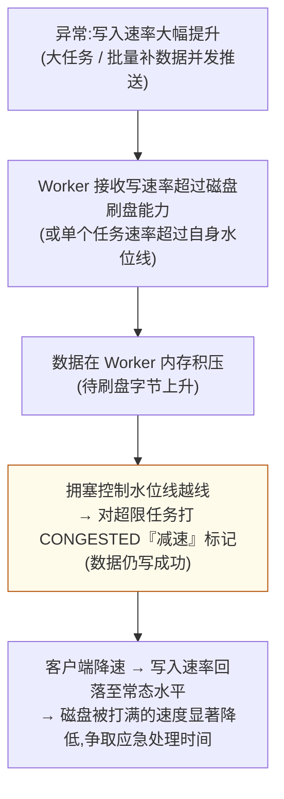
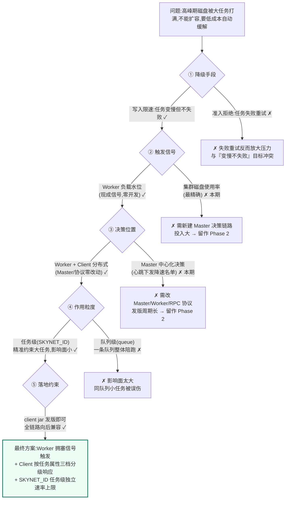
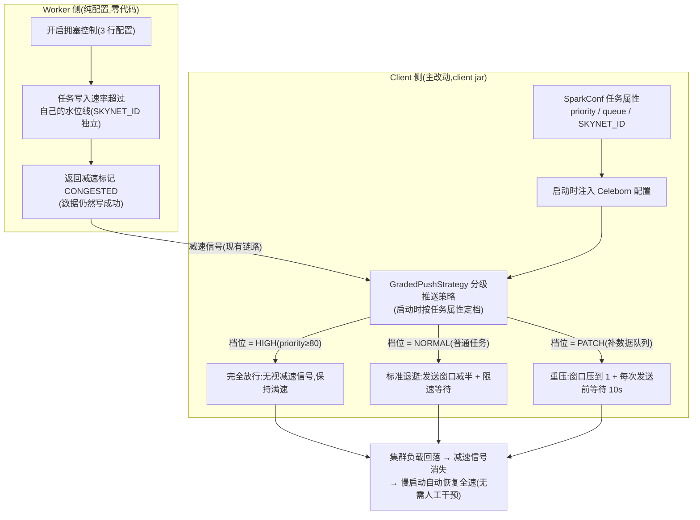
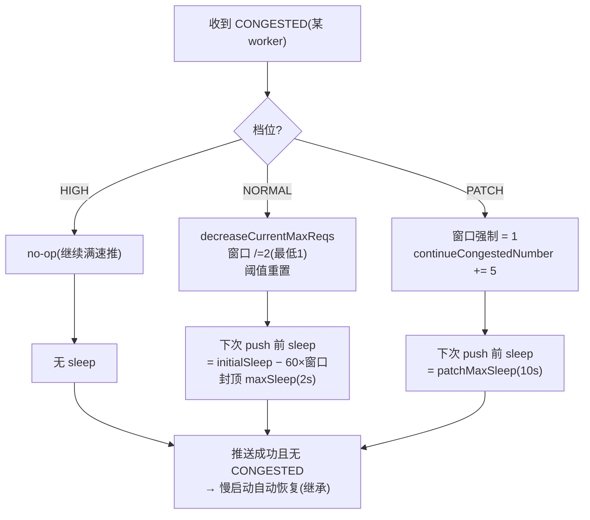

# 技术立项文档:Celeborn 集群高峰期自动降级控制

> **版本**:v3.0(立项评审版) · **日期**:2026-10-27 · **基线**:Apache Celeborn 0.7.0-SNAPSHOT
> **一句话结论**:复用 Celeborn 现有拥塞控制信号做触发器,客户端按任务属性(Spark 原生标签)三档分级响应——高优放行、普通退避、补数据重压,并按任务粒度(SKYNET_ID)给每个任务独立速率上限,精准约束大任务。**Master 与 RPC 协议零改动,发一个 client jar 即可上线。**

---

## 一、项目背景

**挑战**:正常情况下,集群写入速率与磁盘消化能力相匹配,磁盘处于**安全水位**,增长平缓、不会快速打满;**异常**在于写入速率大幅跃升——业务突发提交的大任务与**批量并发执行的补数据任务**,瞬时写入速率远超其他任务,把磁盘快速推向打满。从集群告警到磁盘打满往往只有**分钟级**,平台 SRE/研发应急处理时间不够,影响面容易扩大——全集群任务变慢,甚至大量任务失败。受成本约束短期不能扩容,需要一个**高峰期自动降级措施**:在磁盘逼近危险水位前主动让低优先级任务让路,争取更多应急处理时间,把影响面降到最低。

**现状缺口**(Celeborn 0.7.0 已核实):Worker 已有拥塞控制机制(测用户写入速率,超限打"减速"标记 CONGESTED——"写成功但请减速",客户端自动退避),但:

1. **默认关闭**——高峰期它本会被触发(因果链见 3.1),却处于关闭状态,需开启配置;
2. **不看优先级,谁快压谁**——高峰期高优大任务同样会被压;
3. **任务属性没有进来**——Celeborn 不知道任务的优先级/队列/业务节点(`spark.yarn.priority` / `spark.yarn.queue` / `spark.emr.SKYNET_ID`)。

→ 方案要解决两件事:**把任务属性带进来**,**按属性差异化响应**。

## 二、项目目标与收益

**总目标**:磁盘逼近危险水位前,自动让低优先级任务让路,高优任务零影响,为 SRE/研发争取更多应急处理时间,把影响面降到最低。

**项目收益(全部量化验收)**:

| # | 收益 | 量化指标(目标值) | 度量口径 |
|---|------|------------------|----------|
| 1 | **争取应急处理时间** | 高峰期集群磁盘写入增速较基线下降 **≥30%** | 大盘磁盘增速曲线对齐降级开关时间轴;基线取生产观察期("五、项目时间轴")采集值 |
| 2 | **高优任务零影响** | `priority≥80` 任务写吞吐偏差 **≤5%**,任务成功率不变 | Spark Shuffle Write 指标,降级前后对比 |
| 3 | **降级不伤任务** | 被降级任务成功率 **100%**(0 失败、0 重试、0 丢数据) | 任务运行结果 + 失败日志 |
| 4 | **全自动零人工干预** | 降级触发与恢复全程 **0 次人工介入**(信号消失后速率自动恢复) | `UserProduceSpeed`(任务粒度)时间轴,现有大盘 `CongestionRelatives` panel |

> 目标值为立项初始值,待生产观察期采集真实速率基线后最终锁定。
> 定性补充(不计入验收):不扩容、Master/协议零改动(摘配置即回滚);客户端分级能力可被 Phase 2(磁盘水位直读)直接复用。

**非目标(本期不做)**:磁盘使用率直读触发(Phase 2);对读路径(fetch)限速;准入控制/拒绝分配;自动扩容调度。

## 三、项目方案

### 3.1 高峰期为什么能触发降级:信号因果链

本方案的触发器是 Celeborn Worker **现有**的拥塞控制机制。先说清常态与异常,再看信号如何传导:

> **常态**:写入速率与磁盘消化能力相匹配 → 磁盘处于安全水位,增长平缓,不会快速打满。
> **异常**:数据写入速率**大幅提升**(大任务 / 批量补数据),超出磁盘消化能力 → 磁盘被快速推向打满。
> **降速的本质 = 把异常的写入速率压回常态水平,从而降低节点磁盘被打满的速度**,为应急处理争取时间。

异常发生时,信号在集群内的传导因果链:



具体有两条触发路径:

| 路径 | 触发条件 | 说明 |
|------|---------|------|
| **a · 任务级水位线**(本方案主路径) | 单个任务写入速率超过自己的水位线 | 最小 3 行配置启用的就是这条;每个任务独立水位线(见 3.5) |
| **b · Worker 全局水位线**(可选叠加) | "大部分节点负载打满":内存积压或 Worker 总吞吐超水位 → 点名超均值的用户 | 对应"集群高峰"的整体信号;不配则该路径不启用(默认不触发) |

**与项目背景三个缺口的承接**:这套机制现在就在代码里,但**默认关闭、水位线默认不设**(背景缺口 1)→ 本方案第一步 = 3 行配置把它打开;它不看优先级(缺口 2)、看不到任务属性(缺口 3)→ 所以还需要客户端分级响应。机制细节(判定路径、迟滞、自动恢复闭环)见**附录 A**。

### 3.2 方案选型

围绕背景提出的两件事——**把任务属性带进来、按属性差异化响应**——方案推导经过 5 个关键决策点,每个都考察了两个以上选项:



| 决策点 | 选择 | 一句话理由 |
|--------|------|-----------|
| ① 降级手段 | 写入限速 | 任务变慢但不失败,不触发重试风暴 |
| ② 触发信号 | Worker 负载水位(内存积压/写吞吐) | 现成机制零开发;磁盘使用率直读留作 Phase 2(见"七、其他") |
| ③ 决策位置 | Worker 打标 + Client 分级响应 | Master/RPC 协议零改动,发 client jar 即可 |
| ④ 作用粒度 | 任务级(SKYNET_ID) | 精准约束单个大任务,不牵连同队列小任务 |
| ⑤ 落地约束 | 最小破坏、尽快上线 | 成本受限背景下先拿到 80% 收益,再演进 |
| 压制力度 | 三档(放行/标准退避/重压) | 高优零影响、普通可控、patch 近乎暂停 |
| 配置方式 | 规则随 job conf;水位线支持热更新 | 高峰日临时收紧水位线无需重启 |

> 说明:决策②选的 Worker 负载水位是"集群高峰"的**代理信号**(写吞吐/内存积压),不是磁盘使用率本身——它反映"现在写不动了",大多数场景与磁盘压力同向。要求磁盘使用率直读的自动化,见"七、其他"Phase 2。

**候选方案完整对比**:

| 维度 | 方案一【Phase 0 · 纯配置】 | 方案二【Master 中心化决策】 | **方案三【Client 分级降级】(选定)** |
|------|---------------------------|----------------------------|-------------------------------------|
| **核心思路** | 任务属性配到用户身份上(queue→userName),直接开现有拥塞控制 + 队列水位线,零代码 | 任务标签随注册上报 → Master 聚合全集群**磁盘使用率**迟滞判定(80% 进/70% 出)→ Worker 心跳下发"降速任务名单" → Worker 打减速标记 | Worker 用现有拥塞信号打标(纯配置),客户端新增**分级推送策略**按任务属性三档响应;用户身份改 SKYNET_ID,速率上限落到每个任务头上 |
| **代码改动** | **零**(纯配置) | Master + Worker + RPC 协议与双端编解码,约 11 个文件 | common 3 文件小改 + client-spark 1 文件小改 + Worker 2 处修复(~15 行)+ 内部 jar 2 个新类(~160 行) |
| **触发信号** | Worker 负载水位(代理) | **集群磁盘使用率直读(最准)** | Worker 负载水位(代理) |
| **生效延迟** | 随水位即时 | 决策周期 + 心跳广播,≤60s | 随水位即时 |
| **高优豁免** | ✗(谁快压谁,高优大任务一样被压) | ✓(名单可按优先级圈选) | ✓(priority≥80 无视减速信号) |
| **patch 补数据加重** | ✗ | ✓ | ✓(重压档 ≈0.1MB/s,近乎暂停但不失败) |
| **任务级精准限速** | ✗(只能到队列粒度) | ✓ | ✓(SKYNET_ID 每任务独立水位线,不误伤同队列小任务) |
| **运行中动态调档** | 水位线可热改 | 名单 + 水位均可热改 | 水位线可热改;分级规则对**新任务**生效 |
| **主要风险** | 压错人(无优先级概念) | 改动面大、发版周期长、需 Master/Worker 双端升级 | 触发是代理信号;分级规则运行中不可变 |
| **上线周期** | **当天** | **2-4 周** | **2-3 周(含灰度)** |
| **定位** | 过渡:当天拿到部分收益 | 演进:Phase 2 触发准确性升级 | **本期落地**:最小改动下同时拿到三个关键能力 |

**选型结论**:方案三先行——在"最小改动"约束下同时拿到**高优豁免、patch 加重、任务级限速**三个关键能力;方案一可作当天上线的过渡;方案二作为 Phase 2 演进(触发准确性升级),与方案三**天然叠加、互不推翻**(Phase 2 落地后:Worker 决定"谁该被压",Client 继续决定"压到什么程度")。

### 3.3 总体架构

选型结论(Worker 打标 + Client 分级响应)落地为以下端到端架构:



两个贯穿性的关键性质:

- **数据不丢**:减速标记写在"写成功"的响应里,Worker 从不拒绝、从不丢数据;低优任务只是变慢,最终成功;
- **自动恢复**:客户端是类 TCP 慢启动——收到信号退避,信号消失后速率自动指数恢复,全程无需人工干预。

### 3.4 三档分级规则

| 档位 | 判定(任务属性) | 收到减速信号时的行为 | 实际吞吐量级 |
|------|----------------|---------------------|--------------|
| **HIGH** | `spark.yarn.priority ≥ 80` | 无视信号,保持满速 | 与未开降级完全一致 |
| **NORMAL** | 其余任务 | 标准退避:发送窗口减半(最低 1)+ 约 2s 等待 | ≈ 0.5MB/s/executor(正常为百 MB 级) |
| **PATCH** | `spark.yarn.queue` ∈ patch 名单 | 重压:窗口直接压到 1 + 每次发送前等待 10s | ≈ 0.1MB/s,近乎暂停写但不失败 |

档位在任务启动时按属性确定,整个任务生命周期一致(priority/queue 是任务级属性,运行期不变)。

### 3.5 任务粒度:每任务独立速率上限

用户身份从"共享用户"改为 **SKYNET_ID(任务唯一 id)**,Worker 现有的"用户级速率水位线"就变成**每个任务自己的写入上限**——大任务越过上限即被降速,同队列小任务完全不受牵连。

> 术语解释:水位线 = 速率上限的判定阈值,"高水位"触发限速、"低水位"解除(差值形成迟滞带,防止在阈值附近抖动)。

该粒度的容量影响已逐项核实(堆内存、心跳体积、监控指标基数、动态配置行数),结论是**可用,但需先修复 2 处上游的 per-user 状态累积问题**(合计 ~15 行小改,对现状同样是正确性提升)。完整量化评估与修复方案见**附录 C**。

### 3.6 配置与部署

**Worker 侧(最小 3 行,其余水位线不配即不启用对应路径):**

> **第一步建议只开开关、不配水位线(观察模式)**:开关打开后 `UserProduceSpeed`(每任务写入速率)等指标即开始上报(现有大盘 `CongestionRelatives` panel 可直接观察),而水位线默认不触发 = **零限速风险**。在生产集群跑 1-2 周采集真实速率分布,据此校准水位线取值(附录 A.5 公式中的参数),再进入小池灰度——见"五、项目时间轴"生产观察期。

```properties
celeborn.worker.congestionControl.enabled = true
celeborn.worker.congestionControl.userProduceSpeed.high.watermark = 15MB   # 单任务单 Worker 速率上限
celeborn.worker.congestionControl.userProduceSpeed.low.watermark = 8MB    # 解除阈值(迟滞带)
```

**客户端(job conf / 平台统一下发):**

```properties
spark.celeborn.client.push.limit.strategy = com.dewu.celeborn.write.GradedPushStrategy
spark.celeborn.identity.provider = com.dewu.celeborn.identity.SkynetIdentityProvider
spark.celeborn.client.degradation.highPriorityThreshold = 80
spark.celeborn.client.degradation.patchQueues = du_algo_6_patch,du_algo_7_patch
spark.celeborn.client.degradation.patchMaxSleepMs = 10000
```

水位线的"打底"物理量与换算公式(尤其**单 Worker 口径**的陷阱:任务吞吐分散在多个 Worker 上)见**附录 A.5**;动态配置热更新(高峰日临时收紧,无需重启)见附录 A.5。

### 3.7 详细技术资料索引(附录)

| 附录 | 内容 | 读者 |
|------|------|------|
| 附录 A | 现有 CongestionControl 机制详解(判定路径、闭环语义、水位线配置、常见坑) | 实施与运维 |
| 附录 B | 源码级事实表(18 条,行号级,全部设计依据) | 实施工程师 |
| 附录 C | identity 粒度评估(queue vs SKYNET_ID)与 2 处前置修复 | 实施工程师 |
| 附录 D | 错误处理与边界情况全表 | 实施/测试 |
| 附录 E | 测试计划、改动文件清单、GradedPushStrategy 实现细节 | 实施/测试 |

## 四、项目干系人&人天

| 序号 | 部门 | 姓名 | 工作事项(概括) | 对应人天 |
|------|------|------|----------------|----------|
| 1 | 大数据平台 | 待填 | GradedPushStrategy 分级策略 + 插拔机制改造(common)+ 任务属性注入(client-spark)+ 单元测试 | 4 |
| 2 | 大数据平台 | 待填 | Worker per-user 生命周期修复(2 处)+ Worker 配置联调 | 2 |
| 3 | 测试 | 待填 | 单测评审 + spark-it 集成测试(三档行为 + 回归) | 2 |
| 4 | SRE/运维 | 待填 | 生产观察期(开关开启、CongestionRelatives 指标采集与速率分析、水位线建议值)、灰度池搭建、大盘接入、全量观察 | 3 |
| | / | / | **总人天** | **10** |

> 姓名/部门待立项后补充,用于创建 RDC 任务。

## 五、项目时间轴(阶段性里程碑)

| 序号 | 阶段性里程碑 | 计划完成时间 |
|------|--------------|--------------|
| 1 | 方案评审与立项 | 2026-10-29 |
| 2 | **生产观察期**:生产集群只打开 CongestionControl 开关(**不配任何水位线 → 零限速风险**),经现有大盘 `CongestionRelatives` panel(`UserProduceSpeed` / `WorkerConsumeSpeed` / `PotentialConsumeSpeed` / `IsHighWorkload`)观察真实指标、实测任务写入速率分布,产出**水位线建议值**;立项后当天开启,与开发并行,约 2 周 | 2026-11-13 |
| 3 | 开发阶段(client jar + Worker 修复 + 单元测试) | 2026-11-06 |
| 4 | 联调阶段(单测全绿 + 老 SIMPLE/SLOWSTART 策略回归) | 2026-11-13 |
| 5 | 测试阶段(spark-it 三档行为端到端) | 2026-11-20 |
| 6 | 灰度阶段(小池真实流量,水位线采用观察期产出值,~2 周) | 2026-12-04 |
| 7 | 全量上线与调参(水位线动态配置调优) | 2026-12-18 |

> 时间为计划值,按评审结论与资源到位情况调整;各阶段出口标准详见附录 E 测试计划。

## 六、项目风险点

| # | 风险/边界 | 应对 |
|---|-----------|------|
| 1 | 触发信号是 Worker 负载代理(内存积压/写吞吐),非磁盘使用率直读 | 磁盘压力如何传导为 Worker 负载水位见 3.1 因果链;代理信号与磁盘压力大多同向;要求直读 → Phase 2("七、其他") |
| 2 | 分级规则任务启动时固化,运行中变更只对新任务生效 | 可接受(高峰定义通常提前已知);动态调档 → Phase 2 |
| 3 | 高优全放行后,若 Worker 真正过载,最终会被"硬保险丝"(直接内存 85% 全局暂停)拦住,所有人一起停 | 刻意的最后防线;水位线配置留余量即可(附录 A.5) |
| 4 | 共享 executor 的部署形态(如 Spark Thrift Server 多任务共用 JVM)下,任务属性取的是第一个任务的,分档会失真 | 本方案限定 YARN 每任务独立 executor 的标准形态;STS 场景禁用 |
| 5 | 用户身份变任务粒度后,配额检查/资源用量上报的口径同步变任务粒度 | 通常是更精细的容量治理口径;需同步评估现有按用户的配额与报表 |
| 6 | 水位线配错(忘记按"单 Worker 口径"换算)会显著偏离预期 | 换算公式与常见坑清单见附录 A.7;生产观察期实测速率数据先行校准(见"五、项目时间轴") |

其余边界情况(策略类加载失败 fail-fast、水位抖动、心跳丢失自愈等)全表见**附录 D**。

## 七、其他

**Phase 2 演进路线(下一期,与本方案叠加)**:Master 中心化决策——触发准确性升级:

- 任务标签随现有注册消息上报(协议字段已存在,零协议改动);
- Master 聚合心跳中的磁盘数据,迟滞判定(如 80% 进/70% 出降级模式),按动态名单产出降速任务集合;
- 经 Worker 心跳响应(新增 1 个字段)下发;Worker 对名单内任务打减速标记——**客户端分级逻辑不变**,两级叠加:Worker 决定"谁该被压",Client 决定"压到什么程度";
- 收益:磁盘使用率直读、名单运行中热调、全集群一致生效。

**远期(按需)**:分级压制(按磁盘水位分档给速率倍率);利用协议中已有的 per-app 磁盘用量估算字段做定向限速。

**参考文档**:[congestion-control-analysis-and-design.md](congestion-control-analysis-and-design.md)(拥塞控制机制与水位线全量调研)。

---

# 附录(技术细节,供工程实施参考)

## 附录 A:现有 CongestionControl 机制(只保留本设计依赖的事实)

> 完整机制(测速器数据结构、算法推导、客户端慢启动策略、监控指标、演进历史、测试覆盖)见 [congestion-control-analysis-and-design.md](congestion-control-analysis-and-design.md) 第一部分。本节只保留**本设计实施时必须知道**的事实。

### A.1 定位:软信号,不是惩罚

CONGESTED 只是写在成功响应里的状态 bit(`PUSH_DATA_SUCCESS_PRIMARY_CONGESTED(30)` / `REPLICA_CONGESTED(31)`),Worker **从不丢、从不拒**数据,只是让写的人慢一点。与之并列的是 Backpressure(始终启用、不可关):直接内存 85% Pause Receive / 95% Pause Replicate / 70% Resume;暂停态(`PUSH_PAUSED`)计入 `IsHighWorkload`,是本方案"高优全放行"的最后兜底(见"六、项目风险点")。

### A.2 两条判定路径(本方案复用 B2)

- **路径 A(全局,后台每 10ms)**:`pending > diskBuffer.high` **OR** `全局生产速率 > workerProduceSpeed.high` → `overHighWatermark=true`,并持续 `trimMemoryUsage()`;进入用 OR、退出用 AND,刻意保守。
- **路径 B(每次 push 都判定)**:
  - **B1 公平份额**(无状态):已过载且该用户速率 > 全局平均 → 打标;
  - **B2 个人限速**(有状态、高进低出迟滞):用户速率 > `userProduceSpeed.high` → 打标。**本方案把这里的"用户"换成任务(SKYNET_ID)**。

### A.3 三条水位线压的是不同物理量(配错即无效或误伤)

| 水位线 | 实际物理量 | 单位 |
|---|---|---|
| `diskBuffer.high/low` | `MemoryManager.getMemoryUsage()` = Netty 直接内存 + 排序内存(名字是历史遗留,不是磁盘缓冲计数器) | 字节 |
| `workerProduceSpeed.high/low` | 所有任务 push 到**本 Worker** 的总速率(10s 滑动均值) | bytes/s |
| `userProduceSpeed.high/low` | 单任务 push 到**本 Worker** 的速率(10s 滑动均值) | bytes/s |

换算:`watermark ≈ 目标单任务全集群上限 R ÷ 任务平均占用的 Worker 数 W × 1.2`(例:R=500MB/s、W=40 → high=15MB、low=8MB);实际全局限速 ≈ watermark × W。

### A.4 最小可用配置与生效方式

```properties
celeborn.worker.congestionControl.enabled = true
celeborn.worker.congestionControl.userProduceSpeed.high.watermark = 15MB
celeborn.worker.congestionControl.userProduceSpeed.low.watermark = 8MB
```

静态 conf 或动态 SYSTEM 层(120s 热生效);TENANT_USER 层本方案禁用(逐任务配 = 无界配置行,见附录 C)。

### A.5 五个必知的坑

1. 只开 `enabled=true` 不配水位线 = 限速层面等于没开,但 per-user 速率指标照常上报——这正是"生产观察期"的用法(见 3.6 与"五、项目时间轴");
2. 只配 high 不配 low 会失去迟滞,任务标记闪断闪通、客户端窗口反复减半/恢复;
3. `userProduceSpeed` 是**单 Worker 口径**,忘记除以 W 会把限速配得远超预期;
4. `diskBuffer` 压的是整个进程的直接内存,必须对照 `MaxDirectMemorySize`,且要低于 Backpressure 的 85% 才有"提前量";
5. 客户端默认 SIMPLE 策略收到 CONGESTED 是**空操作**(附录 B 事实 10)——不设 SLOWSTART/自定义策略,Worker 侧配置全部无效。


## 附录 B:源码级事实表(设计依据)

### B.1 Worker 拥塞控制(触发源,零改动复用)

| # | 事实 | 位置 |
|---|------|------|
| 1 | Worker 拥塞控制总开关 `celeborn.worker.congestionControl.enabled` 默认 **false**;关闭时 `CongestionController` 单例为 null,所有检查完全不执行 | `Worker.scala:193-199`;`CongestionController.java:127-138`;`CelebornConf.scala:4383-4389` |
| 2 | 全局水位线触发(定时 10ms 检查):磁盘缓冲 pending 字节 或 Worker 生产速率超水位 → `overHighWatermark=true` → **抑制生产速率超过全局均值的用户**(不看优先级,看速度) | `CongestionController.java:264-287, 149-186` |
| 3 | 用户级水位线路径**独立于全局状态**:userProduceSpeed > 用户高水位 → isUserCongested=true(迟滞:低水位退出);用户水位支持 TENANT_USER 级动态配置(120s 热生效) | `CongestionController.java:149-186, 121-124` |
| 4 | 所有水位线默认 `Long.MAX_VALUE`(不触发),**必须显式配置** | `CelebornConf.scala:4383-4471` |
| 5 | Worker 返回 `PUSH_DATA_SUCCESS_PRIMARY_CONGESTED(30)` / `REPLICA_CONGESTED(31)`,数据仍写成功;4 个判定点(主/副本 × pushData/pushMergedData) | `PushDataHandler.scala:322-337 / 408-426 / 694-721 / 805-823` |
| 6 | Backpressure 三水位(0.85 Pause Receive / 0.95 Pause Replicate / 0.70 Resume)**始终启用**,是高优放行失效后的最后防线 | 见 `congestion-control-analysis-and-design.md` §1.3 |
| 7 | 开启拥塞控制的**副作用**要知情:拥塞中的 Worker 会被加入 Master blacklist(CELEBORN-1782),新 shuffle 不再分配到该 Worker;trimMemoryUsage 会周期执行 | 同上 §八 |

### B.2 客户端 PushStrategy(执行层,本方案的主改动点)

| # | 事实 | 位置 |
|---|------|------|
| 8 | `PushStrategy` 抽象类持有 `protected final CelebornConf conf`,5 个抽象方法:onSuccess / onCongestControl / clear / limitPushSpeed / getCurrentMaxReqsInFlight | `PushStrategy.java:24-56` |
| 9 | **插拔现状:硬编码 switch**(`SIMPLE`/`SLOWSTART`),无反射;且 conf 定义带 toUpperCase + checkValues(Set("SIMPLE","SLOWSTART")) 强校验 → 自定义类名当前**直接被配置校验拒绝** | `PushStrategy.java:28-38`;`CelebornConf.scala:5037-5047` |
| 10 | `celeborn.client.push.limit.strategy` 默认 `SIMPLE`,`SimplePushStrategy.onCongestControl()` **空操作** → 不切 SLOWSTART/自定义策略则限速无效 | `PushStrategy.java:28-37` |
| 11 | 策略实例化链:getPushState(per shuffleId-mapId-attemptId)→ PushState → InFlightRequestTracker → getStrategy;**策略粒度 = per map task attempt**,内部按 hostAndPushPort 维护每 worker 拥塞窗口 | `ShuffleClientImpl.java:635-637, 122`;`PushState.java:44-48`;`InFlightRequestTracker.java:61-65` |
| 12 | CONGESTED 消费链(现有,零改动):响应回调 → PushState.onCongestControl → tracker → pushStrategy.onCongestControl → 窗口减半;限速在 limitMaxInFlight 睡眠循环(下一次 push 前) | `ShuffleClientImpl.java:1207-1230`;`InFlightRequestTracker.java:130-202`;`SlowStartPushStrategy.java:130-169` |
| 13 | SlowStartPushStrategy 关键内部:CongestControlContext(窗口初值 1 / continueCongestedNumber / 阈值);decreaseCurrentMaxReqs(≤1 置 1 并计数,否则减半);getSleepTime(窗口=1 时 initialSleep−60 + 持续拥塞×1s,封顶 maxSleep 默认 2s);getCongestControlContextByAddress 为 **protected,子类可复用**;conf 参数构造时读取一次 | `SlowStartPushStrategy.java:52-100, 82-91, 111-113, 117-121, 137-150, 153-169` |
| 14 | **高优放行必须覆盖三个方法**:只 no-op onCongestControl 不够——limitMaxInFlight 仍会用 getCurrentMaxReqsInFlight(窗口)和 limitPushSpeed(sleep)卡推送 | `InFlightRequestTracker.java:135-136` |

### B.3 标签传递与 IdentityProvider

| # | 事实 | 位置 |
|---|------|------|
| 15 | SparkConf 透传只有 `spark.celeborn.*` 前缀机制;spark.yarn.priority / spark.yarn.queue / spark.emr.SKYNET_ID 当前完全未被 celeborn 读取 → 需在 `SparkUtils.fromSparkConf` 显式注入 | `SparkUtils.java:126-134`;`SparkShuffleManager.java:134` |
| 16 | `IdentityProvider` 是 SPI:`celeborn.identity.provider` 反射实例化,拿到 CelebornConf;UserIdentifier 决定 Worker 端用户级 quota 粒度与 `userResourceConsumption` 上报粒度 | `IdentityProvider.scala:29-36`;`DefaultIdentityProvider.scala:22-28`;`CelebornConf.scala:6102-6131` |
| 17 | **per-user 状态生命周期(决定 SKYNET_ID 可用性)**:心跳 `userResourceConsumption` 是从 `diskFileInfos` 现场聚合的 snapshot(基数=并发活跃 app 数,shuffle 过期即消失);CongestionController 两张 map + UserProduceSpeed gauge 有 10min 不活跃清理;Master QuotaManager 三个 map 每周期按 activeUsers 清理;**HA 模式下心跳的 per-user map 不写进 Ratis** | `StorageManager.scala:1002-1026, 682-683`;`CongestionController.java:242-262`;`QuotaManager.scala:399-413`;`HAMasterMetaManager.java:316-334`;`PbSerDeUtils.scala:465-478` |
| 18 | **两个历史累计型结构(使用 SKYNET_ID 的硬伤,需修)**:① Worker 侧 `ResourceConsumptionSource` per-user gauge,`putIfAbsent` 注册后永不 remove 且无条件注册;② `WorkerInfo.updateThenGetUserResourceConsumption` 对消失的 key 只置零不删(Worker/Master 两侧各一份) | `Worker.scala:736-738, 774-803`;`WorkerInfo.scala:248-257` |

## 附录 C:identity 粒度评估(queue vs SKYNET_ID)与前置修复

> 结论:**选定 SKYNET_ID(任务粒度)**,理由:精准约束单个大任务、不影响同队列小任务(queue 粒度会把整条队列一起限住,影响面太大)。使用前置条件 = 修复 2 处上游累积结构。

### C.1 评估过程与修正说明(实事求是版)

初版评估曾以"1 万**并发**用户"为假设判定 SKYNET_ID 不可用,经逐行核实后**修正两项、保留一项**:

| 初版说法 | 核实结果(行号) | 修正 |
|----------|----------------|------|
| "心跳 per-user map 写进 Ratis,放大 raft 写" | **不成立**:`HAMasterMetaManager.handleWorkerHeartbeat` 构造 `WorkerHeartbeatRequest` 时根本不 set `userResourceConsumption`;Ratis 状态机与 snapshot 均剔除该字段 | raft 无影响 |
| "心跳体积 ~600KB 会痛" | 心跳 map 是从 `diskFileInfos` **现场聚合**的 snapshot,shuffle 过期即消失 → 基数 = **并发活跃 app 数**(1000 并发 ≈ 60KB/心跳) | 量级可接受 |
| "Prometheus 基数会痛" | **成立,且元凶定位修正**:拥塞控制的 `UserProduceSpeed` 有 10min 不活跃清理,不是它;真正的硬伤是 Worker 侧 `ResourceConsumptionSource` per-user gauge——`putIfAbsent` 注册后永不 remove,且无条件注册,基数 = **历史累计任务数** | **必须先修** |

### C.2 per-user 结构的基数语义与清理可靠性(核实全表)

| 结构 | 基数 | 清理 | 判定 |
|------|------|------|------|
| 心跳 `userResourceConsumption` snapshot(StorageManager 聚合) | 并发活跃 | shuffle 过期 → worker cleanup,可靠 | ✅ |
| CongestionController 两张 map + UserProduceSpeed gauge | 并发活跃 | 10min 不活跃定时清理,可靠 | ✅ |
| Master QuotaManager 三个 map | 并发活跃 | 每周期按 activeUsers 清理,可靠 | ✅ |
| **Worker `ResourceConsumptionSource` per-user gauge** | **历史累计** | **无(putIfAbsent 永不移除)** | ❌ 必须修 |
| **`WorkerInfo.userResourceConsumption`(Worker 与 Master 两侧各一份)** | **历史累计** | 无(只置零不删 key) | ⚠️ 建议修 |
| TENANT_USER 动态配额行数 | 历史累计(仅当真的配 per-task 配额) | 不配则成本为零 | 可规避 |

Client 侧零压力(identity 只在 app 启动时计算一次,数据面无 per-user 状态)。

### C.3 前置修复(2 处,合计 ~15 行)

1. **Worker per-user gauge 支持移除**:Worker 心跳构建 snapshot 后,对上次存在、本次消失的 user 调 `removeGauge`(参照 `removeAppResourceConsumption` 的 top-N gauge 移除模式,Worker.scala:855-878)——~10 行;
2. **`WorkerInfo.updateThenGetUserResourceConsumption` 删 key 而非置零**:对 snapshot 中消失的 key 直接 remove(WorkerInfo.scala:248-257,Worker/Master 两侧共用此一处)——~5 行;failover 后新 leader 靠下一次心跳自然重建(per-user 数据本就不进 Ratis,无一致性风险)。

修完后,SKYNET_ID identity 的所有 per-user 资源基数均收敛到**并发活跃任务数**(堆 ~1.1KB/任务、心跳 ~60B/任务、指标 series = 活跃任务数/worker),上万**历史累计**任务不再产生任何累积压力。

## 附录 D:错误处理与边界情况(全表)

| 场景 | 行为 |
|------|------|
| Worker 拥塞控制未开 / 水位线未配(默认 Long.MAX) | 永不返回 CONGESTED → 分级策略惰性化(行为=标准慢启动),无副作用 |
| 自定义策略类名写错 / 类不在 classpath | 首次 push 时 Class.forName 失败,**fail-fast** 抛出含类名的异常(任务快速失败,便于发现配置错误) |
| 分级参数未配置(priority/queue 空) | 归 NORMAL 档(= 标准慢启动) |
| HIGH 档无视 CONGESTED 后 Worker 内存继续涨 | Backpressure 0.85 Pause Receive **始终启用**,全局暂停接收兜底——所有任务(含高优)一起停,这是刻意的最后防线 |
| 共享 executor 场景(Spark Thrift Server 等多 job 共用 JVM) | conf 为第一个 job 固化,分档可能失真 → **本方案限定 YARN per-app 部署模型**,STS 类场景禁用 |
| 开启拥塞控制的副作用(B.1 事实 7) | 拥塞 Worker 会进 Master blacklist(新 shuffle 不分配过去)+ trimMemoryUsage 周期执行——只配用户级水位线(最小配置)时 `overHighWatermark` 永不置位,不会触发 |
| Worker 水位抖动 | 迟滞(高进低出)+ 客户端慢启动本身的指数恢复,双迟滞,不会震荡 |
| 慢启动参数 per-job 配置不生效 | 已知现状(构造时读一次,executor 固化)——分档靠注入的属性而非改 slowStart 参数,规避了此坑 |
| app 运行中 patch 名单变化 | 本期不生效(属性 app 级固化);名单变更对新提交任务生效,可接受 |
| 决策/信号相关扩展 | Phase 2 的 Master 降速名单与本方案客户端分级天然叠加:Worker 决定"谁该被压",Client 决定"压到什么程度" |

## 附录 E:测试计划与改动文件清单

### E.1 测试计划

| 层级 | 用例 |
|------|------|
| 单元(GradedPushStrategy) | HIGH 档:onCongestControl 后窗口不变、getCurrentMaxReqsInFlight=满、limitPushSpeed 无 sleep |
| 单元(GradedPushStrategy) | PATCH 档:收到 CONGESTED 后窗口=1、getSleepTime = patchMaxSleepMs;持续拥塞时不再增长 |
| 单元(GradedPushStrategy) | NORMAL 档:与 SlowStartPushStrategy 行为完全一致(回归) |
| 单元(GradedPushStrategy) | 参数缺失/非法(priority 非数字、名单空)→ NORMAL,不抛异常 |
| 单元(GradedPushStrategy) | 多 worker 并发:per-hostAndPushPort 窗口互相独立(继承行为) |
| 单元(插拔) | getStrategy:SIMPLE/SLOWSTART 大小写兼容;合法类名反射成功;非法类名 fail-fast 且异常信息含类名 |
| 单元(conf) | strategy 配置项接受类 FQCN(不再被 checkValues 拒绝);ConfigurationSuite 配置文档更新 |
| 单元(注入) | SparkUtils.fromSparkConf:有/无 spark.yarn.priority/queue/SKYNET_ID;与既有 spark.celeborn.* 透传不冲突 |
| 单元(IdentityProvider) | SkynetIdentityProvider:有 skynetId → UserIdentifier(name=skynetId);无 → default |
| 单元(生命周期修复) | per-user gauge 随 snapshot 消失被移除;`WorkerInfo.userResourceConsumption` 的消失 key 被删除(而非置零);既有共享 user 场景行为不回归 |
| 集成(spark-it) | Worker 配低水位触发拥塞:HIGH 任务吞吐不受影响;NORMAL/PATCH 任务写速率显著下降且任务最终成功 |
| 集成(spark-it) | 回归:策略=SIMPLE/SLOWSTART 时与 main 行为一致 |

### E.2 改动文件清单

| 文件 | 改动 | 要点(行号锚点) |
|------|------|------------------|
| `client-spark/spark-3/.../SparkUtils.java` | 修改 | fromSparkConf(:126-134)尾部注入 priority/queue/SKYNET_ID;spark-4 同步 |
| `common/.../CelebornConf.scala` | 修改 | 放宽 CLIENT_PUSH_LIMIT_STRATEGY 校验(:5037-5047)+ 5 个新 key;更新配置文档 |
| `common/.../write/PushStrategy.java` | 修改 | getStrategy(:28-38)加反射分支,fail-fast |
| 内部 jar:`GradedPushStrategy`(新) | 新增 | 继承 SlowStartPushStrategy,三档覆盖;~100-150 行 |
| 内部 jar:`SkynetIdentityProvider`(新,必配) | 新增 | ~10 行 |
| `worker/.../Worker.scala` | 修改 | per-user 资源用量 gauge 随 snapshot 消失移除(附录 C.3 修复 1;~10 行) |
| `common/.../meta/WorkerInfo.scala` | 修改 | updateThenGetUserResourceConsumption(:248-257)对消失 key 删除(附录 C.3 修复 2;~5 行,Worker/Master 共用) |
| 各模块单测 / tests/spark-it | 新增 | E.1 测试计划 |

**不改动**:Master 代码、`TransportMessages.proto`、`LifecycleManager`、`ShuffleClientImpl`、`SlowStartPushStrategy`(仅继承)。Worker 仅 2 处 per-user 生命周期修复(附录 C.3,对既有少量 user 场景同样是正确性提升),无新增行为逻辑。

### E.3 GradedPushStrategy 设计细节(实现参考)

构造时从 conf 读:

| conf key | 来源 | 默认 |
|----------|------|------|
| `celeborn.client.degradation.priority` | SparkUtils 注入(spark.yarn.priority) | 空 → NORMAL |
| `celeborn.client.degradation.queue` | SparkUtils 注入(spark.yarn.queue) | 空 → NORMAL |
| `celeborn.client.degradation.skynetId` | SparkUtils 注入(spark.emr.SKYNET_ID) | 空 → default 身份 |
| `celeborn.client.degradation.highPriorityThreshold` | job conf / conf 文件 | 80 |
| `celeborn.client.degradation.patchQueues` | job conf / conf 文件 | 空 |
| `celeborn.client.degradation.patchMaxSleepMs` | job conf / conf 文件 | 10000 |

分档与方法覆盖表(`SlowStartPushStrategy` 的上下文获取器是 protected,子类可复用,附录 B 事实 13):

| 档位 | 判定 | onCongestControl | getCurrentMaxReqsInFlight | limitPushSpeed |
|------|------|------------------|----------------------------|----------------|
| **HIGH** | priority ≥ 阈值 | **no-op** | 返回 maxInFlightPerWorker(满窗) | **no-op** |
| **NORMAL** | 其余 | 继承(窗口减半) | 继承 | 继承(标准 sleep) |
| **PATCH** | queue ∈ patch 名单 | 窗口**直接置 1** + continueCongestedNumber 大步进 | 继承 | 覆盖 getSleepTime:固定返回 patchMaxSleepMs |



插拔机制改造(向后兼容):

1. `CelebornConf.scala:5037-5047`:`CLIENT_PUSH_LIMIT_STRATEGY` 去掉 `.checkValues` 与 `.toUpperCase`(文档说明支持内置值或类 FQCN);
2. `PushStrategy.java:28-38`:`getStrategy` 先匹配内置值(忽略大小写),否则 `Class.forName(name).getConstructor(CelebornConf.class).newInstance(conf)` 反射加载,**加载失败 fail-fast**。

---

*附:事实核查来源为仓库源码行号级阅读(2026-10-27);参考文档 [congestion-control-analysis-and-design.md](congestion-control-analysis-and-design.md)(拥塞控制机制与水位线全量说明)。*
