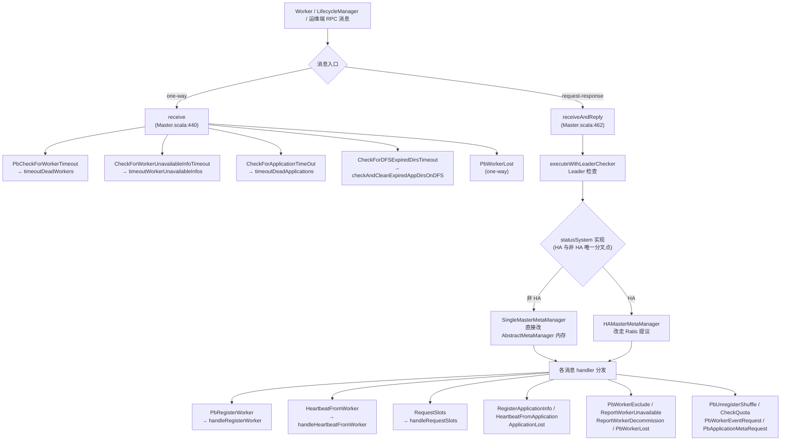
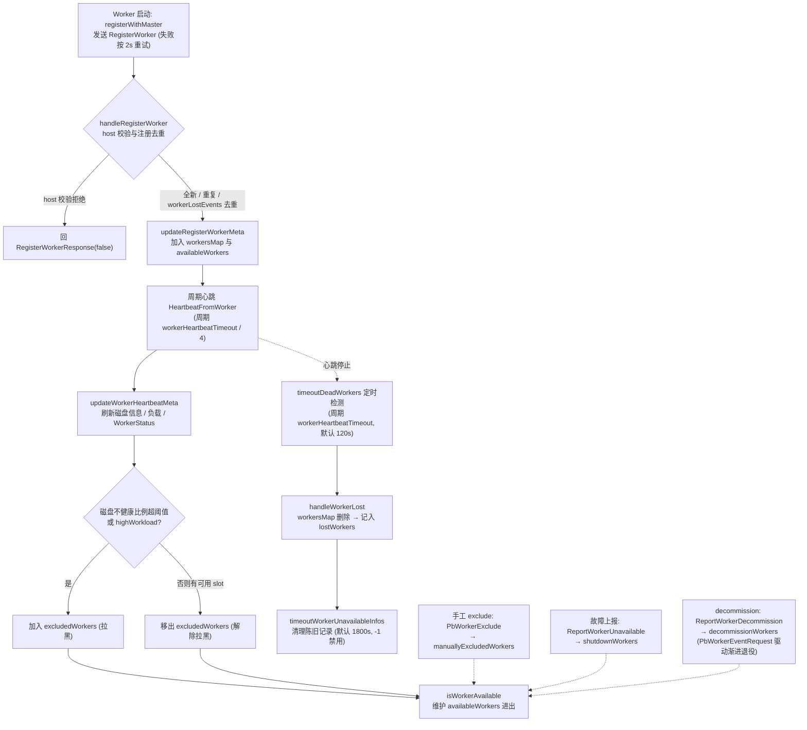
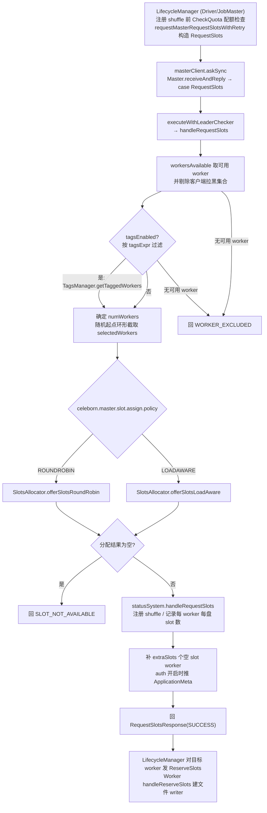

# Apache Celeborn Master 控制面源码阅读指南（非 HA 部分）

> 基于版本 0.7.0-SNAPSHOT，整理日期 2026-08-20；2026-09-06 增补第 7 节「可优化点与代码债务」（条目已对照当前代码逐项核查）。
> 范围：`master/src/main/scala/org/apache/celeborn/service/deploy/master/`（`ha/` 子包除外）与
> `master/src/main/java/org/apache/celeborn/service/deploy/master/clustermeta/`。
> 阅读目标：理解 Master 作为集群控制面如何管理 Worker 生命周期、分配 Slots、跟踪应用，以及配额与 worker tags 的入口。
> HA/Raft（Ratis 集群、Leader 检查、快照）不在本文展开，细节见 [master-ha-ratis-deep-dive.md](./master-ha-ratis-deep-dive.md)。

---

## 1. Master 控制面总览

### 1.1 职责与模块定位

Master 是 Celeborn 集群的元数据与调度中心，官方设计见 `docs/developers/master.md`：

- 维护集群整体状态：哪些 Worker 存活、健康、可用（磁盘状态、负载、WorkerStatus）。
- 维护活跃 shuffle 与应用的注册信息。
- 按策略（roundrobin / loadaware）为每个 shuffle 的 partition 分配 slots。
- 配额检查与 worker tags 过滤。

### 1.2 入口与组件装配

入口 `Master.main`（`master/src/main/scala/org/apache/celeborn/service/deploy/master/Master.scala:1626`）：
`new CelebornConf()` → `new MasterArguments(args, conf)`（解析 `-h/-p`，见 `MasterArguments.scala:26`、`:66`）→ `new Master(conf, masterArgs)` → `master.initialize()`（`Master.scala:1569`，内部启动 HTTP 服务、注册 shutdown hook、最后 `rpcEnv.awaitTermination()`）。

`Master` 类定义在 `Master.scala:62`，继承 `HttpService with RpcEndpoint`。构造期完成的核心装配：

| 组件 | 位置 | 说明 |
|------|------|------|
| 公共 RPC 环境 | `Master.scala:103` | `RpcEnv.create`，auth 开启时挂载 SASL `ServerSaslContext`（`:115-120`）。 |
| 内部 RPC 环境 | `Master.scala:137-153` | `celeborn.internal.port.enabled=true` 时单独建一个免 SASL 的 `RpcEnv`，用于服务间通信。 |
| `InternalRpcEndpoint` | `Master.scala:320-327` | 内部端口 endpoint，把 `receive`/`receiveAndReply` 直接委托回 `Master`（`InternalRpcEndpoint.scala:48-52`）。 |
| `statusSystem` | `Master.scala:156-177` | 元数据管理器：HA 模式为 `HAMasterMetaManager`（`:158`），否则 `SingleMasterMetaManager`（`:176`）。这是 HA 与非 HA 的唯一分叉点。 |
| `CelebornRackResolver` | `Master.scala:155` | rack 感知解析，注册 worker 时确定 `networkLocation`。 |
| `QuotaManager` | `Master.scala:199-204` | 配额检查，见第 5 节。 |
| `TagsManager` | `Master.scala:205` | worker tags 过滤，见第 5 节。 |
| partition size 估算线程 | `Master.scala:221-235` | 周期调用 `statusSystem.handleUpdatePartitionSize()` 更新集群估算 partition 大小。 |
| 超时检查线程 | `Master.scala:337-362` | `onStart()` 用单线程调度器 `forwardMessageThread` 周期 `self.send` 四类自检消息（见 1.3）。 |
| endpoint 注册 | `Master.scala:318` | `rpcEnv.setupEndpoint(RpcNameConstants.MASTER_EP, this)`。 |

### 1.3 RPC 消息分发

Master 的 RPC 体系是 Celeborn 自研 Netty RPC（见 [network-and-protocol-deep-dive.md](./network-and-protocol-deep-dive.md)）。消息分两类入口：

- `receive`（one-way，`Master.scala:440`）：只处理四类定时自检消息与 one-way 的 `PbWorkerLost`（`:449`）：
  - `PbCheckForWorkerTimeout` → `timeoutDeadWorkers()`（`:441`）
  - `CheckForWorkerUnavailableInfoTimeout` → `timeoutWorkerUnavailableInfos()`（`:443`）
  - `CheckForApplicationTimeOut` → `timeoutDeadApplications()`（`:445`）
  - `CheckForDFSExpiredDirsTimeout` → `checkAndCleanExpiredAppDirsOnDFS()`（`:447`）
- `receiveAndReply`（request-response，`Master.scala:462`）：所有来自 Worker / LifecycleManager / 运维端的消息，主要 case 一览：

| 消息 | 位置 | 处理函数 |
|------|------|----------|
| `RegisterApplicationInfo` | `Master.scala:463` | `handleRegisterApplicationInfo`（`:1210`） |
| `HeartbeatFromApplication` | `Master.scala:470` | `handleHeartbeatFromApplication`（`:1220`） |
| `PbRegisterWorker` | `Master.scala:498` | `handleRegisterWorker`（`:837`） |
| `RequestSlots` | `Master.scala:530` | `handleRequestSlots`（`:934`） |
| `PbUnregisterShuffle` / `PbBatchUnregisterShuffles` | `Master.scala:535` / `:545` | `handleUnregisterShuffle`（`:1103`）/ `batchHandleUnregisterShuffles`（`:1115`） |
| `ApplicationLost` | `Master.scala:555` | `handleApplicationLost`（`:1148`） |
| `HeartbeatFromWorker` | `Master.scala:561` | `handleHeartbeatFromWorker`（`:716`） |
| `ReportWorkerUnavailable` | `Master.scala:591` | `handleReportNodeUnavailable`（`:1128`） |
| `ReportWorkerDecommission` | `Master.scala:596` | `handleWorkerDecommission`（`:1138`） |
| `PbWorkerExclude` | `Master.scala:606` | `handleWorkerExclude`（`:797`） |
| `PbWorkerLost` | `Master.scala:620` | `handleWorkerLost`（`:808`） |
| `CheckQuota` | `Master.scala:632` | `handleCheckQuota`（`:1274`） |
| `PbWorkerEventRequest` | `Master.scala:638` | `handleWorkerEvent`（`:1288`） |
| `PbApplicationMetaRequest` | `Master.scala:649` | `handleRequestForApplicationMeta`（`:1308`，auth 模式下 Worker 拉取应用 secret） |

消息体的 Scala case class / 序列化器定义在 `common/src/main/scala/org/apache/celeborn/common/protocol/message/ControlMessages.scala`（如 `RegisterWorker` 对象 `:85`、`HeartbeatFromWorker` `:115`、`RequestSlots` `:164`、`ApplicationLost` `:369`、`ReserveSlots` `:473`）。

下图为两类 RPC 入口到各消息 handler 的分发总览：



### 1.4 与 HA 的边界

所有会改变状态的 RPC 都先经 `executeWithLeaderChecker`（`Master.scala:415`）做 Leader 检查，再调用 `statusSystem.handleXxx`。
非 HA 模式下 `SingleMasterMetaManager`（`master/src/main/java/org/apache/celeborn/service/deploy/master/clustermeta/SingleMasterMetaManager.java:36`）
的每个 `handle*` 方法都是对 `AbstractMetaManager.update*Meta` 的直接内存调用（如 `handleRegisterWorker` → `updateRegisterWorkerMeta`，`SingleMasterMetaManager.java:155-170`）；
HA 模式下同一接口改走 Ratis 提议。Raft 细节见 [master-ha-ratis-deep-dive.md](./master-ha-ratis-deep-dive.md)，本文所有 `statusSystem.handleXxx` 按单机语义阅读即可。

共享的内存状态都在 `AbstractMetaManager`（`master/src/main/java/org/apache/celeborn/service/deploy/master/clustermeta/AbstractMetaManager.java:67`）：

| 字段 | 位置 | 含义 |
|------|------|------|
| `workersMap` | `AbstractMetaManager.java:74` | uniqueId → `WorkerInfo`，所有已注册 worker。 |
| `availableWorkers` | `AbstractMetaManager.java:75` | 当前可参与 slots 分配的 worker 集合。 |
| `lostWorkers` | `AbstractMetaManager.java:77` | worker → lost 时间戳。 |
| `workerEventInfos` | `AbstractMetaManager.java:78` | worker → 进行中的事件（Decommission/Graceful 等）。 |
| `excludedWorkers` / `manuallyExcludedWorkers` | `AbstractMetaManager.java:81-82` | 自动排除 / 手工排除的 worker。 |
| `shutdownWorkers` / `decommissionWorkers` | `AbstractMetaManager.java:83-84` | 上报不可用 / 退役中的 worker。 |
| `workerLostEvents` | `AbstractMetaManager.java:85` | 处于 lost 流程中的 worker（用于去重注册）。 |
| `appHeartbeatTime` | `AbstractMetaManager.java:80` | appId → 最近心跳时间。 |
| `registeredAppAndShuffles` | `AbstractMetaManager.java:71` | appId → 已注册 shuffleId 集合。 |

`availableWorkers` 的进出由 `isWorkerAvailable`（`AbstractMetaManager.java:639`，要求状态 Normal、无事件、不在任何排除集合）与 `updateAvailableWorkers`（`:647`）维护，slots 分配只从该集合取数。

```
                 ┌──────────────────────────── Master ────────────────────────────┐
 Worker ──RPC──▶ │ receiveAndReply → executeWithLeaderChecker → statusSystem      │
 LM    ──RPC──▶ │                                  │  (SingleMasterMetaManager    │
 运维  ──RPC──▶ │                                  ▼   / HAMasterMetaManager)     │
                 │                          AbstractMetaManager 内存状态           │
                 │   定时器: worker超时 / app超时 / unavailable信息过期 / DFS清理   │
                 └────────────────────────────────────────────────────────────────┘
```

---

## 2. Worker 生命周期管理

Worker 从注册到剔除的整体生命周期总览如下，exclude / decommission 分支对应 §2.4：



### 2.1 注册（RegisterWorker）

Worker 侧：启动时 `registerWithMaster()`（`worker/src/main/scala/org/apache/celeborn/service/deploy/worker/Worker.scala:688`）
通过 `masterClient.askSync` 发送 `RegisterWorker`（携带 host、四个端口、internalPort、networkLocation、磁盘与资源占用，`Worker.scala:695-709`），
失败按 2s 间隔重试直至 `registerWorkerTimeout`（`:689`）。

Master 侧链路：

```
PbRegisterWorker (Master.scala:498)
  → executeWithLeaderChecker (:515)
  → handleRegisterWorker (:837)
      1. workerHostAllowedToRegister (:919) 校验 allow/deny host pattern，拒绝则回 RegisterWorkerResponse(false) (:860-868)
      2. 已注册（在 workersMap 中）→ 重复注册，直接走 statusSystem.handleRegisterWorker (:870-884)
      3. 在 workerLostEvents 中 → 移除该事件后重新注册 (:885-900)
      4. 全新 worker → statusSystem.handleRegisterWorker (:902) → RegisterWorkerResponse(true)
  → AbstractMetaManager.updateRegisterWorkerMeta (:352)
      · 构造 WorkerInfo、解析 networkLocation（worker 自带或 rackResolver，:372-378）
      · updateDiskSlots(estimatedPartitionSize) 计算磁盘可用 slot 数 (:379)
      · workersMap.putIfAbsent，并把它从 shutdown/lost/excluded/decommission 等集合中清掉 (:380-388)
      · updateAvailableWorkers 加入可用集合 (:387)
```

### 2.2 心跳（HeartbeatFromWorker）

Worker 侧：`heartbeatToMaster()`（`Worker.scala:512`）周期发送 `HeartbeatFromWorker`（`:522-534`），
携带最新磁盘信息、按用户的资源占用、活跃 shuffleKey 集合、`highWorkload` 标志与当前 `WorkerStatus`。
周期为 `workerHeartbeatTimeout / 4`（`Worker.scala:352`），由 `forwardMessageScheduler` 定时触发（`:560-566`）。
收到响应后做三件事：释放 `expiredShuffleKeys` 并加入清理队列（`:535-536`）、按响应中的 `workerEvent` 驱动状态机迁移（`:538-539`）、
若 Master 认为该 worker 未注册则清理本地数据并重新注册（`:540-550`）。

Master 侧链路：

```
HeartbeatFromWorker (Master.scala:561)
  → handleHeartbeatFromWorker (:716)
      · 未注册：仅打 warning，回包 registered=false（让 worker 重注册）(:730-734)
      · 已注册：statusSystem.handleWorkerHeartbeat (:735)
          → SingleMasterMetaManager.handleWorkerHeartbeat (:136)
          → AbstractMetaManager.updateWorkerHeartbeatMeta (:282)
              · 更新磁盘信息、lastHeartbeat、WorkerStatus、highWorkload (:296-306)
              · worker 事件到达终态则清理事件与 shutdown 集合 (:308-315)
              · 磁盘不健康比例超阈值或 highWorkload → 加入 excludedWorkers；
                否则有可用 slot 时移出（拉黑/解除拉黑）(:318-324)
              · excludedWorkers 占比过高时自动释放高负载 worker（可配，:327-344）
              · 状态 Normal → updateAvailableWorkers (:347-349)
      · 比对 worker 上报的 activeShuffleKeys 与 Master 注册表，计算 expiredShuffleKeys (:749-756)
      · 回复 HeartbeatFromWorkerResponse（过期 shuffle、registered、进行中的 workerEvent）(:762-772)
```

心跳是 Master 控制面的核心输入：磁盘可用空间、flush/fetch 耗时、activeSlots（LOADAWARE 策略的原料）、
`highWorkload`（自动拉黑）、`WorkerStatus`（graceful/decommission 状态机）全部经此汇聚。

### 2.3 超时剔除（WorkerLost）

- 定时器：`onStart` 中以 `workerHeartbeatTimeout`（`celeborn.master.heartbeat.worker.timeout`，默认 120s）为周期检查（`Master.scala:347`）。
- 判定：`timeoutDeadWorkers()`（`Master.scala:661`）遍历 `workersMap`，`lastHeartbeat` 超过超时阈值且不在 `workerLostEvents` 中的 worker，
  `self.send(WorkerLost(...))` 触发事件（`:668-681`）。HA 下先检查 `workerTimeoutDeadline` 防止选举期间误判（`:663-666`）。
- 处理：`handleWorkerLost`（`Master.scala:808`）→ `statusSystem.handleWorkerLost` →
  `AbstractMetaManager.updateWorkerLostMeta`（`:226`）：从 `workersMap` 删除、记入 `lostWorkers`（带时间戳）、移出 `availableWorkers`（`:230-235`）。
  之后该 worker 若重新注册可走 2.1 的 `workerLostEvents` 去重路径。
- 过期清理：`timeoutWorkerUnavailableInfos()`（`Master.scala:684`）按 `celeborn.master.workerUnavailableInfo.expireTimeout`（默认 1800s，设 -1 禁用）
  清理 `lostWorkers` 中的陈旧记录（`AbstractMetaManager.removeWorkersUnavailableInfoMeta:240`），使同名 worker 之后可干净地重新注册。

### 2.4 exclude 与 decommission 简述

- **手工 exclude**：运维端发 `PbWorkerExclude`（`Master.scala:606`）→ `handleWorkerExclude`（`:797`）→
  `updateManuallyExcludedWorkersMeta`（`AbstractMetaManager.java:204`）增删 `manuallyExcludedWorkers`。
  该集合通过 `isWorkerAvailable` 影响 `availableWorkers`，即手工拉黑的 worker 不再参与分配。
- **故障上报**：LifecycleManager 检测到 push/fetch 失败后发 `ReportWorkerUnavailable`（`Master.scala:591`）→
  `handleReportNodeUnavailable`（`:1128`）→ `updateMetaByReportWorkerUnavailable`（`AbstractMetaManager.java:571`）：
  加入 `shutdownWorkers` 并移出 `availableWorkers`。
- **decommission**：`ReportWorkerDecommission`（`Master.scala:596`）→ `handleWorkerDecommission`（`:1138`）→
  `updateMetaByReportWorkerDecommission`（`AbstractMetaManager.java:599`）：加入 `decommissionWorkers` 并移出 `availableWorkers`。
  worker 的渐进退役由 `PbWorkerEventRequest`（`Master.scala:638` → `updateWorkerEventMeta:578`）与 Worker 侧状态机协同，
  心跳回包把事件带回给 worker（见 2.2 末尾）。整体运维流程见 `docs/developers/workerexclusion.md` 与 `docs/decommissioning.md`。

---

## 3. Slots 分配全链路（重点）

设计文档：`docs/developers/slotsallocation.md`。算法实现集中在
`master/src/main/java/org/apache/celeborn/service/deploy/master/SlotsAllocator.java`（类定义 `:40`）。

### 3.1 全链路总览

先从 RequestSlots 入口到响应的整体流程总览（与下方行号走读一一对应）：



```
LifecycleManager (Driver/JobMaster)
  │  requestMasterRequestSlotsWithRetry
  │  (client/src/main/scala/org/apache/celeborn/client/LifecycleManager.scala:1850)
  │  构造 RequestSlots(appId, shuffleId, partitionIds, host, replicate, rackAware,
  │                    userIdentifier, maxWorkers, availableStorageTypes,
  │                    excludedWorkerSet, packed, tagsExpr)   (:1862-1874)
  ▼  masterClient.askSync                                    (:1886)
Master.receiveAndReply → case RequestSlots (Master.scala:530)
  → executeWithLeaderChecker → handleRequestSlots (:934)
      1. workersAvailable(excludedWorkerSet) 取可用 worker 并剔除客户端拉黑集合 (:938, :1297)
      2. tagsEnabled 时用 TagsManager.getTaggedWorkers 按 tags 表达式过滤 (:939-944)
      3. 无可用 worker → 回 WORKER_EXCLUDED (:948-954)
      4. 确定参与分配的 worker 数 numWorkers
         = min( max(replicate?2:1, min(masterMaxWorkers, clientMaxWorkers)), numAvailableWorkers ) (:956-961)
         从随机起点环形截取 selectedWorkers (:962-971)
      5. workersMap.synchronized 内调用 SlotsAllocator 分配 (:973-1001)
         LOADAWARE → offerSlotsLoadAware ；ROUNDROBIN → offerSlotsRoundRobin
      6. 分配为空 → 回 SLOT_NOT_AVAILABLE (:1011-1019)
      7. statusSystem.handleRequestSlots 落元数据（注册 shuffle、记录每 worker 每盘 slot 数）(:1022-1027)
      8. 按需补 extraSlots 个空 slot worker（用于后续 revive）(:1035-1049)
      9. auth 开启时把 ApplicationMeta 推给选中 worker (:1060-1062)
     10. 回 RequestSlotsResponse(SUCCESS, slots) (:1063-1066)
LifecycleManager
  │  对每个 PartitionLocation 的目标 worker 发 ReserveSlots
  ▼  requestWorkerReserveSlots (LifecycleManager.scala:1894)
Worker Controller.receiveAndReply → case ReserveSlots
  (worker/src/main/scala/org/apache/celeborn/service/deploy/worker/Controller.scala:105)
  → handleReserveSlots (:171)：shutdown/磁盘检查 → createWriters 建文件 writer → ReserveSlotsResponse
```

两点值得注意：

- 整个 offer 过程在 `statusSystem.workersMap.synchronized` 内执行（`Master.scala:975`），与心跳状态更新互斥，保证分配读到一致视图，但也使心跳处理与 RequestSlots 串行化。
- Master 只决定 partition → (worker, mountPoint) 的映射并回复；真正创建文件的是 Worker 侧 `handleReserveSlots`（`Controller.scala:171`）。Master 的 `handleRequestSlots` 只是登记（`SingleMasterMetaManager.java:67` → `AbstractMetaManager.updateRequestSlotsMeta:115`）。

### 3.2 ROUNDROBIN 策略

`offerSlotsRoundRobin`（`SlotsAllocator.java:62`）：

1. 为每个 worker 收集健康且存储类型匹配的磁盘为 `UsableDiskInfo`（初始 `usableSlots = diskInfo.getAvailableSlots()`，`:77-87`）。
2. 交给 `locateSlots`（`:88`）→ 核心 `roundRobin`（`:486`）：
   - primary/replica 各持一个随机起始下标，`nextIndex = (v + 1) % size` 步进（`:505-511`），即把所有 worker 当成数组轮询，每个 partition 放一个 slot。
   - 从 partition 列表尾部向前遍历，`LinkedList` + 倒序迭代保证已处理 partition O(1) 移除（`:517-522`）。
   - replica 选择跳过同 worker，rackAware 时再跳过同 rack（`satisfyRackAware`，`:636`）。
   - 磁盘索引轮转：`buildStorageInfo`（`:197`）中 `workerDiskIndex` 初始随机，随后 `(diskIndex + 1) % diskCount` 单调递增取盘（`:223`），保证同一 worker 的多盘均匀使用。
   - 跳过没有可用 slot 的 worker（`haveUsableSlots`，`:529-534`）。

`locateSlots`（`:310`）实际是"多轮渐进"框架：第 1 轮在限制内分配，剩余 partition 依次在"全部 worker 带 rackAware"、"全部 worker 不带 rackAware"中兜底（`:349-421`），尽量放满。

### 3.3 LOADAWARE 策略

`offerSlotsLoadAware`（`SlotsAllocator.java:104`）。整体分四步：

**第 0 步：前置判断与降级**

- HDFSOnly / S3Only / OSSOnly 直接走 roundrobin（`:124-135`）——DFS 无磁盘性能概念。
- 收集所有 `actualUsableSpace > 0`、状态 HEALTHY、非 DFS 的盘（`:137-151`）；无可用盘或总可用 slot 为 0 时降级 roundrobin 并打 warn（`:153-174`）。

**第 1 步：磁盘排序**（`placeDisksToGroups`，`:665`）

按综合负载升序排序（`:672-681`）：

```
score = avgFlushTime * flushTimeWeight + avgFetchTime * fetchTimeWeight + activeSlots * activeSlotsWeight
```

`avgFlushTime/avgFetchTime` 是纳秒级时间窗口均值，`activeSlotsWeight` 相当于"每个活跃 slot 折算多少纳秒"（量级换算见 `docs/developers/slotsallocation.md` 的说明）。

**第 2 步：分组**（同函数，`:682-699`）

排序后的盘按 `ceil(diskCount / numDiskGroups)` 每组大小切成 `numDiskGroups`（默认 5）个组，第 0 组最快。

**第 3 步：组间梯度分配 + 组内按比例分配**（`getSlotsRestrictionsByLoadAwareAlgorithm`，`:706`）

- 组间梯度：`initLoadAwareAlgorithm`（`:648`）预计算 `taskAllocationRatio[i] = (1+diskGroupGradient)^(numGroups-1-i) / Σ`（`:656-657`），
  即快组比相邻慢组多分 `(1+gradient)` 倍；gradient 默认 0.1。
- 组内分配：按 `ceil(partitionCnt * currentAllocation[i])` 估算每组名额，超出组可用 slot 的余量顺延给下一组（`:731-746`）；
  组内再按盘均摊并封顶到该盘 `getAvailableSlots()`（`:748-770`），产出每个 worker 每张盘的 `UsableDiskInfo.usableSlots` 上限。
- 随后仍由 `locateSlots`/`roundRobin` 在这些限制（restrictions）内轮询放置，每放一个 slot 扣减 `usableSlots`（`buildStorageInfo:210-213`）。

> 与官方文档描述的对应：文档里的"组内按 usableSlots 比例分配"在当前实现中等价于"均摊 + 按盘可用 slot 封顶 + 余量顺延"
> （`:758-765`），因为限制阶段先把组的额度摊到盘上，最终轮询时自然消耗快盘。

### 3.4 interruptionAware（0.7.0 新增）

`celeborn.master.slot.assign.interruptionAware=true` 时，`locateSlots` 先调 `prioritizeWorkersBasedOnInterruptionNotice`（`SlotsAllocator.java:265`）
把 worker 分三档：无中断通知 > 中断较晚（前 threshold 百分位，默认 50%）> 中断较早，前三轮分配依次降级兜底（`:330-421`），
避免把新 shuffle 放到即将维护的机器上。

### 3.5 相关配置键

均定义于 `common/src/main/scala/org/apache/celeborn/common/CelebornConf.scala`：

| 配置键 | 默认值 | 位置 | 说明 |
|--------|--------|------|------|
| `celeborn.master.slot.assign.policy` | `ROUNDROBIN` | `CelebornConf.scala:3096` | `ROUNDROBIN` / `LOADAWARE`。 |
| `celeborn.master.slot.assign.loadAware.numDiskGroups` | `5` | `:3129` | LOADAWARE 磁盘分组数。 |
| `celeborn.master.slot.assign.loadAware.diskGroupGradient` | `0.1` | `:3139` | 相邻组分配梯度。 |
| `celeborn.master.slot.assign.loadAware.flushTimeWeight` | `0` | `:3149` | flush 耗时权重。 |
| `celeborn.master.slot.assign.loadAware.fetchTimeWeight` | `1` | `:3159` | fetch 耗时权重。 |
| `celeborn.master.slot.assign.loadAware.activeSlotsWeight` | `0` | `:3169` | 活跃 slot 数权重（0.7.0 新增）。 |
| `celeborn.master.slot.assign.interruptionAware` | `false` | `:3110` | 避开即将维护的 worker（0.7.0 新增）。 |
| `celeborn.master.slot.assign.interruptionAware.threshold` | `50` | `:3119` | interruptionAware 首轮选取百分位。 |
| `celeborn.master.slot.assign.maxWorkers` | `10000` | `:3187` | 单 shuffle 最多落在多少 worker。 |
| `celeborn.master.slot.assign.minWorkers` | `100` | `:3196` | 单 shuffle 最少 worker 数（配合 extraSlots）。 |
| `celeborn.master.slot.assign.extraSlots` | `2` | `:3178` | 额外空 slot worker 数，供 revive 使用。 |
| `celeborn.master.estimatedPartitionSize.initialSize` | `64mb` | `:3204` | 估算 partition 初始大小，用于折算磁盘可用 slot 数。 |
| `celeborn.master.estimatedPartitionSize.minSize` | `8mb` | `:3221` | 估算下界。 |
| `celeborn.master.estimatedPartitionSize.update.initialDelay` | `5min` | `:3231` | 估算更新首次延迟（间隔见同段 `update.interval`）。 |

---

## 4. 应用生命周期

应用的注册方是 LifecycleManager（详见 [client-control-plane-deep-dive.md](./client-control-plane-deep-dive.md)），Master 侧三个动作：

**注册**：`RegisterApplicationInfo`（`Master.scala:463`）→ `handleRegisterApplicationInfo`（`:1210`）→
`statusSystem.handleRegisterApplicationInfo` → `AbstractMetaManager.updateApplicationInfo`（`:109`），
记录 appId、UserIdentifier 与 extraInfo（如 per-app 的 quota 中断开关）。

**心跳**：`HeartbeatFromApplication`（`Master.scala:470`）→ `handleHeartbeatFromApplication`（`:1220`）：

1. `statusSystem.handleAppHeartbeat` 更新 `appHeartbeatTime` 与累计统计（totalWritten/fileCount/shuffleCount、fallback 计数）（`:1232-1242`）。
2. 核对客户端上报的 `needCheckedWorkerList`，找出 Master 已不认识的 worker（`:1243-1244`）。
3. `shouldResponse` 时回 `HeartbeatFromApplicationResponse`：excludedWorkers + manuallyExcluded、unknown workers、
   shutdown + decommission workers、该 app 已注册 shuffle、应用配额状态（`:1245-1258`）。
   这份回包是客户端拉黑列表与 Master 视图对齐的主要通道。应用心跳间隔由客户端配置
   `celeborn.client.application.heartbeatInterval`（默认 10s，`CelebornConf.scala:4817`）控制。

**丢失**：两条路径都汇到 `handleApplicationLost`（`Master.scala:1148`）：

- 主动注销：LM 发送 `ApplicationLost`（`Master.scala:555`）。
- 超时剔除：`timeoutDeadApplications()`（`:701`）以 `celeborn.master.heartbeat.application.timeout`（默认 300s）为阈值扫描
  `appHeartbeatTime`（`:707-713`），定时器周期为超时的一半（`:348-349`）。

处理在 `nonEagerHandler` 线程池异步执行（`:1149`）：移除 `workersAssignedToApp` 映射、`statusSystem.handleAppLost`（→ `updateAppLostMeta:182`，
清掉 `appHeartbeatTime` 等）、`quotaManager.handleAppLost`（`:1153`）、若启用 DFS 存储则清理该 app 的残留目录（`:1155-1157`）。

---

## 5. 配额（quota）与 worker tags

### 5.1 QuotaManager

`master/src/main/scala/org/apache/celeborn/service/deploy/master/quota/QuotaManager.scala:40`，由 Master 构造（`Master.scala:199`），开关为
`celeborn.quota.enabled`（默认 true，`CelebornConf.scala:6133`）。职责：基于 `ResourceConsumptionSource` 聚合的
"用户/应用 × 集群"资源消耗（磁盘字节数、文件数）对照配额判定是否超限。入口：

- `checkUserQuotaStatus`（`QuotaManager.scala:75`）：响应客户端 `CheckQuota`（`Master.scala:632` → `handleCheckQuota:1274`），LM 注册 shuffle 前检查。
- `checkApplicationQuotaStatus`（`:94`）：随应用心跳回包下发（`Master.scala:1258`）。
- 底层判定 `checkQuotaSpace`（`:144`）/ `checkQuota`（`:179`）。
- `handleAppLost`（`:71`）：应用退出时清理状态（`Master.scala:1153`）。

### 5.2 TagsManager

`master/src/main/scala/org/apache/celeborn/service/deploy/master/tags/TagsManager.scala:34`，由 Master 构造（`Master.scala:205`），开关
`celeborn.tags.enabled`（默认 true，`CelebornConf.scala:6897`）。职责：从动态配置服务读取"用户 → tags → worker 集合"映射（`getTagStore:43`），
在 RequestSlots 时按请求携带的 `tagsExpr` 过滤候选 worker（`getTaggedWorkers:53`，调用点 `Master.scala:939-944`），实现租户级 worker 隔离。

---

## 6. 关键配置参数汇总（控制面其余部分）

| 配置键 | 默认值 | 位置 | 说明 |
|--------|--------|------|------|
| `celeborn.master.heartbeat.worker.timeout` | `120s` | `CelebornConf.scala:2544` | Worker 心跳超时，触发 WorkerLost。 |
| `celeborn.master.heartbeat.application.timeout` | `300s` | `:2519` | 应用心跳超时，触发 ApplicationLost。 |
| `celeborn.master.workerUnavailableInfo.expireTimeout` | `1800s` | `:2571` | lostWorkers 记录保留时长，-1 禁用清理。 |
| `celeborn.master.allowWorkerHostPattern` / `denyWorkerHostPattern` | 未设置 | `:2553` / `:2562` | 注册 allow/deny 正则。 |
| `celeborn.master.excludeWorker.unhealthyDiskRatioThreshold` | `1` | `:6925` | 不健康盘占比拉黑阈值。 |
| `celeborn.master.excludeWorker.autoReleaseHighWorkLoadEnabled` | `false` | `:6935` | excluded 占比过高时自动释放高负载 worker。 |
| `celeborn.master.excludeWorker.autoReleaseHighWorkLoadRatioThreshold` | `0.3` | `:6943` | 上述触发比例。 |
| `celeborn.master.send.applicationMeta.threads` | 正整数 | `:6719` | auth 模式下推送 ApplicationMeta 的线程数。 |
| `celeborn.internal.port.enabled` | `false` | `:6584` | 服务间内部 RPC 端口。 |
| `celeborn.quota.enabled` | `true` | `:6133` | 配额开关。 |
| `celeborn.tags.enabled` | `true` | `:6897` | worker tags 开关。 |

---

## 7. 可优化点与代码债务

> 本节条目已于 2026-09 对照当前代码逐项核查。候选清单来自
> [performance-optimization-analysis.md](./performance-optimization-analysis.md) §2.4–2.6 与本文 §3.1 的提示，
> 核查后事实前提不成立或被夸大的条目列入文末附表。按本文范围约定，Raft 写路径类问题
> （如"每次心跳一条 raft 日志"）属 HA 主题，见 [master-ha-ratis-deep-dive.md](./master-ha-ratis-deep-dive.md)
> 与性能分析文档 §2.2–2.3，本节不展开。

### P0：推荐优先实施

#### 7.1 Slot 分配全局锁与心跳路径的同锁竞争

**代码位置**：`Master.scala:975-1000`、`AbstractMetaManager.java:296/330/648/686`

`handleRequestSlots` 把整个分配算法放进 `statusSystem.workersMap.synchronized`：

```scala
statusSystem.workersMap.synchronized {
  if (slotsAssignPolicy == SlotsAssignPolicy.LOADAWARE) {
    SlotsAllocator.offerSlotsLoadAware(...)
  } else {
    SlotsAllocator.offerSlotsRoundRobin(...)
  }
}
```

锁范围本身只包住分配调用（tags 过滤、`workersAvailable` 快照拷贝均在锁外，见 §3.1 与 7.6），但同一把
`workersMap` monitor 还是全局元数据锁：**一次 worker 心跳要在同一把锁上获取 2~3 次**
（`updateWorkerHeartbeatMeta:296` → `updateAvailableWorkers:648` → `updateWorkerResourceConsumptions:686`，
高负载自动释放块 :330 还会二次取锁并全量扫描 excludedWorkers）。锁内计算即 LOADAWARE 的 O(D log D) 全量排序
+ roundRobin 最坏 O(P×W×盘数)（基准场景 1500 workers / 10 万分区，
`master/src/test/java/org/apache/celeborn/service/deploy/master/SlotsAllocatorJmhBenchmark.java:40-46`）。
大集群高注册并发下，心跳流与 RequestSlots 在单监视器上直接互斥，是控制面可观测瓶颈。

注意一个前置障碍：`SlotsAllocator` 全部为 static 方法 + JVM 级可变静态状态（`rand`/`initialized`/
`taskAllocationRatio`，`SlotsAllocator.java:58-60`），且 `initialized` 的 check-then-act（:176-178）无同步，
**线程安全性完全隐式依赖这把全局锁**。任何缩小锁粒度的改造必须先解决 7.5。

**优化方向**：
- 分配改为对不可变 worker 快照的无锁计算（workersMap/availableWorkers 已是并发容器），锁内只做决策点校验与结果提交。
- 心跳路径的 2~3 次取锁合并为一次；:330 自动释放全量扫描移出锁或限频。

#### 7.2 WorkerLost 风暴：判重窗口无效 + 无限速 + 逐条处理

**代码位置**：`Master.scala:661-682`、`AbstractMetaManager.java:229/237`

`timeoutDeadWorkers` 无锁遍历 workersMap，对超时 worker 逐个 `self.send(WorkerLost)`（one-way）：

- **判重覆盖不住 in-flight 窗口**：判重依赖 `workerLostEvents.contains(worker)`，但
  `updateWorkerLostMeta` 在同一方法内先 add（:229）后 remove（:237），处理完即清除；`self.send` 异步排队期间
  判重集里没有该 worker。实际兜底是 `handleWorkerLost` 的 `workersMap.get==null` 早退（`Master.scala:825-829`），
  重复消息只产生告警、不会重复变更——但前提是 inbox 积压不超过一个轮询周期（120s）。
- **单轮无限速**：网络分区/机架掉电恢复时，一轮可产生数百~数千条 WorkerLost，与 RequestSlots 等所有控制面消息
  竞争同一个单线程 inbox；HA 模式下每条还是一次同步 raft 提交（`HAMasterMetaManager.java:259-267`），
  N 个失联 worker = N 次串行提交，直接阻塞 slot 分配。

**优化方向**：
- 批量 WorkerLost：一条消息携带 worker 列表，一次状态变更/一次 raft 提交。
- 将 `workerLostEvents` 的 add 提前到发送侧、处理完成后延迟清除，使判重真正覆盖 in-flight 窗口。

### P1：小而安全的改进

#### 7.3 `registeredAppAndShuffles` 内层 HashSet 非线程安全

**代码位置**：`AbstractMetaManager.java:71-72、:119、:138-162`

外层是 ConcurrentHashMap，但 value 是普通 `HashSet`（:119 `computeIfAbsent(appId, v -> new HashSet<>())`）。
写路径 `updateUnregisterShuffleMeta`（:138-152）的 `get` → `HashSet.remove` → `compute` 检查 size 三步非原子：
并发线程在 get 后移除整个 key 时，:146 的 `shuffles.size()` 会 NPE；`updateBatchUnregisterShuffleMeta`
（:154-162）的 `containsKey`+`get`+`remove` 同样非原子。读侧（`Master.scala:752` 心跳比对、`:1249` 应用心跳、
`registeredShuffleCount():666-668`）与写并发。HA 模式下写被状态机串行化，但读写仍并发；单 master 模式多 RPC
线程下可能丢更新或抛 CME。

**优化方向**：
- 内层换 `ConcurrentHashMap.newKeySet()`，unregister 合并为单个 `compute` 原子操作。成本低、收益明确，适合独立小 PR。

#### 7.4 `estimatedPartitionSize` 非 volatile 的可见性问题

**代码位置**：`AbstractMetaManager.java:92、:606-637`

`estimatedPartitionSize` 是 plain `public long`，`updatePartitionSize` 无锁写，读点包括
`updateWorkerHeartbeatMeta:300`、`updateRegisterWorkerMeta:379`、`Master.scala:259`（metrics gauge）。
64 位 long 的非原子读写存在可见性/撕裂读风险（实际后果仅是估算值短暂偏差，影响磁盘可用 slot 数折算）。

**优化方向**：
- 改为 `volatile long` 或 AtomicLong。

#### 7.5 `SlotsAllocator.taskAllocationRatio` 静态初始化后永不更新

**代码位置**：`SlotsAllocator.java:59-60、:176-178、:648-663`

```java
private static boolean initialized = false;
private static double[] taskAllocationRatio = null;
// 首个 LOADAWARE 请求时初始化一次，之后 diskGroupCount/diskGroupGradient 的变化永远不再生效
```

既是配置热更新失效的正确性隐患（无日志提示），也是 JVM 级可变静态状态：污染单测与多调用方，且如 7.1 所述
挡在去全局锁的路上。

**优化方向**：
- 改为按 (diskGroupCount, gradient) 参数化的实例级缓存，去掉 static。

#### 7.6 `workersAvailable` 每请求全量拷贝

**代码位置**：`Master.scala:1297-1306`（调用点 :938）

每次 RequestSlots 都无条把 `availableWorkers` 拷贝成新 ArrayList；有客户端排除集时是
HashSet 拷贝 + 删除 + 再一次 ArrayList 拷贝，O(W) 起步。拷贝目的是给后续随机起点 `subList` 截取
（:962-971）一个稳定快照，不能直接去掉，但可裁剪。

**优化方向**：
- 维护惰性失效的 ArrayList 快照（worker 上下线时置脏复用）；有排除集时改"随机跳过"而非整体拷贝。

#### 7.7 TagsManager 每请求按 tag 数全量拷贝 tag store

**代码位置**：`TagsManager.scala:43-51、:76-77`

底层动态配置读取有缓存（`BaseConfigServiceImpl.java:81-83` 读 AtomicReference，后台线程周期刷新），
但 `getTagStore` 是 `def` 而非 `val`：每次调用把整个 tag→workers 映射拷贝进一个新 ConcurrentHashMap
（:46 自带 `// TODO: Make configStore.getTags return ConcurrentMap`），且它在 tag 循环内被调用（:76-77），
**每次 RequestSlots 的拷贝次数 = 请求的 tag 个数**。tags 开启时处于 RequestSlots 高频路径。

**优化方向**：
- `getTagStore` 提为循环外单次取值；或维护随配置刷新重建的本地快照，消除每请求拷贝。

### P2：低优先级与较大改动

#### 7.8 LOADAWARE 每请求全量重算与多轮兜底重构

**代码位置**：`SlotsAllocator.java:137-185、:672、:373-377、:500-501、:631-634`

LOADAWARE 每次请求：重建 `usableDisks`/`diskToWorkerMap`（O(D)）、全盘可用 slot 求和、
`placeDisksToGroups` 全量排序（:672，O(D log D)）、逐组逐盘重算分配额，无任何缓存。
`locateSlots` 最多 4 轮兜底，每轮重复构造 rack 重排列表、`workerDiskIndex` HashMap 与 partitionIds
链表全量拷贝；热点 `haveUsableSlots`（:631-634）每次候选检查都对目标 worker 全部磁盘的 usableSlots
重新求和。这些是 7.1 锁内耗时的主体。

**优化方向**：
- 按"心跳代次/磁盘指纹"缓存排序后的 disk groups 与 restrictions，心跳更新后失效重算（性能分析文档 §2.4.2 同此建议）。
- 合并多轮兜底中的重复 rack 重排与列表拷贝；`haveUsableSlots` 用预聚合的每 worker 剩余配额（随分配递减）替代逐盘求和。

#### 7.9 应用心跳回包全量下发

**代码位置**：`Master.scala:1220-1262`

`shouldResponse` 由客户端硬编码 `true`（`ApplicationHeartbeater.scala:88`），每个 app 每 10s
（`celeborn.client.application.heartbeatInterval`）的心跳回包都全量携带
`excludedWorkers ++ manuallyExcludedWorkers`、`shutdownWorkers ++ decommissionWorkers`、
本 app 的 registeredShuffles（:1246-1257，每次新建 4 个 ArrayList 全量序列化）。
平时集合很小，但大规模排除/退役/滚动升级期间回包随集合大小线性增长，按 app 数 × 10s 放大。

**优化方向**：
- 增量/版本号下发：集合未变化时只带版本号，变化时才携带全量。

#### 7.10 DiskInfo 槽位读写的锁协议不一致

**代码位置**：`Master.scala:975` → `SlotsAllocator.java:81/142-151`、`AbstractMetaManager.java:606-637`

同一份 DiskInfo 数据，三方两两互不互斥：心跳路径用 workersMap 锁 + `WorkerInfo.this` 双锁保护
（`AbstractMetaManager.java:296-306`）；`updatePartitionSize` 只持 `WorkerInfo.this` 不持 workersMap
（:633-636）；offerSlots 只持 workersMap 不持 `WorkerInfo.this`，直接读 DiskInfo 的 plain var 字段。
分配算法可能读到撕裂/陈旧的槽位数（表现为偶发分配失败/次优分配，下游有兜底，无状态损坏）。
另 `WorkerInfo.updateThenGetUserResourceConsumption`（`WorkerInfo.scala:248-257`）是
keys+filterNot+put+putAll 的多步复合操作，无 this 锁、非原子。

**优化方向**：
- 统一锁协议：SlotsAllocator 通过 WorkerInfo 的 `this.synchronized` 访问器读快照，或让
  `updatePartitionSize` 在 workersMap 锁内执行；`updateThenGetUserResourceConsumption` 改为 CHM 原子操作。

#### 7.11 Master.scala 可维护性债务

**代码位置**：`Master.scala`（1639 行）

- `receiveAndReply`（:462-659）约 198 行、18 个 case 分支，PbRegisterWorker/PbWorkerExclude/PbWorkerLost
  等分支内联大量 protobuf 解包逻辑。
- `handleRequestSlots`（:934-1067）约 134 行：tag 过滤、worker 选择、两种策略、extra slots、审计、
  推送 app meta 全在一个方法。
- `handleRegisterWorker`（:837-916）约 80 行，含三段近乎重复的 `statusSystem.handleRegisterWorker(...)`
  参数块（:873-883、:889-899、:902-912）。
- `nonEagerHandler`（:187）线程池大小 64 硬编码、无配置项，全文件仅 `handleApplicationLost`（:1149-1163）一处使用。

**优化方向**：
- 巨型 match 按消息类别拆分到独立 handler 对象；线程池大小提为配置项。

### 附：核查后删除或修正的条目

以下候选项经核查事实前提不成立或被夸大，不列为优化点，不建议重新引入：

| 候选条目 | 核查结论 |
|---|---|
| `generateRackAwareWorkers` 在 rack 数≈worker 数时退化 O(W²)（性能分析文档 §2.4） | 不成立：空 rack 即时 `iter.remove()`（`SlotsAllocator.java:460-462`），总访问量 = Σ rack 大小，实际 O(W + R log R)；真实开销是每请求重复调用 4~5 次的对象分配（已并入 7.8） |
| estimatedPartitionSize 更新线程全量遍历 worker × shuffle | 不成立：常规路径只读两个 LongAdder（`AbstractMetaManager.java:608-609`），O(1) 且有早退（:624-626）；仅估算值变化时才 O(W×D) 且 10min 一次 |
| QuotaManager 在 CheckQuota / 应用心跳时全量聚合 | 不成立：请求路径是 O(1) 状态 map 读（`QuotaManager.scala:75-100`）；全量聚合已异步化到后台周期线程（:55-69）。残留小项：聚合周期内逐用户重复解析配额字符串，量级低不单列 |
| tags 过滤在 workersMap 全局锁内 | 不成立：`getTaggedWorkers` 在锁外执行（`Master.scala:939-944`） |
| 心跳比对 activeShuffleKeys 是 O（全集群 shuffle 数） | 夸大：实为 O（该 worker 上报的 key 数），每个 key 一次 split + 两次 O(1) 查找（`Master.scala:749-756`），且 `registeredAppAndShuffles` 按 appId 分桶；真正的成本在 HA 模式的 raft 同步写，属 HA 主题 |
| workerHostAllowedToRegister 每次注册重复编译正则 | 不成立：Pattern 在 Master 初始化时预编译并缓存（`Master.scala:193-194、:919-932`） |
| timeoutDeadApplications / DFS 过期目录清理开销 | 不值得列：遍历 O（活跃 app 数），在独立调度线程与 `nonEagerHandler` 池执行，不占 inbox；DFS 递归删除周期 1h |

---

## 8. 延伸阅读

- [master-ha-ratis-deep-dive.md](./master-ha-ratis-deep-dive.md) — HA 模式下同一套 `handle*` 接口如何改走 Ratis，含 Leader 检查与快照。
- [client-control-plane-deep-dive.md](./client-control-plane-deep-dive.md) — LifecycleManager 侧：RequestSlots 的发起、revive、应用注册与心跳。
- [network-and-protocol-deep-dive.md](./network-and-protocol-deep-dive.md) — Netty RPC 框架与 `MasterClient` 重试/重定向。
- 官方设计文档：`docs/developers/master.md`、`docs/developers/slotsallocation.md`、`docs/developers/overview.md`、`docs/developers/workerexclusion.md`。
- [performance-optimization-analysis.md](./performance-optimization-analysis.md) — Master 侧性能瓶颈（如 offerSlots 全局锁、心跳全量上报）分析。
