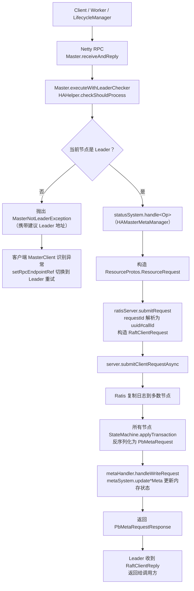
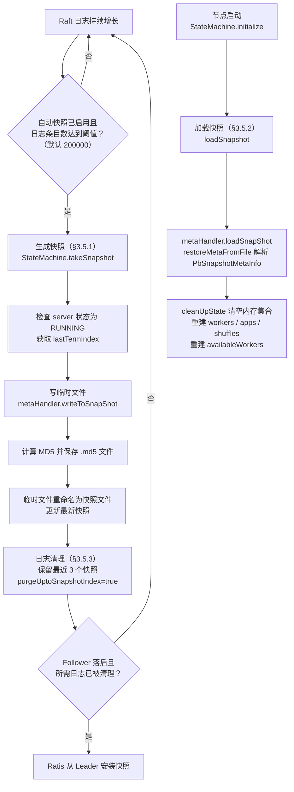

# Apache Celeborn Master HA（Ratis）源码阅读指南

> 基于版本 0.7.0-SNAPSHOT，整理日期 2026-08-05。
> 范围：`master/src/main/java/org/apache/celeborn/service/deploy/master/clustermeta/ha/` 及相关类。
> 阅读目标：理解 Celeborn 如何基于 Apache Ratis 实现 Master 高可用，包括启动、写请求复制、快照、领导者切换与客户端重定向。

---

## 1. 模块定位

当 `celeborn.master.ha.enabled=true` 时，Master 以 **Apache Ratis Raft 集群** 运行，默认 3 节点。所有会改变集群元数据的请求（worker 注册、心跳、slot 申请、应用注册、worker 排除等）都必须先由 Leader 提议到 Ratis，在多数节点提交并应用后，才更新本地内存状态。非 Leader 节点收到写请求后直接返回 `MasterNotLeaderException`，由客户端重试到 Leader。

核心设计要点：

- **状态机模型**：Ratis 负责日志复制与 Leader 选举，Celeborn 提供 `StateMachine` 实现来应用日志、生成快照。
- **双 schema 设计**：提交侧使用 `Resource.proto` 的 `ResourceRequest`，应用侧解析为 `TransportMessages.proto` 的 `PbMetaRequest`。
- **客户端重定向**：非 Leader 不代理请求，而是把 Leader 地址返回给客户端，由客户端重新连接。
- **全量快照**：快照包含所有 in-memory 元数据，启动时从最新快照恢复，缺失的日志由 Ratis 自动补齐。

---

## 2. 核心类与职责

| 类 | 路径 | 职责 |
|----|------|------|
| `HARaftServer` | `master/.../clustermeta/ha/HARaftServer.java` | Ratis server 封装：构建 `RaftServer`、提交请求、Leader 检测、角色刷新、优雅关闭。 |
| `HAHelper` | `master/.../clustermeta/ha/HAHelper.java` | Leader 检查、protobuf ↔ Ratis `Message` 转换、快照临时文件工具、构造 `MasterNotLeaderException`。 |
| `MetaHandler` | `master/.../clustermeta/ha/MetaHandler.java` | 启动 Ratis server；把 `PbMetaRequest` 分发到 `HAMasterMetaManager` 的具体 `handle*` 方法；快照序列化桥接。 |
| `StateMachine` | `master/.../clustermeta/ha/StateMachine.java` | 继承 Ratis `BaseStateMachine`：apply 日志、query 读请求、take/load 快照、处理 Leader 变化。 |
| `HAMasterMetaManager` | `master/.../clustermeta/ha/HAMasterMetaManager.java` | HA 模式下的 `IMetadataHandler`，每个写操作都构建 `ResourceRequest` 提交给 Ratis。 |
| `AbstractMetaManager` | `master/.../clustermeta/AbstractMetaManager.java` | 所有 Master 共享的 in-memory 状态（workers、apps、shuffles 等）与快照序列化。 |
| `SingleMasterMetaManager` | `master/.../clustermeta/SingleMasterMetaManager.java` | 非 HA 模式的直接内存更新实现。 |
| `IMetadataHandler` | `master/.../clustermeta/IMetadataHandler.java` | 元数据变更接口。 |
| `MetaUtil` | `master/.../clustermeta/MetaUtil.java` | protobuf 与领域模型转换工具。 |
| `MasterNode` | `master/.../clustermeta/ha/MasterNode.scala` | 节点描述：nodeId、Ratis 地址、RPC 地址、internal RPC 地址、SSL 标志。 |
| `MasterClusterInfo` | `master/.../clustermeta/ha/MasterClusterInfo.scala` | 从 `CelebornConf` 加载 HA 节点列表并解析本地节点。 |
| `Master` | `master/.../master/Master.scala` | Master 入口；装配 `HAMasterMetaManager` 与 Ratis，所有写 RPC 先执行 Leader 检查。 |
| `MasterArguments` | `master/.../master/MasterArguments.scala` | 命令行参数解析；HA 模式下从配置解析 host/port。 |
| `RatisResource` | `master/.../http/api/v1/RatisResource.scala` | REST API：Leader 转移、成员增删、快照、暂停/恢复选举。 |
| `Resource.proto` | `master/src/main/proto/Resource.proto` | 内部 Ratis 请求/响应 protobuf。 |
| `TransportMessages.proto` | `common/src/main/proto/TransportMessages.proto` | 公共 RPC protobuf，含 `PbMetaRequest` / `PbMetaRequestType`。 |

---

## 3. 关键流程源码走读

### 3.1 Ratis 集群启动

#### 3.1.1 从配置发现节点

`MasterClusterInfo.loadHAConfig(conf)`：

1. 读取 `celeborn.master.ha.node.ids`（或旧名 `celeborn.ha.master.node.ids`）。
2. 对每个 node id 读取：
   - `celeborn.master.ha.node.<id>.host`
   - `celeborn.master.ha.node.<id>.port`
   - `celeborn.master.ha.node.<id>.ratis.host`（缺省用 host）
   - `celeborn.master.ha.node.<id>.ratis.port`
   - `celeborn.master.ha.node.<id>.internal.port`（若启用 internal port）
3. 构建 `List[MasterNode]`。
4. 确定本地节点：优先用 `celeborn.master.ha.node.id`，否则匹配本机网卡 IP。
5. 返回 `MasterClusterInfo(localNode, peerNodes)`。

#### 3.1.2 构建 RaftServer

`HARaftServer.newMasterRatisServer(handler, conf, localNode, peerNodes)`：

1. 用 `localNode.nodeId()` 创建 `RaftPeerId`。
2. 为每个节点构建 `RaftPeer`：
   - `ratisAddr`：Ratis 内部通信地址
   - `clientAddress`：对外 RPC 地址
   - `adminAddress`：internal RPC 地址
3. 用固定 `RAFT_GROUP_ID`（由 `"CELEBORN"` 的 UUID 派生）创建 `RaftGroup`。
4. 实例化自定义 `StateMachine`。
5. 通过 `RaftServer.newBuilder()` 组装：
   - `setServerId`、`setGroup`、`setProperties`
   - `setParameters(sslParameters)`（仅 gRPC 类型使用）
   - `setStateMachine`
   - `setOption(StartupOption.RECOVER)`（或 `FORMAT`）

#### 3.1.3 RaftProperties 关键配置

`HARaftServer.newRaftProperties(conf)` 把 Celeborn 配置映射到 Ratis：

- RPC type：`netty` 或 `grpc`
- Ratis 端口
- 存储目录、日志段大小、预分配大小、write buffer
- appender 队列元素/字节限制、install snapshot 开关
- log purge gap、purge up to snapshot
- RPC 超时、retry cache 过期、选举超时
- no-leader 通知超时、slowness timeout
- 角色检查间隔
- 自动快照开关与阈值、快照保留数量
- 自定义 Ratis 配置：`celeborn.ratis.*`

### 3.2 写请求完整流程

整体流程总览（详细调用链见下文）：



```
Client / Worker / LifecycleManager
  → Netty RPC → Master.receiveAndReply
      → Master.executeWithLeaderChecker(ctx, ...)
          → HAHelper.checkShouldProcess(ctx, statusSystem, false)
              → 若非 Leader：抛出 MasterNotLeaderException（携带建议 Leader 地址）
              → 若是 Leader：继续执行
      → statusSystem.handle<Op>(...)   // HAMasterMetaManager
          → 构造 ResourceProtos.ResourceRequest
          → ratisServer.submitRequest(request)
              → 把 requestId 解析为 uuid#callId
              → 构造 RaftClientRequest
              → server.submitClientRequestAsync(...)
  → Ratis 复制日志到多数节点
  → 所有节点 StateMachine.applyTransaction(trx)
      → 反序列化为 PbMetaRequest
      → CompletableFuture.supplyAsync(() -> metaHandler.handleWriteRequest(req), executorService)
          → metaSystem.update*Meta(...) 更新内存状态
      → 返回 PbMetaRequestResponse
  → Leader 收到 RaftClientReply 后返回给调用方
```

### 3.3 Leader 检查

`Master.executeWithLeaderChecker` 包装每个会改变状态的 RPC。`HAHelper.checkShouldProcess`：

```java
public static boolean checkShouldProcess(
    RpcCallContext context,
    AbstractMetaManager metaManager,
    boolean preferInternal) {
  // 1. 检查当前节点是否为 Leader
  // 2. 若不是，从 HARaftServer 获取缓存的 Leader endpoint
  // 3. 构造 MasterNotLeaderException，包含 public/internal leader 地址
  // 4. context.sendFailure(exception)
}
```

客户端 `MasterClient.shouldRetry` 识别 `MasterNotLeaderException` 后，调用 `setRpcEndpointRef` 切换到建议的 Leader 地址重试。

> 注意：这是**客户端重定向**，非 Leader 节点不代理请求。

### 3.4 幂等 / Retry Cache

`HARaftServer.submitRequest` 把 Celeborn 的 `requestId`（格式 `uuid#callId`）映射为 Ratis 的 `ClientId` + `CallId`。Ratis 内部用这对值做 retry cache，因此同一客户端同一 call id 的重复提交会被去重。

### 3.5 快照机制

快照的触发、生成、加载与日志清理总览（细节见 3.5.1 ~ 3.5.3）：



#### 3.5.1 生成快照

`StateMachine.takeSnapshot()`：

1. 检查 server 状态为 `RUNNING`。
2. 获取 `lastTermIndex`。
3. 通过 `HAHelper.createTempSnapshotFile` 创建临时文件。
4. `metaHandler.writeToSnapShot(tempFile)` → `AbstractMetaManager.writeMetaInfoToFile`。
5. 计算 MD5 并保存 `.md5` 文件。
6. 把临时文件重命名为 `storage.getSnapshotFile(term, index)`。
7. 更新 `SimpleStateMachineStorage` 的最新快照。

快照内容（`PbSnapshotMetaInfo`）包括：

- `estimatedPartitionSize`
- 已注册 shuffle、hostname 集合
- excluded / manuallyExcluded / lost / shutdown / decommission workers
- 应用心跳时间
- 完整 worker 列表（含磁盘/资源信息）
- partition / shuffle / application 计数器与 fallback 计数
- worker 事件、application meta、application info

#### 3.5.2 加载快照

启动时 `StateMachine.initialize()` → `loadSnapshot(storage.getLatestSnapshot())` → `metaHandler.loadSnapShot(file)` → `AbstractMetaManager.restoreMetaFromFile(file)`：

1. 解析 `PbSnapshotMetaInfo`。
2. `cleanUpState()` 清空内存集合。
3. 重建 workers、apps、shuffles、计数器等。
4. 用当前 `CelebornRackResolver` 重新解析 worker 网络位置。
5. 重建 `availableWorkers`。

#### 3.5.3 自动快照与日志清理

- `celeborn.master.ha.ratis.raft.server.snapshot.auto.trigger.enabled`（默认 true）
- `celeborn.master.ha.ratis.raft.server.snapshot.auto.trigger.threshold`（默认 200000）
- `celeborn.master.ha.ratis.raft.server.snapshot.retention.file.num`（默认 3）
- `celeborn.master.ha.ratis.raft.server.log.purge.gap`（默认 1000000）
- `purgeUptoSnapshotIndex` 设为 true

当 Follower 落后且日志被清理时，Ratis 会从 Leader 安装快照（`MasterStateMachineSuiteJ.testInstallSnapshot` 覆盖此路径）。

### 3.6 Leader 选举与角色刷新

`HARaftServer.isLeader()`：

1. 先查缓存角色。
2. 若非 Leader，调用 `updateServerRole()`：
   - `getGroupInfo()` 获取 `RoleInfoProto`。
   - Leader：把缓存 endpoint 设为自己。
   - Follower：从 `followerInfo.getLeaderInfo().getId()` 提取 Leader 的 `clientAddress`（公共 RPC）与 `adminAddress`（internal RPC），转换为 `(ip:port, host:port)`。
3. 返回 Leader 状态。

`setServerRole` 还会调整超时截止时间：成为 Leader 时把 `workerTimeoutDeadline` / `appTimeoutDeadline` 设为当前时间 + 配置超时；失去 Leader 时重置为 `Integer.MAX_VALUE`，避免选举期间误判超时。

### 3.7 优雅关闭与 Leader 转移

`Master.stop()`：

1. 若 `celeborn.master.ha.graceful.shutdown.enabled=true`，调用 `ratisServer.stop(transferLeadership=true)`。
2. `HARaftServer.stop(boolean transferLeadership)` 先 `stepDown()` 再 `server.close()`。
3. `stepDown()` 发送 `TransferLeadershipRequest`，new leader id 为 `null`（让 Ratis 自行选择），超时为 `haMasterGracefulShutdownTimeoutMs`。

---

## 4. 两套 Protobuf Schema

| Schema | 位置 | 用途 |
|--------|------|------|
| `Resource.proto` | `master/src/main/proto/Resource.proto` | `HAMasterMetaManager` 提交写请求到 Ratis 时使用。`HARaftServer.submitRequest` 把 `ResourceRequest` 序列化为 Ratis `Message`。 |
| `TransportMessages.proto` | `common/src/main/proto/TransportMessages.proto` | `StateMachine.applyTransaction` 从日志数据中反序列化为 `PbMetaRequest`，再交给 `MetaHandler.handleWriteRequest`。 |

这两套 schema 描述的是同一组操作（`RequestSlots`、`WorkerHeartbeat`、`RegisterWorker` 等）。`MasterStateMachineSuiteJ.testRunCommandByTransportMessage` 演示了 `PbMetaRequest` 字节可以通过 `ResourceRequest.parseFrom` 解析，说明布局兼容。这种双 schema 设计增加了维护成本，但也是历史包袱。

---

## 5. 与 Ratis 的交互总结

| 场景 | 调用链 | 说明 |
|------|--------|------|
| 启动 Ratis | `Master` → `MetaHandler.setUpMasterRatisServer` → `HARaftServer.newMasterRatisServer` | 节点发现、RaftGroup、StateMachine、RaftServer 构建 |
| 提交写请求 | `HAMasterMetaManager.handle*` → `HARaftServer.submitRequest` → `RaftServer.submitClientRequestAsync` | requestId 作为 ClientId/CallId 提供幂等 |
| 应用日志 | `StateMachine.applyTransaction` → `MetaHandler.handleWriteRequest` → `AbstractMetaManager.update*` | 所有节点按相同顺序应用 |
| 读请求 | `StateMachine.query` 已覆写但为死代码（见 §7.12） | 实际读操作走本地内存 + `executeWithLeaderChecker` |
| 快照 | `StateMachine.takeSnapshot` / `loadSnapshot` ↔ `AbstractMetaManager` | 全量内存状态序列化 |
| Leader 切换 | `HARaftServer.updateServerRole` + `HAHelper.checkShouldProcess` | 客户端重定向 |
| REST 运维 | `RatisResource` | 转移 leader、快照、成员变更、暂停选举 |

---

## 6. 关键配置参数

| 配置键 | 默认值 | 说明 |
|--------|--------|------|
| `celeborn.master.ha.enabled` | `false` | 启用 HA。 |
| `celeborn.master.ha.node.id` | hostname | 本地节点 id。 |
| `celeborn.master.ha.node.<id>.host` | required | 节点 RPC host。 |
| `celeborn.master.ha.node.<id>.port` | `9097` | 节点 RPC port。 |
| `celeborn.master.ha.node.<id>.ratis.host` | fallback to host | Ratis 内部 host。 |
| `celeborn.master.ha.node.<id>.ratis.port` | `9872` | Ratis 内部 port。 |
| `celeborn.master.ha.node.<id>.internal.port` | `8097` | internal RPC port。 |
| `celeborn.master.ha.ratis.raft.rpc.type` | `netty` | `netty` 或 `grpc`。 |
| `celeborn.master.ha.ratis.raft.server.storage.dir` | `/tmp/ratis` | Ratis 数据目录。 |
| `celeborn.master.ha.ratis.raft.server.storage.startup.option` | `RECOVER` | `RECOVER` / `FORMAT`。 |
| `celeborn.master.ha.ratis.raft.server.log.segment.size.max` | `4MB` | 最大日志段。 |
| `celeborn.master.ha.ratis.raft.server.log.appender.buffer.byte-limit` | `32MB` | appender 队列字节限制。 |
| `celeborn.master.ha.ratis.raft.server.log.purge.gap` | `1000000` | 日志清理间隔。 |
| `celeborn.master.ha.ratis.raft.server.rpc.request.timeout` | `3s` | server RPC 请求超时。 |
| `celeborn.master.ha.ratis.raft.server.retrycache.expirytime` | `600s` | retry cache 过期时间。 |
| `celeborn.master.ha.ratis.raft.server.rpc.timeout.min` / `max` | `3s` / `5s` | 选举超时。 |
| `celeborn.master.ha.ratis.raft.server.role.check.interval` | `1s` | 角色缓存刷新间隔。 |
| `celeborn.master.ha.ratis.raft.server.snapshot.auto.trigger.enabled` | `true` | 自动快照。 |
| `celeborn.master.ha.ratis.raft.server.snapshot.auto.trigger.threshold` | `200000` | 触发快照的日志条目数阈值。 |
| `celeborn.master.ha.ratis.raft.server.snapshot.retention.file.num` | `3` | 保留快照文件数。 |
| `celeborn.master.ha.graceful.shutdown.enabled` | `false` | 关闭前转移 leadership。 |
| `celeborn.master.ha.graceful.shutdown.timeout` | `30s` | leadership 转移超时。 |
| `celeborn.ratis.*` | — | 透传给 Ratis 的原始配置。 |

---

## 7. 可优化点

> 本节条目已于 2026-09 对照当前代码（0.7.0-SNAPSHOT）逐项核查。原 10 项中 1 项前提不成立已删除（见文末附表），3 项合并、2 项修正表述，另新增 6 项核查中发现的问题；最终 13 项按价值分级排序。

### P0：推荐优先实施

#### 7.1 Worker/应用心跳全量复制到 Raft（原条目 1/2/4 合并）

**代码位置**：`HAMasterMetaManager.java:160-192`（handleAppHeartbeat）、`:303-339`（handleWorkerHeartbeat）

- Worker 心跳无条件 `ratisServer.submitRequest(...)`，无任何状态变化检查/合并逻辑；发送间隔为 `workerHeartbeatTimeout / 4`（默认超时 120s ⇒ 每 30s 一次，`worker/.../Worker.scala:561-566`），且每次都 `putAllDisks(...)` 携带**全量磁盘信息**（`HAMasterMetaManager.java:327`；`PbHeartbeatFromWorker` 定义见 `TransportMessages.proto:224-237`）。
- 应用心跳的 `AppHeartbeatRequest` 携带 `totalWritten / fileCount / shuffleCount / fallbackCounts` 等纯统计累加器（`HAMasterMetaManager.java:176-186`），apply 时仅累加到 LongAdder（`AbstractMetaManager.java:164-180`），不影响调度决策。
- 无批量机制：协议层只有 `BatchUnRegisterShuffle` 先例，不存在批量心跳消息类型；每个心跳 = 一个 Raft entry = 一次多数派提交。
- 已存在正面先例：心跳中的 `userResourceConsumption` 不进 Raft，submit 后仅本地更新（`HAMasterMetaManager.java:333-334`），说明"部分字段 Leader 本地化"模式可行。

**优化方向**：
- 磁盘状态、`highWorkload`、`WorkerStatus` 变化时才复制完整心跳，否则只更新 Leader 内存中的 `lastHeartbeat` 并定期 checkpoint（注意：`lastHeartbeat` 决定 worker 超时剔除与快照恢复语义，本地化需配套持久化方案）。
- 统计类累加器仅 Leader 聚合（注意这些值会写入快照持久化，`AbstractMetaManager.java:408-413`，本地化需接受 follower 重放后的指标语义变化）。
- 聚合多个心跳为一个批量 entry，减少 fsync 与提案次数。

#### 7.2 Ratis 运维 REST 接口默认无鉴权（新发现）

**代码位置**：`master/.../http/api/v1/RatisResource.scala`、`MasterHttpResourceUtils.scala:26-40`、`CelebornConf.scala:2643-2657`

`RatisResource` 仅做 `ensureMasterIsLeader` / `ensureMasterHAEnabled` 检查，无管理员身份校验；HTTP 层 `AuthenticationFilter` 依赖 `celeborn.master.http.auth.supportedSchemes`，其**默认值为 `Nil`（不启用）**。即默认配置下 `/ratis/peer/remove`、`/election/pause` 等高危操作对网络可达者完全开放——可远程拆除 Raft 组或暂停选举造成集群不可用；pause/resume election（`RatisResource.scala:86-104`）甚至不要求目标是 Leader。此外 leader 检查与实际操作间存在 TOCTOU，失败时以 HTTP 200 + body `success(false)` 返回，只看状态码的调用方会误判。

**优化方向**：
- 部署文档强调必须为 Master HTTP 配置认证；长期为 ratis 运维端点加管理员角色校验，并要求 pause/resume election 走 Leader。
- 运维操作失败返回非 200 状态码。

#### 7.3 快照 rename 非原子，且 md5 先于数据写入（原条目 7 加强）

**代码位置**：`StateMachine.java:266-295`、`HAHelper.java:150-158`

- 使用 `java.io.File.renameTo`（`:282`），Javadoc 不保证原子性。临时文件写在 storage 的 `tmp/` 目录，快照文件在 `sm/` 目录——若两者位于不同挂载点，rename **必然失败**，此时仅 `tempFile.delete()` + warn 日志后返回 `INVALID_LOG_INDEX`（`:282-286`），不重试、无 metrics，表现为**每次快照持续静默失败**，比"偶尔留半成品"更严重。
- `MD5FileUtil.saveMD5File` 在 rename **之前**执行（`:278-285`）：rename 失败会残留孤儿 `.md5` 文件；进程在两者之间崩溃则出现"有 md5 无数据"的不一致对。

**优化方向**：
- 改用 `Files.move(..., ATOMIC_MOVE)`；md5 文件在 rename 成功后写入。
- rename 失败增加重试与 metrics 告警。

### P1：中等收益改进

#### 7.4 `submitRequest` 同步阻塞等待 Raft 提交（新发现）

**代码位置**：`HARaftServer.java:223-262`（`:245` 的 `.get()`）

每个写请求都在 Master RPC 线程上同步阻塞等待多数派提交完成，无队列、无聚合窗口。配合 7.1 的心跳量，高峰期 RPC 线程易被心跳提交占满，`RequestSlots` 等 latency-sensitive 请求被拖慢。

**优化方向**：
- 提交异步化 + 聚合批量；至少将心跳类与 RequestSlots 分离处理，避免相互阻塞。

#### 7.5 状态机 apply 单线程（原条目 3）

**代码位置**：`StateMachine.java:95-96`（`newDaemonSingleThreadExecutor`）、`:189-190`（applyTransaction 的 `supplyAsync`）

所有元数据写（WorkerHeartbeat、AppHeartbeat、RequestSlots……）全部串行排队在一条线程上；代码注释（`:182-187`）说明这是为保序刻意为之（源自 Ozone）。心跳 burst 与 RequestSlots 共享该线程、互相排队，排队延迟真实存在（RequestSlots 的 offerSlots 计算虽在 RPC 线程完成，apply 侧的 `updateRequestSlotsMeta` 仍需排队）。

**优化方向**：
- 按 worker host 分区使用 striped executor，在保持单 worker 有序的前提下并发应用。

#### 7.6 Follower 上角色检查同步阻塞 RPC 线程（新发现）

**代码位置**：`HARaftServer.java:513-523`（isLeader）、`:542-588`、`:626-630`（updateServerRole）、`:159-169`（定时刷新仅 Leader）、`HAHelper.java:54`

定时角色刷新只在 Leader 上运行；Follower 完全靠请求驱动的惰性刷新——每个打到 Follower 的请求，其 `checkShouldProcess` 中的 `isLeader()` 都会同步执行 `updateServerRole()` → `getGroupInfo()` 本地 Ratis 调用，阻塞 RPC handler 线程。

**优化方向**：
- Follower 同样定时刷新角色缓存；`isLeader` 命中缓存直接返回，刷新改为异步。

#### 7.7 快照加载缺校验与回退，失败留半恢复状态（新发现）

**代码位置**：`AbstractMetaManager.java:430-535`、`StateMachine.java:116-122`、`:147-150`

- Celeborn 侧不校验 md5，完全依赖 Ratis `SimpleStateMachineStorage`；md5 不匹配时 Ratis 仅静默跳过该快照，集群将从空状态 + 日志重放恢复，无告警。
- 损坏快照使 Master 启动失败（`initialize()` 直接向上抛），没有"回退到上一个快照"逻辑——尽管 `snapshot.retention.file.num` 保留了 3 个快照。
- `restoreMetaFromFile` 先 `cleanUpState()` 清空内存再逐段解析（`:433`）；解析中途抛异常时，`reinitialize()` 路径（`StateMachine.java:116-122`）会以**半空的元数据状态继续运行**。

**优化方向**：
- 加载失败回退到上一个保留快照并告警；`cleanUpState` 推迟到解析成功后执行。

#### 7.8 快照全量序列化双份内存、无压缩、随规模线性膨胀（新发现）

**代码位置**：`AbstractMetaManager.java:397-422`

快照在 Ratis 快照线程上同步执行：先 `PbSnapshotMetaInfo.toByteArray()` 把整个快照加载进内存（byte[] + protobuf 内部缓冲，**双倍内存占用**），再 `Files.write` 落盘，无压缩。内容含 workersMap 全量（含每 worker 磁盘/slot 信息）、registeredAppAndShuffles、applicationInfos 等约 15 个集合，体量 ≈ O(worker 数 × 磁盘数 + 应用数 × shuffle 数）。心跳量大还会更快打满 200000 条目的触发阈值，使快照更频繁。

**优化方向**：
- 改用 `writeTo(OutputStream)` 流式写出，加压缩；与 7.1 联动降低快照触发频率。

#### 7.9 Slot 分配全局锁（原条目 10）

**代码位置**：`Master.scala:973-1000`（`:975` 的 `statusSystem.workersMap.synchronized`）

`SlotsAllocator.offerSlots*` 在 `workersMap` 全局锁内执行，与心跳状态更新（如 `updateWorkerHeartbeatMeta`，`AbstractMetaManager.java:296`）互斥，心跳高峰期会拉长 slot 分配延迟。

**优化方向**：
- 缩小临界区：锁外快照 `availableWorkers` 并完成分配计算，锁内仅校验并写入分配结果。

#### 7.10 优雅关闭默认关闭（原条目 9）

**代码位置**：`CelebornConf.scala:2796-2805`（默认 `false`）、`Master.scala:1595-1612`、`HARaftServer.java:282-312`

默认不转移 leadership，计划内重启 Leader 直接 `server.close()`，客户端需经历完整 Raft 选举超时窗口（默认 3s~5s）才有新 Leader。

**优化方向**：
- 部署侧建议开启 `celeborn.master.ha.graceful.shutdown.enabled`；长期可考虑改默认值。

### P2：低优先级与长期清理

#### 7.11 双 schema 冗余（原条目 5，修正表述）

**代码位置**：`Resource.proto:57-78` vs `TransportMessages.proto:1003-1022`

`ResourceRequest` 与 `PbMetaRequest` 信封字段号完全对齐，枚举 `Type` / `PbMetaRequestType` 取值逐项相同，子消息成对重复（`DiskInfo`↔`PbDiskInfo`、`WorkerStatus`↔`PbWorkerStatus` 等），新增操作需两边同步维护。布局兼容属实（proto3 同字段号天然可互解析，`MasterStateMachineSuiteJ.java:97` 有测试佐证）；注意生产路径的跨解析方向是 **ResourceRequest 字节 → `PbMetaRequest.parseFrom`**（`StateMachine.java:179-180`），反向仅出现在死代码 `query` 中。

**优化方向**：
- 逐步统一为 `TransportMessages.proto` 一套 schema，删除 `Resource.proto` 的重复定义。

#### 7.12 读路径无 follower read；`query` 覆写为死代码（原条目 6 修正）

**代码位置**：`StateMachine.java:228-237`、`MetaHandler.java:81-98`、`HARaftServer.java:239`

"query 只有默认实现"表述不准确：`query(Message)` 已被覆写，但其调用的 `MetaHandler.handleReadRequest` 只有 `default` 分支直接抛异常，且全库无人发送 Ratis read-only 请求（`submitRequest` 恒用 `writeRequestType()`），该覆写永远不会被触发——是死代码。核心结论不变：所有读请求都走 Leader 本地内存（`executeWithLeaderChecker`），未利用 Ratis follower read / readIndex。

**优化方向**：
- 删除死代码，或对非关键诊断接口引入 follower stale read（`readOnlyRequestType`）。

#### 7.13 错误处理小项（新发现）

**代码位置**：`MasterClient.java:83-89`（common 模块）、`HARaftServer.java:226-248`、`MetaHandler.java:338-352`

- `decodeRequestId` 对同一字符串 `split("#")` 两次（每次重新编译正则）；`uuid#`（无 callId）、非数字 callId、非法 uuid 分别抛 `ArrayIndexOutOfBoundsException` / `NumberFormatException` / `IllegalArgumentException`，且不在 try 块内，以原始异常穿透而非统一包装。
- `MetaHandler.writeToSnapShot/loadSnapShot` 把 RuntimeException 包成 `new IOException(e.getCause())`，丢失原堆栈与异常类型，`getCause()` 还可能为 null，排障困难。

**优化方向**：
- 一次 `indexOf`/`substring` 解析 + 非法输入统一抛 `CelebornRuntimeException`；异常包装保留 cause 与完整堆栈。

### 已移除条目

| 原编号 | 条目 | 处理 | 原因 |
|--------|------|------|------|
| 8 | 客户端重定向额外 RTT，建议引入 Leader hint 缓存 | 删除 | 前提不成立：Leader hint 缓存已存在。客户端 `MasterClient.shouldRetry` 识别 `MasterNotLeaderException` 后调 `setRpcEndpointRef` 把新 Leader 的 `RpcEndpointRef` 存入 `AtomicReference` 缓存（`common/.../client/MasterClient.java:171-194`、`:222-259`），后续请求经 `getOrSetupRpcEndpointRef` 直连缓存的 Leader（`:290-328`），Leader 切换仅付出一次失败 + 重试的代价。 |

---

## 8. 延伸阅读

- [client-control-plane-deep-dive.md](./client-control-plane-deep-dive.md) — `LifecycleManager` 如何与 Master 交互，包括 `RequestSlots`、应用注册。
- [network-and-protocol-deep-dive.md](./network-and-protocol-deep-dive.md) — Netty RPC、`MasterClient` 重试机制与 `TransportMessages.proto` 消息定义。
- [service-and-security-deep-dive.md](./service-and-security-deep-dive.md) — `RatisResource` REST API 与 HTTP 服务。
- [celeborn-conf-functional-map.md](./celeborn-conf-functional-map.md) — 完整 HA/Ratis 配置参数索引。
- [performance-optimization-analysis.md](./performance-optimization-analysis.md) — Master 侧性能瓶颈与优化建议。
