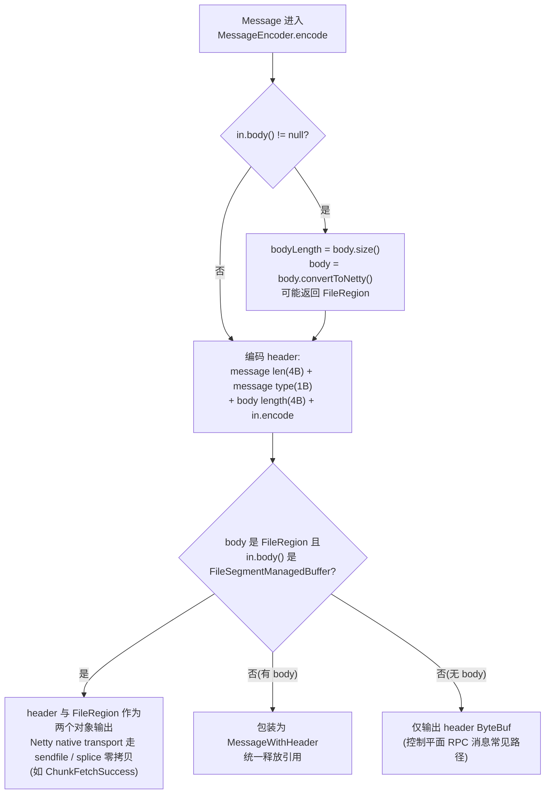
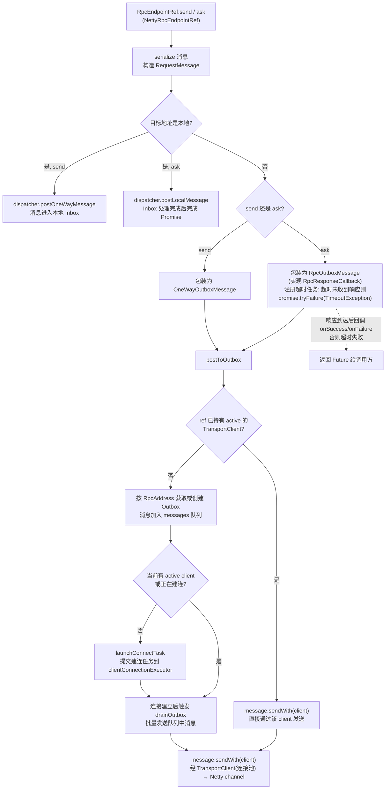
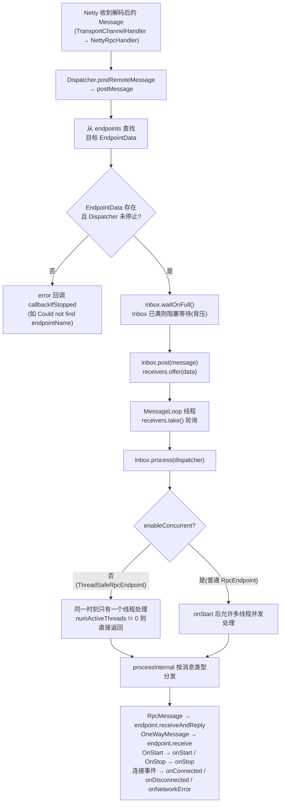

# Celeborn 网络框架与消息协议源码阅读指南

> 基于版本 0.7.0-SNAPSHOT，整理日期 2026-08-05。
> 覆盖模块：`common/src/main/scala/org/apache/celeborn/common/rpc/`、`common/src/main/java/org/apache/celeborn/common/network/`、`common/src/main/proto/`、`common/src/main/scala/org/apache/celeborn/common/protocol/message/`
> 核心文件：`NettyRpcEnv.scala`、`Dispatcher.scala`、`Outbox.scala`、`Inbox.scala`、`RpcEnv.scala`、`RpcEndpoint.scala`、`TransportContext.java`、`TransportClientFactory.java`、`TransportServer.java`、`MessageEncoder.java`、`MessageDecoder.java`、`TransportMessages.proto`、`ControlMessages.scala`、`Message.java`、`TransportMessage.java`

---

## 1. 模块定位与职责

Celeborn 的网络与协议栈是整个系统的通信底座，分为三个相互配合的层次：

- **控制面 RPC 框架**（`common/rpc/`、`common/network/`）：承担 Master/Worker/Client 之间的控制消息传输，提供 `send`（单向）和 `ask`（请求-响应）语义。
- **数据面传输**（复用同一套 Netty 基础设施）：承担 Push/Fetch 大数据块传输，由专门的 `BaseMessageHandler`（如 Worker 的 `PushDataHandler`、`FetchHandler`）处理，不经 RPC 语义层。
- **消息定义层**（`common/proto/`、`common/protocol/message/`）：`TransportMessages.proto` 定义所有上层控制消息，`Message.java` 定义底层网络帧的消息类型。

整个框架基于 Netty 4 构建，RPC 语义层设计上参考了 Apache Spark 的 RPC 实现，核心分层如下：

- **RPC 语义层**：`RpcEnv` / `RpcEndpoint` / `RpcEndpointRef`，提供 `send` 和 `ask` 语义。
- **消息调度层**：`Dispatcher` + `Inbox`，将消息路由到目标 `RpcEndpoint` 并串行/并发处理。
- **网络传输层**：`TransportContext` / `TransportClientFactory` / `TransportServer`，管理 Netty Channel、连接池、编解码器、SSL/SASL 握手。
- **消息队列层**：`Outbox`，为每个远程地址维护一个发送队列，实现非阻塞 `send`/`ask`。

消息协议在分层上的对应关系：

1. **底层网络消息（Netty Message）**：定义在 `common/network/protocol/` 中，用于 Netty Channel 上实际传输的字节流。包括 RPC 请求/响应、OneWay 消息、PushData、FetchChunk、RegionStart/Finish、Stream 控制等。
2. **上层控制消息（Protobuf Control Messages）**：定义在 `TransportMessages.proto` 中，通过 `ControlMessages.scala` 包装为 Scala case class。这些消息被序列化后作为 Netty RPC 消息或 OneWay 消息的 body 传输。

这种分层设计的优点是：底层网络层专注于字节流、帧解析、零拷贝、背压；上层控制消息使用 Protobuf 结构化描述，便于版本兼容和跨语言支持；数据平面消息（PushData/FetchChunk）直接走底层协议，避免 Protobuf 开销。

---

## 2. 协议基础：帧格式、编解码与零拷贝

### 2.1 统一帧格式

Celeborn 在一条 TCP 连接上同时传输控制消息和数据消息。所有消息都先经过 `MessageEncoder` 编码为统一的帧格式：

```
┌─────────────────┬─────────────────┬─────────────────┬─────────────────────────────┐
│  message len    │   message type  │   body length   │  body (optional)            │
│    (4 bytes)    │    (1 byte)     │    (4 bytes)    │  (protobuf / raw bytes)     │
└─────────────────┴─────────────────┴─────────────────┴─────────────────────────────┘
```

- `message len`：`Message` 自身（不含 body）编码后的长度。
- `message type`：由 `Message.Type` 枚举定义（单字节 id），决定如何解析 body。
- `body`：
  - 对于 `RPC_REQUEST` / `RPC_RESPONSE` / `ONE_WAY_MESSAGE`：body 是上层控制消息的序列化字节（Java 序列化或 Protobuf）。
  - 对于 `PUSH_DATA` / `PUSH_MERGED_DATA`：body 是原始 shuffle 数据。
  - 对于 `CHUNK_FETCH_SUCCESS`：body 是文件片段（通过 `ManagedBuffer` 零拷贝）。

### 2.2 编码器 MessageEncoder

`MessageEncoder`（`common/network/protocol/MessageEncoder.java`）将 `Message` 编码为 `ByteBuf`。下图总览编码与零拷贝分支（帧格式见 §2.1，零拷贝细节见 §2.4）：



`MessageEncoder` 的关键代码如下：

```java
public void encode(ChannelHandlerContext ctx, Message in, List<Object> out) {
  Object body = null;
  int bodyLength = 0;
  if (in.body() != null) {
    bodyLength = (int) in.body().size();
    body = in.body().convertToNetty(); // 可能返回 FileRegion 用于零拷贝
  }

  int headerLength = 4 + msgType.encodedLength() + 4 + in.encodedLength();
  ByteBuf header = ctx.alloc().heapBuffer(headerLength);
  header.writeInt(in.encodedLength());
  msgType.encode(header);
  header.writeInt(bodyLength);
  in.encode(header);

  if (body != null) {
    if (body instanceof FileRegion && in.body() instanceof FileSegmentManagedBuffer) {
      // 拆分为 header + FileRegion，走 sendfile 零拷贝
      out.add(header);
      out.add(body);
    } else {
      // 包装为 MessageWithHeader，统一释放引用
      out.add(new MessageWithHeader(in.body(), header, body, bodyLength, source));
    }
  } else {
    out.add(header);
  }
}
```

### 2.3 解码器 MessageDecoder 与粘包处理

入站方向，`TransportFrameDecoder` / `FrameDecoder`（`network/util/`）先按帧长度拆分 TCP 字节流（粘包处理），随后 `MessageDecoder` 从 `ByteBuf` 解析 `Message.Type`，再调用 `Message.decode(msgType, in)` 反序列化具体消息：

```java
public void decode(ChannelHandlerContext ctx, ByteBuf in, List<Object> out) {
  Message.Type msgType = Message.Type.decode(in);
  Message decoded = Message.decode(msgType, in);
  out.add(decoded);
}
```

### 2.4 零拷贝 FileRegion 路径

数据平面的大消息（如 `ChunkFetchSuccess`）通过 `ManagedBuffer.convertToNetty()` 返回 `FileRegion`，`MessageEncoder` 检测到后会将 header 和 FileRegion 作为两个对象输出，使 Netty native transport 能走 `sendfile` 或 `splice` 系统调用：

```java
if (body instanceof FileRegion && in.body() instanceof FileSegmentManagedBuffer) {
  out.add(header);
  out.add(body);
}
```

控制平面 RPC 消息通常无 body 或 body 较小，直接走堆 ByteBuf。

---

## 3. RPC 框架

### 3.1 核心类与文件清单

| 类/对象 | 文件 | 职责 |
|---|---|---|
| `RpcEnv` / `RpcEnvConfig` | `RpcEnv.scala` | RPC 环境抽象，提供创建、Endpoint 注册、地址解析能力 |
| `NettyRpcEnv` | `NettyRpcEnv.scala` | 基于 Netty 的 `RpcEnv` 实现，封装 `send`/`ask`、序列化、Outbox 管理 |
| `RpcEndpoint` / `ThreadSafeRpcEndpoint` | `RpcEndpoint.scala` | RPC 端点抽象，定义 `receive`/`receiveAndReply`/`onStart`/`onStop` |
| `Dispatcher` | `Dispatcher.scala` | 消息分发器，维护 Endpoint 注册表和消息处理线程池 |
| `Inbox` | `Inbox.scala` | 每个 Endpoint 的消息邮箱，保证消息按序或并发投递 |
| `Outbox` | `Outbox.scala` | 每个远程地址的发送队列，管理连接建立与消息发送 |
| `NettyRpcEndpointRef` | `NettyRpcEndpointRef.scala` | 远程/本地 Endpoint 的引用，封装 `send`/`ask` |
| `TransportContext` | `TransportContext.java` | 创建 Server/Client Factory，初始化 Netty Channel Pipeline |
| `TransportClientFactory` | `TransportClientFactory.java` | 管理到远程主机的连接池，每条连接复用一个 `TransportClient` |
| `TransportServer` | `TransportServer.java` | Netty Server 封装，监听端口并接入客户端连接 |
| `TransportChannelHandler` | `TransportChannelHandler.java` | 每个 Channel 的总处理器，聚合 request/response/channel 事件 |
| `MessageEncoder` / `MessageDecoder` | `MessageEncoder.java` / `MessageDecoder.java` | 消息编码器/解码器（见 §2） |
| `TransportFrameDecoder` / `FrameDecoder` | `network/util/` | TCP 粘包处理，按帧长度拆分字节流 |

### 3.2 RpcEnv 创建与初始化

所有 RPC 环境通过 `RpcEnv.create(...)` 创建，实际由 `NettyRpcEnvFactory` 生产 `NettyRpcEnv`：

```scala
object RpcEnv {
  def create(name, transportModule, bindAddress, advertiseAddress, port,
             conf, numUsableCores, role, securityContext, source): RpcEnv = {
    val config = RpcEnvConfig(conf, name, transportModule, bindAddress, ...)
    new NettyRpcEnvFactory().create(config)
  }
}
```

`NettyRpcEnv` 构造时完成以下关键初始化：

1. **TransportConf**：从 `CelebornConf` 中提取当前 module 相关的网络配置（克隆一份配置）。
2. **Dispatcher**：创建消息分发器。
3. **TransportContext**：创建 Netty 上下文，传入 `NettyRpcHandler` 作为控制消息处理器。
4. **ClientFactory**：基于 TransportContext 创建客户端工厂，注册 SASL/Registration 启动器。
5. **TimeoutScheduler**：单线程调度器，处理 RPC ask 超时。

```scala
class NettyRpcEnv(config: RpcEnvConfig, javaSerializerInstance: JavaSerializerInstance) extends RpcEnv(config) {
  private[celeborn] val transportConf = Utils.fromCelebornConf(
    celebornConf.clone, config.transportModule, celebornConf.rpcIoThreads.getOrElse(config.numUsableCores))

  private[netty] val dispatcher: Dispatcher = new Dispatcher(this, _rpcSource)

  private val transportContext = new TransportContext(
    transportConf,
    new NettyRpcHandler(dispatcher, this),
    false, false, config.source.orNull)

  val clientFactory = transportContext.createClientFactory(createClientBootstraps())

  private val timeoutScheduler = ThreadUtils.newDaemonSingleThreadScheduledExecutor(...)
  private[celeborn] val clientConnectionExecutor = ThreadUtils.newDaemonCachedThreadPool(...)
}
```

`NettyRpcEnv.startServer(bindAddress, port)` 启动服务端：

```scala
def startServer(bindAddress: String, port: Int): Unit = {
  server = transportContext.createServer(bindAddress, port, createServerBootstraps())
  dispatcher.registerRpcEndpoint(RpcEndpointVerifier.NAME, new RpcEndpointVerifier(this, dispatcher))
}
```

每个 `NettyRpcEnv` 都会注册一个 `RpcEndpointVerifier`，用于远程节点查询某个 Endpoint 是否存在。

### 3.3 RPC 消息发送流程（send / ask）

下图总览 `send`/`ask` 从 `RpcEndpointRef` 到 Netty channel 的完整发送路径（各步骤细节见后续小节）：



#### 3.3.1 NettyRpcEndpointRef

`RpcEndpointRef` 是 Endpoint 的引用，提供 `send` 和 `ask` 方法。远程引用 `NettyRpcEndpointRef` 保存目标 `RpcEndpointAddress`（host + port + name）。

```scala
case class NettyRpcEndpointRef(conf: CelebornConf, endpointAddress: RpcEndpointAddress, @transient nettyEnv: NettyRpcEnv)
  extends RpcEndpointRef(conf) {

  override def send(message: Any): Unit = {
    require(message != null, "Message is null")
    nettyEnv.send(RequestMessage(nettyEnv.address, this, serialize(message)))
  }

  override def ask[T: ClassTag](message: Any, timeout: RpcTimeout): Future[T] = {
    nettyEnv.ask(RequestMessage(nettyEnv.address, this, serialize(message)), timeout)
  }
}
```

#### 3.3.2 send 路径

`NettyRpcEnv.send(message)`：

- 若目标地址是本地地址，直接调用 `dispatcher.postOneWayMessage`，消息进入本地 Inbox。
- 若目标是远程，将序列化后的消息包装为 `OneWayOutboxMessage`，投递到 `Outbox`。

```scala
private[celeborn] def send(message: RequestMessage): Unit = {
  val remoteAddr = message.receiver.address
  if (remoteAddr == address) {
    dispatcher.postOneWayMessage(message)
  } else {
    postToOutbox(message.receiver, OneWayOutboxMessage(message.serialize(this)))
  }
}
```

#### 3.3.3 ask 路径

`NettyRpcEnv.ask[T]`：

- 本地 ask：调用 `dispatcher.postLocalMessage`，传入一个 `Promise`，由 Inbox 处理完成后完成 Promise。
- 远程 ask：构造 `RpcOutboxMessage`，它实现了 `RpcResponseCallback`，在收到响应后回调 `onSuccess`/`onFailure`。
- 同时注册超时任务：超时未收到响应则 `promise.tryFailure(new TimeoutException(...))`。

```scala
private[celeborn] def ask[T: ClassTag](message: RequestMessage, timeout: RpcTimeout): Future[T] = {
  val promise = Promise[Any]()
  val remoteAddr = message.receiver.address

  if (remoteAddr == address) {
    val p = Promise[Any]()
    p.future.onComplete {
      case Success(response) => onSuccess(response)
      case Failure(e) => onFailure(e)
    }(ThreadUtils.sameThread)
    dispatcher.postLocalMessage(message, p)
  } else {
    val rpcMessage = RpcOutboxMessage(
      message.serialize(this),
      onFailure,
      (client, response) => onSuccess(deserialize[Any](client, response)))
    postToOutbox(message.receiver, rpcMessage)
    promise.future.failed.foreach {
      case _: TimeoutException => rpcMessage.onTimeout()
      case _ =>
    }(ThreadUtils.sameThread)
  }

  val timeoutCancelable = timeoutScheduler.schedule(...)
  promise.future.onComplete { v => timeoutCancelable.cancel(true) }(ThreadUtils.sameThread)

  promise.future.mapTo[T].recover(timeout.addMessageIfTimeout(address))(ThreadUtils.sameThread)
}
```

#### 3.3.4 postToOutbox

`postToOutbox` 为每个远程 `RpcAddress` 维护一个 `Outbox`。若 `NettyRpcEndpointRef` 已持有 active 的 `TransportClient`（数据平面复用场景），直接通过该 client 发送；否则进入 Outbox 队列。

```scala
private def postToOutbox(receiver: NettyRpcEndpointRef, message: OutboxMessage): Unit = {
  if (receiver.client != null && receiver.client.isActive) {
    message.sendWith(receiver.client)
  } else {
    val targetOutbox = outboxes.computeIfAbsent(receiver.address, addr => new Outbox(this, addr))
    if (stopped.get) {
      outboxes.remove(receiver.address)
      targetOutbox.stop(cause = new RpcEnvStoppedException())
      message.onFailure(cause)
    } else {
      targetOutbox.send(message)
    }
  }
}
```

### 3.4 Outbox 连接管理与消息队列

`Outbox` 是每个远程地址的消息发送队列，核心职责：

1. **缓存消息**：`send(message)` 将消息加入 `messages` 链表。
2. **懒建连**：若当前无 active client 且无正在进行的建连任务，提交建连任务到 `clientConnectionExecutor`。
3. **批量 Drain**：连接建立后，一次性将队列中消息通过 `TransportClient` 发送。
4. **失败处理**：网络失败时标记 `stopped`，清空队列并通知所有消息失败，同时从 `NettyRpcEnv.outboxes` 中移除自己。

```scala
class Outbox(nettyEnv: NettyRpcEnv, val address: RpcAddress) {
  @GuardedBy("this") private val messages = new java.util.LinkedList[OutboxMessage]
  @GuardedBy("this") private var client: TransportClient = null
  @GuardedBy("this") private var connectFuture: Future[Unit] = null
  @GuardedBy("this") private var stopped = false
  @GuardedBy("this") private var draining = false

  def send(message: OutboxMessage): Unit = {
    val failure = synchronized {
      if (stopped) stopCause else { messages.add(message); null }
    }
    if (failure != null) message.onFailure(failure) else drainOutbox()
  }

  private def drainOutbox(): Unit = {
    synchronized {
      if (stopped || connectFuture != null || draining) return
      if (client == null || !client.isActive) { launchConnectTask(); return }
      message = messages.poll()
      if (message == null) return
      draining = true
    }
    while (true) {
      message.sendWith(client)
      synchronized {
        if (stopped) return
        message = messages.poll()
        if (message == null) { draining = false; return }
      }
    }
  }
}
```

建连任务 `launchConnectTask`：

```scala
connectFuture = nettyEnv.clientConnectionExecutor.submit(new Callable[Unit] {
  override def call(): Unit = {
    val _client = nettyEnv.createClient(address)
    outbox.synchronized { client = _client; if (stopped) closeClient() }
    outbox.synchronized { connectFuture = null }
    drainOutbox() // 连接建立后触发 drain
  }
})
```

### 3.5 Dispatcher 消息路由与 Inbox 处理

下图总览消息从 Netty 接收到 `RpcEndpoint` 处理的路由路径（各组件细节见后续小节）：



#### 3.5.1 Dispatcher 结构

`Dispatcher` 是消息路由中枢：

- `endpoints: ConcurrentMap[String, EndpointData]`：name -> EndpointData。
- `endpointRefs: ConcurrentMap[RpcEndpoint, RpcEndpointRef]`：Endpoint 实例 -> Ref。
- `receivers: LinkedBlockingQueue[EndpointData]`：待处理的 Endpoint 队列，供 MessageLoop 消费。
- `threadpool`：固定大小的线程池，运行多个 `MessageLoop`。

```scala
private class EndpointData(val name: String, val endpoint: RpcEndpoint, val ref: NettyRpcEndpointRef) {
  val inbox = new Inbox(ref, endpoint, celebornConf, metrics)
}
```

#### 3.5.2 消息投递

`Dispatcher.postMessage`：

1. 从 `endpoints` 获取目标 `EndpointData`。
2. 调用 `data.inbox.waitOnFull()` 若 Inbox 已满则阻塞等待（背压）。
3. 再次检查后将消息 `post` 到 Inbox，并将 `EndpointData` 加入 `receivers` 队列。

```scala
def postMessage(endpointName: String, message: InboxMessage, callbackIfStopped: Exception => Unit): Unit = {
  val data = synchronized { endpoints.get(endpointName) }
  if (data != null) data.inbox.waitOnFull()
  val error = synchronized {
    if (stopped) Some(new RpcEnvStoppedException())
    else if (data == null) Some(new CelebornException(s"Could not find $endpointName."))
    else {
      data.inbox.post(message)
      receivers.offer(data)
      None
    }
  }
  error.foreach(callbackIfStopped)
}
```

#### 3.5.3 MessageLoop

`MessageLoop` 不断从 `receivers` 取出 `EndpointData`，调用 `inbox.process(dispatcher)`：

```scala
private class MessageLoop extends Runnable {
  override def run(): Unit = {
    while (true) {
      val data = receivers.take()
      if (data == PoisonPill) { receivers.offer(PoisonPill); return }
      data.inbox.process(Dispatcher.this)
    }
  }
}
```

`Dispatcher` 默认将 `RpcEndpointVerifier` 的 Inbox 单独用一个 `EndpointVerifierMessageLoop` 处理（由 `celeborn.rpc.RpcEndpointVerifier.separate.enabled` 控制，默认开启），避免大量 `CheckExistence` 请求阻塞普通消息。

#### 3.5.4 Inbox 消息处理

`Inbox` 为每个 `RpcEndpoint` 维护一个消息队列 `messages`，并控制并发度：

- `ThreadSafeRpcEndpoint`：`enableConcurrent = false`，同一时刻只有一个线程处理其消息。
- 普通 `RpcEndpoint`：`enableConcurrent = true`，`onStart` 后允许多线程并发处理。

`Inbox.process`：

```scala
def process(dispatcher: Dispatcher): Unit = {
  inboxLock.lockInterruptibly()
  if (!enableConcurrent && numActiveThreads != 0) return
  message = messages.poll()
  if (message != null) {
    numActiveThreads += 1
    messageCount.decrementAndGet()
    signalNotFull()
  } else return
  inboxLock.unlock()

  while (true) {
    safelyCall(endpoint, endpointRef.name, message) {
      processInternal(dispatcher, message)
    }
    inboxLock.lockInterruptibly()
    if (!enableConcurrent && numActiveThreads != 1) {
      numActiveThreads -= 1; return
    }
    message = messages.poll()
    if (message == null) { numActiveThreads -= 1; return }
    // 继续处理下一条消息
  }
}
```

`processInternal` 根据消息类型分发：

- `RpcMessage` -> `endpoint.receiveAndReply(context).applyOrElse(...)`
- `OneWayMessage` -> `endpoint.receive.applyOrElse(...)`
- `OnStart` -> `endpoint.onStart()`，非 ThreadSafe 则 `enableConcurrent = true`
- `OnStop` -> `dispatcher.removeRpcEndpointRef(endpoint)`，然后 `endpoint.onStop()`
- `RemoteProcessConnected/Disconnected/ConnectionError` -> 对应的 `onConnected`/`onDisconnected`/`onNetworkError`

### 3.6 Netty Channel Pipeline

`TransportContext.initializePipeline` 为每个 SocketChannel 初始化 Netty Pipeline：

```java
ChannelPipeline pipeline = channel.pipeline();
if (nettyLogger.getLoggingHandler() != null) {
  pipeline.addLast("loggingHandler", nettyLogger.getLoggingHandler());
}
if (sslEncryptionEnabled()) {
  pipeline.addFirst("NettySslEncryptionHandler", sslHandler);
  pipeline.addLast("chunkedWriter", new ChunkedWriteHandler());
}
if (channelsLimiter != null) {
  pipeline.addLast("limiter", channelsLimiter);
}
TransportChannelHandler channelHandler = createChannelHandler(channel, resolvedMsgHandler);
pipeline
  .addLast("encoder", sslEncryptionEnabled() ? SSL_ENCODER : ENCODER)
  .addLast(FrameDecoder.HANDLER_NAME, decoder)
  .addLast("idleStateHandler", new IdleStateHandler(...))
  .addLast("handler", channelHandler);
```

从外到内的顺序：

1. **SSL Handler**（可选）：TLS 加密。
2. **ChunkedWriteHandler**（SSL 场景）：将大消息切块。
3. **ChannelsLimiter**（可选）：连接数限制。
4. **MessageEncoder**：出站编码（帧格式见 §2）。
5. **FrameDecoder / TransportFrameDecoder**：入站粘包处理。
6. **IdleStateHandler**：连接空闲检测。
7. **TransportChannelHandler**：最终业务处理。

`TransportChannelHandler` 是每个 Channel 的入口 Handler，聚合了：

- `TransportClient`：代表对端。
- `TransportResponseHandler`：处理 RPC 响应、Chunk 响应。
- `TransportRequestHandler`：处理 RPC 请求、Chunk 请求，调用 `BaseMessageHandler`。

当收到一个解码后的 `Message` 时，根据消息类型路由到 `responseHandler.handle(msg)` 或 `requestHandler.handle(msg)`。

### 3.7 TransportClient 连接池

#### 3.7.1 连接池结构

`TransportClientFactory` 维护 `ConcurrentHashMap<SocketAddress, ClientPool>`，每个地址对应一个 `ClientPool`：

```java
private static class ClientPool {
  TransportClient[] clients;
  Object[] locks;
  ClientPool(int size) {
    clients = new TransportClient[size];
    locks = new Object[size];
  }
}
```

`numConnectionsPerPeer` 决定每个远程地址的并发连接数（默认 1）。

#### 3.7.2 createClient 流程

```java
public TransportClient createClient(String remoteHost, int remotePort, int partitionId) {
  final InetSocketAddress unresolvedAddress = InetSocketAddress.createUnresolved(remoteHost, remotePort);
  ClientPool clientPool = connectionPool.computeIfAbsent(unresolvedAddress, key -> new ClientPool(numConnectionsPerPeer));
  int clientIndex = partitionId < 0 ? rand.nextInt(numConnectionsPerPeer) : partitionId % numConnectionsPerPeer;

  TransportClient cachedClient = clientPool.clients[clientIndex];
  if (cachedClient != null && cachedClient.isActive()) {
    // 更新最后请求时间，返回缓存连接
    return cachedClient;
  }

  synchronized (clientPool.locks[clientIndex]) {
    // 双重检查
    cachedClient = clientPool.clients[clientIndex];
    if (cachedClient != null && cachedClient.isActive()) return cachedClient;
    clientPool.clients[clientIndex] = internalCreateClient(resolvedAddress, decoder);
    return clientPool.clients[clientIndex];
  }
}
```

#### 3.7.3 internalCreateClient 流程

1. 创建 Netty `Bootstrap`，配置 TCP 参数（NODELAY、KEEPALIVE、CONNECT_TIMEOUT、SO_RCVBUF/SO_SNDBUF、Allocator）。
2. 初始化 Channel Pipeline（调用 `TransportContext.initializePipeline`）。
3. 阻塞等待连接成功。
4. 若启用 SSL，等待 TLS 握手完成。
5. 依次执行 `clientBootstraps`（SASL/Registration 认证）。
6. 返回 `TransportClient`。

### 3.8 与其他模块的交互

```
┌─────────────────────────────────────────────────────────────────────────────┐
│                              Application / Driver                           │
│  ┌───────────────────────────────────────────────────────────────────────┐  │
│  │                         NettyRpcEnv                                   │  │
│  │  ┌──────────┐   ┌──────────┐   ┌──────────┐   ┌────────────────────┐  │  │
│  │  │ Outbox A │   │ Outbox B │   │ ...      │   │ Dispatcher         │  │  │
│  │  │ (Worker1)│   │ (Worker2)│   │          │   │ ┌─────┐ ┌─────┐   │  │  │
│  │  └────┬─────┘   └────┬─────┘   └──────────┘   │ │Inbox│ │Inbox│   │  │  │
│  │       │              │                        │ │ LM  │ │ Ver │   │  │  │
│  │       └──────────────┴───────────────────────▶│ └─────┘ └─────┘   │  │  │
│  │                                                  └─────────────────┘  │  │
│  └───────────────────────────────────────────────────────────────────────┘  │
│                                    │                                        │
│                                    │ Netty Channel                           │
└────────────────────────────────────┼────────────────────────────────────────┘
                                     │
                    ┌────────────────┼────────────────┐
                    │                │                │
                    ▼                ▼                ▼
            ┌──────────────┐  ┌──────────────┐  ┌──────────────┐
            │    Worker    │  │    Worker    │  │    Master    │
            │  NettyRpcEnv │  │  NettyRpcEnv │  │  NettyRpcEnv │
            └──────────────┘  └──────────────┘  └──────────────┘
```

- **与 Master/Worker 控制平面**：`LifecycleManager`、`Master`、`Worker` 都通过 `NettyRpcEnv` 相互发送 `RequestSlots`、`ReserveSlots`、`CommitFiles`、`Heartbeat` 等控制消息。
- **与数据平面 Push/Fetch**：`ShuffleClientImpl` 和 Worker 的 `PushDataHandler`/`FetchHandler` 复用 `TransportClientFactory` 建立的连接，但通过 `BaseMessageHandler` 处理数据消息。
- **与认证安全**：SASL/SSL 启动器作为 `TransportClientBootstrap` / `TransportServerBootstrap` 在连接建立后执行。
- **与 Metrics**：`RpcSource` / `AbstractSource` 收集 RPC 消息队列长度、处理时间等指标。

---

## 4. 消息体系

### 4.1 核心类与文件清单

| 文件 | 职责 |
|---|---|
| `TransportMessages.proto` | 所有上层控制消息的 Protobuf 定义 |
| `ControlMessages.scala` | Scala 端对 Protobuf 消息的封装、工厂方法、类型标记（Master/Worker/Client） |
| `Message.java` | 底层 Netty 消息基类，定义 `Message.Type` 枚举和 `decode` 分发 |
| `RequestMessage.java` / `ResponseMessage.java` | 请求/响应消息基类 |
| `RpcRequest.java` / `RpcResponse.java` / `RpcFailure.java` | RPC 请求/响应/失败消息 |
| `OneWayMessage.java` | 单向消息封装 |
| `PushData.java` / `PushMergedData.java` | 数据平面 Push 消息 |
| `RegionStart.java` / `RegionFinish.java` / `PushDataHandShake.java` | MapPartition / Flink Hybrid Shuffle 控制消息 |
| `OpenStream.java` / `StreamHandle.java` / `ChunkFetchRequest.java` / `ChunkFetchSuccess.java` / `ChunkFetchFailure.java` | 数据读取流控制消息 |
| `ReadData.java` / `ReadAddCredit.java` / `BacklogAnnouncement.java` / `BufferStreamEnd.java` | Credit-based 流控消息 |
| `TransportMessage.java` | 将 Protobuf 消息包装为可序列化的 Transport 消息体 |
| `Encoders.java` | 字符串、byte 数组等基础类型的编码器 |
| `SerdeVersion.java` | 控制消息序列化版本（见 §4.6） |

### 4.2 上层控制消息：TransportMessages.proto

#### 4.2.1 MessageType 枚举

`TransportMessages.proto` 中定义了约 97 种 `MessageType`，覆盖 Master、Worker、Client 三方交互：

| 范围 | 典型消息 | 说明 |
|---|---|---|
| Worker ↔ Master | `REGISTER_WORKER`、`HEARTBEAT_FROM_WORKER`、`WORKER_LOST`、`WORKER_EVENT_REQUEST` | Worker 生命周期与状态同步 |
| Client ↔ Master | `REGISTER_SHUFFLE`、`REQUEST_SLOTS`、`UNREGISTER_SHUFFLE`、`HEARTBEAT_FROM_APPLICATION`、`CHECK_QUOTA` | Shuffle 注册、Slot 申请、应用心跳 |
| Client ↔ Worker | `RESERVE_SLOTS`、`COMMIT_FILES`、`DESTROY`、`MAPPER_END`、`GET_REDUCER_FILE_GROUP` | Slot 预留、Commit、释放 |
| 数据流控制 | `OPEN_STREAM`、`STREAM_HANDLER`、`CHUNK_FETCH_REQUEST`、`PUSH_DATA_HAND_SHAKE`、`REGION_START`、`REGION_FINISH` | Flink Hybrid Shuffle / 流读取 |
| 认证安全 | `SASL_REQUEST`、`AUTHENTICATION_INITIATION_REQUEST`、`REGISTER_APPLICATION_REQUEST` | SASL/应用注册 |
| 批量/优化 | `BATCH_OPEN_STREAM`、`BATCH_UNREGISTER_SHUFFLES`、`PUSH_MERGED_DATA_SPLIT_PARTITION_INFO` | 批量操作与打包优化 |

#### 4.2.2 核心消息结构

**PbPartitionLocation**：Celeborn 最核心的元数据结构之一，描述一个 partition 的位置。

```protobuf
message PbPartitionLocation {
  enum Mode { Primary = 0; Replica = 1; }
  Mode mode = 1;
  int32 id = 2;
  int32 epoch = 3;
  string host = 4;
  int32 rpcPort = 5;
  int32 pushPort = 6;
  int32 fetchPort = 7;
  int32 replicatePort = 8;
  PbPartitionLocation peer = 9;
  PbStorageInfo storageInfo = 10;
  bytes mapIdBitmap = 11;
}
```

- `mode`：主副本/备副本。
- `epoch`：partition location 版本，每次 revive/change 后递增。
- `peer`：主副本指向备副本，反之亦然。
- `storageInfo`：文件路径、存储类型、chunk offset 等。
- `mapIdBitmap`：已写入该 partition 的 mapId 集合（RoaringBitmap 序列化）。

**PbRequestSlots / PbRequestSlotsResponse**：Slot 申请与分配。

```protobuf
message PbRequestSlots {
  string applicationId = 1;
  int32 shuffleId = 2;
  repeated int32 partitionIdList = 3;
  string hostname = 4;
  bool shouldReplicate = 5;
  string requestId = 6;
  int32 storageType = 7;
  PbUserIdentifier userIdentifier = 8;
  bool shouldRackAware = 9;
  int32 maxWorkers = 10;
  int32 availableStorageTypes = 11;
  repeated PbWorkerInfo excludedWorkerSet = 12;
  bool packed = 13;
  string tagsExpr = 14;
}

message PbRequestSlotsResponse {
  int32 status = 1;
  map<string, PbWorkerResource> workerResource = 2;
  map<string, PbPackedWorkerResource> packedWorkerResource = 3;
}
```

- `partitionIdList`：需要分配 slot 的 partition id 列表。
- `excludedWorkerSet`：已被排除的 Worker。
- `packed`：是否使用打包格式返回 `PartitionLocation`，减少大 shuffle 的响应体积。当前 `LifecycleManager` 构造 `RequestSlots` 时固定传 `true`（`LifecycleManager.scala:1873` 附近），无对应配置开关。

**PbReserveSlots / PbReserveSlotsResponse**：

```protobuf
message PbReserveSlots {
  string applicationId = 1;
  int32 shuffleId = 2;
  repeated PbPartitionLocation primaryLocations = 3;
  repeated PbPartitionLocation replicaLocations = 4;
  int64 splitThreshold = 5;
  int32 splitMode = 6;
  int32 partitionType = 7;
  bool rangeReadFilter = 8;
  PbUserIdentifier userIdentifier = 9;
  int64 pushDataTimeout = 10;
  bool partitionSplitEnabled = 11;
  bool isSegmentGranularityVisible = 14;
}
```

Worker 收到 `ReserveSlots` 后，会为每个 partition location 创建对应的 `PartitionDataWriter`。

**PbCommitFiles / PbCommitFilesResponse**：

```protobuf
message PbCommitFiles {
  string applicationId = 1;
  int32 shuffleId = 2;
  repeated string primaryIds = 3;
  repeated string replicaIds = 4;
  repeated int32 mapAttempts = 5;
  int64 epoch = 6;
  bool mockFailure = 7;
}

message PbCommitFilesResponse {
  int32 status = 1;
  repeated string committedPrimaryIds = 2;
  repeated string committedReplicaIds = 3;
  repeated string failedPrimaryIds = 4;
  repeated string failedReplicaIds = 5;
  map<string, PbStorageInfo> committedPrimaryStorageInfos = 6;
  map<string, PbStorageInfo> committedReplicaStorageInfos = 7;
  map<string, bytes> mapIdBitmap = 10;
  int64 totalWritten = 8;
  int32 fileCount = 9;
}
```

Commit 请求携带 partition unique id 列表，Worker 完成文件 flush 和索引写入后返回结果。

### 4.3 ControlMessages.scala 的封装

`ControlMessages.scala` 将 Protobuf 消息包装为 Scala case class/object，并提供工厂方法。同时用 trait 标记消息处理方：

```scala
sealed trait Message extends Serializable
sealed trait MasterMessage extends Message
sealed trait WorkerMessage extends Message
sealed trait ClientMessage extends Message
```

例如：

```scala
case class RequestSlots(
    applicationId: String,
    shuffleId: Int,
    partitionIdList: util.ArrayList[Integer],
    hostname: String,
    shouldReplicate: Boolean,
    shouldRackAware: Boolean,
    userIdentifier: UserIdentifier,
    maxWorkers: Int,
    availableStorageTypes: Int,
    excludedWorkerSet: Set[WorkerInfo] = Set.empty,
    packed: Boolean = false,
    tagsExpr: String = "",
    override var requestId: String = ZERO_UUID)
  extends MasterRequestMessage
```

部分消息直接以 Protobuf 生成类形式使用（如 `PbRegisterMapPartitionTask`、`PbPartitionSplit`），没有额外 case class 包装。

### 4.4 底层网络消息：Message.Type

`Message.java` 定义了底层传输消息类型（单字节 id）：

| Type id | 消息类型 | 用途 |
|---|---|---|
| 0 | CHUNK_FETCH_REQUEST | 请求 chunk |
| 1 | CHUNK_FETCH_SUCCESS | 返回 chunk 数据 |
| 2 | CHUNK_FETCH_FAILURE | chunk 读取失败 |
| 3 | RPC_REQUEST | RPC 请求 |
| 4 | RPC_RESPONSE | RPC 响应 |
| 5 | RPC_FAILURE | RPC 失败 |
| 6 | OPEN_STREAM | 打开数据流 |
| 7 | STREAM_HANDLE | 流句柄响应 |
| 9 | ONE_WAY_MESSAGE | 单向消息 |
| 11 | PUSH_DATA | 单条数据推送 |
| 12 | PUSH_MERGED_DATA | 合并数据推送 |
| 13 | REGION_START | 区域开始（Flink） |
| 14 | REGION_FINISH | 区域结束（Flink） |
| 15 | PUSH_DATA_HAND_SHAKE | Push 握手 |
| 16 | READ_ADD_CREDIT | 读取侧增加 credit |
| 17 | READ_DATA | 读取数据 |
| 18 | OPEN_STREAM_WITH_CREDIT | 带 credit 打开流 |
| 19 | BACKLOG_ANNOUNCEMENT | 背压通知 |
| 20 | TRANSPORTABLE_ERROR | 可传输错误 |
| 21 | BUFFER_STREAM_END | Buffer 流结束 |
| 22 | HEARTBEAT | 心跳 |
| 23 | SEGMENT_START | Segment 开始 |
| 24 | NOTIFY_REQUIRED_SEGMENT | 通知所需 segment |
| 25 | SUBPARTITION_READ_DATA | Subpartition 读取 |

`Message.decode(Type, ByteBuf)` 根据类型分发给具体消息类的 `decode` 方法（`Message.java:128` 起的 switch）。

### 4.5 序列化流程

#### 4.5.1 上层控制消息序列化

上层控制消息通常通过 Java 序列化写入 `RpcRequest` / `OneWayMessage` 的 body：

```scala
// NettyRpcEnv.scala:303
private[celeborn] def serialize(content: Any): ByteBuffer = {
  javaSerializerInstance.serialize(content)
}
```

`RpcRequest` 的结构：

```
┌─────────────┬─────────────┬────────────────────────────────────────┐
│ requestId   │  body length │  body (Java serialized ControlMessage) │
│  (8 bytes)  │   (4 bytes)  │           (variable)                   │
└─────────────┴─────────────┴────────────────────────────────────────┘
```

部分消息（如 `PbRegisterMapPartitionTask`、`PbPartitionSplit`）直接以 Protobuf bytes 作为 body，通过 `TransportMessage` 包装——其线格式为 `messageTypeValue (4 bytes) + payloadLength (4 bytes) + payload`：

```java
public ByteBuffer toByteBuffer() {
  int payloadLength = payload != null ? payload.length : 0;
  ByteBuffer buffer = ByteBuffer.allocate(payloadLength + 4 + 4);
  buffer.putInt(messageTypeValue);
  buffer.putInt(payloadLength);
  if (payload != null) buffer.put(payload);
  ...
}
```

`TransportMessage.fromByteBuffer` 反序列化时先读 `messageTypeValue`，若无法匹配 `MessageType` 枚举则抛出异常并回退到 legacy Java 序列化消息的解析路径。

#### 4.5.2 数据平面消息序列化

以 `PushData` 为例：

```java
public final class PushData extends RequestMessage {
  public long requestId;
  public final byte mode;
  public final String shuffleKey;
  public final String partitionUniqueId;

  @Override
  public void encode(ByteBuf buf) {
    buf.writeLong(requestId);
    buf.writeByte(mode);
    Encoders.Strings.encode(buf, shuffleKey);
    Encoders.Strings.encode(buf, partitionUniqueId);
  }

  public static PushData decode(ByteBuf buf, boolean decodeBody) {
    long requestId = buf.readLong();
    byte mode = buf.readByte();
    String shuffleKey = Encoders.Strings.decode(buf);
    String partitionUniqueId = Encoders.Strings.decode(buf);
    if (decodeBody) {
      return new PushData(requestId, mode, shuffleKey, partitionUniqueId, new NettyManagedBuffer(buf));
    } else {
      return new PushData(requestId, mode, shuffleKey, partitionUniqueId, NettyManagedBuffer.EmptyBuffer);
    }
  }
}
```

数据平面消息的 body 直接是原始字节，不经过 Protobuf 或 Java 序列化。

### 4.6 版本兼容：SerdeVersion 与 packed 格式

#### 4.6.1 SerdeVersion 的真实机制

`SerdeVersion`（`common/src/main/java/org/apache/celeborn/common/network/protocol/SerdeVersion.java`）只有两个版本，靠 body 的首字节（marker）区分序列化栈：

```java
public enum SerdeVersion {
  V1((byte) 0xAC),
  V2((byte) 0xFF);
}
```

- **V1（marker 0xAC）**：传统 Java 引擎（Spark/Flink/MR/Tez）使用的版本，body 走 Java 序列化。`0xAC` 正是 Java 序列化流的魔数首字节（`0xACED`），因此可直接兼容识别。
- **V2（marker 0xFF）**：面向 C++ Client 的语言无关版本，body 为 Protobuf 字节。`0xFF` 由 celeborn-cpp 模块定义。

机制要点：

1. `serdeVersion` 是**消息级字段**，由发起方携带在 `RegisterShuffle`、`Revive`、`GetReducerFileGroup`、`MapperEnd` 等控制消息中（见 `ControlMessages.scala`），不存在 `celeborn.client.rpc.serdeVersion` 之类的配置项。Java 客户端（如 `ShuffleClientImpl`）固定传 `SerdeVersion.V1`；C++ 客户端通过 JNI 传入 V2。
2. 响应方按请求中的 `serdeVersion` 决定响应 payload 的编码方式，主要影响 `PartitionLocation` 的序列化格式和 `GetReducerFileGroupResponse` 的内容格式。
3. `TransportMessage` 携带 `serdeVersion` 字段。`NettyRpcEnv.serialize` 遇到 V2 的 `TransportMessage` 时，会显式先写入 marker 字节再写 body（`NettyRpcEnv.scala:516-524`）：

```scala
case transMsg: TransportMessage =>
  // Check if the msg is a TransportMessage with language-agnostic V2 serdeVersion.
  // If so, write the marker and the body explicitly.
  if (transMsg.getSerdeVersion == SerdeVersion.V2) {
    val out = new DataOutputStream(bos)
    out.writeByte(SerdeVersion.V2.getMarker)
    out.write(transMsg.toByteBuffer.array)
    ...
  }
```

接收端通过首字节判断走 Java 反序列化还是 Protobuf 解析，从而在同一 RPC 框架上兼容两种语言栈。

#### 4.6.2 Packed PartitionLocation

大规模 shuffle 中，`RegisterShuffleResponse` 和 `RequestSlotsResponse` 可能包含数十万 `PartitionLocation`，Protobuf 嵌套消息开销大。因此引入了 packed 格式：

```protobuf
message PbPackedPartitionLocations {
  repeated int32 ids = 1;
  repeated int32 epoches = 2;
  repeated int32 workerIds = 3;
  repeated string workerIdsSet = 4;
  repeated bytes mapIdBitMap = 5;
  repeated int32 types = 6;
  repeated int32 mountPoints = 7;
  repeated string mountPointsSet = 8;
  repeated bool finalResult = 9;
  repeated string filePaths = 10;
  repeated int32 availableStorageTypes = 11;
  repeated int32 modes = 12;
  repeated int64 fileSizes = 13;
  repeated PbChunkOffsets chunksOffsets = 14;
}
```

通过将同类字段分别打包成数组，减少 repeated message 的 tag 开销。`PbSerDeUtils` 提供 `toPbPackedPartitionLocations` 和 `fromPbPackedPartitionLocations` 转换。是否使用 packed 由 `RequestSlots` 消息中的 `packed` 字段决定（LifecycleManager 当前固定传 `true`），无配置开关。

### 4.7 消息路由与处理

#### 4.7.1 服务端接收

`TransportChannelHandler.channelRead` 收到解码后的 `Message`：

- `RpcRequest` / `OneWayMessage` -> 提取 body，通过 `NettyRpcHandler` 交给 `Dispatcher`，最终到达目标 `RpcEndpoint`。
- `PushData` / `PushMergedData` -> 交给 `PushDataHandler`。
- `ChunkFetchRequest` / `OpenStream` / `ReadAddCredit` -> 交给 `FetchHandler` / `CreditStreamManager`。

#### 4.7.2 客户端接收

`TransportResponseHandler.handle(msg)` 根据 `requestId` 找到对应的 `RpcResponseCallback`（如 `RpcOutboxMessage`），触发 `onSuccess` 或 `onFailure`。

#### 4.7.3 双层模型总览

```
┌─────────────────────────────────────────────────────────────────────────────┐
│                         ControlMessages / Protobuf                          │
│   RegisterShuffle / RequestSlots / CommitFiles / MapperEnd / ...            │
└─────────────────────────────────┬───────────────────────────────────────────┘
                                  │ Java Serializer / Protobuf bytes
                                  ▼
┌─────────────────────────────────────────────────────────────────────────────┐
│                         Netty Message (Message.Type)                        │
│   RPC_REQUEST / RPC_RESPONSE / ONE_WAY_MESSAGE / PUSH_DATA / CHUNK_FETCH... │
└─────────────────────────────────┬───────────────────────────────────────────┘
                                  │ MessageEncoder / MessageDecoder
                                  ▼
┌─────────────────────────────────────────────────────────────────────────────┐
│                              TCP Byte Stream                                │
└─────────────────────────────────────────────────────────────────────────────┘
```

---

## 5. 关键配置参数（CelebornConf 视角）

### 5.1 RPC 框架配置

| 配置项 | 默认值 | 作用位置 | 说明 |
|---|---|---|---|
| `celeborn.rpc.io.threads` | CPU 核数 | NettyRpcEnv | RPC 模块 IO 线程数 |
| `celeborn.rpc.connect.threads` | 64 | NettyRpcEnv | 建连任务线程池大小 |
| `celeborn.rpc.dispatcher.threads` | 0（= CPU 核数） | Dispatcher | Dispatcher 消息处理线程数 |
| `celeborn.rpc.lookupTimeout` | 30s | RpcEnv | Endpoint 查找超时 |
| `celeborn.rpc.askTimeout` | 60s | NettyRpcEnv | RPC ask 超时 |
| `celeborn.rpc.retryWait` | 1s | RpcEnv | RpcTimeoutException 后重试等待 |
| `celeborn.rpc.inbox.capacity` | 0 | Inbox | Inbox 容量上限，0 表示无限制 |
| `celeborn.rpc.RpcEndpointVerifier.separate.enabled` | true | Dispatcher | 是否用独立 MessageLoop 处理 EndpointVerifier |
| `celeborn.auth.enabled` | false | NettyRpcEnv | 是否启用 SASL 认证 |

### 5.2 网络传输配置（按 module 划分）

网络 IO 配置按传输模块划分，键名为 `celeborn.<module>.io.*`，`<module>` 取值包括 `rpc_app`、`rpc_service`、`data`、`push`、`replicate`、`fetch`（见 `TransportModuleConstants`）：

| 配置项 | 默认值 | 作用位置 | 说明 |
|---|---|---|---|
| `celeborn.<module>.io.mode` | 自动探测 | TransportClientFactory | Netty IO 模式（NIO/EPOLL/KQUEUE） |
| `celeborn.<module>.io.clientThreads` | 0（= 2×核数） | TransportClientFactory | Client EventLoop 线程数 |
| `celeborn.<module>.io.serverThreads` | 0（= 2×核数） | TransportServer | Server EventLoop 线程数 |
| `celeborn.<module>.io.numConnectionsPerPeer` | 1 | TransportClientFactory | 每对端连接数 |
| `celeborn.<module>.io.connectTimeout` | 10s | TransportClientFactory | TCP 连接超时（fallback：`celeborn.network.connect.timeout`） |
| `celeborn.<module>.io.connectionTimeout` | 240s | TransportChannelHandler | 连接空闲超时（fallback：`celeborn.network.timeout`） |
| `celeborn.<module>.io.receiveBuffer` | 0 | TransportClientFactory | SO_RCVBUF |
| `celeborn.<module>.io.sendBuffer` | 0 | TransportClientFactory | SO_SNDBUF |
| `celeborn.<module>.io.maxRetries` | 3 | TransportClientFactory | 建连/IO 重试次数 |
| `celeborn.<module>.io.retryWait` | 5s | TransportClientFactory | 重试间隔 |
| `celeborn.ssl.<module>.enabled` | false | TransportContext | 是否启用 SSL/TLS |
| `celeborn.ssl.<module>.*` | — | SSLFactory | 协议、算法等配置 |

### 5.3 数据面与消息相关配置

| 配置项 | 默认值 | 作用 | 说明 |
|---|---|---|---|
| `celeborn.client.fetch.maxReqsInFlight` | 3 | Fetch | 每个 stream 最大并发 chunk 请求 |
| `celeborn.client.push.buffer.max.size` | 64k | PushData | 单 reducer partition 的推送缓冲上限 |
| `celeborn.worker.pushdata.mergeBuffer.enabled` | false | Worker 写盘 | 写入前合并低利用率的 PushData body buffer |
| `celeborn.shuffle.chunk.size` | 8m | ChunkFetch | 单次 fetch chunk 大小 |

> 说明：早期文档中的 `celeborn.client.registerShuffle.packed.enabled`、`celeborn.client.requestSlots.packed.enabled`、`celeborn.client.rpc.serdeVersion` 等配置在 0.7.0 代码中并不存在——packed 由 `RequestSlots` 消息字段控制（LifecycleManager 固定传 `true`），serde 版本由消息级 `SerdeVersion` 字段控制（见 §4.6）。

---

## 6. 可优化点与代码债务

> 本节条目已于 2026-09 对照当前代码逐项核查。原 17 项中事实前提不成立或不值得做的 9 项已删除（见文末附表），保留的 8 项按价值重新排序编号。

### P0：推荐优先实施

#### 6.1 启用 V2 serde，消除控制消息的 Java 序列化包装壳

**代码位置**：`NettyRpcEnv.scala:303-305`

```scala
private[celeborn] def serialize(content: Any): ByteBuffer = {
  javaSerializerInstance.serialize(content)
}
```

业务 payload 早已全部是 Protobuf（`ControlMessages.toTransportMessage` 逐消息转 pb），Java 序列化的只是 `TransportMessage` 包装壳（enum + byte[]）。关键问题：框架层已实现 **V2 serde 快路径**（`NettyRpcEnv.scala:519-525`、`JavaSerializer.scala:119-125`——直接写 marker + pb 原始字节，完全绕过 Java 序列化），但全仓库没有任何消息构造点使用 `SerdeVersion.V2`，线上所有控制消息的包装壳仍走 Java 序列化。`ControlMessages.scala:536`、`:1071` 的 `// TODO change message type to GeneratedMessageV3` 仍在。

**优化方向**：
- 启用 V2 serde（默认切换或加配置开关），消除包装壳的 Java 序列化。HeartbeatFromWorker、RequestSlots 等 Master 高频路径直接受益，并带来跨语言（Rust/C++ 客户端）兼容收益。**这是本节投入产出比最高的一项。**
- 中长期：将控制消息统一迁移为直接发送 pb 消息，消除 legacy case class 与手工转换。

#### 6.2 拆分 `ControlMessages.scala`（与 6.1 协同）

**代码位置**：`ControlMessages.scala`

文件 1580 行，31 个消息 case class、`toTransportMessage`（约 530 行巨型 match，`:537`）与 `fromTransportMessage`（约 500 行，`:1072`）全部耦合在一个 object 内。是控制面可维护性最大的债务，且 6.1 的 pb 迁移正好要动这些转换逻辑，拆分是天然的前置工作。

**优化方向**：
- 按模块拆分为 `MasterControlMessages`、`WorkerControlMessages`、`ClientControlMessages`（已存在对应 sealed trait 可作边界）。
- 将 Protobuf 转换逻辑下沉到 `PbSerDeUtils`，保留 `ControlMessages` object 作为 re-export 门面。

### P1：小而安全的改进

#### 6.3 移除 `Dispatcher.postMessage` 多余的第一重 `synchronized`

**代码位置**：`Dispatcher.scala:170-199`

`postMessage` 先 `synchronized` 读取 `endpoints`，然后 `data.inbox.waitOnFull()`，再 `synchronized` 双重检查并 post。`endpoints` 已是 `ConcurrentHashMap`，第一次 `synchronized` 仅为读 map，确凿多余（第二段因 `stopped` 检查仍需保留）。这是每条 RPC 投递的必经之路，改动极小、安全。

**优化方向**：
- 第一次读取改为无锁的 `endpoints.get(endpointName)`。

### P2：低优先级与大版本清理

#### 6.4 `TransportMessages.proto` 的 deprecated 字段清理

实际仅约 6 个 deprecated 字段（`:248`、`:707-719`、`:731-732`）加 1 个兼容枚举值（`:28`）；proto3 未设置的字段在线上零开销，真实成本只是 schema 维护负担。

**优化方向**：
- 在重大版本升级时清理。

#### 6.5 `Message.Type` 硬编码 switch 分支

**代码位置**：`Message.java:126-182`（另有平行的 `Message.decode` switch，`:189-254`）

新增消息类型需修改 4 处（enum 常量、两个 switch 的 case、新消息类）。消息类型极少变动（id 上限 128），实际风险低。

**优化方向**：
- 可使用注册表模式（registry）按 id 映射到解码器。

#### 6.6 `MessageDecoder` 补充异常上下文日志

**代码位置**：`MessageDecoder.java:42-49`

decode 无 try-catch；异常沿 pipeline 传播到末端 `TransportChannelHandler.exceptionCaught`（`:92-100`），有 warn 日志（含堆栈与远端地址）并关闭连接，兜底行为明确。可挑剔的仅是日志不含消息类型与 buffer 状态等解码上下文。

**优化方向**：
- 在 decoder 或 `exceptionCaught` 处补充消息类型、远端地址与 buffer 状态。

#### 6.7 `TransportContext.initializePipeline` SSL 分支提取

**代码位置**：`TransportContext.java:190-231`

SSL 判断集中在同一方法内的两处条件（`:195-211` 的 SslHandler/ChunkedWriteHandler 添加、`:218` 的 encoder 二选一），SSL 与非 SSL 走两套 encoder 类（`SslMessageEncoder` / `MessageEncoder`），存在分叉维护点。

**优化方向**：
- 将 SSL pipeline 构建提取为独立方法，统一处理 SSL/非 SSL 分支。

#### 6.8 清理非 packed 的 `PbPartitionLocation` 兼容路径

packed 格式已是事实默认且为代码硬编码：`RegisterShuffleResponse`（`ControlMessages.scala:643-647`）、`GetReducerFileGroupResponse`（`:783-789`）、Master→Worker `ReserveSlots`（`:965-969`）均无条件使用 packed；`RequestSlots` 的 packed 开关由 LifecycleManager 硬编码传 `true`（`LifecycleManager.scala:1873`）。

**优化方向**：
- 剩余债务仅是 `PbPartitionLocation` 消息定义与非 packed 兼容路径的保留，可在重大版本升级时清理。

### 附：核查后删除的条目

以下 9 项原为第 6 节内容，经核查事实前提不成立或风险远大于收益，已删除，不建议重新引入：

| 原条目 | 删除原因 |
|---|---|
| 6.1 `NettyRpcEnv.ask` 本地路径嵌套 Promise | 仅多一次分配加同线程回调，无锁无切换，只命中同进程路径，价值过低 |
| 6.2 `Outbox` LinkedList + synchronized | 锁临界区纳秒级；`draining`/`stopped`/`connectFuture` 状态机与队列操作需原子组合，改无锁队列要重写沿用自 Spark 的成熟逻辑，风险远大于收益 |
| 6.3 `MessageEncoder` 每次分配堆 ByteBuf | 默认 `POOLED` allocator（0.7.0 起）下 `heapBuffer` 已池化，不产生 GC 压力 |
| 6.6 `Inbox` 锁保护改 Atomic | 论断错误：`enableConcurrent` 在 `stop()` 中会置 false（`Inbox.scala:281`），锁保护是必要的 |
| 6.7 连接池按 partitionId 取模热点 | `numConnectionsPerPeer` 默认为 1，取模无意义；取模对连续 partitionId 本就均匀 |
| 6.8 `launchConnectTask` 失败级联重构 | 属正确的 fail-fast 语义（失败即回调 + Outbox 重建），沿用自 Spark 且经长期验证 |
| 6.11 `PushMergedData` 16 字节固定头 | 数字错误：固定部分仅 9 字节，批处理合并本身是设计特性 |
| 6.13 `CelebornConf.clone` 深拷贝开销 | 纯 HashMap 拷贝几十微秒，且只在进程启动期发生个位数次 |
| 6.17 控制/数据消息共用车道 | 前提不成立：rpc/push/fetch/replicate 四端口、独立 TransportServer/ClientFactory/EventLoopGroup 早已分离 |

---

## 7. 阅读建议与延伸阅读

### 7.1 阅读路径建议

1. **先读 `TransportMessages.proto`**：建立消息全景图，知道有哪些控制消息。
2. **从 `RpcEnv.create` 入手**：理解 `NettyRpcEnv` 如何被创建和初始化。
3. **跟踪一次远程 `ask` 调用**：从 `NettyRpcEndpointRef.ask` -> `NettyRpcEnv.ask` -> `Outbox.send` -> `TransportClient.sendRpc` -> `MessageEncoder` -> 对端 `MessageDecoder` -> `TransportChannelHandler` -> `Dispatcher.postRemoteMessage` -> `Inbox.process` -> `RpcEndpoint.receiveAndReply`，走完整条链路。
4. **对比本地与远程路径**：本地路径绕过 Outbox 和 Netty，直接进入 Dispatcher。
5. **结合数据平面**：阅读 `PushDataHandler` / `FetchHandler` 如何复用 `TransportServer` 和 `TransportClient`。

### 7.2 延伸阅读

- [client-control-plane-deep-dive.md](./client-control-plane-deep-dive.md) — 控制消息的主要生产者和消费者 LifecycleManager
- [master-ha-ratis-deep-dive.md](./master-ha-ratis-deep-dive.md) — Master 侧控制消息处理与 HA 状态机
- [service-and-security-deep-dive.md](./service-and-security-deep-dive.md) — SASL/SSL 启动器与认证相关消息（SASL_REQUEST 等）
- [ARCHITECTURE_ANALYSIS.md](./ARCHITECTURE_ANALYSIS.md) — 系统整体架构
- [performance-optimization-analysis.md](./performance-optimization-analysis.md) — 网络与传输层性能瓶颈分析
