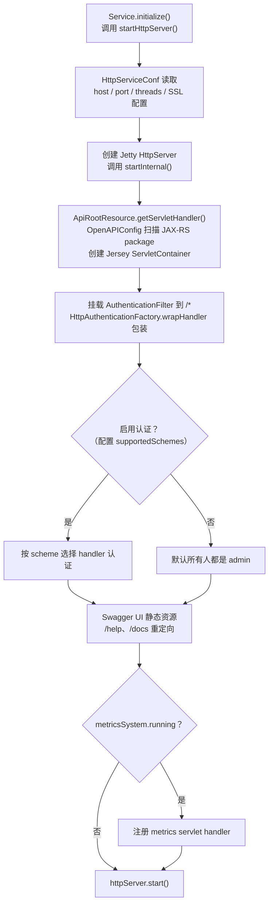
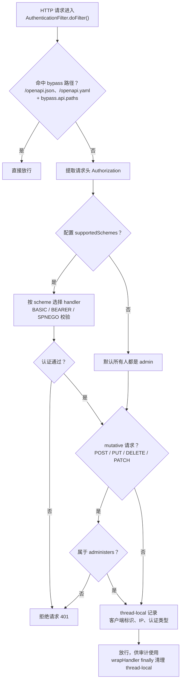
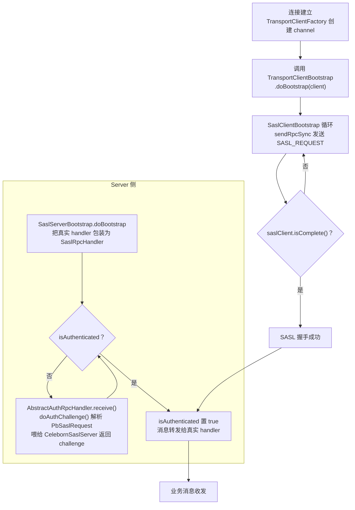

# Apache Celeborn Service 模块与安全机制源码阅读指南

> 范围：`service/` 目录（HTTP REST、认证过滤器、动态配置）+ 传输层安全（SASL 认证、SSL/TLS）。
> 基于版本 0.7.0-SNAPSHOT，整理日期 2026-08-05。
> 第 8 节「可优化点与代码债务」已于 2026-09-06 对照当前代码逐项核查修订（含条目删除/修正记录）。
> 阅读目标：理解 Celeborn 的 HTTP REST 服务如何启动、如何注册 endpoint、HTTP 认证如何工作；控制面 RPC 上的 SASL 认证机制；数据面与控制面通道上的 TLS；以及动态配置如何分级生效。

---

## 1. 模块定位

### 1.1 `service/`：Master/Worker 共享的基础层

`service/` 是 Master 与 Worker 共享的**通用服务基础设施层**，位于 `common/` 与具体 server 模块之间，负责：

- 启动嵌入式 Jetty HTTP 服务器；
- 提供 REST API 资源（Jersey / OpenAPI）；
- 提供 HTTP 认证过滤器（BASIC / BEARER / SPNEGO）；
- 提供动态配置 SPI 与缓存刷新机制；
- 提供 Metrics System 与 Dropwizard/Jetty metrics servlet。

`Master` 与 `Worker` 都继承 `HttpService`，并各自注册自己的 JAX-RS resource package：

- Master：`org.apache.celeborn.service.deploy.master.http.api`
- Worker：`org.apache.celeborn.service.deploy.worker.http.api`

### 1.2 三条安全线总览

Celeborn 的安全体系由三条独立但可叠加的线组成：

| 层级 | 机制 | 覆盖范围 | 说明 |
|------|------|----------|------|
| 控制面 RPC | SASL DIGEST-MD5 | Client ↔ Master / Client ↔ Worker / Master ↔ Worker / Worker ↔ Worker | 基于每应用随机 secret 的认证，不加密后续流量。 |
| 数据/控制面传输 | SSL/TLS | push / fetch / replicate / rpc_app / rpc_service / data / HTTP | 传输层加密，可独立开启。 |
| HTTP 管理面 | BASIC / BEARER / SPNEGO | Master/Worker REST API | 独立的 HTTP 认证，与 SASL 不互通。 |

> 当前实现中，SASL 只认证不加密后续 RPC payload；如需保密需同时开启 SSL。

---

## 2. HTTP 服务与 REST

### 2.1 核心类与职责

| 类 | 路径 | 职责 |
|----|------|------|
| `Service.scala` | `service/src/main/scala/org/apache/celeborn/server/common/Service.scala` | 服务抽象基类；定义 `initialize()` / `stop()` 生命周期。 |
| `HttpService.scala` | `service/src/main/scala/org/apache/celeborn/server/common/HttpService.scala` | 继承 `Service`；启动 Jetty `HttpServer`，注册 Jersey、认证、Swagger、metrics。 |
| `HttpServer.scala` | `service/src/main/scala/org/apache/celeborn/server/common/http/HttpServer.scala` | Jetty `Server` 的薄封装；配置线程池、HTTPS、handler。 |
| `ApiRootResource.scala` | `service/src/main/scala/org/apache/celeborn/server/common/http/api/ApiRootResource.scala` | JAX-RS root resource；生成 Jersey `ServletContainer`。 |
| `OpenAPIConfig.scala` | `service/src/main/scala/org/apache/celeborn/server/common/http/api/OpenAPIConfig.scala` | Jersey `ResourceConfig`；扫描 package、注册 OpenAPI resource。 |
| `CelebornOpenApiResource.scala` | `service/src/main/scala/org/apache/celeborn/server/common/http/api/CelebornOpenApiResource.scala` | 提供 `/openapi.json` 与 `/openapi.yaml`。 |
| `RestExceptionMapper.scala` | `service/src/main/scala/org/apache/celeborn/server/common/http/api/RestExceptionMapper.scala` | 全局异常映射。 |
| `HttpUtils.scala` / `RestAuditLogger.scala` | `service/.../http/` | 请求解析与审计日志。 |

### 2.2 HTTP 服务启动流程

启动流程总览：



`Master` / `Worker` 启动时调用 `Service.initialize()`：

```scala
// HttpService.scala
override def initialize(): Unit = {
  super.initialize()
  startHttpServer()
}
```

`startHttpServer()` 内部：

1. 用 `HttpServiceConf` 读取 host/port/threads/SSL 等配置；
2. 创建 Jetty `HttpServer`；
3. 调用 `startInternal()`：

```scala
protected def startInternal(): Unit = {
  val contextHandler = ApiRootResource.getServletHandler(this)

  // 认证过滤器挂载到 /*
  val holder = new FilterHolder(new AuthenticationFilter(conf, serviceName))
  contextHandler.addFilter(holder, "/*", util.EnumSet.allOf(classOf[DispatcherType]))
  httpServer.addHandler(HttpAuthenticationFactory.wrapHandler(contextHandler))

  // Swagger UI 静态资源
  httpServer.addStaticHandler("META-INF/resources/webjars/swagger-ui/4.9.1/", "/swagger-static/")
  httpServer.addStaticHandler("org/apache/celeborn/swagger", "/swagger")
  httpServer.addRedirectHandler("/help", "/swagger")
  httpServer.addRedirectHandler("/docs", "/swagger")

  // Metrics servlets
  if (metricsSystem.running) {
    metricsSystem.getServletContextHandlers.foreach(httpServer.addHandler)
  }

  httpServer.start()
}
```

`ApiRootResource.getServletHandler()` 基于 `OpenAPIConfig` 创建 Jersey `ServletContainer`。`OpenAPIConfig` 会扫描：

- 通用 package：`org.apache.celeborn.server.common.http.api`
- Master 额外 package：`org.apache.celeborn.service.deploy.master.http.api`
- Worker 额外 package：`org.apache.celeborn.service.deploy.worker.http.api`

### 2.3 REST Endpoint 层级

| 前缀 | 说明 |
|------|------|
| `/` | 旧版 text/plain 端点（已标记 deprecated），如 `/ping`、`/conf`、`/workerInfo`。 |
| `/api/v1` | 新版 JSON 端点。 |
| `/api/v1/conf` | `ConfResource`：查看/修改配置。 |
| `/api/v1/loggers` | `LoggerResource`：日志级别。 |
| `/api/v1/thread_dump` | 线程栈。 |
| `/api/v1/container_info` | 容器信息。 |
| `/api/v1/shuffles`、`/api/v1/applications`、`/api/v1/workers`、`/api/v1/masters`、`/api/v1/ratis` | Master/Worker 各有实现。 |
| `/metrics/prometheus`、`/metrics/json` | Metrics servlets。 |
| `/swagger`、`/openapi.json` | Swagger UI 与 OpenAPI 描述。 |

### 2.4 与 Master / Worker 的交互

| 功能 | Master 扩展 | Worker 扩展 |
|------|------------|------------|
| 启动 HTTP | 继承 `HttpService`，调用 `super.initialize()` | 同左 |
| 注册资源 | `org.apache.celeborn.service.deploy.master.http.api` | `org.apache.celeborn.service.deploy.worker.http.api` |
| 动态配置 | 读取 SYSTEM/TENANT/TENANT_USER 配置用于调度策略 | 读取用于本地存储/推送策略 |
| 认证 | 控制 exclude worker、decommission 等管理员操作 | 控制 exit、动态配置修改等 |

---

## 3. HTTP 认证

HTTP 认证与 SASL 是两套独立体系（身份不互通，管理员需分别配置）。

### 3.1 核心类与职责

| 类 | 路径 | 职责 |
|----|------|------|
| `AuthenticationFilter.scala` | `service/src/main/scala/org/apache/celeborn/server/common/http/authentication/AuthenticationFilter.scala` | Servlet `Filter`；根据配置的 scheme 选择 handler 进行认证。 |
| `HttpAuthenticationFactory.scala` | `service/.../http/authentication/HttpAuthenticationFactory.scala` | 包装 handler，负责 thread-local 清理。 |
| `BasicAuthenticationHandler` / `BearerAuthenticationHandler` / `SpnegoAuthenticationHandler` | `service/.../http/authentication/` | 分别处理 BASIC、BEARER、SPNEGO。 |
| `AnonymousAuthenticationProviderImpl.scala` | `common/src/main/scala/org/apache/celeborn/common/authentication/` | 默认 provider，允许匿名访问。 |

三种方案：

| 方案 | 默认 | 说明 |
|------|------|------|
| SPNEGO | 未启用 | Kerberos。 |
| BASIC | `AnonymousAuthenticationProviderImpl` | 可插拔 provider。 |
| BEARER | `AnonymousAuthenticationProviderImpl` | 可插拔 token provider。 |

### 3.2 认证流程

认证流程总览：



`AuthenticationFilter.doFilter(...)`：

1. 从请求头中提取 `Authorization`；
2. 根据 `celeborn.<role>.http.auth.supportedSchemes` 选择 handler；
3. 如果未配置任何 scheme，默认所有人都是 admin；
4. 对 mutative 请求（POST/PUT/DELETE/PATCH）检查是否属于 `administers`；
5. 通过 thread-local 设置客户端标识、IP、认证类型，供审计使用；
6. `HttpAuthenticationFactory.wrapHandler()` 在 finally 中清理 thread-local。

默认 bypass 路径：`/openapi.json`、`/openapi.yaml`；额外路径通过 `celeborn.http.auth.bypass.api.paths` 配置。

---

## 4. SASL 认证

### 4.1 覆盖范围

| 通道 | 认证方式 |
|------|----------|
| Client ↔ Master (RPC) | `RegistrationClientBootstrap` / `RegistrationServerBootstrap` + SASL |
| Client ↔ Worker (RPC) | `SaslClientBootstrap` / `SaslServerBootstrap` + SASL |
| Master ↔ Worker (RPC) | `SaslClientBootstrap` / `SaslServerBootstrap` + SASL |
| Worker ↔ Worker (replicate RPC) | `SaslClientBootstrap` / `SaslServerBootstrap` + SASL |
| Push / Fetch / Replicate 数据面 | **无 SASL**，依赖 SSL/TLS |

### 4.2 核心类与职责

#### SASL 框架

所有 SASL 代码位于 `common/src/main/java/org/apache/celeborn/common/network/sasl/`：

| 类 | 职责 |
|----|------|
| `CelebornSaslClient.java` | 包装 `javax.security.sasl.SaslClient`，驱动 challenge/response。 |
| `CelebornSaslServer.java` | 包装 `javax.security.sasl.SaslServer`，通过 `DigestCallbackHandler` 校验 client token。 |
| `SaslClientBootstrap.java` | `TransportClientBootstrap`；连接建立后立即发起 DIGEST-MD5 握手。 |
| `SaslServerBootstrap.java` | `TransportServerBootstrap`；把真实 handler 包装进 `SaslRpcHandler`。 |
| `SaslRpcHandler.java` | 服务端 RPC handler；完成 challenge/response 后再把消息转发给真实 handler。 |
| `SaslUtils.java` | 常量：`DIGEST_MD5`、`ANONYMOUS`、QOP、realm、Base64 编解码辅助。 |
| `SaslCredentials.java` | 不可变的 `(userId, password)` 元组。 |
| `SecretRegistry.java` / `SecretRegistryImpl.java` | 应用 secret 查询接口与默认内存实现。 |
| `SaslTimeoutException.java` | 区分 SASL 超时与其他失败。 |

#### 匿名注册协议

用于 Client 首次向 Master 注册应用：

| 类 | 职责 |
|----|------|
| `anonymous/AnonymousSaslProvider.java` | 注册自定义 ANONYMOUS 工厂的安全 provider。 |
| `anonymous/AnonymousSaslClientFactory.java` | ANONYMOUS client 工厂。 |
| `anonymous/AnonymousSaslServerFactory.java` | ANONYMOUS server 工厂。 |
| `registration/RegistrationClientBootstrap.java` | Client → Master：先 ANONYMOUS 认证，再发送 `RegisterApplicationRequest`。 |
| `registration/RegistrationServerBootstrap.java` | Master 端注册协议 bootstrap。 |
| `registration/RegistrationRpcHandler.java` | 处理 `AUTHENTICATION_INITIATION`、ANONYMOUS client-auth、应用注册。 |
| `registration/RegistrationInfo.java` | 追踪注册状态。 |

#### 高层上下文

| 类 | 路径 | 职责 |
|----|------|------|
| `RpcSecurityContext.scala` | `common/src/main/scala/org/apache/celeborn/common/rpc/RpcSecurityContext.scala` | 把 client/server SASL 上下文带入 `NettyRpcEnv`。 |
| `ClientSaslContext` | 同上 | 应用 id + 凭证 + 是否需要注册。 |
| `ServerSaslContext` | 同上 | secret registry + 是否使用注册 bootstrap。 |

### 4.3 支持的 SASL 机制

`SaslUtils.java` 定义两种机制：

- **DIGEST-MD5**：真正的连接认证，使用共享 secret。
- **ANONYMOUS**：仅用于 Client 向 Master 注册应用时的 client-auth，不校验凭证。

`CelebornSaslClient` 等代码有 TODO 注释指向 `CELEBORN-1158`：当前机制硬编码，未来应支持可配置。

### 4.4 Secret 生命周期

1. `LifecycleManager.createSecret()` 为每个应用生成 256-bit 随机 secret（`client/src/main/scala/org/apache/celeborn/client/LifecycleManager.scala`）。
2. 封装为 `ApplicationMeta(appUniqueId, appSecret)`。
3. Client 通过 `RegistrationClientBootstrap` 向 Master 注册应用，携带 appId + secret。
4. Master 通过 `MasterSecretRegistryImpl` 把 secret 持久化到 Ratis-backed `statusSystem.applicationMetas`（`master/.../MasterSecretRegistryImpl.java`）。
5. Master 通过 `pushApplicationMetaToWorkers` 把 `ApplicationMeta` 推送给分配到的 Worker（`master/.../Master.scala`）。
6. Worker 在 `WorkerSecretRegistryImpl` 中缓存 secret，缺失时回查 Master（`worker/.../WorkerSecretRegistryImpl.java`）。
7. Executor/`ShuffleClientImpl` 向 LifecycleManager 获取 `PbApplicationMeta`，再用 `SaslClientBootstrap` 向 Worker 认证。

> Master 注册应用仅在 HA leader 上执行：`MasterSecretRegistryImpl.registrationEnabled()` 检查 `HAHelper.checkShouldProcess()`。

### 4.5 SASL 与 Netty Pipeline 的交互

交互流程总览：



SASL **不是 Netty channel handler**，而是应用层 RPC bootstrap：

**Client 侧**：
- `TransportClientFactory` 在 channel 连接后调用 `TransportClientBootstrap.doBootstrap(client)`。
- `SaslClientBootstrap.doBootstrap` 循环调用 `client.sendRpcSync(...)` 发送 `SASL_REQUEST`，直到 `saslClient.isComplete()`。

**Server 侧**：
- `SaslServerBootstrap.doBootstrap(channel, rpcHandler)` 把真实 handler 包装为 `SaslRpcHandler`。
- `SaslRpcHandler` 继承 `AbstractAuthRpcHandler`。
- `AbstractAuthRpcHandler.receive()` 在 `isAuthenticated == false` 时调用 `doAuthChallenge()`。
- `SaslRpcHandler.doAuthChallenge()` 解析 `PbSaslRequest`，喂给 `CelebornSaslServer`，返回 challenge。
- `saslServer.isComplete()` 后 `isAuthenticated` 置 true，后续消息转发给真实 handler。

---

## 5. SSL / TLS

### 5.1 覆盖范围

| 通道/服务 | SSL 支持 |
|-----------|----------|
| RPC 数据通道：`rpc_app`、`rpc_service`、`push`、`fetch`、`replicate`、`data` | 是，按 module 配置 `celeborn.ssl.<module>.*` |
| HTTP REST 服务（Master/Worker） | 是，`celeborn.<role>.http.ssl.*` |
| Ratis HA 共识（Master 之间） | 是，复用 `celeborn.ssl.rpc_service.*` |

### 5.2 核心类与职责

#### SSL 工厂

`common/src/main/java/org/apache/celeborn/common/network/ssl/`：

| 类 | 职责 |
|----|------|
| `SSLFactory.java` | 构建 `SSLContext`、KeyManager、TrustManager、SSLEngine；支持 auto-SSL 自签名模式。 |
| `SSLUtils.java` | 生成自签名证书与临时 JKS 密钥库。 |
| `ReloadingX509TrustManager.java` | 配置 truststore 定期热加载。 |

#### Netty 集成

| 类 | 路径 | 职责 |
|----|------|------|
| `TransportContext.java` | `common/.../network/TransportContext.java` | 为每个 context 构造 `SSLFactory`；`initializePipeline()` 在 SSL 启用时把 `SslHandler` 加到 pipeline 首位，并替换 `MessageEncoder` 为 `SslMessageEncoder`；零拷贝退化为 `ChunkedWriteHandler`。 |
| `TransportConf.java` | `common/.../network/util/TransportConf.java` | 按 module 读取 SSL 配置。 |

#### HTTP 集成

| 类 | 路径 | 职责 |
|----|------|------|
| `HttpServer.scala` | `service/.../http/HttpServer.scala` | Jetty `SslContextFactory.Server` + `SslConnectionFactory` + `HttpConnectionFactory`。 |
| `HttpService.scala` | `service/.../HttpService.scala` | 从 `CelebornConf` 读取 `celeborn.<role>.http.ssl.*` 并启动 HTTPS。 |

#### Ratis HA 集成

| 类 | 路径 | 职责 |
|----|------|------|
| `HARaftServer.java` | `master/.../clustermeta/ha/HARaftServer.java` | `configureSsl()` 用 `RPC_SERVICE_MODULE` 配置构造 `SSLFactory`，提取首组 KeyManager/TrustManager，生成 `GrpcTlsConfig` 注入 Ratis；**仅当 Ratis RPC type 为 GRPC 时生效**，否则直接禁用 TLS 并记录错误日志。 |

### 5.3 SSL 上下文构建

`SSLFactory` builder 参数：

- `requestedProtocol`（默认 `TLSv1.2`；builder 显式传 null 时回退到 `TLSv1.3`）
- `requestedCiphers`
- `keyStore` + `keyStorePassword` + `keyPassword`
- `trustStore` + `trustStorePassword` + `trustStoreReloadingEnabled` + `reloadIntervalMs`
- `autoSslEnabled`

信任行为：

- 未配置 truststore 时，安装 **`credulousTrustStoreManagers()`**，信任**所有**证书。
- 启用 truststore 热加载时，使用 `ReloadingX509TrustManager`。
- 否则使用 JDK 默认 `TrustManagerFactory`。

`SSLFactory.createSSLEngine`：

- `setUseClientMode(isClient)`
- `setWantClientAuth(true)` — 请求客户端证书但不强制。
- 协议过滤：requestedProtocol 非空时仅启用该协议，为空时启用 `TLSv1.3` + `TLSv1.2`（`SSLFactory.enabledProtocols`）。
- 未显式配置加密套件时，使用 Mozilla-modern 列表过滤。

---

## 6. 动态配置

### 6.1 核心类与职责

| 类 | 路径 | 职责 |
|----|------|------|
| `ConfigService.java` | `service/src/main/java/org/apache/celeborn/server/common/service/config/ConfigService.java` | 动态配置服务接口。 |
| `BaseConfigServiceImpl.java` | `service/.../service/config/BaseConfigServiceImpl.java` | 缓存 + 定时刷新 + listener 通知的公共实现。 |
| `FsConfigServiceImpl.java` | `service/.../service/config/FsConfigServiceImpl.java` | 文件（YAML）后端，只读。 |
| `DbConfigServiceImpl.java` | `service/.../service/config/DbConfigServiceImpl.java` | 数据库（JDBC/MyBatis/HikariCP）后端，支持 CRUD。 |
| `DynamicConfigServiceFactory.java` | `service/.../service/config/DynamicConfigServiceFactory.java` | 通过 Java SPI `ConfigStore` 加载后端，创建单例 `ConfigService`。 |
| `DynamicConfig.java` / `SystemConfig.java` / `TenantConfig.java` | `service/.../service/config/` | 配置层级抽象与优先级解析。 |
| `ConfigLevel.java` | `service/.../service/config/ConfigLevel.java` | `SYSTEM` / `TENANT` / `TENANT_USER` 枚举。 |

### 6.2 动态配置生效链

优先级从高到低：

```
TENANT_USER → TENANT → SYSTEM → CelebornConf (static)
```

实现流程：

1. `Service.configService` 懒加载，调用 `DynamicConfigServiceFactory.getConfigService(conf)`；
2. `DynamicConfigServiceFactory` 通过 `ServiceLoader.load(ConfigStore.class)` 查找 `FS` 或 `DB` 后端；
3. `BaseConfigServiceImpl` 启动一个 daemon 定时线程，按 `celeborn.dynamicConfig.refresh.interval`（默认 120s）调用 `refreshCache()`；
4. 刷新后调用 `notifyListenersOnConfigUpdate()`，同步执行注册的 `Runnable` listener；
5. `DynamicConfig.getValue()` 按层级递归查找，缺失时最终回退到 `CelebornConf`。

### 6.3 FS 后端 YAML 格式

```yaml
- level: SYSTEM
  config:
    key: value
  tags:
    tag1: ['host:port', ...]

- tenantId: tenant_1
  level: TENANT
  config:
    key: value
  users:
    - name: user_1
      config:
        key: value
```

> FS 后端目前只读；`upsert/delete` 抛 `UnsupportedOperationException("Not supported yet.")`。

### 6.4 DB 后端

- MyBatis + HikariCP；
- 集群身份解析位于 `DbServiceManagerImpl`：来自 `CELEBORN_CLUSTER_NAME` 环境变量，缺省回退到 `celeborn.cluster.name`；namespace 来自 `CELEBORN_CLUSTER_NAMESPACE`；
- 表：`celeborn_cluster_info`、`celeborn_cluster_system_config`、`celeborn_cluster_tenant_config`、`celeborn_cluster_tags`；
- 支持 REST 全量 CRUD。

---

## 7. 关键配置参数

### 7.1 HTTP 服务

| 配置键 | 默认值 | 说明 |
|--------|--------|------|
| `celeborn.master.http.host` / `celeborn.worker.http.host` | `<localhost>` | HTTP 绑定 host，`<localhost>` 会替换为本地主机名。 |
| `celeborn.master.http.port` / `celeborn.worker.http.port` | `9098` / `9096` | HTTP 端口。 |
| `celeborn.<role>.http.maxWorkerThreads` | `200` | Jetty worker 线程池。 |
| `celeborn.<role>.http.stopTimeout` | `5s` | 停止超时。 |
| `celeborn.<role>.http.idleTimeout` | `30s` | 连接空闲超时。 |

### 7.2 HTTP 认证

| 配置键 | 默认值 | 说明 |
|--------|--------|------|
| `celeborn.<role>.http.auth.supportedSchemes` | `Nil` | 支持的认证方式：`SPNEGO`、`BASIC`、`BEARER`。 |
| `celeborn.<role>.http.auth.basic.provider` | `AnonymousAuthenticationProviderImpl` | BASIC provider。 |
| `celeborn.<role>.http.auth.bearer.provider` | `AnonymousAuthenticationProviderImpl` | BEARER provider。 |
| `celeborn.<role>.http.auth.administers` | `[]` | 管理员用户列表。 |
| `celeborn.<role>.http.proxy.client.ip.header` | `X-Real-IP` | 反向代理客户端 IP 头。 |
| `celeborn.http.auth.bypass.api.paths` | `[]` | 额外免认证 API 路径。 |

### 7.3 SASL / 认证

| 配置键 | 默认值 | 说明 |
|--------|--------|------|
| `celeborn.auth.enabled` | `false` | 启用 SASL 认证；需要同时开启 internal port。 |
| `celeborn.internal.port.enabled` | `false` | 为 Master↔Worker/Master↔Master 服务流量创建免认证 internal port。 |
| `celeborn.master.internal.port` | `8097` | Master internal port。 |
| `celeborn.master.ha.node.<id>.internal.port` | `8097` | HA 模式下节点 internal port。 |
| `celeborn.worker.internal.port` | `0` | Worker internal port（0 表示随机端口）。 |
| `celeborn.<module>.io.saslTimeout` | `30s` | 单次 SASL 往返超时。 |
| `celeborn.master.send.applicationMeta.threads` | `8` | Master 向 Worker 推送 app meta 的线程数。 |
| `celeborn.worker.applicationRegistry.cache.size` | `10000` | Worker secret 缓存大小。 |

### 7.4 传输层 SSL（按 module）

`<module>` 可取：`push`、`fetch`、`replicate`、`data`、`rpc_app`、`rpc_app_lifecyclemanager`、`rpc_app_client`、`rpc_service`、`rpc`（deprecated）。

| 配置键 | 默认值 | 说明 |
|--------|--------|------|
| `celeborn.ssl.<module>.enabled` | `false` | 为该 module 启用 SSL。 |
| `celeborn.ssl.<module>.protocol` | `TLSv1.2` | TLS 协议。 |
| `celeborn.ssl.<module>.enabledAlgorithms` | — | 逗号分隔的加密套件；未设置时使用 JRE 默认套件。 |
| `celeborn.ssl.<module>.keyStore` | — | 服务端密钥库路径。 |
| `celeborn.ssl.<module>.keyStorePassword` | — | 密钥库密码。 |
| `celeborn.ssl.<module>.trustStore` | — | 信任库路径。 |
| `celeborn.ssl.<module>.trustStorePassword` | — | 信任库密码。 |
| `celeborn.ssl.<module>.trustStoreReloadingEnabled` | `false` | 信任库变更热加载。 |
| `celeborn.ssl.<module>.trustStoreReloadIntervalMs` | `10s` | 热加载检查间隔。 |
| `celeborn.ssl.<module>.sslHandshakeTimeoutMs` | `10s` | SSL 握手超时（适用于 `rpc_app` / `rpc_service`）。 |
| `celeborn.ssl.<module>.maxEncryptedBlockSize` | `64k` | SSL 下内部 chunking 大小。 |
| `celeborn.ssl.<module>.autoSslEnabled` | `false` | 自动生成自签名证书；仅适用于 `rpc_app` 模块，若已配置 keystore/truststore 则忽略。 |

### 7.5 HTTP SSL

| 配置键 | 说明 |
|--------|------|
| `celeborn.master.http.ssl.enabled` / `celeborn.worker.http.ssl.enabled` | 启用 HTTPS。 |
| `celeborn.<role>.http.ssl.keystore.path` | 密钥库路径。 |
| `celeborn.<role>.http.ssl.keystore.password` | 密钥库密码。 |
| `celeborn.<role>.http.ssl.keystore.type` | 密钥库类型。 |
| `celeborn.<role>.http.ssl.keystore.algorithm` | KeyManagerFactory 算法。 |
| `celeborn.<role>.http.ssl.disallowed.protocols` | 默认 `SSLv2, SSLv3`。 |
| `celeborn.<role>.http.ssl.include.ciphersuites` | 允许的加密套件。 |

### 7.6 动态配置

| 配置键 | 默认值 | 说明 |
|--------|--------|------|
| `celeborn.dynamicConfig.store.backend` | 无 | `FS` 或 `DB`；未设置则禁用。 |
| `celeborn.dynamicConfig.refresh.interval` | `120s` | 缓存刷新间隔。 |
| `celeborn.dynamicConfig.store.fs.path` | `${CELEBORN_CONF_DIR}/dynamicConfig.yaml` | FS 后端文件路径。 |
| `celeborn.dynamicConfig.store.db.fetch.pageSize` | `1000` | DB 后端分页大小。 |
| `celeborn.dynamicConfig.store.db.hikari.*` | — | JDBC 驱动、URL、用户名、密码、连接池参数。 |

### 7.7 反序列化安全与脱敏

| 配置键 | 默认值 | 说明 |
|--------|--------|------|
| `celeborn.serializer.deserialization.filter.enabled` | `true` | Java 反序列化过滤器，防止 RCE。 |
| `celeborn.serializer.deserialization.filter.allowedPackages` | `java.,scala.,org.apache.celeborn.,com.google.protobuf.,[` | 允许反序列化的包前缀。 |
| `celeborn.serializer.deserialization.filter.maxDepth` | `100` | 对象图最大深度。 |
| `celeborn.serializer.deserialization.filter.maxArrayLength` | `10000` | 数组最大长度。 |
| `celeborn.serializer.deserialization.filter.maxReferences` | `100000` | 最大对象引用数。 |
| `celeborn.serializer.deserialization.filter.maxStreamBytes` | `100000000` | 最大反序列化字节数。 |
| `celeborn.redaction.regex` | `(?i)secret\|password\|token\|access[.]key` | 日志脱敏正则。 |

---

## 8. 可优化点与代码债务

> 本节条目已于 2026-09-06 对照当前代码逐项核查。原 20 项中事实前提不成立或价值过低的 4 项已删除（见文末附表），保留条目与 4 项新发现按价值重新排序编号。

### P0：推荐优先实施

#### 8.1 BASIC/BEARER `authenticationSupported` 的类型检查是无效死代码

**代码位置**：`BasicAuthenticationHandler.scala:43-51`、`BearerAuthenticationHandler.scala:42-50`

```scala
Class.forName(providerClass).isAssignableFrom(classOf[PasswdAuthenticationProvider])
true
```

这处代码有两层问题：(1) `isAssignableFrom` 方向写反——`A.isAssignableFrom(B)` 判断的是"B 是否为 A 的子类型"，正确写法应为 `classOf[PasswdAuthenticationProvider].isAssignableFrom(Class.forName(providerClass))`；(2) 更根本的是**表达式结果被直接丢弃**，无条件返回 `true`——类型检查实际完全不生效，任何能加载的类都通过。由此产生两个后果：

- 配置了未实现 SPI 接口的 provider（类可加载）时，启动校验静默通过，要到每次请求的 `authenticate()` 里才由 `DynConstructors.buildChecked` 抛出异常（`HttpAuthenticationFactory.scala:75-91`）；
- 配置了无法加载的 provider 类名（如拼写错误）时走 catch 分支返回 false，handler 不注册（`AuthenticationFilter.scala:44-55` 仅 logWarning）；若该 scheme 是唯一配置的 scheme，`authSchemeHandlers` 为空，`doFilter` 在 `:143` 直接放行且跳过 mutative 管理员检查——**用户以为配置了认证，实际完全没有认证**。

SPNEGO 不受影响（其 `authenticationSupported` 检查 keytab/principal 非空，`SpnegoAuthenticationHandler.scala:47-49`）。

**优化方向**：
- 返回方向正确的检查结果，使类型校验真正生效（已提交 CELEBORN-2456 修复）。
- 配置了 scheme 但没有任何 handler 注册成功时 fail-fast 拒绝启动，而不是静默放行（同随 CELEBORN-2456）。

#### 8.2 应用注册时 secret 明文传输

**代码位置**：`RegistrationClientBootstrap.java:207-215`

```java
PbRegisterApplicationRequest.newBuilder()
    .setId(appId)
    .setSecret(saslCredentials.getPassword())  // 256-bit secret 明文上链
```

Client 首次注册时，在仅通过 ANONYMOUS "认证"（不校验任何凭证、不认证服务端身份）的通道上，把应用 secret 明文发送给 Master。未开启 `rpc_app` 模块 SSL 时，任何能嗅探 Client→Master 链路的人都可窃取 secret，进而冒充该应用通过 DIGEST-MD5 向 Worker 认证；ANONYMOUS 握手本身也可被中间人完全代理。

**优化方向**：
- 文档与部署侧明确：`celeborn.auth.enabled=true` 时应同时为 `rpc_app` 模块开启 SSL，否则 secret 等于明文广播。
- 中长期：注册通道强制 TLS，或改为 Master 侧生成 secret 并经已认证的控制面下发。

#### 8.3 truststore 缺失或路径错误时静默信任所有证书

**代码位置**：`SSLFactory.java:326-327`（`credulousTrustStoreManagers()` 见 `:301-318`）

```java
if (trustStore == null || !trustStore.exists()) {
  return credulousTrustStoreManagers();
}
```

未配置 truststore 时信任所有证书，尚可视为 auto-SSL 场景的设计取舍；但 `!trustStore.exists()` 分支意味着**配置了 truststore 但路径写错或文件丢失时，同样静默回退到信任所有证书**，无任何告警，TLS 的认证意义完全丧失。

**优化方向**：
- `trustStore != null && !trustStore.exists()` 应直接抛异常（配置错误 fail-fast）；仅未配置时允许回退，且回退时打 WARN 日志。

#### 8.4 internal port 免认证且绑定地址无限制

**代码位置**：`Master.scala:137-153`、`CelebornConf.scala:1650-1654`

开启 internal port 后，Master/Worker 在独立端口创建**不带任何安全上下文**的 RpcEnv（`RpcEnv.create(..., None, None)`），绑定 `masterArgs.host`（与主端口相同地址，无 loopback/网段限制）。且 `CelebornConf.scala:1650-1654` 强制 `celeborn.auth.enabled=true` 必须同时开启 internal port——即**打开认证必然伴随一个免认证端口**，任何能连通该端口者可调用内部 RPC（如 `InternalRpcEndpoint`）。

**优化方向**：
- 文档与部署模板中明确 internal port 必须依靠网络层隔离（安全组/防火墙/K8s NetworkPolicy）。
- 代码层面可考虑 internal 通道也启用 SASL（Master/Worker 间共享密钥），或为 internal RpcEnv 提供独立绑定地址配置。

### P1：小而安全的改进

#### 8.5 认证失败事件的审计日志丢失身份，且审计 ThreadLocal 从不清理

**代码位置**：`AuthenticationFilter.scala:169-179`、`RestAuditLogger.scala:26-28`

catch `AuthenticationException` 分支在 `:172-175` 先 `remove()` 了四个 thread-local，`finally` 中 `:178` 的 `RestAuditLogger.audit(...)` 于是记录 `user=null(auth=null) ip=null proxyIp=null`——**认证失败这种最该留痕的事件反而丢失客户端身份与 IP**（原文档所述"sendError 后再 setStatus 导致状态不一致"与代码顺序相反：`:171` setStatus 先于 `:176` sendError，状态本身一致，见附表）。另外 `RestAuditLogger.AUDIT_BUFFER` 是 `ThreadLocal<StringBuilder>` 且从不 `remove()`，Jetty 池化线程会永久持有膨胀过的 buffer。

**优化方向**：
- 删除 catch 分支的提前清理——`HttpAuthenticationFactory.wrapHandler` 的 finally 本就统一 remove（`HttpAuthenticationFactory.scala:43-48`）。
- `audit()` 结束后 `AUDIT_BUFFER.remove()`，或直接改用局部 StringBuilder。

#### 8.6 401 响应回显 Authorization 头

**代码位置**：`AuthenticationFilter.scala:161-163`

无匹配 scheme 时 `sendError(SC_UNAUTHORIZED, s"No auth scheme matched for $authorization")` 把客户端发来的原始 Authorization 头（含 Base64 凭证）写进错误响应。

**优化方向**：
- 错误消息不回显头内容，至多保留 scheme 名。

#### 8.7 动态配置的 REST 输出不脱敏

**代码位置**：`ConfResource.scala:138-181`（`/api/v1/conf/dynamic`）、`HttpService.scala:132-142`（`/listDynamicConfigs`）

静态 conf 的查看接口均已过 `Utils.redact` 脱敏（`HttpService.scala:46`、`ConfResource.scala:54`；默认正则 `(?i)secret|password|token|access[.]key` 已覆盖 keystore 密码键），但两个动态配置接口原样返回全部键值。若租户在动态配置中写入含 password/secret 的键，任何能访问 REST 的人都能读走明文。

**优化方向**：
- `getDynamicConfig` / `configs()` 输出前统一过 `Utils.redact`。

#### 8.8 `FsConfigServiceImpl.refreshCache()` 刷新期间发布中间态

**代码位置**：`FsConfigServiceImpl.java:79-80`、`:53`

读路径走 `AtomicReference` 无锁（`BaseConfigServiceImpl.java:81-103`），这本身没问题；但 `tenantConfigAtomicReference.set(...)` 写在逐条解析的 for 循环**内部**，system 配置则通过 `systemConfigAtomicReference.get().setConfigs(...)` 原地修改——刷新中途读者可看到"一半新一半旧"的配置。（原文档所述"synchronized 阻塞所有 API 读请求"前提不成立，见附表。）

**优化方向**：
- 循环结束后一次性 `set`；SystemConfig 改为整体替换而非原地修改。

#### 8.9 配置变更 listener 同步执行且无隔离

**代码位置**：`BaseConfigServiceImpl.java:115-119`

`notifyListenersOnConfigUpdate()` 逐个 `listener.run()`，无 per-listener try/catch，一个抛异常会中断后续 listener（外层调度任务有 catch Throwable 兜底日志）。当前全仓库唯一注册者是 Worker 的 `CongestionController`（`CongestionController.java:123`），实际影响面很小。另注意 `listeners` 字段在调度启动之后才赋值（`:72` 在 `:59` 之后），极小刷新间隔下存在理论 NPE 窗口。

**优化方向**：
- 每个 listener 包 try/catch 并记日志；`listeners` 初始化移到调度之前。

### P2：低优先级与大版本清理

#### 8.10 SASL 机制硬编码，DIGEST-MD5 已显老旧

**代码位置**：`CelebornSaslClient.java:46-48`、`SaslClientBootstrap.java:72-76`、`RegistrationClientBootstrap.java:74-86`

DIGEST-MD5 / ANONYMOUS 多处写死，TODO 指向 CELEBORN-1158（机制可配置化）。DIGEST-MD5 基于 MD5、无 channel binding；服务端 `DigestCallbackHandler` 取出明文 secret 交由 JDK 实现比较（`CelebornSaslServer.java:140-144`）。

**优化方向**：
- 跟随 CELEBORN-1158 支持可配置机制（如 SCRAM-SHA-256）并允许协商。

#### 8.11 SASL 只认证不加密后续流量

**代码位置**：`SaslClientBootstrap.java:113`（注释 "Once authentication is complete, the server will trust all remaining communication"）

SASL 是应用层 RPC bootstrap，握手完成后 pipeline 不安装任何加密层，后续 RPC payload 为明文；需保密必须叠加 SSL（注意 8.3 的信任回退风险）。

**优化方向**：
- 文档已有提示；长期可评估更强机制的 qop=auth-int/conf，或直接推荐 TLS。

#### 8.12 Auto-SSL 无身份校验

**代码位置**：`SSLFactory.java:113-133`

自签名证书只提供加密；配合 8.3 的 credulous trust manager，无法抵御中间人。`configureAutoSsl` 注释（`:120-122`）也承认无法识别并防止 executor 侧误用："How can be identify this scenario and ensure this is not invoked at executors?"

**优化方向**：
- auto-SSL 限定在 LifecycleManager 侧生成证书；文档明确标注其仅用于加密而非认证。

#### 8.13 未启用双向 TLS（wantClientAuth 而非 needClientAuth）

**代码位置**：`SSLFactory.java:289`（javadoc `:280` 明言 "currently client auth is not supported"）

`setWantClientAuth(true)` 只请求不强制客户端证书，mTLS 未用于身份认证。

**优化方向**：
- 增加可选的 needClientAuth 配置，供需要 mTLS 的部署使用。

#### 8.14 Ratis HA 的 SSL 仅支持 GRPC

**代码位置**：`HARaftServer.java:442-447`

Ratis RPC type 非 GRPC 时只打一行 error 日志便直接禁用 TLS（return null），Netty-based Ratis 的 Master 间共识流量无法加密。

**优化方向**：
- 不支持时应在启动期 fail-fast，而非静默降级为明文。

#### 8.15 动态配置全局单例无角色隔离，HikariCP 数据源无关闭路径

**代码位置**：`DynamicConfigServiceFactory.java:28`、`DBSessionFactory.java:45`

`_INSTANCE` / `_instance` 为 JVM 全局静态单例，Master 与 Worker 同 JVM（测试/mini-cluster）时共享实例，缺乏角色隔离；DB 后端的 `HikariDataSource` 创建后没有任何 close 路径（`DynamicConfigServiceFactory.reset()` 只 shutdown 刷新线程）。

**优化方向**：
- 单例按角色或 CelebornConf 做 key；`shutdown()` 时关闭 DataSource。

#### 8.16 `startHttpServer()` 忙等无超时

**代码位置**：`HttpService.scala:214-219`

`while (httpServer.getState != "STARTED") { logInfo(...); Thread.sleep(1000) }`——Jetty 启动失败（如端口占用）时每秒打一条日志无限等待，服务卡在半启动状态。

**优化方向**：
- 加超时并在超时后抛异常，让启动失败立即可见。

#### 8.17 SASL 异常语义在包装中丢失

**代码位置**：`CelebornSaslClient.java:72,109`、`CelebornSaslServer.java:62,86`

`SaslException` 被包成 `IllegalArgumentException` / `RuntimeException`，调用方无法区分"凭证错误"与"协议错误"。

**优化方向**：
- 定义专门的 `CelebornSaslException`，保留 cause 链与语义。

#### 8.18 HTTP 认证与 SASL 两套身份体系割裂

HTTP 管理面（BASIC/BEARER/SPNEGO）与控制面 RPC（SASL）身份不互通，管理员需分别配置与维护。

**优化方向**：
- 属架构现状；可在部署文档层面给出统一身份管理建议，长期看 CELEBORN-1158 的可插拔机制是收敛点。

#### 8.19 旧版 `/` text/plain 端点的维护负担

**代码位置**：`ApiBaseResource.scala:28-117`

`/ping`、`/conf`、`/workerInfo` 等旧端点以类级 `@Tag(name = "Deprecated")` 标记（Swagger 分组，而非 `@Deprecated` 注解），与 `/api/v1` JSON 端点双份维护。

**优化方向**：
- 大版本升级时移除；或至少加 `@Deprecated` 注解让 IDE/静态检查可见。

#### 8.20 API 响应格式不一致

**代码位置**：`ApiBaseResource.scala:56-57`（text/plain）vs `ConfResource.scala:39,64-68`（JSON）

动态配置的 legacy 接口返回 text/plain 大字符串，v1 接口返回结构化 JSON，调用方体验割裂。

**优化方向**：
- 随 8.19 的旧端点清理一并收敛。

### 附：核查后删除的条目

以下 4 项为原第 8 节内容，经核查事实前提不成立或价值过低，已删除（其涉及的真实问题以修正形式保留在正文 8.5/8.7/8.8），不建议按原样重新引入：

| 原条目 | 删除原因 |
|---|---|
| 8.1.1 `FsConfigServiceImpl.refreshCache()` synchronized 阻塞所有 API 读请求 | 前提不成立：读路径走 `AtomicReference` 无锁（`BaseConfigServiceImpl.java:81-103`），刷新不阻塞读；synchronized 只串行化刷新本身，而刷新线程本就只有一个。真实问题（中间态发布）见 8.8 |
| 8.1.4 审计日志"sendError 后再 setStatus"状态不一致 | 机制描述与代码相反：`AuthenticationFilter.scala:171` setStatus 先于 `:176` sendError，状态一致。真实问题（认证失败事件丢失身份）见 8.5 |
| 8.1.7 SSL 密码明文风险 | 静态 conf 查看接口均过 `Utils.redact`，默认正则已覆盖 `password` 类键。真实缺口（动态配置不脱敏）见 8.7 |
| 8.1.9 FS 后端每次刷新读 `System.getenv()` | 价值过低：`System.getenv()` 返回不可变 map 视图，开销可忽略；且仅在未配置 `dynamicConfigStoreFsPath` 时走到 |

---

## 9. 延伸阅读

- [network-and-protocol-deep-dive.md](./network-and-protocol-deep-dive.md) — Netty RPC、Outbox、pipeline 与传输协议消息定义。
- [master-ha-ratis-deep-dive.md](./master-ha-ratis-deep-dive.md) — Ratis HA 共识与 `HARaftServer` 细节。
- [client-control-plane-deep-dive.md](./client-control-plane-deep-dive.md) — `LifecycleManager` 控制面与应用注册。
- [cli-and-rest-api-analysis.md](./cli-and-rest-api-analysis.md) — CLI 如何通过 REST API 与 Master/Worker 交互。
- [celeborn-conf-functional-map.md](./celeborn-conf-functional-map.md) — 完整配置参数功能地图（含安全配置）。
