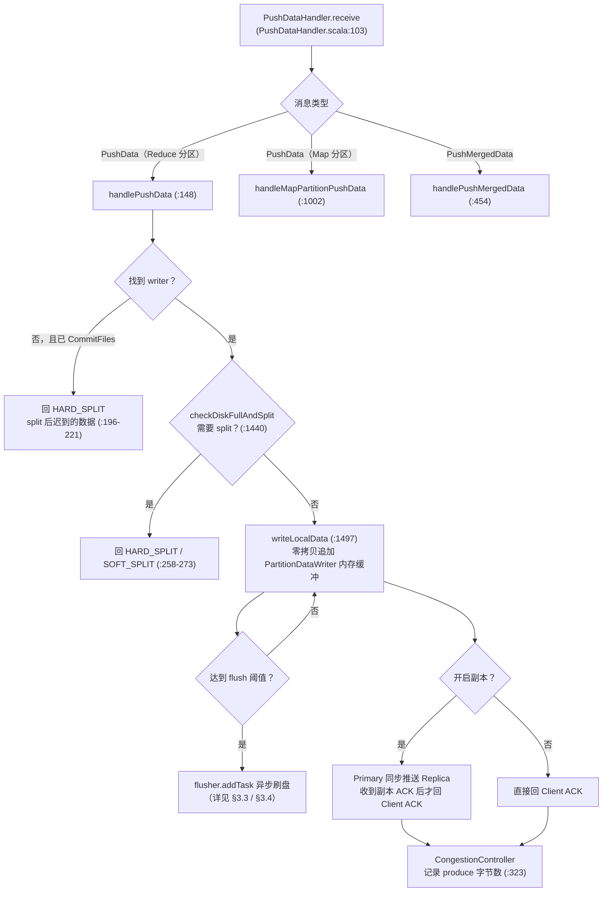
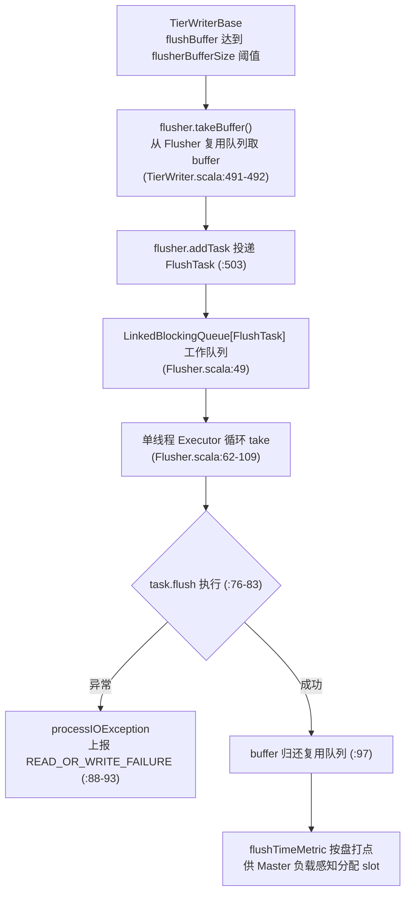
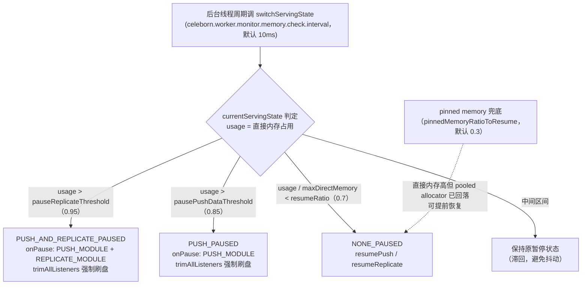

# Celeborn Worker 存储与流控源码阅读指南

> 基于版本 0.7.0-SNAPSHOT，整理日期 2026-08-20；2026-09-07 对照当前代码复核（修正少量行号/键名）并新增 §8。
> 覆盖模块：`worker/src/main/scala/org/apache/celeborn/service/deploy/worker/`、`worker/src/main/java/org/apache/celeborn/service/deploy/worker/`
> 核心文件：`Worker.scala`、`Controller.scala`、`PushDataHandler.scala`、`FetchHandler.scala`、`storage/StorageManager.scala`、`storage/Flusher.scala`、`storage/TierWriter.scala`、`storage/DeviceMonitor.scala`、`storage/PartitionMetaHandler.scala`、`memory/MemoryManager.java`、`congestcontrol/CongestionController.java`
> 配套官方文档：`docs/developers/storage.md`、`docs/developers/trafficcontrol.md`、`docs/developers/worker.md`

---

## 1. Worker 总览

Worker 是 Celeborn 的数据节点：接收 Client 推送的 shuffle 数据、聚合写盘（或远端存储）、供 Reducer 拉取，同时承担副本复制、磁盘健康检查、内存背压与拥塞控制。

### 1.1 入口与启动

- 进程入口是伴生对象 `Worker.main`（`worker/src/main/scala/org/apache/celeborn/service/deploy/worker/Worker.scala:1115`），解析 `WorkerArguments` 后构造 `Worker` 实例（`Worker.scala:1128`）。
- 主类定义为 `Worker.scala:62` 的 `private[celeborn] class Worker`。

### 1.2 内部组件组装

组件在构造函数体内按依赖顺序创建，关键几行：

```scala
// Worker.scala:186-201
val storageManager = new StorageManager(conf, workerSource)          // 186
val memoryManager: MemoryManager = MemoryManager.initialize(...)     // 188
memoryManager.registerMemoryListener(storageManager)                 // 189
val partitionsSorter = new PartitionFilesSorter(memoryManager, ...)  // 191
CongestionController.initialize(...)                                  // 194
val controller = new Controller(rpcEnv, conf, metricsSystem, workerSource) // 201
```

随后创建三个独立的 Netty TransportServer，各挂一个 Handler：

| 服务端 | Handler | 端口配置 | 代码位置 |
|---|---|---|---|
| PushServer（Client → Primary 推送） | `pushDataHandler` | `celeborn.worker.push.port` | `Worker.scala:213-231` |
| ReplicateServer（Primary → Replica 复制） | `replicateHandler`（同样是 `PushDataHandler` 实例） | `celeborn.worker.replicate.port` | `Worker.scala:233-253` |
| FetchServer（Reducer 拉取） | `fetchHandler` | `celeborn.worker.fetch.port` | `Worker.scala:255-273` |

三个端口的实际绑定值在 `Worker.scala:275-281` 取回，注册进 `WorkerInfo` 后随心跳上报 Master。

组件关系图：

```
                        Worker (Worker.scala:62)
        ┌───────────────┬───────────────┬───────────────┐
   PushServer      ReplicateServer  FetchServer      RPC Controller
        │               │               │           (Worker.scala:201)
  PushDataHandler  PushDataHandler  FetchHandler        │
  (:213)           (:233)           (:255)              │
        └───────┬───────┴───────┬───┘                   │
                ▼               ▼                        ▼
        StorageManager (:186)  ◄────  ReserveSlots / CommitFiles
                │                    (Controller.scala:105/141)
        ┌───────┼──────────┐
   LocalFlusher HdfsFlusher ...   DeviceMonitor（磁盘健康，StorageManager.scala:137）
        │
   MemoryManager (:188) ── ServingState 三水位背压
   CongestionController (:194) ── 按 UserIdentifier 限速（可选）
```

### 1.3 心跳与状态上报

`heartbeatToMaster`（`Worker.scala:512`）周期性向 Master 上报磁盘信息、活跃 shuffle、`highWorkload` 标志和 Worker 状态。`highWorkload`（`Worker.scala:498-510`）在三种情况下为 true：CongestionController 超过高水位、`MemoryManager` 处于任一 PAUSED 状态、活跃连接数超过 `celeborn.worker.activeConnection.max`。

---

## 2. 请求处理链

Worker 侧的网络流量分两类：控制 RPC 走 `Controller`（Celeborn 自有 RPC 框架），数据流量走 `PushDataHandler` / `FetchHandler`（Netty 数据面）。

### 2.1 Controller：ReserveSlots / CommitFiles / Destroy

`Controller`（`worker/src/main/scala/org/apache/celeborn/service/deploy/worker/Controller.scala:44`）是 `RpcEndpoint`，消息路由：

- `ReserveSlots` → `handleReserveSlots`（`Controller.scala:105`，入口 `:171`）
- `CommitFiles` → `handleCommitFiles`（`Controller.scala:141`，入口 `:462`）
- `DestroyWorkerSlots` → `handleDestroy`（`Controller.scala:166`，入口 `:735`）

**handleReserveSlots 要点**（`Controller.scala:171-250`）：

1. Worker 正在 shutdown 时直接回 `WORKER_SHUTDOWN`（`:186-191`）。
2. 本地健康目录为空且无远端存储时回 `NO_AVAILABLE_WORKING_DIR`（`:193-198`）。
3. 分别为主/副本 `PartitionLocation` 调 `createWriters`（`:204`、`:225`），内部委托 `StorageManager.createPartitionDataWriter` 创建 `PartitionDataWriter`。
4. 任一不满足即销毁已建 writer 并回 `RESERVE_SLOTS_FAILED`（`:217-245`）。
5. 成功后把 locations 登记进 `partitionLocationInfo`（`:248-249`）。

**handleCommitFiles 要点**（`Controller.scala:462`）：按 `(shuffleKey, epoch)` 用 `shuffleCommitInfos` 幂等去重（`:505-518`，重复请求返回首次的结果）；对每个 writer 触发强制 flush + close，回收 chunk 索引等元信息，最后从 `partitionLocationInfo` 移除并回复成功/失败列表。

### 2.2 PushDataHandler：PushData / PushMergedData

PushData 处理链总览（细节见下文走读）：



`PushDataHandler`（`worker/src/main/scala/org/apache/celeborn/service/deploy/worker/PushDataHandler.scala:51`）同时服务 PushServer 和 ReplicateServer。入口 `receive`（`PushDataHandler.scala:103`）按消息类型分发：

- `PushData`：Reduce 分区走 `handlePushData`（`:148`）；Map 分区走 `handleMapPartitionPushData`（`:1002`）。
- `PushMergedData`：走 `handlePushMergedData`（`:454`）。
- Map 分区的 `PbPushDataHandShake` / `PbRegionStart` / `PbRegionFinish` / `PbSegmentStart` 等 RPC 在 `handleRpcRequest` → `mapPartitionRpcRequest` 中分发（`:1072`、`:1103-1139`）。

**handlePushData 核心路径**（`:148` 起）：

1. 查找 writer；找不到且该 shuffle 已 CommitFiles 过时直接回 `HARD_SPLIT`（`:196-221`，对应 split 后迟到的数据）。
2. Worker shutdown 期间对存量分区一律回 `HARD_SPLIT`（`:232-236`）。
3. `checkDiskFullAndSplit` 判定是否需要 split（`:1440`，详见 §5.2），`HARD_SPLIT`/`SOFT_SPLIT` 直接作为应答返回（`:258-273`）。
4. 正常路径调 `writeLocalData`（`:1497`）：数据逻辑追加进 `PartitionDataWriter` 内存缓冲（零拷贝），达到 flush 阈值后异步刷盘（详见 §3.3）；若开启副本，Primary 同步向 Replica 推送，收到副本 ACK 后才向 Client 回 ACK。
5. 成功后若开启拥塞控制，向 `CongestionController` 记录 produce 字节数（`:323`）。

### 2.3 FetchHandler：OpenStream / ChunkFetch

`FetchHandler`（`worker/src/main/scala/org/apache/celeborn/service/deploy/worker/FetchHandler.scala:45`）处理拉取侧流量：

- `receive` 入口（`FetchHandler.scala:105`）：`ChunkFetchRequest` → `handleChunkFetchRequest`（`:551`）；`BufferStreamEnd` / `ReadAddCredit` 走 credit 流（Map 分区）。
- RPC 消息在 `handleRpcRequest` 中分发：`PbOpenStream`（`:132`）、`PbOpenStreamList`（`:144`）、`PbReadAddCredit`（`:185`）、`PbChunkFetchRequest`（`:198`）。
- Reduce 分区打开流走 `handleReduceOpenStreamInternal`（`:252`）：按 shuffleKey + 文件名定位 `DiskFileInfo`，向客户端返回 chunk 数量（内存索引的元信息），随后每个 `ChunkFetchRequest` 从磁盘顺序读一个 chunk 返回。
- Map 分区打开流走 `handleOpenStreamInternal`（`:356`），经 `CreditStreamManager` 建立 credit-based 流。

---

## 3. 存储体系

### 3.1 StorageManager：磁盘/目录/Flusher 的注册中心

`StorageManager`（`worker/src/main/scala/org/apache/celeborn/service/deploy/worker/storage/StorageManager.scala`）构造时完成：

1. **解析工作目录**：`celeborn.worker.storage.dirs` 解析出 `(目录, 配额, flusher 线程数, 磁盘类型)`（`:86-89`），`DeviceInfo.getDeviceAndDiskInfos` 把同一物理盘上的多个目录归并到同一 `DiskInfo`（`:95`），做到盘级管理。
2. **创建 DeviceMonitor**（`:137-138`）。
3. **每盘一个 LocalFlusher**（`:143-166`）：以 mountPoint 为 key，线程数取目录声明值。
4. **writer 注册表**：`workingDirWriters` / `hdfsWriters` / `s3Writers` / `ossWriters` / `memoryWriters`（`:59-64`）。

`createPartitionDataWriter`（`:423` / `:485` 两个重载）在 ReserveSlots 时被调用，最终经 `StoragePolicy.createFileWriter` 落到一个具体存储层的 `TierWriterBase`（`storage/StoragePolicy.scala:96` 按 `StorageInfo.Type` 分派，MEMORY/HDD/SSD/HDFS/OSS/S3）。创建成功后向 `DeviceMonitor.registerFileWriter` 注册（`StorageManager.scala:558`），以便该盘故障时批量通知。

### 3.2 PartitionDataWriter 与 TierWriter

- `PartitionDataWriter`（`worker/src/main/java/org/apache/celeborn/service/deploy/worker/storage/PartitionDataWriter.java:47`）是一个 `PartitionLocation` epoch 的写句柄，实现 `DeviceObserver` 以接收磁盘故障通知；`numPendingWrites`（`:53`）跟踪未完成的 flush。
- 实际写逻辑在 `TierWriterBase`（`storage/TierWriter.scala:45`）及三个实现：`MemoryTierWriter`（`:267`）、`LocalTierWriter`（`:381`）、`DfsTierWriter`（`:517`，覆盖 HDFS/S3/OSS）。

### 3.3 内存缓冲与异步 flush

`LocalTierWriter.writeInternal`（`TierWriter.scala:432`）的逻辑：数据先追加进 `flushBuffer`（CompositeByteBuf，逻辑追加零拷贝），当 `flushBufferReadableBytes + numBytes >= flusherBufferSize`（`:437`）时触发 flush。`flusherBufferSize` 取值（`TierWriter.scala:404`、`:541`）：

| 存储层 | 配置键 | 默认值 | 配置定义 |
|---|---|---|---|
| 本地盘 | `celeborn.worker.flusher.buffer.size` | 256KiB | `common/src/main/scala/org/apache/celeborn/common/CelebornConf.scala:3940-3946` |
| HDFS | `celeborn.worker.flusher.hdfs.buffer.size` | 4MiB | `CelebornConf.scala:3948-3954` |
| S3 / OSS | `celeborn.worker.flusher.s3.buffer.size` / `.oss.` | 6MiB | `CelebornConf.scala:3956-3970` |

flush 是异步的：buffer 通过 `flusher.takeBuffer()` 从 Flusher 的复用队列取出（`TierWriter.scala:491-492`），flush 任务经 `flusher.addTask` 投递（`:503`）。

### 3.4 Flusher 线程模型

flush 任务从 Writer 到落盘的路径总览（细节见下文走读）：



`Flusher`（`storage/Flusher.scala`）持有一组 `LinkedBlockingQueue[FlushTask]` 工作队列（`:49`），每个队列绑定一个单线程 Executor（`:62-109`），循环 `take` 任务并执行 `task.flush`（`:76-83`），异常时经 `processIOException` 上报为 `READ_OR_WRITE_FAILURE`（`:88-93`）。完成后把 buffer 归还复用队列（`:97`）。

四个实现类：`LocalFlusher`（`:147`）、`HdfsFlusher`（`:192`）、`S3Flusher`（`:217`）、`OssFlusher`（`:242`）。flush 耗时按盘打点（`flushTimeMetric`），是 Master 负载感知分配 slot 的输入之一。

---

## 4. 文件布局

元信息钩子挂在 `PartitionMetaHandler`（`storage/PartitionMetaHandler.scala`）上，三个实现：`MapPartitionMetaHandler`（`:94`）、`ReducePartitionMetaHandler`（`:334`）、`SegmentMapPartitionMetaHandler`（`:387`）。

### 4.1 ReducePartition：chunk + 内存索引

- 数据文件由若干 chunk 组成，chunk 上限为 `celeborn.shuffle.chunk.size`，默认 **8MiB**（`CelebornConf.scala:3265-3273`）。
- 每个 chunk 的起始偏移记录在内存索引中（`ReduceFileMeta` 的 chunkOffsets）；`ReducePartitionMetaHandler.afterClose` 负责在关文件时补齐最后一个 chunk 边界（`PartitionMetaHandler.scala:344-361`）。
- 读取时 OpenStream 先返回 chunk 数，之后每个 `ChunkFetchRequest` 顺序返回一个 chunk（`FetchHandler.scala:551`）。
- 开启 range read filter 时写入路径同步维护 mapId 的 RoaringBitmap（`PartitionMetaHandler.scala:363-372`），用于 Reducer 侧按 map 范围过滤。

### 4.2 MapPartition：region + 按 partitionId 排序索引

- 数据文件由若干 region 组成；客户端先发 `PbRegionStart` 声明 region 开始，按 partitionId 排序后整批推送，最后发 `PbRegionFinish`（事件入口 `PushDataHandler.scala:1119-1139`）。
- region 大小不由 Worker 配置决定，而由 Flink 客户端本地缓冲池间接决定：`celeborn.client.flink.resultPartition.memory`（别名 `remote-shuffle.job.memory-per-partition`），默认 **64MiB**（`CelebornConf.scala:6289-6296`）——与官方文档 "region 默认 64MiB" 一致。
- 每个 region 有内存索引记录各 partition 的起始位置，索引项定长 `INDEX_ENTRY_SIZE`（16 字节，`storage/MapPartitionDataReader.java:74`），按 region 在索引文件中分区存储（`:169`、`:313-326`）。
- 读取时 Worker 从每个 region 中抽出目标 partition 的数据，经 credit 流推送。

---

## 5. 磁盘管理

### 5.1 DeviceMonitor：健康检查与隔离

`DeviceMonitor`（`storage/DeviceMonitor.scala`）按设备（而非目录）管理。`startCheck`（`:112`）周期执行，对每个设备做两类检查：

- **highDiskUsage**（`:268-291`）：OS 报的 free space 低于实际保留量，或 Celeborn 记账的 `actualUsableSpace <= 0`，则置盘为 `HIGH_DISK_USAGE`。实际保留量 = `celeborn.worker.storage.disk.reserve.size`（默认 **5GiB**，`CelebornConf.scala:3462-3469`）与按 `celeborn.worker.storage.disk.reserve.ratio` 计算的较大者（`:3471-3479`）。
- **readWriteError**（`:300-314`）：向数据目录写探针文件验证读写。

另有非关键错误聚合：file writer / flusher 上报的 IO 异常经 `reportNonCriticalError`（`:206`）累计，时间窗内超过 `device.notifyErrorThreshold` 即把设备判为不健康并通知其上的所有 writer（`:124-156`）。不健康的盘不再承接新 slot，存量 writer 收到通知后报错，触发 Client 端 ChangePartition。

### 5.2 空间不足触发 HARD_SPLIT

Push 路径上 `checkDiskFullAndSplit`（`PushDataHandler.scala:1440-1487`）的判定链：

```
checkDiskFull (:1429)
  └─ LocalFlusher 对应盘为 HIGH_DISK_USAGE 或 actualUsableSpace <= 0 (:1430-1437)
       │
       ▼
diskFull && fileLength > partitionSplitMinimumSize  →  HARD_SPLIT (:1461-1462)
isPrimary && fileLength > splitThreshold            →  SOFT_SPLIT / HARD_SPLIT (:1463-1469)
否则                                                  →  NO_SPLIT
```

要点：

- 5GiB 保留空间经 `highDiskUsage` 周期性置 `HIGH_DISK_USAGE`，Push 时读到该状态即回 `HARD_SPLIT`，Client 随后向 LifecycleManager 请求新 PartitionLocation。
- 文件长度未超过 `celeborn.worker.shuffle.partitionSplit.min` 时即使盘满也不 split（避免产生大量碎片文件）。
- 开启副本时 split 仅由 Primary 侧文件长度阈值驱动（`:1463` 的 `isPrimary` 条件），保证主备 epoch 一致。
- Map 分区的 `PbRegionStart` 响应同样可能携带 `HARD_SPLIT`（客户端处理见 `client-flink/.../FlinkShuffleClientImpl.java:552-553`）。

---

## 6. 流控

官方设计见 `docs/developers/trafficcontrol.md`，两条机制：必选的 **Back Pressure** 与可选的 **Congestion Control**。

### 6.1 Back Pressure：三水位状态机

三水位状态迁移总览（判定逻辑与副作用见下文走读）：



实现在 `MemoryManager`（`worker/src/main/java/org/apache/celeborn/service/deploy/worker/memory/MemoryManager.java`）。

**水位配置**（相对 `maxDirectMemory` 的比例，`maxDirectMemory` 通过反射读取 VM 值，`:150-155`）：

| 水位 | 配置键 | 默认值 | 配置定义 |
|---|---|---|---|
| Pause Receive | `celeborn.worker.directMemoryRatioToPauseReceive` | 0.85 | `CelebornConf.scala:4303-4309` |
| Pause Replicate | `celeborn.worker.directMemoryRatioToPauseReplicate` | 0.95 | `CelebornConf.scala:4311-4318` |
| Resume | `celeborn.worker.directMemoryRatioToResume` | 0.7 | `CelebornConf.scala:4320-4326` |

构造时强校验 `pauseReplicate > pauseReceive > resume`（`MemoryManager.java:158-166`），并换算成绝对阈值（`:172-174`）。

**状态机**：`ServingState` 枚举（`MemoryManager.java:684-687`）三态 `NONE_PAUSED` / `PUSH_PAUSED` / `PUSH_AND_REPLICATE_PAUSED`。后台线程按 `celeborn.worker.monitor.memory.check.interval`（默认 10ms，`CelebornConf.scala:4094-4101`）周期调 `switchServingState`（`MemoryManager.java:179-189`、`:333`）。`currentServingState`（`:309-330`）的判定：

```
usage > pauseReplicateThreshold          → PUSH_AND_REPLICATE_PAUSED
usage > pausePushDataThreshold           → PUSH_PAUSED
usage / maxDirectMemory < resumeRatio    → NONE_PAUSED
中间区间                                  → 保持原暂停状态（滞回，避免抖动）
```

状态副作用（`switchServingState` 的 switch 分支，`:340-411`）：

- 进入 PAUSED：对 `PUSH_MODULE`（以及 Replicate 版还包含 `REPLICATE_MODULE`）调用监听器的 `onPause`——`ChannelsLimiter` 暂停接收通道读（AutoRead 置 false）；同时 `trimAllListeners`（`:414`）强制 StorageManager 把所有 buffer 刷盘以释放内存。
- 回到 `NONE_PAUSED`：`resumePush` / `resumeReplicate` 恢复通道读，并累计暂停时长指标。
- 另有 pinned memory 兜底（`celeborn.worker.pinnedMemoryRatioToResume`，默认 0.3，`CelebornConf.scala:4328-4336`）：直接内存高但 Netty pooled allocator 实际占用已回落时可提前恢复（`MemoryManager.java:610-650` 的 `resumeByPinnedMemory` / `tryResumeByPinnedMemory`）。

Client 侧感知：PAUSED 期间 Worker 不回 PushData 的 ACK，Client 在途请求耗尽超时后触发限速/重试。

### 6.2 Congestion Control：按用户的滑窗限速（可选）

开关 `celeborn.worker.congestionControl.enabled`，默认 **false**（`CelebornConf.scala:4383-4389`）。实现在 `congestcontrol` 包（Java）：

- `CongestionController`（`congestcontrol/CongestionController.java:41`）：单例，由 `Worker` 初始化（`Worker.scala:194`）。
- **滑窗统计**：全局 produce/consume 速率各用一个 `BufferStatusHub`（`CongestionController.java:80-81`），每个 `UserIdentifier` 一个（`:193`）。`BufferStatusHub extends TimeSlidingHub`（`congestcontrol/BufferStatusHub.java:24`），`avgBytesPerSec`（`:83`）基于滑动时间窗求速率；窗口长度 `celeborn.worker.congestionControl.sample.time.window`，默认 10s（`CelebornConf.scala:4391-4397`）。
- **高/低水位判定**：`checkCongestion`（`CongestionController.java:264-287`）周期执行（周期为 `celeborn.worker.congestionControl.check.interval`，默认 10ms，`CelebornConf.scala:4464-4471`）——`pendingConsume`（未刷盘字节）跌破 `diskBuffer.low.watermark` 且全局生产速率低于 `workerProduceSpeed.low.watermark` 则退出拥塞；任一超过对应 high watermark 则置 `overHighWatermark` 并 `trimMemoryUsage`。四组水位配置见 `CelebornConf.scala:4399-4454`（默认均为 `Long.MaxValue`，即开启开关后也需显式配水位才生效）。
- **用户维度限速**：超水位时，生产速率高于"潜在平均速率"的用户被打上拥塞标记（`UserCongestionControlContext`，`congestcontrol/UserCongestionControlContext.java:25`），PushData 应答中携带拥塞信号，Client 端走类 TCP 的慢启动/拥塞避免。注意 `isUserCongested`（`CongestionController.java:158-160`）中比较对象的变量名为 `avgConsumeSpeed`，但实际调用的是 `getPotentialProduceSpeed()`（全 Worker 生产速率按用户数均分），与 javadoc 所称"潜在平均消费速率"不一致，详见 §8.10。不活跃用户在 `removeInactiveUsers`（`:242-262`）按 `celeborn.worker.congestionControl.user.inactive.interval`（默认 10min）清理。
- Worker 把 `isOverHighWatermark`（`:289`）纳入 `highWorkload` 上报 Master（`Worker.scala:503`）。

设计与现状分析不在这里重复，详见仓库根目录的 `congestion-control-analysis-and-design.md`。

---

## 7. 多级存储

存储层级由 `celeborn.storage.availableTypes`（别名 `celeborn.storage.activeTypes`）声明，可选项 `MEMORY,HDD,SSD,HDFS,S3,OSS`，默认 `HDD`（`CelebornConf.scala:6360-6370`）。官方设计原则（`docs/developers/storage.md` §Multi-layered Storage）：小数据尽量留内存、总是偏好更快的存储、在快存储空间与数据搬迁成本间权衡。

代码侧的落点：

- **创建时分层选择**：`StoragePolicy.createFileWriter`（`storage/StoragePolicy.scala:67`）按 `celeborn.worker.storage.storagePolicy.createFilePolicy` 解析的层级顺序尝试，经 `tryCreateFileByType`（`:96-126`）落到 MEMORY / 本地盘 / DFS。
- **驱逐迁移**：`getEvictedFileWriter`（`:36`）按 `celeborn.worker.storage.storagePolicy.evictPolicy` 把 writer 从快层迁到慢层（如 MEMORY → 本地盘、本地盘 → HDFS），`PartitionDataWriter` 在 `:209` 处接管迁移。
- **内存层**：`MemoryTierWriter`（`TierWriter.scala:267`）占用配额由 `celeborn.worker.directMemoryRatioForMemoryFileStorage` 控制（默认 0 即关闭，`CelebornConf.scala:4294-4301`），单文件上限 `celeborn.worker.memoryFileStorage.maxFileSize`（默认 8MB，`:4338-4345`）；Worker 进入 PAUSED 时可按 evict ratio 驱逐内存文件换内存（`:4347-4364`，并联动 `MemoryManager.shouldEvict`，`MemoryManager.java:303-307`）。
- **远端层**：HDFS/S3/OSS 共享 `DfsTierWriter`（`TierWriter.scala:517`），目录清理逻辑集中在 `StorageManager`（`:702-712` 按类型删过期目录）。

需要说明：官方文档描述的五级搬迁策略（Push Region / Cache Region 等）是目标设计，当前实现以"创建时按序选层 + 触发条件驱逐"为主，阅读时以 `StoragePolicy.scala` 实际逻辑为准。

---

## 8. 可优化点与代码债务

> 本节条目已于 2026-09-07 对照当前代码逐项核查。候选主要来自 `performance-optimization-analysis.md` §3（Worker），其中事实前提不成立或不值得做的 12 项已剔除（见本节末附表），保留的 16 项按价值分级排序。

### P0：推荐优先实施

#### 8.1 Push 应答路径在 Netty IO 线程上同步 `Await.result` 等待写完成

**代码位置**：`PushDataHandler.scala:304`、`:399`、`:640`、`:796`、`:1061`

`handlePushData` / `handlePushMergedData` / `handleMapPartitionPushData` 的应答路径均为 `Await.result(writePromise.future, Duration.Inf)`：开启副本时 promise 要等 Primary→Replica 同步推送成功才完成。`receive` 由 Netty EventLoop 线程调用，阻塞期间该 EventLoop 负责的所有连接都无法处理新消息；磁盘或副本慢时沿"写慢 → IO 线程阻塞 → push 积压 → 更多等待"链路放大，Worker push 吞吐受制于单次写延迟而非磁盘带宽。

**优化方向**：
- 改为真异步：提交写任务后立即返回，promise 完成时在回调中回 ACK（需保住同一 partition 的应答顺序语义）。
- 副本等待是主要延迟源，可评估"只等本地写入完成即应答、副本失败走 HARD_SPLIT 兜底"的弱化语义。

#### 8.2 心跳路径持锁做全量统计

**代码位置**：`StorageManager.scala:952-993`（`updateDiskInfos`）、`:1002-1024`（`userResourceConsumptionSnapshot`）

- `updateDiskInfos` 外层 `this.synchronized` + 内层逐目录 `writers.synchronized` 求和文件长度，持锁期间阻塞同监视器的 `notifyError`（`:252`）/ `notifyHealthy`（`:263`）。
- `userResourceConsumptionSnapshot` 在 `diskFileInfos.synchronized` 内做 flatMap + groupBy + mapValues 全量聚合，持锁时间与文件总数成正比，由心跳周期调用（`Worker.scala:740`）。

**优化方向**：
- writer 写入/关闭时原子累加每盘使用量，`updateDiskInfos` 只读计数器，不再遍历 writer。
- 快照式浅拷贝后在锁外聚合，或维护增量统计。

### P1：小而安全的改进

#### 8.3 `PartitionDataWriter` 全部操作 synchronized(this)

**代码位置**：`PartitionDataWriter.java:121`（flush）、`:144`（write）、`:197`（evict）、`:214`（destroy）、`:218`（close）

写、驱逐、销毁、关闭共享同一把实例锁：MemoryManager 触发 evict 时与正在写数据的 Netty 线程互斥；close 与最后一批写入互斥，抬高 CommitFiles 延迟。

**优化方向**：tier 切换用 `AtomicReference<TierWriterBase>` + CAS 保护，普通 write 路径只在 tier 切换瞬间短暂独占。

#### 8.4 内存文件驱逐每次全量排序

**代码位置**：`MemoryManager.java:257-264`

内存压力触发驱逐时 `new ArrayList<>(storageManager.memoryWriters().values())` 后按 fileLength 全量排序再取头部。内存压力时 writer 可达数万，排序本身耗 CPU 并制造 GC，形成负反馈。

**优化方向**：改用 Top-K（PriorityQueue）或维护按文件大小有序的索引结构。

#### 8.5 `getSortedFileInfo` 等待排序完成用 50ms sleep 轮询

**代码位置**：`PartitionFilesSorter.java:272-275`

Reducer 等待排序完成时以固定 50ms 间隔轮询 `sorted`/`sorting` 两个 Set，平均多付 ~25ms 唤醒延迟，大量 Reducer 并发等待时轮询本身也耗 CPU。

**优化方向**：每个 fileId 维护 `CompletableFuture`，排序完成精确唤醒。

#### 8.6 `ReadBufferDispatcher` 将引用计数强制归零

**代码位置**：`ReadBufferDispatcher.java:92-95`

`buf.release(refCnt)` 一次性把引用计数清零而非减一。若该 buffer 确为独占则语义无误，但代码未注释所有权约定；一旦存在其他持有者即为 use-after-free，reducer 会读到损坏数据且极难排查。

**优化方向**：改为 `release()` 减一语义；或保留强制归零但显式注释所有权不变量，并在测试环境开 `ResourceLeakDetector` 验证。

#### 8.7 本地盘 flush buffer 默认值（256KiB）与 HDFS（4MiB）差距悬殊

**代码位置**：`CelebornConf.scala:3941-3946` vs `:3949-3954`

本地盘每 MB 数据触发约 4 次 flush 系统调用，是 HDFS 路径的 16 倍。这是纯配置项（不改代码），建议在 SSD/NVMe 部署上实测提高到 1–4MiB 的收益与直接内存代价。

### P2：低优先级与微优化

#### 8.8 `memoryPressureListeners` 遍历未同步

**代码位置**：`MemoryManager.java:58`（ArrayList）、`:122-123`（add 持锁）vs `:355`、`:383-386`、`:421`（forEach 不持锁）

添加/移除持 `synchronized(memoryPressureListeners)`，但 pause/resume/trim 路径的遍历不持锁，理论上有 CME 风险（发生频率低：仅在状态迁移时）。

**优化方向**：改用 `CopyOnWriteArrayList`（读多写少的 listener 场景的标准做法）。

#### 8.9 `TierWriterBase` 单一 `flushLock` 串行化所有 buffer 操作

**代码位置**：`TierWriter.scala:63`，使用点 `:77`、`:224`、`:253`、`:300`、`:454`、`:676`

write / takeBuffer / returnBuffer / flush / evict 共用一把锁，是单 writer 写路径的序列化点。

**优化方向**：拆分 buffer 管理与 flush 提交两把锁，或读路径改乐观锁。

#### 8.10 CongestionController 限速精度与命名错位

**代码位置**：`CongestionController.java:158-160`、`:217-222`

- `isUserCongested` 中变量 `avgConsumeSpeed` 实际赋值自 `getPotentialProduceSpeed()`，javadoc 与命名声称"潜在平均消费速率"，代码语义实为"生产速率按用户均分"，二者不一致，需澄清设计意图。
- 均分逻辑假设所有用户消费能力相同，大用户被过度限速、小用户漏限。

**优化方向**：先修正命名/文档与实现的一致性；再评估按用户历史生产/消费比限速。

#### 8.11 Flusher buffer 复用队列无界且只增不减

**代码位置**：`Flusher.scala:50`（无界 `LinkedBlockingQueue`）、`:123-136`（`returnBuffer`）；`TierWriter.scala:429`（`LocalTierWriter.genFlushTask` 硬编码 `keepBuffer=true`）

本地盘每个 flush buffer 用完后都回到复用队列，队列只增不减：流量峰值过后，峰值规模的 CompositeByteBuf 常驻直接内存。

**优化方向**：给 `bufferQueue` 设容量上限（如 `threadCount × 2`），超出时 `release` 而非入队。

#### 8.12 Push 应答路径微优化合集

**代码位置**：`PushDataHandler.scala`

- 单字节状态码应答每次新分配 `Array[Byte]` + `ByteBuffer`（`:205`、`:211`、`:221`、`:236`、`:260`、`:273` 等 10+ 处）——可用静态单例。
- 副本路径每条 push `new WorkerInfo(...)` 仅为查找 replicate client（`:281`、`:613`）——可直接用 (host, port)。
- `mapPartitionRpcRequest` 用 try-catch 区分新旧协议（`:1106`、`:1150-1152`）——异常驱动控制流，可由消息前导字节显式区分。

#### 8.13 Flusher metrics key 使用全局 `Random.nextInt`

**代码位置**：`Flusher.scala:77`

每个 flush 任务生成 `s"Flusher-$this-${Random.nextInt()}"`，`scala.util.Random` 全局实例在多线程下有 CAS 竞争。改用 `ThreadLocalRandom` 或线程 index 即可。

#### 8.14 MapPartition 每 region 同步写索引文件

**代码位置**：`PartitionMetaHandler.scala:236-238`

每个 RegionFinish 触发一次阻塞 `indexChannel.write`，HDFS 场景下为高频小 IO。

**优化方向**：聚合多个 region 的索引批量写，close 时兜底。

#### 8.15 Worker 常驻定时线程与 TopN 全量排序

**代码位置**：`Worker.scala:332`、`:341`、`:347`、`:349`（3 个单线程 ScheduledExecutor + 1 个 HashedWheelTimer）；`:745-758`（`handleTopAppResourceConsumption` 全量 `sortBy` 后取 TopN）

前者可合并为共享调度池；后者用堆做 Top-K 即可。

#### 8.16 磁盘目录选择纯轮询，忽略已维护的性能指标

**代码位置**：`StorageManager.scala:273-281`、`:397`

`getNextIndex` 在健康目录间简单轮询；`DiskInfo` 已维护 `flushTimeMetrics`/`fetchTimeMetrics`（供 Master 负载感知分配），但 Worker 本地选盘完全不看。

**优化方向**：加权轮询，权重取 flush/fetch 耗时倒数。

### 附：核查后剔除的候选

以下候选来自 `performance-optimization-analysis.md` §3，经核查事实前提不成立、无法证实或风险收益不匹配，不建议实施：

| 候选（原编号） | 剔除原因 |
|---|---|
| 内存压力轮询检测延迟约 100ms（3.3.4） | 前提错误：检查间隔默认 10ms（`celeborn.worker.monitor.memory.check.interval`，`CelebornConf.scala:4094-4101`） |
| `trimAllListeners` 丢弃重叠触发（3.3.3） | 暂停状态持续期间每个检查周期都会重新触发 trim，无累积丢失 |
| `PartitionDataWriter.needHardSplitForMemoryShuffleStorage` DCL 锁序死锁（3.6.2） | 纯推测：未找到以相反顺序获取两把锁的代码路径 |
| `checkCongestion` 与 `isUserCongested` 竞态窗口（3.7.3） | `overHighWatermark` 是 AtomicBoolean 无锁读，10ms 检查周期自愈，窗口无害 |
| flush 阈值缺乏最小间隔迟滞（3.5.2） | 阈值触发是内存释放主路径，加最小间隔反而延缓高压下刷盘 |
| HDFS/S3 `reuseCopyBuffer` 预分配浪费（3.5.7） | 仅开启 `workerFlushReuseCopyBufferEnabled` 时存在，量级为线程数 × maxTaskSize（~2.5MB），可忽略 |
| S3/OSS 6MB 分片过小（3.5.10） | 分片大小与 flush buffer 一致是端到端延迟与分片数的既定权衡，且 multipart part 有 5MB 下限 |
| `commitFinishedChecker` 固定轮询（3.9.2） | 低频后台检查，开销可忽略 |
| `MapPartitionDataReader` retain 后异常路径泄漏（3.9.5 后半） | 异常路径有 `bufferRecycler.recycle(buffer)` 兜底（`:199`），无法证实泄漏 |
| `MemoryManager.isPaused` 非 volatile | 已修复：`MemoryManager.java:81` 已是 `private volatile boolean` |
| `Controller.commitFiles` 持锁执行 close/flush | 已重构：每 partition 一个 `CompletableFuture.runAsync` 异步任务（`Controller.scala:386`），不在全局锁内 |
| `createPartitionDataWriter` 异常驱动的磁盘选择重试 | 已重构：磁盘经 `healthyLocalWorkingDirs()` 预过滤后轮询选中（`StorageManager.scala:496`、`:397`） |

---

## 附：关键配置速查

| 配置键 | 默认值 | 作用 | 定义位置 |
|---|---|---|---|
| `celeborn.shuffle.chunk.size` | 8m | ReducePartition chunk 上限 | `CelebornConf.scala:3265` |
| `celeborn.client.flink.resultPartition.memory` | 64m | 间接决定 MapPartition region 大小 | `CelebornConf.scala:6289` |
| `celeborn.worker.flusher.buffer.size` | 256k | 本地盘 flush 阈值 | `CelebornConf.scala:3940` |
| `celeborn.worker.storage.disk.reserve.size` | 5G | 磁盘保留空间，低于即 HIGH_DISK_USAGE → HARD_SPLIT | `CelebornConf.scala:3462` |
| `celeborn.worker.directMemoryRatioToPauseReceive` | 0.85 | 暂停接收 push | `CelebornConf.scala:4303` |
| `celeborn.worker.directMemoryRatioToPauseReplicate` | 0.95 | 暂停接收 push + replicate | `CelebornConf.scala:4311` |
| `celeborn.worker.directMemoryRatioToResume` | 0.7 | 恢复水位 | `CelebornConf.scala:4320` |
| `celeborn.worker.monitor.memory.check.interval` | 10ms | 内存压力检查（switchServingState）周期 | `CelebornConf.scala:4094` |
| `celeborn.worker.congestionControl.enabled` | false | 拥塞控制开关 | `CelebornConf.scala:4383` |
| `celeborn.storage.availableTypes` | HDD | 启用的存储层 | `CelebornConf.scala:6360` |
